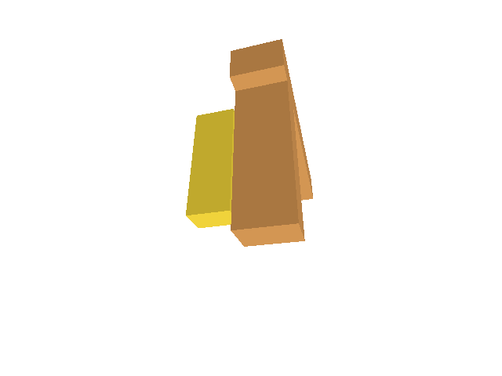
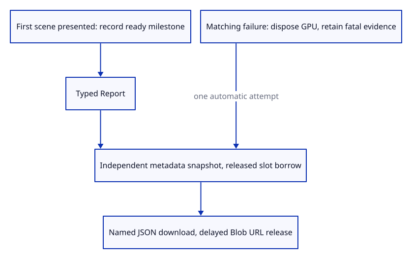

# 4.2.6 · Download diagnostics through the real command line

**Chapter 4 · Browser lifetime and recovery · Section 4.2 · GPU diagnostics and recovery** · [Contents](contents.md)

**Typing: 13–25 minutes.** [Estimate](typing-load.md).

Add `Report` to the command dock. It downloads the current metadata as `viewer-diagnostic.json`. The first presented scene records a geometry-on-screen milestone and marks a healthy run Ready.

## Type

Continue from [Read live diagnostic context outside the GPU runtime](34c-browser.md). [Save or recover your work](recovery.md).

### 1. `src/file_output.rs`

Reuse the existing owned Blob/anchor cleanup for a named report while keeping Save’s filename unchanged. Choose the diagnostic JSON filename without changing the document download contract.

<details>
<summary>Locate the existing block</summary>

```rust
use wasm_bindgen::{JsCast, JsValue, closure::Closure};

pub fn download(bytes: &[u8]) -> Result<(), JsValue> {
    let window = web_sys::window().ok_or("No browser window")?;
    let document = window.document().ok_or("No document")?;
    let body = document.body().ok_or("No document body")?;
    let anchor: web_sys::HtmlAnchorElement = document.create_element("a")?.dyn_into()?;
    anchor.set_hidden(true);
    anchor.set_download("viewer.session");
    body.append_child(&anchor)?;
    let parts = js_sys::Array::new();
    parts.push(&js_sys::Uint8Array::from(bytes));
    let blob = match web_sys::Blob::new_with_u8_array_sequence(&parts) {
        Ok(blob) => blob,
        Err(error) => { anchor.remove(); return Err(error); }
    };
    let url = match web_sys::Url::create_object_url_with_blob(&blob) {
        Ok(url) => url,
        Err(error) => { anchor.remove(); return Err(error); }
    };
    anchor.set_href(&url);
    anchor.click();
    anchor.remove();
    let cleanup: js_sys::Function = Closure::once_into_js(move || {
        let _ = web_sys::Url::revoke_object_url(&url);
    }).unchecked_into();
    if let Err(error) = window.set_timeout_with_callback_and_timeout_and_arguments_0(&cleanup, 10_000) {
        let _ = cleanup.call0(&JsValue::NULL);
        return Err(error);
    }
    Ok(())
}
```

</details>

Edit the existing block to match this code; keep unchanged lines:

```rust
use wasm_bindgen::{JsCast, JsValue, closure::Closure};

pub fn download(bytes: &[u8]) -> Result<(), JsValue> { download_named(bytes, "viewer.session") }

pub fn download_named(bytes: &[u8], name: &str) -> Result<(), JsValue> {
    let window = web_sys::window().ok_or("No browser window")?;
    let document = window.document().ok_or("No document")?;
    let body = document.body().ok_or("No document body")?;
    let anchor: web_sys::HtmlAnchorElement = document.create_element("a")?.dyn_into()?;
    anchor.set_hidden(true);
    anchor.set_download(name);
    body.append_child(&anchor)?;
    let parts = js_sys::Array::new();
    parts.push(&js_sys::Uint8Array::from(bytes));
    let blob = match web_sys::Blob::new_with_u8_array_sequence(&parts) {
        Ok(blob) => blob,
        Err(error) => { anchor.remove(); return Err(error); }
    };
    let url = match web_sys::Url::create_object_url_with_blob(&blob) {
        Ok(url) => url,
        Err(error) => { anchor.remove(); return Err(error); }
    };
    anchor.set_href(&url);
    anchor.click();
    anchor.remove();
    let cleanup: js_sys::Function = Closure::once_into_js(move || {
        let _ = web_sys::Url::revoke_object_url(&url);
    }).unchecked_into();
    if let Err(error) = window.set_timeout_with_callback_and_timeout_and_arguments_0(&cleanup, 10_000) {
        let _ = cleanup.call0(&JsValue::NULL);
        return Err(error);
    }
    Ok(())
}
```

<details>
<summary>Optional patch references</summary>

Use these original edit fragments when comparing a saved checkpoint. Apply the complete blocks above.

```text
--8<-- "journey/code/34d-download-01.rs"
```

```text
--8<-- "journey/code/34d-download-02.rs"
```

</details>

### 2. `src/browser_report.rs`

Download a current metadata snapshot and attempt one automatic download for the first fatal observation.

<details>
<summary>Locate the existing block</summary>

```rust
#[wasm_bindgen::prelude::wasm_bindgen]
```

</details>

Edit the existing block to match this code; keep unchanged lines:

```rust
pub fn download() -> Result<(), JsValue> {
    let json = diagnostic_snapshot()?;
    crate::file_output::download_named(json.as_bytes(), "viewer-diagnostic.json")
}

pub fn fatal(message: &str) {
    let first = REPORT.with(|slot| slot.borrow().as_ref().is_some_and(|report| report.failure().is_none()));
    if observe("fatal", message).is_ok() && first { let _ = download(); }
}

#[wasm_bindgen::prelude::wasm_bindgen]
```

<details>
<summary>Optional patch references</summary>

Use these original edit fragments when comparing a saved checkpoint. Apply the complete blocks above.

```text
--8<-- "journey/code/34d-download-03.rs"
```

</details>

### 3. `src/browser.rs`

Keep the matching device’s failure evidence after its GPU runtime is disposed. Expose diagnostics through the actual command dock without an HTML feature button. Mark the report ready only after the initial scene frame is presented. Handle the typed report command separately from document Save and edit history.

Edit these blocks from bottom to top. Keep the surrounding lines unchanged.

<details>
<summary>Locate this block</summary>

```rust
                    input.click();
                }
                None
            } else if line == "save" {
                let result = crate::browser_reload::restore_for(crate::edit_intent::Intent::Save,
                    &editor, std::rc::Rc::clone(&reload), std::rc::Rc::clone(&reload_delivery))
```

</details>

Replace it with:

```rust
                    input.click();
                }
                None
            } else if line == "report" {
                let result = crate::browser_report::download().map(|()| "Diagnostic report downloaded.".to_owned())
                    .unwrap_or_else(|error| format!("Diagnostic report failed: {error:?}"));
                panel.result(&result);
                None
            } else if line == "save" {
                let result = crate::browser_reload::restore_for(crate::edit_intent::Intent::Save,
                    &editor, std::rc::Rc::clone(&reload), std::rc::Rc::clone(&reload_delivery))
```

<details>
<summary>Locate this block</summary>

```rust
            &editor.camera.uniform(),
            &mut panel,
        )?;
    }
    let input_canvas = canvas.clone();
    let browser_window = window.clone();
```

</details>

Replace it with:

```rust
            &editor.camera.uniform(),
            &mut panel,
        )?;
        crate::browser_report::observe("milestone", "geometry on screen")?;
    }
    let input_canvas = canvas.clone();
    let browser_window = window.clone();
```

<details>
<summary>Locate this block</summary>

```rust
            "Reload Sources",
            "Cancel Reload",
            "Save",
            "Example Box",
            "Example Triangle",
            "Select Next",
```

</details>

Replace it with:

```rust
            "Reload Sources",
            "Cancel Reload",
            "Save",
            "Report",
            "Example Box",
            "Example Triangle",
            "Select Next",
```

<details>
<summary>Locate this block</summary>

```rust
fn failed(fault: crate::gpu_fault::Fault, message: String) {
    if !fault.remember(message.clone()) { return; }
    wasm_bindgen_futures::spawn_local(async move {
        if crate::browser_runtime::stop_if(&fault) { report(&format!("Cannot draw: {message}")); }
    });
}
```

</details>

Replace it with:

```rust
fn failed(fault: crate::gpu_fault::Fault, message: String) {
    if !fault.remember(message.clone()) { return; }
    wasm_bindgen_futures::spawn_local(async move {
        if crate::browser_runtime::stop_if(&fault) {
            crate::browser_report::fatal(&message);
            report(&format!("Cannot draw: {message}"));
        }
    });
}
```

<details>
<summary>Complete updated block reference</summary>

```rust
use crate::background::Background;
use crate::editor::{Action, Change, Editor};
use crate::gesture::Gesture;
use crate::renderer::Renderer;
use crate::viewport::Viewport;
use wasm_bindgen::{JsCast, JsValue, closure::Closure};

pub fn report(message: &str) {
    if let Some(document) = web_sys::window().and_then(|window| window.document()) {
        if let Some(status) = document.get_element_by_id("status") {
            status.set_text_content(Some(message));
            if message.starts_with("Cannot draw:") { let _ = status.remove_attribute("hidden"); }
        }
    }
}

fn failed(fault: crate::gpu_fault::Fault, message: String) {
    if !fault.remember(message.clone()) { return; }
    wasm_bindgen_futures::spawn_local(async move {
        if crate::browser_runtime::stop_if(&fault) {
            crate::browser_report::fatal(&message);
            report(&format!("Cannot draw: {message}"));
        }
    });
}

fn save_result(bytes: &[u8]) -> Result<String, String> {
    crate::file_output::download(bytes)
        .map(|()| format!("Saved editable document ({} bytes)", bytes.len()))
        .map_err(|error| format!("Save failed: {error:?}"))
}

pub async fn run() -> Result<(), JsValue> {
    let window = web_sys::window().ok_or("No browser window")?;
    let document = window.document().ok_or("No document")?;
    let canvas: web_sys::HtmlCanvasElement = document
        .get_element_by_id("canvas")
        .ok_or("Missing canvas")?
        .dyn_into()?;
    crate::browser_report::start()?;
    let instance = wgpu::Instance::new(wgpu::InstanceDescriptor {
        backends: wgpu::Backends::BROWSER_WEBGPU,
        flags: Default::default(),
        memory_budget_thresholds: Default::default(),
        backend_options: Default::default(),
        display: None,
    });
    let surface = instance
        .create_surface(wgpu::SurfaceTarget::Canvas(canvas.clone()))
        .map_err(|error| JsValue::from_str(&error.to_string()))?;
    let adapter = instance
        .request_adapter(&wgpu::RequestAdapterOptions {
            compatible_surface: Some(&surface),
            ..Default::default()
        })
        .await
        .map_err(|error| JsValue::from_str(&error.to_string()))?;
    let (device, queue) = adapter
        .request_device(&wgpu::DeviceDescriptor::default())
        .await
        .map_err(|error| JsValue::from_str(&error.to_string()))?;
    let fault = crate::gpu_fault::Fault::default();
    let errors = fault.clone();
    device.on_uncaptured_error(std::sync::Arc::new(move |error| failed(errors.clone(), format!("WebGPU error: {error}"))));
    let lost = fault.clone();
    device.set_device_lost_callback(move |reason, message| failed(lost.clone(), format!("WebGPU device lost ({reason:?}): {message}")));
    let limit = device.limits().max_texture_dimension_2d;
    let width = (window.inner_width()?.as_f64().ok_or("No window width")? as u32).clamp(1, limit);
    let height = (window.inner_height()?.as_f64().ok_or("No window height")? as u32).clamp(1, limit);
    canvas.set_width(width);
    canvas.set_height(height);
    let mut config = surface
        .get_default_config(&adapter, width, height)
        .ok_or("No compatible surface format")?;
    config.view_formats = vec![config.format.add_srgb_suffix()];
    surface.configure(&device, &config);
    let mut editor = Editor::default();
    let mut renderer = Renderer::new(
        device,
        queue,
        config.format.add_srgb_suffix(),
        &editor.scene,
    );
    renderer.resize(Viewport { width, height });
    inspect(&editor, &renderer)?;
    let mut panel = crate::panel::Panel::new(
        &renderer,
        config.format.add_srgb_suffix(),
        &[
            "Help",
            "Open",
            "Open Replace",
            "Cancel Open",
            "Close",
            "Unload Sources",
            "Reload Sources",
            "Cancel Reload",
            "Save",
            "Report",
            "Example Box",
            "Example Triangle",
            "Select Next",
            "Delete",
            "Undo",
            "Redo",
            "Background",
            "Zoom In",
            "Zoom Out",
            "Pan Left",
            "Pan Right",
            "Orbit Right",
            "Orbit Up",
            "View Isometric",
            "View Perspective",
            "View Orthographic",
            "Fit",
            "Fit Selected",
            "Move",
            "View Reset",
        ],
    );
    panel.update(None, &canvas)?;
    if resize(
        &window,
        &canvas,
        &surface,
        &mut config,
        &mut renderer,
        &mut editor,
    ) {
        panel.update(None, &canvas)?;
        present(
            &surface,
            &renderer,
            &editor.background,
            &editor.camera.uniform(),
            &mut panel,
        )?;
        crate::browser_report::observe("milestone", "geometry on screen")?;
    }
    let input_canvas = canvas.clone();
    let browser_window = window.clone();
    let pointer_canvas = canvas.clone();
    let mut gesture = Gesture::default();
    let request = std::rc::Rc::new(std::cell::RefCell::new(crate::read_gate::ReadGate::default()));
    let read_mode = std::cell::Cell::new(crate::file_input::Mode::Append);
    let delivery: crate::file_input::Delivery = std::rc::Rc::new(std::cell::RefCell::new(None));
    let reload: crate::browser_reload::Shared = std::rc::Rc::new(std::cell::RefCell::new(Default::default()));
    let reload_delivery: crate::browser_reload::Delivery = std::rc::Rc::new(std::cell::RefCell::new(None));
    let owned_request = std::rc::Rc::clone(&request);
    let owned_reload = std::rc::Rc::clone(&reload);
    let active_fault = fault.clone();
    let update = Closure::<dyn FnMut(web_sys::Event)>::new(move |event: web_sys::Event| {
        if active_fault.message().is_some() { return; }
        if event.type_() == "pagehide" {
            gesture.cancel();
            if event.dyn_ref::<web_sys::PageTransitionEvent>().is_some_and(|event| event.persisted()) { return; }
            wasm_bindgen_futures::spawn_local(async { crate::browser_runtime::stop(); });
            return;
        }
        let shortcut = event.dyn_ref::<web_sys::KeyboardEvent>().and_then(|key| panel.shortcut(key));
        let line = if let Some(shortcut) = shortcut {
            event.prevent_default();
            panel.answer(shortcut.command(), "");
            Some(shortcut.command().to_ascii_lowercase())
        } else { match panel.update(Some(&event), &input_canvas) {
            Ok(line) => line,
            Err(error) => {
                report(&format!("Cannot read command: {error:?}"));
                return;
            }
        } };

        let action = if event.type_() == "cancel" && event.target()
            .and_then(|target| target.dyn_into::<web_sys::HtmlInputElement>().ok())
            .is_some_and(|input| input.id() == "open")
        {
            request.borrow_mut().cancel();
            report("Open cancelled.");
            panel.answer("Open", "Open cancelled.");
            None
        } else if event.type_() == "change" {
            crate::file_input::choose(&event, std::rc::Rc::clone(&request), read_mode.get(), std::rc::Rc::clone(&delivery));
            None
        } else if event.type_() == "viewer-file-error" {
            if let Some(message) = event.dyn_ref::<web_sys::CustomEvent>().and_then(|event| event.detail().as_string()) {
                report(&message);
                panel.answer("Open", &message);
            }
            None
        } else if event.type_() == "viewer-reload" {
            if let Some(reply) = reload_delivery.borrow_mut().take() {
                let command = reply.intent.map_or("Reload Sources", |intent| intent.command());
                match reply.complete(&mut editor) {
                    Ok(Some(crate::edit_replay::Reply::Changed(_))) => {
                        renderer.set_scene(&editor.scene, editor.selected);
                        let message = if command == "Reload Sources" {
                            "Editable sources restored; display retained.".to_owned()
                        } else { format!("{command} completed after source reload.") };
                        report(&message); panel.answer(command, &message);
                    }
                    Ok(Some(crate::edit_replay::Reply::Saved(bytes))) => {
                        let message = save_result(&bytes).unwrap_or_else(|error| error);
                        report(&message); panel.answer(command, &message);
                    }
                    Ok(None) => {}
                    Err(error) => { report(&error); panel.answer(command, &error); }
                }
            }
            None
        } else if event.type_() == "viewer-file" {
            match crate::file_input::action(&event, &delivery) {
                Ok(action) => action,
                Err(error) => { let message = format!("Cannot retain reload file: {error:?}");
                    report(&message); panel.answer("Open", &message); None }
            }
        } else if let Some(line) = line {
            if line == "reload sources" {
                let result = crate::browser_reload::start(std::rc::Rc::clone(&reload), editor.reload_keys(), std::rc::Rc::clone(&reload_delivery));
                match result {
                    Ok(()) => panel.result("Reloading editable sources…"),
                    Err(error) => { report(&error); panel.result(&error); }
                }
                None
            } else if line == "cancel reload" {
                reload.borrow_mut().cancel();
                report("Reload cancelled."); panel.result("Reload cancelled.");
                None
            } else if line == "unload sources" {
                Some(Action::UnloadSources)
            } else if line == "close" {
                request.borrow_mut().cancel();
                Some(Action::Close)
            } else if line == "cancel open" {
                request.borrow_mut().cancel();
                report("Open cancelled.");
                panel.result("Open cancelled.");
                None
            } else if line == "open" || line == "open replace" {
                let ticket = request.borrow_mut().begin();
                if let Err(error) = ticket { report(error); panel.result(error); return; }
                if line == "open replace" { reload.borrow_mut().cancel(); }
                read_mode.set(if line == "open replace" { crate::file_input::Mode::Replace }
                    else { crate::file_input::Mode::Append });
                if let Some(input) = web_sys::window()
                    .and_then(|window| window.document())
                    .and_then(|document| document.get_element_by_id("open"))
                    .and_then(|element| element.dyn_into::<web_sys::HtmlInputElement>().ok())
                {
                    input.click();
                }
                None
            } else if line == "report" {
                let result = crate::browser_report::download().map(|()| "Diagnostic report downloaded.".to_owned())
                    .unwrap_or_else(|error| format!("Diagnostic report failed: {error:?}"));
                panel.result(&result);
                None
            } else if line == "save" {
                let result = crate::browser_reload::restore_for(crate::edit_intent::Intent::Save,
                    &editor, std::rc::Rc::clone(&reload), std::rc::Rc::clone(&reload_delivery))
                    .and_then(|waiting| {
                        if waiting { Ok("Reloading editable sources…".to_owned()) }
                        else { crate::document::snapshot(&editor.scene).map_err(str::to_owned)
                            .and_then(|bytes| save_result(&bytes)) }
                    });
                panel.result(&result.unwrap_or_else(|error| error));
                None
            } else if line == "move" || line.starts_with("move ") {
                match crate::offset::parse(&line) {
                    Ok(offset) => Some(Action::Translate(offset)),
                    Err(error) => { panel.result(error); None }
                }
            } else {
                let action = match line.as_str() {
                    "example box" => Action::AddBox,
                    "example triangle" => Action::ToggleExtra,
                    "select next" => Action::SelectNext,
                    "delete" => Action::Delete,
                    "undo" => Action::Undo,
                    "redo" => Action::Redo,
                    "background" => Action::Background,
                    "zoom in" => Action::Zoom(2.0),
                    "zoom out" => Action::Zoom(0.5),
                    "pan left" => Action::Pan(-0.25, 0.0),
                    "pan right" => Action::Pan(0.25, 0.0),
                    "orbit right" => Action::Orbit(std::f64::consts::FRAC_PI_4, 0.0),
                    "orbit up" => Action::Orbit(0.0, std::f64::consts::FRAC_PI_6),
                    "view isometric" => Action::Isometric,
                    "view perspective" => {
                        Action::Projection(crate::camera::Projection::Perspective)
                    }
                    "view orthographic" => {
                        Action::Projection(crate::camera::Projection::Orthographic)
                    }
                    "fit" if shortcut.is_some() && editor.selected.is_some() => Action::FitSelected,
                    "fit" => Action::Fit,

                    "fit selected" => Action::FitSelected,
                    "view reset" => Action::ResetView,
                    _ => return,
                };
                Some(action)
            }
        } else if !panel.consumed {
            navigation_action(&event, &pointer_canvas, &mut gesture)
        } else {
            None
        };
        if let Some(action) = action {
            if matches!(&action, Action::Close | Action::UnloadSources | Action::Undo | Action::Redo
                | Action::Replace(_) | Action::ReplaceAt(_, _)) { reload.borrow_mut().cancel(); }
            let replacement = matches!(&action, Action::Replace(_) | Action::ReplaceAt(_, _));
            let closing = matches!(&action, Action::Close);
            let unloading = matches!(&action, Action::UnloadSources);
            let waiting = crate::edit_intent::Intent::capture(&action, editor.selected)
                .map_err(str::to_owned).and_then(|intent| match intent {
                    Some(intent) => crate::browser_reload::restore_for(intent, &editor,
                        std::rc::Rc::clone(&reload), std::rc::Rc::clone(&reload_delivery)),
                    None => Ok(false),
                });
            let change = waiting.and_then(|waiting| {
                if waiting { panel.result("Reloading editable sources…"); Ok(None) }
                else { editor.apply(action).map(Some).map_err(str::to_owned) }
            });
            match change {
                Ok(Some(Change::Scene)) => {
                    renderer.set_scene(&editor.scene, editor.selected);
                    if unloading {
                        report("Editable sources unloaded; display retained.");
                        panel.result("Editable sources unloaded; display retained.");
                    } else if closing {
                        report("Document closed.");
                        panel.result("Document closed.");
                    } else if event.type_() == "viewer-file" {
                        let message = if replacement { "Document replaced. Undo restores the previous document." }
                            else { "File imported. Undo removes the entire import." };
                        report(message);
                        panel.answer(if replacement { "Open Replace" } else { "Open" }, message);
                    }
                }
                Ok(Some(Change::View)) | Ok(None) => {}
                Err(error) => {
                    report(&error);
                    if event.type_() == "viewer-file" { panel.answer("Open", &error); }
                    else { panel.result(&error); }
                }
            }
        }
        if let Err(error) = inspect(&editor, &renderer) {
            report(&format!("Cannot report projection: {error:?}"));
            return;
        }
        if resize(
            &browser_window,
            &pointer_canvas,
            &surface,
            &mut config,
            &mut renderer,
            &mut editor,
        ) {
            if let Err(error) = panel.update(None, &input_canvas) {
                report(&format!("Cannot lay out commands: {error:?}"));
                return;
            }
            if let Err(error) = present(
                &surface,
                &renderer,
                &editor.background,
                &editor.camera.uniform(),
                &mut panel,
            ) {
                report(&format!("Cannot redraw: {error:?}"));
            }
        }
    });
    let mut listeners = crate::listeners::Listeners::new(update);
    for name in [
        "pointerdown",
        "pointermove",
        "pointerup",
        "pointercancel",
        "lostpointercapture",
        "contextmenu",
        "keydown",
        "keyup",
        "blur",
    ] {
        listeners.listen(canvas.as_ref(), name)?;
    }
    listeners.listen(canvas.as_ref(), "wheel")?;
    listeners.listen(window.as_ref(), "resize")?;
    listeners.listen(window.as_ref(), "blur")?;
    listeners.listen(document.as_ref(), "change")?;
    listeners.listen(document.as_ref(), "cancel")?;
    listeners.listen(window.as_ref(), "viewer-file")?;
    listeners.listen(window.as_ref(), "viewer-file-error")?;
    listeners.listen(window.as_ref(), "viewer-reload")?;
    listeners.listen(window.as_ref(), "pagehide")?;
    crate::browser_runtime::install(listeners, owned_request, owned_reload, fault);
    report("Wheel zooms; type commands anywhere in the drawing. Escape cancels a drag.");
    Ok(())
}

fn inspect(editor: &Editor, renderer: &Renderer) -> Result<(), JsValue> {
    let document = web_sys::window()
        .and_then(|window| window.document())
        .ok_or("No document")?;
    let canvas = document
        .get_element_by_id("canvas")
        .ok_or("Missing canvas")?;
    let placements: Vec<_> = editor.scene.objects().iter().map(|row| (format!("{:?}", row.id), row.model.m)).collect();
    canvas.set_attribute("data-row-placements", &serde_json::to_string(&placements).map_err(|error| JsValue::from_str(&error.to_string()))?)?;
    canvas.set_attribute("data-selected-id", &editor.selected.map(|id| format!("{id:?}")).unwrap_or_default())?;
    canvas.set_attribute("data-camera-matrix", &serde_json::to_string(&editor.camera.view_projection().m).map_err(|error| JsValue::from_str(&error.to_string()))?)?;
    canvas.set_attribute("data-object-count", &editor.scene.objects().len().to_string())?;
    let metadata: Vec<_> = editor.scene.objects().iter().map(|row| {
        let m = &row.metadata;
        (&row.guid, &m.source_guid, &m.name, m.is_visible, m.is_locked)
    }).collect();
    let origins: Vec<_> = editor.scene.objects().iter().filter_map(|row| row.origin().map(|origin|
        (&row.guid, origin.id.to_string(), origin.version.hex(),
            origin.location.as_ref().map(|location| location.value())))).collect();
    let residency: Vec<_> = editor.scene.objects().iter().map(|row|
        (&row.guid, row.geometry().is_some(), row.release_epoch())).collect();
    canvas.set_attribute("data-source-residency", &serde_json::to_string(&residency)
        .map_err(|error| JsValue::from_str(&error.to_string()))?)?;
    canvas.set_attribute("data-source-origins", &serde_json::to_string(&origins)
        .map_err(|error| JsValue::from_str(&error.to_string()))?)?;
    canvas.set_attribute("data-row-metadata", &serde_json::to_string(&metadata)
        .map_err(|error| JsValue::from_str(&error.to_string()))?)?;
    canvas.set_attribute("data-gpu-stats", &format!("{:?}", renderer.stats()))?;
    let cpu = crate::memory::cpu(editor.scenes(), renderer.geometry_owners().map(|owner| &owner.source));
    canvas.set_attribute("data-cpu-usage", &format!("{cpu:?}"))?;
    canvas.set_attribute("data-gpu-usage", &format!("{:?}", renderer.usage()))?;
    canvas.set_attribute("data-projection", &format!("{:?}", editor.camera.projection))
}

fn navigation_action(
    event: &web_sys::Event,
    canvas: &web_sys::HtmlCanvasElement,
    gesture: &mut Gesture,
) -> Option<Action> {
    let action = match event.type_().as_str() {
        "wheel" => {
            let wheel = event.dyn_ref::<web_sys::WheelEvent>()?;
            let mode = wheel.delta_mode();
            crate::navigation::wheel(
                wheel.delta_y(),
                mode,
                canvas.get_bounding_client_rect().height(),
            )
        }
        "keydown" => {
            let key = event.dyn_ref::<web_sys::KeyboardEvent>()?;
            if key.is_composing() || key.alt_key() {
                return None;
            }
            if key.key() == "Escape" {
                gesture.cancel();
                event.prevent_default();
                return None;
            }
            return None;
        }
        _ => return pointer_action(event, canvas, gesture),
    }?;
    event.prevent_default();
    Some(action)
}

fn pointer_action(
    event: &web_sys::Event,
    canvas: &web_sys::HtmlCanvasElement,
    gesture: &mut Gesture,
) -> Option<Action> {
    match event.type_().as_str() {
        "contextmenu" => {
            event.prevent_default();
            return None;
        }
        "blur" | "resize" => {
            gesture.cancel();
            return None;
        }
        _ => {}
    }
    let pointer = event.dyn_ref::<web_sys::PointerEvent>()?;
    let id = pointer.pointer_id();
    let position = [pointer.client_x() as f64, pointer.client_y() as f64];
    let motion = match event.type_().as_str() {
        "pointerdown" => {
            if pointer.is_primary() && gesture.press(id, pointer.button(), position) {
                event.prevent_default();
                let options = web_sys::FocusOptions::new();
                options.set_prevent_scroll(true);
                if canvas.focus_with_options(&options).is_err()
                    || canvas.set_pointer_capture(id).is_err()
                {
                    gesture.cancel();
                }
            }
            None
        }
        "pointermove" => gesture.move_to(id, position),
        "pointerup" => {
            let motion = gesture.release(id, position);
            let _ = canvas.release_pointer_capture(id);
            motion
        }
        "pointercancel" | "lostpointercapture" => {
            gesture.cancel_pointer(id);
            None
        }
        _ => None,
    }?;
    let rect = canvas.get_bounding_client_rect();
    motion.action([rect.left(), rect.top(), rect.width(), rect.height()])
}

fn resize(
    window: &web_sys::Window,
    canvas: &web_sys::HtmlCanvasElement,
    surface: &wgpu::Surface<'_>,
    config: &mut wgpu::SurfaceConfiguration,
    renderer: &mut Renderer,
    editor: &mut Editor,
) -> bool {
    let rect = canvas.get_bounding_client_rect();
    let limit = renderer.device.limits().max_texture_dimension_2d;
    let Some(size) = Viewport::from_css(
        rect.width(),
        rect.height(),
        window.device_pixel_ratio(),
        limit,
    ) else {
        return false;
    };
    if size.width != config.width || size.height != config.height {
        canvas.set_width(size.width);
        canvas.set_height(size.height);
        config.width = size.width;
        config.height = size.height;
        surface.configure(&renderer.device, config);
        renderer.resize(size);
    }
    editor.camera.aspect = size.aspect();
    true
}

fn present(
    surface: &wgpu::Surface<'_>,
    renderer: &Renderer,
    background: &Background,
    transform: &[f32; 16],
    panel: &mut crate::panel::Panel,
) -> Result<(), JsValue> {
    let frame = match surface.get_current_texture() {
        wgpu::CurrentSurfaceTexture::Success(frame)
        | wgpu::CurrentSurfaceTexture::Suboptimal(frame) => frame,
        other => {
            return Err(JsValue::from_str(&format!(
                "Surface unavailable: {other:?}"
            )));
        }
    };
    let view = frame.texture.create_view(&wgpu::TextureViewDescriptor {
        format: Some(frame.texture.format().add_srgb_suffix()),
        ..Default::default()
    });
    renderer.draw(&view, background, transform);
    panel.draw(renderer, &view);
    frame.present();
    Ok(())
}
```

</details>

<details>
<summary>Optional patch references</summary>

Use these original edit fragments when comparing a saved checkpoint. Apply the complete blocks above.

```text
--8<-- "journey/code/34d-download-04.rs"
```

```text
--8<-- "journey/code/34d-download-05.rs"
```

```text
--8<-- "journey/code/34d-download-06.rs"
```

```text
--8<-- "journey/code/34d-download-07.rs"
```

</details>

### 4. `src/lib.rs`

Capture startup failure after diagnostic initialization, even when no GPU runtime could be installed.

<details>
<summary>Locate the existing block</summary>

```rust
            browser::report(&format!("Cannot draw: {error:?}"));
```

</details>

Edit the existing block to match this code; keep unchanged lines:

```rust
            browser_report::fatal(&format!("Cannot draw: {error:?}"));
            browser::report(&format!("Cannot draw: {error:?}"));
```

<details>
<summary>Optional patch references</summary>

Use these original edit fragments when comparing a saved checkpoint. Apply the complete blocks above.

```text
--8<-- "journey/code/34d-download-08.rs"
```

</details>

## Run and check

In your project:

```sh
cd workspace/journey
REGEN_PROTO=0 cargo build --lib --locked --target wasm32-unknown-unknown -j1
REGEN_PROTO=0 CARGO_BUILD_JOBS=1 trunk serve --port 8780
```

Open `http://127.0.0.1:8780/`. Keep an existing Trunk server running; saving rebuilds it.

Type `Report` and open `viewer-diagnostic.json`. A drawn scene should have outcome `ready` and a geometry-on-screen event. The document and Undo history stay unchanged.

### Recorded visual result

**Previous native render — current verification pending.**



*This recorded image predates a source or checker change. Rebuild this checkpoint before using it as current evidence; browser controls require separate acceptance.*

<details>
<summary>Code explanation and diagram</summary>

Finish serializing before clicking the temporary download anchor. This releases the report’s `RefCell` borrow before browser behavior can call back into Rust. The existing download owner revokes its Blob URL after ten seconds.

A GPU failure first stops its matching runtime, then records the fatal reason and attempts one report download. Startup failures are recorded too when metadata initialization succeeded. Browsers may block automatic downloads; storing a report for later retrieval comes next. `Save` still writes the editable document and neither download consumes Undo.

first scene presented → ready report → typed Report → JSON Blob → actual download → delayed URL cleanup.



Why can the failed viewer download a report after GPU input and drawing have stopped?

The independent report owns metadata only. JSON serialization and the existing Blob/anchor download need no GPU resources, so disposal can stop the renderer without destroying its evidence.

Study estimate, including typing and experiments: 1–2 hours.

</details>

<details>
<summary>Optional experiment</summary>

Keep the report inside the GPU Runtime and explain why the fatal download would lose it. Then compare the actual document Save and diagnostic downloads and explain why they cannot be used interchangeably.

</details>

<details>
<summary>Check and save your work</summary>

Restore experimental edits, then run from `session_viewer`:

```sh
npm --prefix ../session_tests run course -- check 4.2.6
npm --prefix ../session_tests run course -- save 4.2.6
```

Source comparison leaves your project untouched. [Save and recovery instructions](recovery.md).

</details>

<details>
<summary>Viewer coverage and verification</summary>

Production exposes Report through the command dock and attempts an automatic first-failure report download. This endpoint establishes current/fatal downloads. Persisted reports, detailed adapter/load/resource telemetry and bounded automatic recovery remain future work.

Chrome types Report and reads the actual JSON download. It verifies ready context and milestone timing, unchanged placement/camera/history/GPU counters, then confirms Move Undo still works. It destroys the real GPUDevice, captures the actual failed download, checks the first reason, unchanged message after repeated input and no further GPU work. A startup adapter rejection produces a failed report without a runtime. Normal same-tab reload restarts the working viewer.

Chrome reads actual typed ready-report and real GPU-loss/startup-failure JSON downloads, checks scene/history/camera/GPU invariants and late-input blocking, then reloads the same test page for its final working picture.

[Full validation scope](release.md).

To reproduce the scripted acceptance of the reference checkpoint, run from `session_viewer` with the [course bundle server](release.md#reproduce) running on port 8781:

```sh
npm --prefix ../session_tests run course -- capture 4.2.6
```

This uses the verified reference bundle; it does not check or change your typed project.

</details>
