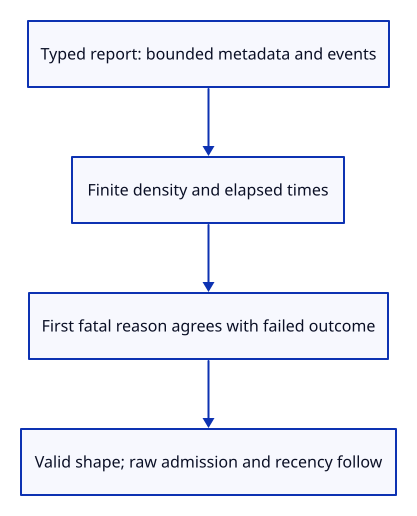

# 4.2.7 · Check the bounded shape of a report

**Chapter 4 · Browser lifetime and recovery · Section 4.2 · GPU diagnostics and recovery** · [Contents](contents.md)

**Typing: 13–25 minutes.** [Estimate](typing-load.md).

Validate a report before trusting it. `valid` bounds identifiers, timestamp text and events; it requires sensible finite dimensions/timing and agreement between Failed and the retained first fatal event.

## Type

Continue from [Download diagnostics through the real command line](34d-download.md). [Save or recover your work](recovery.md).

### 1. `src/diagnostic.rs`

Validate shape, limits and failure/outcome consistency before trusting a decoded stored value. Keep recording bounded even if a caller bypasses admission and directly deserializes an oversized queue.

Edit these blocks from bottom to top. Keep the surrounding lines unchanged.

<details>
<summary>Locate this block</summary>

```rust
        } else if kind == "milestone" && message == "geometry on screen" && self.failure.is_none() {
            self.outcome = Outcome::Ready;
        }
        if self.events.len() == 24 { self.events.pop_front(); }
        self.events.push_back(event);
        Ok(())
    }
```

</details>

Replace it with:

```rust
        } else if kind == "milestone" && message == "geometry on screen" && self.failure.is_none() {
            self.outcome = Outcome::Ready;
        }
        while self.events.len() >= 24 { self.events.pop_front(); }
        self.events.push_back(event);
        Ok(())
    }
```

<details>
<summary>Locate this block</summary>

```rust
            context, events: Default::default(), failure: None }
    }

    pub fn failure(&self) -> Option<&Event> { self.failure.as_ref() }

    pub fn record(&mut self, time: String, elapsed_ms: f64, kind: &str, message: &str) -> Result<(), &'static str> {
```

</details>

Replace it with:

```rust
            context, events: Default::default(), failure: None }
    }

    pub fn valid(&self) -> bool {
        let text = |s: &str, max| s.chars().count() <= max;
        let event = |e: &Event| !e.time.is_empty() && text(&e.time, 64) && !e.kind.is_empty()
            && text(&e.kind, 64) && text(&e.message, 4096) && e.elapsed_ms.is_finite() && e.elapsed_ms >= 0.0;
        self.version == 1 && !self.tab.is_empty() && text(&self.tab, 128)
            && !self.started.is_empty() && text(&self.started, 64) && !self.last_seen.is_empty() && text(&self.last_seen, 64)
            && !self.context.page.is_empty() && text(&self.context.page, 4096) && !self.context.page.contains(['?', '#'])
            && text(&self.context.browser, 4096) && self.context.device_pixel_ratio.is_finite() && self.context.device_pixel_ratio > 0.0
            && self.events.len() <= 24 && self.events.iter().all(event)
            && self.events.iter().all(|e| e.kind != "fatal" || self.failure.is_some())
            && match &self.failure {
                Some(first) => event(first) && first.kind == "fatal" && self.outcome == Outcome::Failed,
                None => self.outcome != Outcome::Failed,
            }
    }

    pub fn failure(&self) -> Option<&Event> { self.failure.as_ref() }

    pub fn record(&mut self, time: String, elapsed_ms: f64, kind: &str, message: &str) -> Result<(), &'static str> {
```

<details>
<summary>Complete updated block reference</summary>

```rust
use serde::{Deserialize, Serialize};

#[derive(Clone, Debug, PartialEq, Serialize, Deserialize)]
#[serde(rename_all = "camelCase")]
pub struct Context {
    pub page: String,
    pub browser: String,
    pub secure_context: bool,
    pub webgpu: bool,
    pub viewport: [u32; 2],
    pub canvas: [u32; 2],
    pub device_pixel_ratio: f64,
}

#[derive(Clone, Debug, PartialEq, Serialize, Deserialize)]
#[serde(rename_all = "lowercase")]
pub enum Outcome { Running, Ready, Closed, Failed }

#[derive(Clone, Debug, PartialEq, Serialize, Deserialize)]
#[serde(rename_all = "camelCase")]
pub struct Event {
    pub time: String,
    pub elapsed_ms: f64,
    pub kind: String,
    pub message: String,
}

#[derive(Clone, Debug, PartialEq, Serialize, Deserialize)]
#[serde(rename_all = "camelCase")]
pub struct Report {
    pub version: u32,
    pub tab: String,
    pub started: String,
    pub last_seen: String,
    pub outcome: Outcome,
    #[serde(flatten)]
    pub context: Context,
    events: std::collections::VecDeque<Event>,
    failure: Option<Event>,
}

impl Report {
    pub fn new(tab: String, started: String, context: Context) -> Self {
        Self { version: 1, tab, last_seen: started.clone(), started, outcome: Outcome::Running,
            context, events: Default::default(), failure: None }
    }

    pub fn valid(&self) -> bool {
        let text = |s: &str, max| s.chars().count() <= max;
        let event = |e: &Event| !e.time.is_empty() && text(&e.time, 64) && !e.kind.is_empty()
            && text(&e.kind, 64) && text(&e.message, 4096) && e.elapsed_ms.is_finite() && e.elapsed_ms >= 0.0;
        self.version == 1 && !self.tab.is_empty() && text(&self.tab, 128)
            && !self.started.is_empty() && text(&self.started, 64) && !self.last_seen.is_empty() && text(&self.last_seen, 64)
            && !self.context.page.is_empty() && text(&self.context.page, 4096) && !self.context.page.contains(['?', '#'])
            && text(&self.context.browser, 4096) && self.context.device_pixel_ratio.is_finite() && self.context.device_pixel_ratio > 0.0
            && self.events.len() <= 24 && self.events.iter().all(event)
            && self.events.iter().all(|e| e.kind != "fatal" || self.failure.is_some())
            && match &self.failure {
                Some(first) => event(first) && first.kind == "fatal" && self.outcome == Outcome::Failed,
                None => self.outcome != Outcome::Failed,
            }
    }

    pub fn failure(&self) -> Option<&Event> { self.failure.as_ref() }

    pub fn record(&mut self, time: String, elapsed_ms: f64, kind: &str, message: &str) -> Result<(), &'static str> {
        if !elapsed_ms.is_finite() || elapsed_ms < 0.0 { return Err("Invalid elapsed time"); }
        let event = Event { time, elapsed_ms, kind: kind.chars().take(64).collect(), message: message.chars().take(4096).collect() };
        self.last_seen.clone_from(&event.time);
        if kind == "fatal" {
            if self.failure.is_none() { self.failure = Some(event.clone()); }
            self.outcome = Outcome::Failed;
        } else if kind == "milestone" && message == "geometry on screen" && self.failure.is_none() {
            self.outcome = Outcome::Ready;
        }
        while self.events.len() >= 24 { self.events.pop_front(); }
        self.events.push_back(event);
        Ok(())
    }
}
```

</details>

<details>
<summary>Optional patch references</summary>

Use these original edit fragments when comparing a saved checkpoint. Apply the complete blocks above.

```text
--8<-- "journey/code/34e-schema-01.rs"
```

```text
--8<-- "journey/code/34e-schema-02.rs"
```

</details>

<details>
<summary>Supplied validation fixture</summary>

Copy this supplied authoring fixture once. Continue with the browser build below; the course does not require running native tests.

### 2. `src/diagnostic_shape_tests.rs`

Optional authoring fixture. Verify typed metadata, bounded queues and consistent first-failure state.

Copy this supplied file:

```text
--8<-- "journey/code/34e-schema-03.rs"
```

</details>

### 3. `src/lib.rs`

Include the native shape-invariant checks.

<details>
<summary>Locate the existing block</summary>

```rust
pub mod diagnostic;
```

</details>

Edit the existing block to match this code; keep unchanged lines:

```rust
#[cfg(test)]
mod diagnostic_shape_tests;
pub mod diagnostic;
```

<details>
<summary>Optional patch references</summary>

Use these original edit fragments when comparing a saved checkpoint. Apply the complete blocks above.

```text
--8<-- "journey/code/34e-schema-04.rs"
```

</details>

## Run and check

In your project:

```sh
cd workspace/journey
REGEN_PROTO=0 cargo build --lib --locked --target wasm32-unknown-unknown -j1
REGEN_PROTO=0 CARGO_BUILD_JOBS=1 trunk serve --port 8780
```

Open `http://127.0.0.1:8780/`. Keep an existing Trunk server running; saving rebuilds it.

Run the report-policy checks below. Invalid dimensions, excess events or inconsistent fatal evidence must be rejected. A valid first failure may survive outside the rotated event window.

### Recorded visual result

**Previous native render — current verification pending.**


*This recorded image predates a source or checker change. Rebuild this checkpoint before using it as current evidence; browser controls require separate acceptance.*

<details>
<summary>Code explanation and diagram</summary>

The first fatal event may be older than the recent-event window. A recent fatal event still requires a retained failure. Validation must accept that distinction.

Use `while` when trimming a deserialized queue: removing one event is insufficient if its input already exceeded the limit. Repairing that queue does not validate the rest of the report. Byte limits, raw JSON fields and timestamp interpretation follow.

typed report → bounded metadata and observations → consistent failure/outcome → valid shape.



Why must a deserialized report satisfy our shape invariants before it can be used?

Deserialization alone does not enforce our version, metadata limits, bounded event window or consistent first-failure/outcome state. Those checks are separate from JSON syntax and later timestamp recency.

Study estimate, including typing and experiments: 1–2 hours.

</details>

<details>
<summary>Optional experiment</summary>

Directly deserialize 25 recent events, inspect valid(), then record one new observation and inspect it again. Explain why queue repair cannot validate the rest of the stored format.

</details>

<details>
<summary>Check and save your work</summary>

Restore experimental edits, then run from `session_viewer`:

```sh
npm --prefix ../session_tests run course -- check 4.2.7
npm --prefix ../session_tests run course -- save 4.2.7
```

Source comparison leaves your project untouched. [Save and recovery instructions](recovery.md).

</details>

<details>
<summary>Viewer coverage and verification</summary>

The saved-report reader must validate its metadata before use. This endpoint establishes typed shape invariants; raw JSON admission, recency, real storage, telemetry and recovery follow.

Chrome verifies inherited real diagnostic downloads and GPU-loss/restart behavior. Browser storage is connected only after the complete admission and recency checks.

Chrome checks inherited actual diagnostic downloads and failure/restart behavior. Native tests establish typed report shape; raw JSON admission and browser storage follow.

[Full validation scope](release.md).

To reproduce the scripted acceptance of the reference checkpoint, run from `session_viewer` with the [course bundle server](release.md#reproduce) running on port 8781:

```sh
npm --prefix ../session_tests run course -- capture 4.2.7
```

This uses the verified reference bundle; it does not check or change your typed project.

</details>
