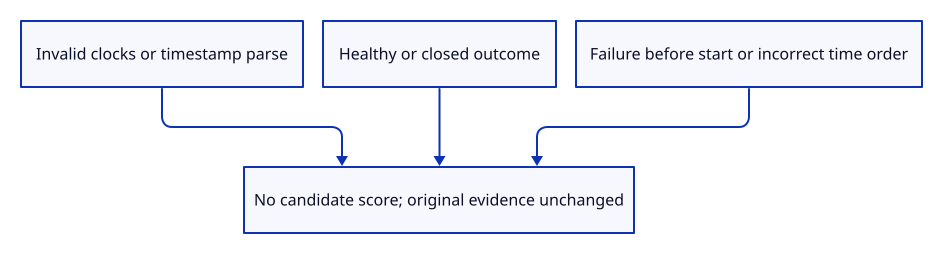

# 4.2.10 · Prove saved-run exclusions before adopting storage

**Chapter 4 · Browser lifetime and recovery · Section 4.2 · GPU diagnostics and recovery** · [Contents](contents.md)

**Typing: 0–0 minutes.** [Estimate](typing-load.md).

Complete the previous-run policy with rejected examples. Use a fixed clock to test invalid timestamps, reversed start/heartbeat order, and a failure dated before its run.

## Type

Continue from [Choose a recent failure without blaming active tabs](34eb-recency.md). [Save or recover your work](recovery.md).

<details>
<summary>Supplied validation fixture</summary>

Copy this supplied authoring fixture once. Continue with the browser build below; the course does not require running native tests.

### 1. `src/report_recency_tests.rs`

Optional authoring fixture. Prove invalid clocks, healthy/closed runs, invalid failure ordering and unchanged metadata cannot become interruption evidence.

<details>
<summary>Locate the existing block</summary>

```text
use crate::{diagnostic::Outcome, diagnostic_shape_tests::report, report_recency::eligible};

#[test]
fn previous_run_selection_respects_actual_failure_time() {
    let now = 1_000_000_000.0;
    for (name, failed, same, seen_age, failure_age, expected) in [
        ("old failure, fresh heartbeat", true, false, 5000.0, 259_200_000.0, false),
        ("recent failure", true, false, 5000.0, 10000.0, true),
        ("failure at cutoff", true, false, 5000.0, 7_200_000.0, false),
        ("failure after heartbeat", true, false, 5000.0, 1000.0, false),
        ("future heartbeat", true, false, -1.0, 1000.0, false),
        ("future failure", true, false, 0.0, -1.0, false),
        ("active other tab", false, false, 120_000.0, 0.0, false),
        ("interrupted other tab", false, false, 120_001.0, 0.0, true),
        ("stale other tab", false, false, 7_200_000.0, 0.0, false),
        ("interrupted same tab", false, true, 0.0, 0.0, true),
    ] {
        let mut value = report(); value.started = "start".into();
        if failed { value.record("failed".into(), 1.0, "fatal", "original").unwrap(); }
        value.last_seen = "seen".into(); value.tab = if same { "current" } else { "other" }.into();
        let parser = |time: &str| match time { "start" => now - 259_200_000.0, "seen" => now - seen_age,
            "failed" => now - failure_age, _ => f64::NAN };
        let selected = eligible(&value, now, "current", parser);
        assert_eq!(selected.is_some(), expected, "{name}");
        if expected { assert_eq!(selected, Some(now - if failed { failure_age } else { seen_age })); }
    }
}
```

</details>

After that block, append this supplied code:

```text
--8<-- "journey/code/34ec-proof-01.rs" skip=1607
```

</details>

## Run and check

In your project:

```sh
cd workspace/journey
REGEN_PROTO=0 cargo build --lib --locked --target wasm32-unknown-unknown -j1
REGEN_PROTO=0 CARGO_BUILD_JOBS=1 trunk serve --port 8780
```

Open `http://127.0.0.1:8780/`. Keep an existing Trunk server running; saving rebuilds it.

Optional boundary cases cover invalid clocks and Ready/Closed exclusions. The browser storage reader is still prepared for the next lesson.

### Recorded visual result

**Previous native render — current verification pending.**


*This recorded image predates a source or checker change. Rebuild this checkpoint before using it as current evidence; browser controls require separate acceptance.*

<details>
<summary>Code explanation and diagram</summary>

Ready and Closed must never produce interruption evidence. Compare the report before and after selection: eligibility reads its metadata without changing it.

This step adds the boundary checks. The browser storage reader is connected next.

candidate → invalid clock/healthy state/incorrect chronology → excluded without mutation.



Why test healthy and invalid-clock cases before wiring the policy to localStorage?

The browser will see values from other tabs and old or edited storage. A false interruption notice is visible user behavior, so exclusions need explicit acceptance before adoption.

Study estimate, including typing and experiments: 1–2 hours.

</details>

<details>
<summary>Optional experiment</summary>

Trace one Ready report, one reversed heartbeat and one earlier failure through the eligibility function. Explain the returned value for each without changing the policy. Reading these fixtures requires no native runner.

</details>

<details>
<summary>Check and save your work</summary>

Restore experimental edits, then run from `session_viewer`:

```sh
npm --prefix ../session_tests run course -- check 4.2.10
npm --prefix ../session_tests run course -- save 4.2.10
```

Source comparison leaves your project untouched. [Save and recovery instructions](recovery.md).

</details>

<details>
<summary>Viewer coverage and verification</summary>

Previous-report notices must avoid blaming a live or healthy tab and must reject invalid chronology. These native exclusions complete the policy acceptance before browser storage is connected.

Native tests reject invalid current clocks, failed timestamp parsing, start after heartbeat and a first failure before start. Ready and closed runs remain quiet. The same report compares equal before and after policy evaluation: selection reads metadata without altering its evidence. Browser Date.parse and storage are still connected next.

Chrome retains actual report-download, GPU-loss and startup-restart acceptance. This proof adds no timer, listener, visible control or storage adoption.

Native tests prove invalid/healthy/closed/bad-order candidates are excluded without mutation. Chrome retains existing real diagnostic/loss/download acceptance; browser storage follows next.

[Full validation scope](release.md).

To reproduce the scripted acceptance of the reference checkpoint, run from `session_viewer` with the [course bundle server](release.md#reproduce) running on port 8781:

```sh
npm --prefix ../session_tests run course -- capture 4.2.10
```

This uses the verified reference bundle; it does not check or change your typed project.

</details>
