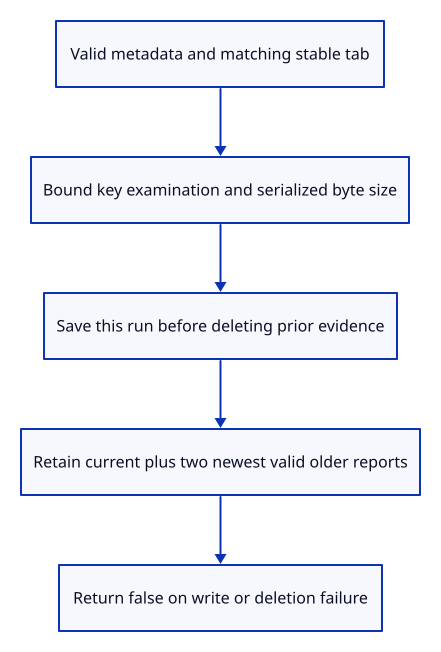

# 4.2.12 · Retain only three diagnostic runs

**Chapter 4 · Browser lifetime and recovery · Section 4.2 · GPU diagnostics and recovery** · [Contents](contents.md)

**Typing: 18–35 minutes.** [Estimate](typing-load.md).

Keep the current run and two older reports. Validate the report and its matching tab ID before writing. Repeated writes reuse the current run key.

## Type

Continue from [Read previous reports from real browser storage](34f-storage.md). [Save or recover your work](recovery.md).

### 1. `src/report_storage.rs`

Admit metadata, save to this run’s key and retain at most two older valid reports; refuse unbounded namespace examination and tolerate unavailable storage. Verify repeated writes use the same key and reach actual Web Storage; this debug export is not a runtime feature control.

<details>
<summary>Locate the existing block</summary>

```rust
use crate::diagnostic::Report;
use web_sys::Storage;

pub const PREFIX: &str = "viewer-journey-report:";

pub struct Store {
    pub tab: String,
    key: String,
    storage: Option<Storage>,
}

impl Store {
    pub fn open() -> Self {
        let window = web_sys::window();
        let session = window.as_ref().and_then(|w| w.session_storage().ok().flatten());
        let tab = session.as_ref().and_then(|s| s.get_item(PREFIX).ok().flatten())
            .filter(|tab| !tab.is_empty() && tab.chars().count() <= 128)
            .unwrap_or_else(|| uuid::Uuid::new_v4().to_string());
        if let Some(session) = session { let _ = session.set_item(PREFIX, &tab); }
        Self { tab, key: format!("{PREFIX}{}", uuid::Uuid::new_v4()),
            storage: window.and_then(|w| w.local_storage().ok().flatten()) }
    }

    pub fn reports(&self) -> Vec<(String, Report)> {
        let Some(storage) = &self.storage else { return Vec::new(); };
        (0..storage.length().unwrap_or(0).min(256))
            .filter_map(|i| storage.key(i).ok().flatten()).filter(|key| key.starts_with(PREFIX)).take(32)
            .filter_map(|key| {
                let text = storage.get_item(&key).ok().flatten()?;
                Some((key, crate::report_store::decode(&text)?))
            }).collect()
    }

    pub fn previous(&self) -> Option<Report> {
        let now = js_sys::Date::now();
        self.reports().into_iter().filter_map(|(_, report)| {
            let score = crate::report_recency::eligible(&report, now, &self.tab, js_sys::Date::parse)?;
            Some((score, report))
        }).max_by(|a, b| a.0.total_cmp(&b.0)).map(|(_, report)| report)
    }
}

#[wasm_bindgen::prelude::wasm_bindgen]
pub fn previous_storage_probe() -> String {
    let store = Store::open();
    serde_json::json!({"tab": store.tab, "key": store.key, "previous": store.previous()}).to_string()
}
```

</details>

Edit the existing block to match this code; keep unchanged lines:

```rust
use crate::diagnostic::Report;
use web_sys::Storage;

pub const PREFIX: &str = "viewer-journey-report:";

pub struct Store {
    pub tab: String,
    key: String,
    storage: Option<Storage>,
}

impl Store {
    pub fn open() -> Self {
        let window = web_sys::window();
        let session = window.as_ref().and_then(|w| w.session_storage().ok().flatten());
        let tab = session.as_ref().and_then(|s| s.get_item(PREFIX).ok().flatten())
            .filter(|tab| !tab.is_empty() && tab.chars().count() <= 128)
            .unwrap_or_else(|| uuid::Uuid::new_v4().to_string());
        if let Some(session) = session { let _ = session.set_item(PREFIX, &tab); }
        Self { tab, key: format!("{PREFIX}{}", uuid::Uuid::new_v4()),
            storage: window.and_then(|w| w.local_storage().ok().flatten()) }
    }

    pub fn reports(&self) -> Vec<(String, Report)> {
        let Some(storage) = &self.storage else { return Vec::new(); };
        (0..storage.length().unwrap_or(0).min(256))
            .filter_map(|i| storage.key(i).ok().flatten()).filter(|key| key.starts_with(PREFIX)).take(32)
            .filter_map(|key| {
                let text = storage.get_item(&key).ok().flatten()?;
                Some((key, crate::report_store::decode(&text)?))
            }).collect()
    }

    pub fn write(&self, report: &Report) -> bool {
        if !report.valid() || report.tab != self.tab { return false; }
        let Some(storage) = &self.storage else { return false; };
        let Ok(length) = storage.length() else { return false; };
        if length > 256 { return false; }
        let keys: Result<Vec<_>, _> = (0..length).map(|i| storage.key(i)).collect();
        let Ok(keys) = keys else { return false; };
        let keys: Vec<_> = keys.into_iter().flatten().filter(|key| key.starts_with(PREFIX)).collect();
        if keys.len() > 32 { return false; }
        let mut old = self.reports(); old.retain(|(key, _)| key != &self.key);
        old.retain(|(_, report)| js_sys::Date::parse(&report.last_seen).is_finite());
        old.sort_by(|a, b| js_sys::Date::parse(&b.1.last_seen).total_cmp(&js_sys::Date::parse(&a.1.last_seen)));
        let keep: Vec<_> = old.iter().take(2).map(|(key, _)| key).collect();
        let Ok(text) = serde_json::to_string(report) else { return false; };
        if text.len() > crate::report_store::MAX_BYTES || storage.set_item(&self.key, &text).is_err() { return false; }
        let mut success = true;
        for key in keys {
            if key != self.key && !keep.contains(&&key) { success &= storage.remove_item(&key).is_ok(); }
        }
        success
    }

    pub fn previous(&self) -> Option<Report> {
        let now = js_sys::Date::now();
        self.reports().into_iter().filter_map(|(_, report)| {
            let score = crate::report_recency::eligible(&report, now, &self.tab, js_sys::Date::parse)?;
            Some((score, report))
        }).max_by(|a, b| a.0.total_cmp(&b.0)).map(|(_, report)| report)
    }
}

#[wasm_bindgen::prelude::wasm_bindgen]
pub fn previous_storage_probe() -> String {
    let store = Store::open();
    serde_json::json!({"tab": store.tab, "key": store.key, "previous": store.previous()}).to_string()
}

#[wasm_bindgen::prelude::wasm_bindgen]
pub fn stored_report_probe(text: &str) -> Result<String, wasm_bindgen::JsValue> {
    let report = crate::report_store::decode(text).ok_or("Unsupported report")?;
    let store = Store::open(); let first = store.write(&report); let second = store.write(&report);
    Ok(serde_json::json!({"key": store.key, "first": first, "second": second}).to_string())
}
```

<details>
<summary>Optional patch references</summary>

Use these original edit fragments when comparing a saved checkpoint. Apply the complete blocks above.

```text
--8<-- "journey/code/34fa-retain-01.rs"
```

```text
--8<-- "journey/code/34fa-retain-02.rs"
```

</details>

## Run and check

In your project:

```sh
cd workspace/journey
REGEN_PROTO=0 cargo build --lib --locked --target wasm32-unknown-unknown -j1
REGEN_PROTO=0 CARGO_BUILD_JOBS=1 trunk serve --port 8780
```

Open `http://127.0.0.1:8780/`. Keep an existing Trunk server running; saving rebuilds it.

In the debug console, run:

```js
const report = JSON.parse(window.wasmBindings.diagnostic_snapshot());
report.tab = JSON.parse(window.wasmBindings.previous_storage_probe()).tab;
window.wasmBindings.stored_report_probe(JSON.stringify(report));
```

Both writes return `true` and use the same storage key.

### Recorded visual result

**Previous native render — current verification pending.**


*This recorded image predates a source or checker change. Rebuild this checkpoint before using it as current evidence; browser controls require separate acceptance.*

<details>
<summary>Code explanation and diagram</summary>

Prepare the retention list, write the current value, then remove excess course-owned keys. Leave unrelated storage alone. Retention ranks heartbeat age; failure selection still ranks fatal time.

A failed write preserves earlier values. A later deletion failure may leave the new report already stored, so return false without claiming rollback. Refuse oversized reports or namespaces before mutation. Storage denial must never stop the viewer.

valid matching-tab report → bounded existing namespace → current run write → two older reports → release other owned keys.



Why write the current run before pruning the older keys?

A failed write must leave existing evidence intact. Only after current metadata is saved can the owner remove older values while keeping two prior reports. Deletion failures are reported rather than claimed as successful retention.

Study estimate, including typing and experiments: 1–2 hours.

</details>

<details>
<summary>Optional experiment</summary>

Make setItem throw and compare all existing values before and after. Then make removal throw after a successful write; explain why returning false cannot mean the current value was rolled back.

</details>

<details>
<summary>Check and save your work</summary>

Restore experimental edits, then run from `session_viewer`:

```sh
npm --prefix ../session_tests run course -- check 4.2.12
npm --prefix ../session_tests run course -- save 4.2.12
```

Source comparison leaves your project untouched. [Save and recovery instructions](recovery.md).

</details>

<details>
<summary>Viewer coverage and verification</summary>

Production diagnostics persist bounded metadata independently of the GPU. The course now has a tested writer; startup/current-event integration and typed previous-report download follow.

Headed Chrome reads the actual saved JSON, tests stable-key repeated writes and a fourth run reducing the set to three, retains the two newest old values, removes malformed owned values and preserves unrelated keys. Storage denial and an excessive namespace return false without mutation. These probes exercise the physical storage boundary before live report persistence is connected.

Additional verification: Run the storage-write browser acceptance below. Writing a fourth run must leave the current run and the two newest older reports, preserving unrelated storage keys.

Actual Web Storage contains the saved JSON and only three retained runs after successful pruning. Chrome checks repeated keys, malformed cleanup, unrelated-key preservation and denied/excessive storage; live persistence follows next.

[Full validation scope](release.md).

To reproduce the scripted acceptance of the reference checkpoint, run from `session_viewer` with the [course bundle server](release.md#reproduce) running on port 8781:

```sh
npm --prefix ../session_tests run course -- capture 4.2.12
```

This uses the verified reference bundle; it does not check or change your typed project.

</details>
