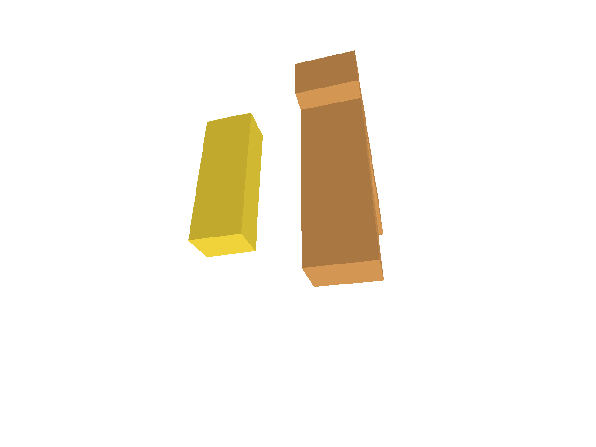
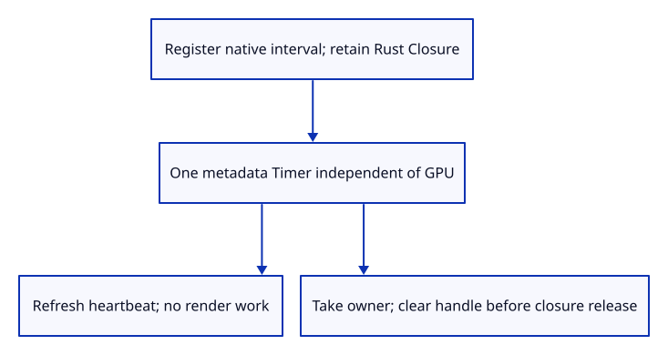

# 4.2.16 · Own the periodic diagnostic heartbeat

**Chapter 4 · Browser lifetime and recovery · Section 4.2 · GPU diagnostics and recovery** · [Contents](contents.md)

**Typing: 16–31 minutes.** [Estimate](typing-load.md).

Own the browser interval and its Rust closure together. `Timer` stores the Window, native handle and Closure. Drop clears the interval before releasing the callback environment.

## Type

Continue from [Refresh heartbeat without rewriting failure evidence](34g-heartbeat.md). [Save or recover your work](recovery.md).

### 1. `src/timer.rs`

Own the actual interval and callback together; clear its native timer before Rust releases the closure.

Create the file and type:

```rust
--8<-- "journey/code/34ga-timer-01.rs"
```

### 2. `src/lib.rs`

Keep browser interval ownership out of the native editor model.

<details>
<summary>Locate the existing block</summary>

```rust
pub mod report_storage;
```

</details>

After that block, type:

```rust
#[cfg(target_arch = "wasm32")]
mod timer;
```

<details>
<summary>Optional patch references</summary>

Use these original edit fragments when comparing a saved checkpoint. Apply the complete blocks above.

```text
--8<-- "journey/code/34ga-timer-02.rs"
```

</details>

### 3. `src/browser_report.rs`

Retain metadata scheduling independently of the GPU runtime lifetime. Install periodic metadata refresh at run startup; report scheduler unavailability without rejecting drawing or current downloads. Replace one owned interval at a time, cancel outside the slot borrow, and keep the callback metadata-only.

Edit these blocks from bottom to top. Keep the surrounding lines unchanged.

<details>
<summary>Locate this block</summary>

```rust
    crate::file_output::download_named(json.as_bytes(), "viewer-diagnostic.json")
}

fn persist() -> bool {
    let report = REPORT.with(|slot| slot.borrow().clone());
    let Some(report) = report else { return false; };
```

</details>

Replace it with:

```rust
    crate::file_output::download_named(json.as_bytes(), "viewer-diagnostic.json")
}

#[wasm_bindgen::prelude::wasm_bindgen]
pub fn start_periodic() -> Result<(), JsValue> {
    stop_periodic();
    let timer = crate::timer::Timer::every(15000, || { let _ = heartbeat(); })?;
    BEAT.with(|slot| slot.replace(Some(timer))); Ok(())
}

#[wasm_bindgen::prelude::wasm_bindgen]
pub fn stop_periodic() -> bool {
    let timer = BEAT.with(|slot| slot.borrow_mut().take());
    let active = timer.is_some(); drop(timer); active
}

fn persist() -> bool {
    let report = REPORT.with(|slot| slot.borrow().clone());
    let Some(report) = report else { return false; };
```

<details>
<summary>Locate this block</summary>

```rust
    let report = Report::new(store.tab.clone(), js_sys::Date::new_0().to_iso_string().into(), context()?);
    PREVIOUS.with(|slot| slot.replace(previous)); STORE.with(|slot| slot.replace(Some(store)));
    REPORT.with(|slot| slot.replace(Some(report)));
    let _ = persist(); Ok(())
}

pub fn observe(kind: &str, message: &str) -> Result<(), JsValue> {
```

</details>

Replace it with:

```rust
    let report = Report::new(store.tab.clone(), js_sys::Date::new_0().to_iso_string().into(), context()?);
    PREVIOUS.with(|slot| slot.replace(previous)); STORE.with(|slot| slot.replace(Some(store)));
    REPORT.with(|slot| slot.replace(Some(report)));
    let _ = persist();
    if let Err(error) = start_periodic() { let _ = observe("diagnostic", &format!("Heartbeat unavailable: {error:?}")); }
    Ok(())
}

pub fn observe(kind: &str, message: &str) -> Result<(), JsValue> {
```

<details>
<summary>Locate this block</summary>

```rust
    static REPORT: RefCell<Option<Report>> = const { RefCell::new(None) };
    static STORE: RefCell<Option<crate::report_storage::Store>> = const { RefCell::new(None) };
    static PREVIOUS: RefCell<Option<Report>> = const { RefCell::new(None) };
}

fn context() -> Result<Context, JsValue> {
```

</details>

Replace it with:

```rust
    static REPORT: RefCell<Option<Report>> = const { RefCell::new(None) };
    static STORE: RefCell<Option<crate::report_storage::Store>> = const { RefCell::new(None) };
    static PREVIOUS: RefCell<Option<Report>> = const { RefCell::new(None) };
    static BEAT: RefCell<Option<crate::timer::Timer>> = const { RefCell::new(None) };
}

fn context() -> Result<Context, JsValue> {
```

<details>
<summary>Complete updated block reference</summary>

```rust
use crate::diagnostic::{Context, Report};
use std::cell::RefCell;
use wasm_bindgen::{JsCast, JsValue};

thread_local! {
    static REPORT: RefCell<Option<Report>> = const { RefCell::new(None) };
    static STORE: RefCell<Option<crate::report_storage::Store>> = const { RefCell::new(None) };
    static PREVIOUS: RefCell<Option<Report>> = const { RefCell::new(None) };
    static BEAT: RefCell<Option<crate::timer::Timer>> = const { RefCell::new(None) };
}

fn context() -> Result<Context, JsValue> {
    let window = web_sys::window().ok_or("No browser window")?;
    let document = window.document().ok_or("No document")?;
    let canvas: web_sys::HtmlCanvasElement = document.get_element_by_id("canvas").ok_or("No canvas")?.dyn_into()?;
    let location = window.location(); let navigator = window.navigator();
    Ok(Context {
        page: format!("{}{}", location.origin()?, location.pathname()?),
        browser: navigator.user_agent()?, secure_context: window.is_secure_context(),
        webgpu: js_sys::Reflect::get(navigator.as_ref(), &"gpu".into())?.is_object(),
        viewport: [window.inner_width()?.as_f64().ok_or("No width")? as u32,
            window.inner_height()?.as_f64().ok_or("No height")? as u32],
        canvas: [canvas.width(), canvas.height()], device_pixel_ratio: window.device_pixel_ratio(),
    })
}

pub fn start() -> Result<(), JsValue> {
    let store = crate::report_storage::Store::open(); let previous = store.previous();
    let report = Report::new(store.tab.clone(), js_sys::Date::new_0().to_iso_string().into(), context()?);
    PREVIOUS.with(|slot| slot.replace(previous)); STORE.with(|slot| slot.replace(Some(store)));
    REPORT.with(|slot| slot.replace(Some(report)));
    let _ = persist();
    if let Err(error) = start_periodic() { let _ = observe("diagnostic", &format!("Heartbeat unavailable: {error:?}")); }
    Ok(())
}

pub fn observe(kind: &str, message: &str) -> Result<(), JsValue> {
    let context = context()?;
    let elapsed = web_sys::window().and_then(|window| window.performance()).ok_or("No clock")?.now();
    REPORT.with(|slot| {
        let mut slot = slot.borrow_mut(); let report = slot.as_mut().ok_or("No report")?;
        report.context = context;
        report.record(js_sys::Date::new_0().to_iso_string().into(), elapsed, kind, message).map_err(JsValue::from_str)
    })?;
    let _ = persist(); Ok(())
}

#[wasm_bindgen::prelude::wasm_bindgen]
pub fn heartbeat() -> Result<(), JsValue> {
    let context = context()?; let time = js_sys::Date::new_0().to_iso_string().into();
    REPORT.with(|slot| {
        let mut slot = slot.borrow_mut(); let report = slot.as_mut().ok_or("No report")?;
        report.heartbeat(time).map_err(JsValue::from_str)?; report.context = context; Ok::<_, JsValue>(())
    })?;
    let _ = persist(); Ok(())
}

pub fn download() -> Result<(), JsValue> {
    let json = diagnostic_snapshot()?; let _ = persist();
    crate::file_output::download_named(json.as_bytes(), "viewer-diagnostic.json")
}

#[wasm_bindgen::prelude::wasm_bindgen]
pub fn start_periodic() -> Result<(), JsValue> {
    stop_periodic();
    let timer = crate::timer::Timer::every(15000, || { let _ = heartbeat(); })?;
    BEAT.with(|slot| slot.replace(Some(timer))); Ok(())
}

#[wasm_bindgen::prelude::wasm_bindgen]
pub fn stop_periodic() -> bool {
    let timer = BEAT.with(|slot| slot.borrow_mut().take());
    let active = timer.is_some(); drop(timer); active
}

fn persist() -> bool {
    let report = REPORT.with(|slot| slot.borrow().clone());
    let Some(report) = report else { return false; };
    STORE.with(|slot| slot.borrow().as_ref().is_some_and(|store| store.write(&report)))
}

pub fn previous_notice() -> Option<&'static str> {
    PREVIOUS.with(|slot| slot.borrow().as_ref().map(|report| if report.outcome == crate::diagnostic::Outcome::Failed {
        "Previous viewer run failed. Type Report Previous."
    } else { "Previous viewer run was interrupted. Type Report Previous." }))
}

pub fn download_previous() -> Result<(), JsValue> {
    let json = previous_diagnostic_snapshot()?;
    crate::file_output::download_named(json.as_bytes(), "viewer-diagnostic-previous.json")
}

#[wasm_bindgen::prelude::wasm_bindgen]
pub fn previous_diagnostic_snapshot() -> Result<String, JsValue> {
    PREVIOUS.with(|slot| {
        let slot = slot.borrow(); let report = slot.as_ref().ok_or("No previous report")?;
        serde_json::to_string_pretty(report).map_err(|error| JsValue::from_str(&error.to_string()))
    })
}

pub fn fatal(message: &str) {
    let first = REPORT.with(|slot| slot.borrow().as_ref().is_some_and(|report| report.failure().is_none()));
    if observe("fatal", message).is_ok() && first { let _ = download(); }
}

#[wasm_bindgen::prelude::wasm_bindgen]
pub fn diagnostic_snapshot() -> Result<String, JsValue> {
    let context = context()?;
    REPORT.with(|slot| {
        let mut slot = slot.borrow_mut(); let report = slot.as_mut().ok_or("No report")?;
        report.context = context;
        serde_json::to_string_pretty(report).map_err(|error| JsValue::from_str(&error.to_string()))
    })
}
```

</details>

<details>
<summary>Optional patch references</summary>

Use these original edit fragments when comparing a saved checkpoint. Apply the complete blocks above.

```text
--8<-- "journey/code/34ga-timer-03.rs"
```

```text
--8<-- "journey/code/34ga-timer-04.rs"
```

```text
--8<-- "journey/code/34ga-timer-05.rs"
```

</details>

## Run and check

In your project:

```sh
cd workspace/journey
REGEN_PROTO=0 cargo build --lib --locked --target wasm32-unknown-unknown -j1
REGEN_PROTO=0 CARGO_BUILD_JOBS=1 trunk serve --port 8780
```

Open `http://127.0.0.1:8780/`. Keep an existing Trunk server running; saving rebuilds it.

Download `Report`, wait at least 15 seconds, then download it again. lastSeen should advance without adding an event. The timer updates metadata only.

### Recorded visual result

**Previous native render — current verification pending.**



*This recorded image predates a source or checker change. Rebuild this checkpoint before using it as current evidence; browser controls require separate acceptance.*

<details>
<summary>Code explanation and diagram</summary>

Keep one timer outside the GPU runtime and schedule a metadata heartbeat every 15000 milliseconds. Its callback captures no renderer or document, so diagnostics can continue after device loss.

Stop takes the owner out of the `RefCell` before dropping it. Replacement stops the old timer first; failed registration leaves no old timer running. Never dispose the timer from inside its active callback. Browser suspension/final-exit handling follows.

metadata startup → Timer owns native handle and Closure → heartbeat persists metadata → clear interval before callback release.



Why must clearing the interval happen before dropping its Rust Closure?

JavaScript holds the callback function while the interval is registered. Dropping the Rust environment first could leave a callback that invokes released state. The owner clears the native interval in Drop before field cleanup releases the closure.

Study estimate, including typing and experiments: 1–2 hours.

</details>

<details>
<summary>Optional experiment</summary>

Call start_periodic twice and inspect the cleared handles. Make registration throw and explain why the previous owner must not remain running. Never drop the owner from inside its own active callback.

</details>

<details>
<summary>Check and save your work</summary>

Restore experimental edits, then run from `session_viewer`:

```sh
npm --prefix ../session_tests run course -- check 4.2.16
npm --prefix ../session_tests run course -- save 4.2.16
```

Source comparison leaves your project untouched. [Save and recovery instructions](recovery.md).

</details>

<details>
<summary>Viewer coverage and verification</summary>

Production periodically saves diagnostics. The course now has explicit callback ownership and real scheduled persistence independent of GPU loss. Automatic lifecycle/error observations, full load telemetry and bounded recovery follow.

The test observes the real 15000-millisecond registration, then substitutes faster browser delivery to verify callbacks without a 15-second wait. During inherited acceptance it gates delivery, preserving the preceding checkpoints’ exact snapshot comparisons; custom acceptance enables real callback invocation afterward. This is semantic scheduling/ownership evidence, not a phone performance measurement. It proves lastSeen refresh with unchanged events/outcome, zero GPU calls inside each callback, continued metadata after real device destruction, first-failure preservation, exact cancellation and replacement, and ready startup when registration is denied.

Chrome observes actual 15-second interval registration and accelerates test delivery. It verifies owned callback replacement/cancellation, independent post-loss metadata, unchanged failure/events, zero callback GPU work and usable startup/downloads when scheduling fails.

[Full validation scope](release.md).

To reproduce the scripted acceptance of the reference checkpoint, run from `session_viewer` with the [course bundle server](release.md#reproduce) running on port 8781:

```sh
npm --prefix ../session_tests run course -- capture 4.2.16
```

This uses the verified reference bundle; it does not check or change your typed project.

</details>
