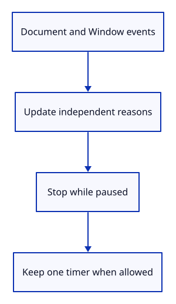

# 4.2.20 · Connect visibility and freezing to heartbeat scheduling

**Chapter 4 · Browser lifetime and recovery · Section 4.2 · GPU diagnostics and recovery** · [Contents](contents.md)

**Typing: 20–39 minutes.** [Estimate](typing-load.md).

Connect visibilitychange, freeze and resume on Document. Keep pagehide and pageshow on Window. Each event changes its own pause reason before synchronizing the heartbeat.

## Type

Continue from [Keep each heartbeat pause reason separate](34gbb-suspension.md). [Save or recover your work](recovery.md).

### 1. `src/report_lifecycle.rs`

Use the scheduling policy in the existing metadata owner. Store pause reasons beside the owned listeners and allocation token. Keep replacement identity independent of scheduling state. Read or update scheduling state without retaining a borrow while the timer changes. Read the initial hidden state and retain Document for later visibility observations. Pause cached scheduling; close the policy permanently before final cleanup is deferred. On page return, clear only the cached reason and refresh actual visibility. Observe Document visibility and freezing, then synchronize one timer after updating all affected reasons. Bind all three Document events; partial registration still cleans up through the listener owner.

<details>
<summary>Locate the existing block</summary>

```rust
use std::{cell::RefCell, rc::Rc};
use wasm_bindgen::{closure::Closure, JsCast, JsValue};
use crate::{browser_report as report, listeners::Listeners};

thread_local! { static ACTIVE: RefCell<Option<(Rc<()>, Listeners)>> = const { RefCell::new(None) }; }

fn current(token: &Rc<()>) -> bool {
    ACTIVE.with(|slot| slot.borrow().as_ref().is_some_and(|(id, _)| Rc::ptr_eq(id, token)))
}

#[wasm_bindgen::prelude::wasm_bindgen(js_name = stop_report_lifecycle)]
pub fn stop() -> bool {
    let owner = ACTIVE.with(|slot| slot.borrow_mut().take());
    let active = owner.is_some(); report::stop_periodic(); drop(owner); active
}

#[wasm_bindgen::prelude::wasm_bindgen(js_name = install_report_lifecycle)]
pub fn install() -> Result<(), JsValue> {
    stop(); let window = web_sys::window().ok_or("No browser window")?;
    let token = Rc::new(()); let guarded = Rc::clone(&token);
    let callback = Closure::<dyn FnMut(web_sys::Event)>::new(move |event: web_sys::Event| {
        if !current(&guarded) { return; }
        match event.type_().as_str() {
            "pagehide" => {
                let cached = event.dyn_ref::<web_sys::PageTransitionEvent>().is_some_and(|event| event.persisted());
                let _ = report::observe("lifecycle", if cached { "pagehide cached" } else { "pagehide final" });
                report::stop_periodic();
                if !cached {
                    let _ = report::close_report(); let token = Rc::clone(&guarded);
                    wasm_bindgen_futures::spawn_local(async move { if current(&token) { stop(); } });
                }
            }
            "pageshow" => {
                let _ = report::observe("lifecycle", "pageshow");
                if let Err(error) = report::start_periodic() {
                    let _ = report::observe("diagnostic", &format!("Heartbeat unavailable: {error:?}"));
                }
            }
            _ => {}
        }
    });
    let mut listeners = Listeners::new(callback);
    listeners.listen(window.as_ref(), "pagehide")?; listeners.listen(window.as_ref(), "pageshow")?;
    ACTIVE.with(|slot| slot.replace(Some((token, listeners)))); Ok(())
}

#[wasm_bindgen::prelude::wasm_bindgen]
pub fn report_lifecycle_running() -> bool { ACTIVE.with(|slot| slot.borrow().is_some()) }
```

</details>

Edit the existing block to match this code; keep unchanged lines:

```rust
use std::{cell::RefCell, rc::Rc};
use wasm_bindgen::{closure::Closure, JsCast, JsValue};
use crate::{browser_report as report, listeners::Listeners, suspension::{Reason, Suspension}};

thread_local! { static ACTIVE: RefCell<Option<(Rc<()>, Listeners, Suspension)>> = const { RefCell::new(None) }; }

fn current(token: &Rc<()>) -> bool {
    ACTIVE.with(|slot| slot.borrow().as_ref().is_some_and(|(id, _, _)| Rc::ptr_eq(id, token)))
}

pub fn permits() -> bool {
    ACTIVE.with(|slot| slot.borrow().as_ref().is_some_and(|(_, _, state)| state.permits()))
}

fn change(reason: Reason, paused: bool) {
    ACTIVE.with(|slot| { if let Some((_, _, state)) = slot.borrow_mut().as_mut() { state.change(reason, paused); } });
}

#[wasm_bindgen::prelude::wasm_bindgen(js_name = stop_report_lifecycle)]

pub fn stop() -> bool {
    let owner = ACTIVE.with(|slot| slot.borrow_mut().take());
    let active = owner.is_some(); report::stop_periodic(); drop(owner); active
}

#[wasm_bindgen::prelude::wasm_bindgen(js_name = install_report_lifecycle)]
pub fn install() -> Result<(), JsValue> {
    stop(); let window = web_sys::window().ok_or("No browser window")?;
    let document = window.document().ok_or("No document")?;
    let hidden = document.hidden(); let observed = document.clone();
    let token = Rc::new(()); let guarded = Rc::clone(&token);
    let callback = Closure::<dyn FnMut(web_sys::Event)>::new(move |event: web_sys::Event| {
        if !current(&guarded) { return; }
        match event.type_().as_str() {
            "pagehide" => {
                let cached = event.dyn_ref::<web_sys::PageTransitionEvent>().is_some_and(|event| event.persisted());
                let _ = report::observe("lifecycle", if cached { "pagehide cached" } else { "pagehide final" });
                change(Reason::Cached, true);
                report::stop_periodic();
                if !cached {
                    ACTIVE.with(|slot| { if let Some((_, _, state)) = slot.borrow_mut().as_mut() { state.close(); } });
                    let _ = report::close_report(); let token = Rc::clone(&guarded);
                    wasm_bindgen_futures::spawn_local(async move { if current(&token) { stop(); } });
                }
            }
            "pageshow" => {
                let _ = report::observe("lifecycle", "pageshow");
                change(Reason::Cached, false); change(Reason::Hidden, observed.hidden());
            }
            "visibilitychange" => {
                change(Reason::Hidden, observed.hidden());
                let _ = report::observe("lifecycle", if observed.hidden() { "hidden" } else { "visible" });
            }
            "freeze" | "resume" => {
                change(Reason::Frozen, event.type_() == "freeze");
                change(Reason::Hidden, observed.hidden());
                let _ = report::observe("lifecycle", &event.type_());
            }
            _ => return,
        }
        if let Err(error) = report::start_periodic() {
            let _ = report::observe("diagnostic", &format!("Heartbeat unavailable: {error:?}"));
        }
    });
    let mut listeners = Listeners::new(callback);
    listeners.listen(window.as_ref(), "pagehide")?; listeners.listen(window.as_ref(), "pageshow")?;
    for name in ["visibilitychange", "freeze", "resume"] { listeners.listen(document.as_ref(), name)?; }
    ACTIVE.with(|slot| slot.replace(Some((token, listeners, Suspension::new(hidden))))); Ok(())
}

#[wasm_bindgen::prelude::wasm_bindgen]
pub fn report_lifecycle_running() -> bool { ACTIVE.with(|slot| slot.borrow().is_some()) }
```

<details>
<summary>Optional patch references</summary>

Use these original edit fragments when comparing a saved checkpoint. Apply the complete blocks above.

```text
--8<-- "journey/code/34gbba-browser-01.rs"
```

```text
--8<-- "journey/code/34gbba-browser-02.rs"
```

```text
--8<-- "journey/code/34gbba-browser-03.rs"
```

```text
--8<-- "journey/code/34gbba-browser-04.rs"
```

```text
--8<-- "journey/code/34gbba-browser-05.rs"
```

```text
--8<-- "journey/code/34gbba-browser-06.rs"
```

```text
--8<-- "journey/code/34gbba-browser-07.rs"
```

```text
--8<-- "journey/code/34gbba-browser-08.rs"
```

```text
--8<-- "journey/code/34gbba-browser-09.rs"
```

</details>

### 2. `src/browser_report.rs`

Refuse suspended scheduling and retain an existing timer, so repeated resume events cannot restart or duplicate it.

<details>
<summary>Locate the existing block</summary>

```rust
pub fn start_periodic() -> Result<(), JsValue> {
    stop_periodic();
```

</details>

Edit the existing block to match this code; keep unchanged lines:

```rust
pub fn start_periodic() -> Result<(), JsValue> {
    if !crate::report_lifecycle::permits() { stop_periodic(); return Ok(()); }
    if BEAT.with(|slot| slot.borrow().is_some()) { return Ok(()); }
```

<details>
<summary>Optional patch references</summary>

Use these original edit fragments when comparing a saved checkpoint. Apply the complete blocks above.

```text
--8<-- "journey/code/34gbba-browser-10.rs"
```

</details>

## Run and check

In your project:

```sh
cd workspace/journey
REGEN_PROTO=0 cargo build --lib --locked --target wasm32-unknown-unknown -j1
REGEN_PROTO=0 CARGO_BUILD_JOBS=1 trunk serve --port 8780
```

Open `http://127.0.0.1:8780/`. Keep an existing Trunk server running; saving rebuilds it.

Switch away from the viewer tab, then return and type Report. Its lifecycle entries show hidden and visible, while the healthy outcome remains Ready.

### Recorded visual result

**Previous native render — current verification pending.**


*This recorded image predates a source or checker change. Rebuild this checkpoint before using it as current evidence; browser controls require separate acceptance.*

This reference image is shared with [4.2.18 · Own diagnostic page transitions](34gba-lifecycle.md). It does not demonstrate a new feature by itself.

<details>
<summary>Code explanation and diagram</summary>

Read Document.hidden at startup and on return. Start one timer only when the policy permits it. Repeated resume events retain the existing timer. Final closure prevents restart before deferred listener cleanup.

Document and Window events → independent pause reasons → stop or retain one heartbeat timer.



Why does timer synchronization happen after updating the event’s reasons?

The scheduling decision must include both the changed reason and current visibility. It must not resume between clearing cached state and discovering the document is still hidden.

Study estimate, including typing and experiments: 0.75–1.25 hours.

</details>

<details>
<summary>Optional experiment</summary>

In the debug console, dispatch Document freeze, cached Window pagehide, then Document resume. The cached reason still blocks scheduling until pageshow.

</details>

<details>
<summary>Check and save your work</summary>

Restore experimental edits, then run from `session_viewer`:

```sh
npm --prefix ../session_tests run course -- check 4.2.20
npm --prefix ../session_tests run course -- save 4.2.20
```

Source comparison leaves your project untouched. [Save and recovery instructions](recovery.md).

</details>

<details>
<summary>Viewer coverage and verification</summary>

Diagnostic metadata remains independent of drawing and survives device loss. This connects hidden/frozen/cached scheduling; pending GPU startup revocation, browser errors, full phases and bounded recovery follow. Scheduling requires a live lifecycle owner; denied bindings preserve manual report downloads without installing a heartbeat.

Chrome acceptance covers genuine visibility and freeze/resume separately from injected overlap orders. It checks initial hidden startup, duplicate resumption, timer-only metadata, first-failure preservation after actual device loss, final cleanup, refused late scheduling, replacement identity and partial binding failure. Native policy and common typed command/camera checks remain required.

Actual Chrome visibility/freezing, independent reason overlap, one timer, post-loss metadata and final cleanup are verified by this checkpoint.

[Full validation scope](release.md).

To reproduce the scripted acceptance of the reference checkpoint, run from `session_viewer` with the [course bundle server](release.md#reproduce) running on port 8781:

```sh
npm --prefix ../session_tests run course -- capture 4.2.20
```

This uses the verified reference bundle; it does not check or change your typed project.

</details>
