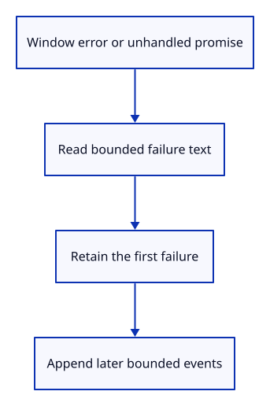

# 4.2.24 · Observe uncaught browser failures

**Chapter 4 · Browser lifetime and recovery · Section 4.2 · GPU diagnostics and recovery** · [Contents](contents.md)

**Typing: 18–35 minutes.** [Estimate](typing-load.md).

Listen for Window error and unhandledrejection events in the metadata owner. Read an Error’s message safely; use a label for non-text promise reasons instead of serializing them.

## Type

Continue from [Bound browser failure messages](34gc-messages.md). [Save or recover your work](recovery.md).

### 1. `src/browser_errors.rs`

Read native error events and safe promise-reason values; avoid serializing objects and catch unavailable Error messages.

Create the file and type:

```rust
--8<-- "journey/code/34gca-errors-01.rs"
```

### 2. `Cargo.toml`

Enable the two browser event interfaces without changing dependency versions.

<details>
<summary>Locate the existing block</summary>

```toml
web-sys = { version = "=0.3.105", features = ["Window", "Document", "Element", "HtmlCanvasElement", "EventTarget", "AddEventListenerOptions", "PageTransitionEvent", "Location", "Navigator", "Storage", "Performance", "Event", "MouseEvent", "PointerEvent", "DomRect", "KeyboardEvent", "WheelEvent", "AddEventListenerOptions", "HtmlElement", "HtmlInputElement", "File", "FileList", "Blob", "CustomEvent", "CustomEventInit", "FocusOptions", "Url", "HtmlAnchorElement", "AbortController", "AbortSignal", "RequestInit", "Response", "Headers", "ReadableStream", "ReadableStreamDefaultReader"] }
```

</details>

Edit the existing block to match this code; keep unchanged lines:

```toml
web-sys = { version = "=0.3.105", features = ["Window", "Document", "Element", "HtmlCanvasElement", "EventTarget", "AddEventListenerOptions", "PageTransitionEvent", "ErrorEvent", "PromiseRejectionEvent", "Location", "Navigator", "Storage", "Performance", "Event", "MouseEvent", "PointerEvent", "DomRect", "KeyboardEvent", "WheelEvent", "AddEventListenerOptions", "HtmlElement", "HtmlInputElement", "File", "FileList", "Blob", "CustomEvent", "CustomEventInit", "FocusOptions", "Url", "HtmlAnchorElement", "AbortController", "AbortSignal", "RequestInit", "Response", "Headers", "ReadableStream", "ReadableStreamDefaultReader"] }
```

<details>
<summary>Optional patch references</summary>

Use these original edit fragments when comparing a saved checkpoint. Apply the complete blocks above.

```text
--8<-- "journey/code/34gca-errors-02.rs"
```

</details>

### 3. `src/lib.rs`

Register browser failure observation.

<details>
<summary>Locate the existing block</summary>

```rust
mod browser_startup;
```

</details>

After that block, type:

```rust
#[cfg(target_arch = "wasm32")]
mod browser_errors;
```

<details>
<summary>Optional patch references</summary>

Use these original edit fragments when comparing a saved checkpoint. Apply the complete blocks above.

```text
--8<-- "journey/code/34gca-errors-03.rs"
```

</details>

### 4. `src/report_lifecycle.rs`

Record failures through the existing first-failure path; keep event defaults and heartbeat scheduling unchanged. Own both Window failure bindings beside the five existing metadata bindings, including partial-registration cleanup.

Edit these blocks from bottom to top. Keep the surrounding lines unchanged.

<details>
<summary>Locate this block</summary>

```rust
    let mut listeners = Listeners::new(callback);
    listeners.listen(window.as_ref(), "pagehide")?; listeners.listen(window.as_ref(), "pageshow")?;
    for name in ["visibilitychange", "freeze", "resume"] { listeners.listen(document.as_ref(), name)?; }
    ACTIVE.with(|slot| slot.replace(Some((token, listeners, Suspension::new(hidden))))); Ok(())
}
```

</details>

Replace it with:

```rust
    let mut listeners = Listeners::new(callback);
    listeners.listen(window.as_ref(), "pagehide")?; listeners.listen(window.as_ref(), "pageshow")?;
    for name in ["visibilitychange", "freeze", "resume"] { listeners.listen(document.as_ref(), name)?; }
    for name in ["error", "unhandledrejection"] { listeners.listen(window.as_ref(), name)?; }
    ACTIVE.with(|slot| slot.replace(Some((token, listeners, Suspension::new(hidden))))); Ok(())
}
```

<details>
<summary>Locate this block</summary>

```rust
                change(Reason::Hidden, observed.hidden());
                let _ = report::observe("lifecycle", &event.type_());
            }
            _ => return,
        }
        if let Err(error) = report::start_periodic() {
```

</details>

Replace it with:

```rust
                change(Reason::Hidden, observed.hidden());
                let _ = report::observe("lifecycle", &event.type_());
            }
            "error" | "unhandledrejection" => {
                if let Some(message) = crate::browser_errors::message(&event) { report::fatal(&message); }
                return;
            }
            _ => return,
        }
        if let Err(error) = report::start_periodic() {
```

<details>
<summary>Complete updated block reference</summary>

```rust
use std::{cell::RefCell, rc::Rc};
use wasm_bindgen::{closure::Closure, JsCast, JsValue};
use crate::{browser_report as report, listeners::Listeners, suspension::{Reason, Suspension}};

thread_local! { static ACTIVE: RefCell<Option<(Rc<()>, Listeners, Suspension)>> = const { RefCell::new(None) }; }

fn current(token: &Rc<()>) -> bool {
    ACTIVE.with(|slot| slot.borrow().as_ref().is_some_and(|(id, _, _)| Rc::ptr_eq(id, token)))
}

pub fn permits() -> bool {
    ACTIVE.with(|slot| slot.borrow().as_ref().is_some_and(|(_, _, state)| state.permits()))
}

fn change(reason: Reason, paused: bool) {
    ACTIVE.with(|slot| { if let Some((_, _, state)) = slot.borrow_mut().as_mut() { state.change(reason, paused); } });
}

#[wasm_bindgen::prelude::wasm_bindgen(js_name = stop_report_lifecycle)]

pub fn stop() -> bool {
    let owner = ACTIVE.with(|slot| slot.borrow_mut().take());
    let active = owner.is_some(); report::stop_periodic(); drop(owner); active
}

#[wasm_bindgen::prelude::wasm_bindgen(js_name = install_report_lifecycle)]
pub fn install() -> Result<(), JsValue> {
    stop(); let window = web_sys::window().ok_or("No browser window")?;
    let document = window.document().ok_or("No document")?;
    let hidden = document.hidden(); let observed = document.clone();
    let token = Rc::new(()); let guarded = Rc::clone(&token);
    let callback = Closure::<dyn FnMut(web_sys::Event)>::new(move |event: web_sys::Event| {
        if !current(&guarded) { return; }
        match event.type_().as_str() {
            "pagehide" => {
                let cached = event.dyn_ref::<web_sys::PageTransitionEvent>().is_some_and(|event| event.persisted());
                let _ = report::observe("lifecycle", if cached { "pagehide cached" } else { "pagehide final" });
                change(Reason::Cached, true);
                report::stop_periodic();
                if !cached {
                    ACTIVE.with(|slot| { if let Some((_, _, state)) = slot.borrow_mut().as_mut() { state.close(); } });
                    let _ = report::close_report(); let token = Rc::clone(&guarded);
                    wasm_bindgen_futures::spawn_local(async move { if current(&token) { stop(); } });
                }
            }
            "pageshow" => {
                let _ = report::observe("lifecycle", "pageshow");
                change(Reason::Cached, false); change(Reason::Hidden, observed.hidden());
            }
            "visibilitychange" => {
                change(Reason::Hidden, observed.hidden());
                let _ = report::observe("lifecycle", if observed.hidden() { "hidden" } else { "visible" });
            }
            "freeze" | "resume" => {
                change(Reason::Frozen, event.type_() == "freeze");
                change(Reason::Hidden, observed.hidden());
                let _ = report::observe("lifecycle", &event.type_());
            }
            "error" | "unhandledrejection" => {
                if let Some(message) = crate::browser_errors::message(&event) { report::fatal(&message); }
                return;
            }
            _ => return,
        }
        if let Err(error) = report::start_periodic() {
            let _ = report::observe("diagnostic", &format!("Heartbeat unavailable: {error:?}"));
        }
    });
    let mut listeners = Listeners::new(callback);
    listeners.listen(window.as_ref(), "pagehide")?; listeners.listen(window.as_ref(), "pageshow")?;
    for name in ["visibilitychange", "freeze", "resume"] { listeners.listen(document.as_ref(), name)?; }
    for name in ["error", "unhandledrejection"] { listeners.listen(window.as_ref(), name)?; }
    ACTIVE.with(|slot| slot.replace(Some((token, listeners, Suspension::new(hidden))))); Ok(())
}

#[wasm_bindgen::prelude::wasm_bindgen]
pub fn report_lifecycle_running() -> bool { ACTIVE.with(|slot| slot.borrow().is_some()) }
```

</details>

<details>
<summary>Optional patch references</summary>

Use these original edit fragments when comparing a saved checkpoint. Apply the complete blocks above.

```text
--8<-- "journey/code/34gca-errors-04.rs"
```

```text
--8<-- "journey/code/34gca-errors-05.rs"
```

</details>

## Run and check

In your project:

```sh
cd workspace/journey
REGEN_PROTO=0 cargo build --lib --locked --target wasm32-unknown-unknown -j1
REGEN_PROTO=0 CARGO_BUILD_JOBS=1 trunk serve --port 8780
```

Open `http://127.0.0.1:8780/`. Keep an existing Trunk server running; saving rebuilds it.

In the browser console, run `Promise.reject(new Error("lesson check"))`. Type `Report`: its first failure reads “Unhandled rejection: lesson check”.

### Recorded visual result

**Previous native render — current verification pending.**


*This recorded image predates a source or checker change. Rebuild this checkpoint before using it as current evidence; browser controls require separate acceptance.*

This reference image is shared with [4.2.18 · Own diagnostic page transitions](34gba-lifecycle.md). It does not demonstrate a new feature by itself.

<details>
<summary>Code explanation and diagram</summary>

Reuse the existing fatal-report path: retain the first failure and attempt its download once. Later failures remain in the bounded event history. The observers keep browser defaults and do not stop drawing.

Window failure → bounded message → first-failure report and bounded history.



Why does a browser failure not stop the GPU runtime here?

The event proves a script or promise failed, not that the drawing device was lost. Metadata records the failure; GPU loss still stops its own runtime.

Study estimate, including typing and experiments: 0.75–1.25 hours.

</details>

<details>
<summary>Optional experiment</summary>

In the debug console, run Promise.reject(new Error("lesson failure")), then type Report. A later failure must not replace the first one.

</details>

<details>
<summary>Check and save your work</summary>

Restore experimental edits, then run from `session_viewer`:

```sh
npm --prefix ../session_tests run course -- check 4.2.24
npm --prefix ../session_tests run course -- save 4.2.24
```

Source comparison leaves your project untouched. [Save and recovery instructions](recovery.md).

</details>

<details>
<summary>Viewer coverage and verification</summary>

Browser failure metadata now shares lifecycle ownership and survives device loss. Full loading phases, adapter/resource information and bounded GPU recovery follow.

Fresh native, WebAssembly, Trunk, GPU and Chrome checks are required. Actual browser failures are exercised in isolated browser contexts so deliberate exceptions cannot hide unexpected main-viewer errors.

Additional verification: Reload and type Report. Normal startup remains Ready. The checkpoint’s browser check produces real uncaught errors and rejected promises, then verifies retained failure evidence.

Actual uncaught errors and unhandled promises, bounded messages, first-failure retention, typed downloads and independent GPU ownership are checked.

[Full validation scope](release.md).

To reproduce the scripted acceptance of the reference checkpoint, run from `session_viewer` with the [course bundle server](release.md#reproduce) running on port 8781:

```sh
npm --prefix ../session_tests run course -- capture 4.2.24
```

This uses the verified reference bundle; it does not check or change your typed project.

</details>
