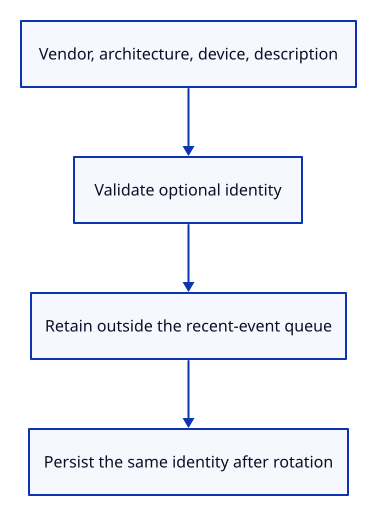

# 4.2.25 · Retain adapter identity in the report

**Chapter 4 · Browser lifetime and recovery · Section 4.2 · GPU diagnostics and recovery** · [Contents](contents.md)

**Typing: 14–28 minutes.** [Estimate](typing-load.md).

Keep vendor, architecture, device and description in one optional report field. Later events can rotate out without losing the adapter identity.

## Type

Continue from [Observe uncaught browser failures](34gca-errors.md). [Save or recover your work](recovery.md).

### 1. `src/adapter_info.rs`

Keep four bounded adapter strings without retaining a GPU object.

Create the file and type:

```rust
--8<-- "journey/code/34gd-adapter-01.rs"
```

### 2. `src/diagnostic.rs`

Retain optional adapter identity separately from the recent-event queue. Start without adapter identity; the browser will supply it after its request. Reject oversized adapter fields when validating a saved report. Validate identity before changing the report.

Edit these blocks from bottom to top. Keep the surrounding lines unchanged.

<details>
<summary>Locate this block</summary>

```rust

    pub fn failure(&self) -> Option<&Event> { self.failure.as_ref() }

    pub fn record(&mut self, time: String, elapsed_ms: f64, kind: &str, message: &str) -> Result<(), &'static str> {
        if !elapsed_ms.is_finite() || elapsed_ms < 0.0 { return Err("Invalid elapsed time"); }
        let event = Event { time, elapsed_ms, kind: kind.chars().take(64).collect(), message: message.chars().take(4096).collect() };
```

</details>

Replace it with:

```rust

    pub fn failure(&self) -> Option<&Event> { self.failure.as_ref() }

    pub fn set_adapter(&mut self, info: crate::adapter_info::AdapterInfo) -> Result<(), &'static str> {
        if !info.valid() { return Err("Invalid adapter identity"); }
        self.adapter = Some(info); Ok(())
    }

    pub fn record(&mut self, time: String, elapsed_ms: f64, kind: &str, message: &str) -> Result<(), &'static str> {
        if !elapsed_ms.is_finite() || elapsed_ms < 0.0 { return Err("Invalid elapsed time"); }
        let event = Event { time, elapsed_ms, kind: kind.chars().take(64).collect(), message: message.chars().take(4096).collect() };
```

<details>
<summary>Locate this block</summary>

```rust
            && !self.started.is_empty() && text(&self.started, 64) && !self.last_seen.is_empty() && text(&self.last_seen, 64)
            && !self.context.page.is_empty() && text(&self.context.page, 4096) && !self.context.page.contains(['?', '#'])
            && text(&self.context.browser, 4096) && self.context.device_pixel_ratio.is_finite() && self.context.device_pixel_ratio > 0.0
            && self.events.len() <= 24 && self.events.iter().all(event)
            && self.events.iter().all(|e| e.kind != "fatal" || self.failure.is_some())
            && match &self.failure {
```

</details>

Replace it with:

```rust
            && !self.started.is_empty() && text(&self.started, 64) && !self.last_seen.is_empty() && text(&self.last_seen, 64)
            && !self.context.page.is_empty() && text(&self.context.page, 4096) && !self.context.page.contains(['?', '#'])
            && text(&self.context.browser, 4096) && self.context.device_pixel_ratio.is_finite() && self.context.device_pixel_ratio > 0.0
            && self.adapter.as_ref().is_none_or(|info| info.valid())
            && self.events.len() <= 24 && self.events.iter().all(event)
            && self.events.iter().all(|e| e.kind != "fatal" || self.failure.is_some())
            && match &self.failure {
```

<details>
<summary>Locate this block</summary>

```rust
    pub context: Context,
    events: std::collections::VecDeque<Event>,
    failure: Option<Event>,
}

impl Report {
    pub fn new(tab: String, started: String, context: Context) -> Self {
        Self { version: 1, tab, last_seen: started.clone(), started, outcome: Outcome::Running,
            context, events: Default::default(), failure: None }
    }

    pub fn valid(&self) -> bool {
```

</details>

Replace it with:

```rust
    pub context: Context,
    events: std::collections::VecDeque<Event>,
    failure: Option<Event>,
    // An optional field lets old reports decode unchanged; keeping identity outside the event queue preserves it when later events rotate.
    #[serde(default, skip_serializing_if = "Option::is_none")]
    adapter: Option<crate::adapter_info::AdapterInfo>,
}

impl Report {
    pub fn new(tab: String, started: String, context: Context) -> Self {
        Self { version: 1, tab, last_seen: started.clone(), started, outcome: Outcome::Running,
            context, events: Default::default(), failure: None, adapter: None }
    }

    pub fn valid(&self) -> bool {
```

<details>
<summary>Complete updated block reference</summary>

```rust
use serde::{Deserialize, Serialize};

#[derive(Clone, Debug, PartialEq, Serialize, Deserialize)]
#[serde(rename_all = "camelCase")]
pub struct Context {
    pub page: String,
    pub browser: String,
    pub secure_context: bool,
    pub webgpu: bool,
    pub viewport: [u32; 2],
    pub canvas: [u32; 2],
    pub device_pixel_ratio: f64,
}

#[derive(Clone, Debug, PartialEq, Serialize, Deserialize)]
#[serde(rename_all = "lowercase")]
pub enum Outcome { Running, Ready, Closed, Failed }

#[derive(Clone, Debug, PartialEq, Serialize, Deserialize)]
#[serde(rename_all = "camelCase")]
pub struct Event {
    pub time: String,
    pub elapsed_ms: f64,
    pub kind: String,
    pub message: String,
}

#[derive(Clone, Debug, PartialEq, Serialize, Deserialize)]
#[serde(rename_all = "camelCase")]
pub struct Report {
    pub version: u32,
    pub tab: String,
    pub started: String,
    pub last_seen: String,
    pub outcome: Outcome,
    #[serde(flatten)]
    pub context: Context,
    events: std::collections::VecDeque<Event>,
    failure: Option<Event>,
    // An optional field lets old reports decode unchanged; keeping identity outside the event queue preserves it when later events rotate.
    #[serde(default, skip_serializing_if = "Option::is_none")]
    adapter: Option<crate::adapter_info::AdapterInfo>,
}

impl Report {
    pub fn new(tab: String, started: String, context: Context) -> Self {
        Self { version: 1, tab, last_seen: started.clone(), started, outcome: Outcome::Running,
            context, events: Default::default(), failure: None, adapter: None }
    }

    pub fn valid(&self) -> bool {
        let text = |s: &str, max| s.chars().count() <= max;
        let event = |e: &Event| !e.time.is_empty() && text(&e.time, 64) && !e.kind.is_empty()
            && text(&e.kind, 64) && text(&e.message, 4096) && e.elapsed_ms.is_finite() && e.elapsed_ms >= 0.0;
        self.version == 1 && !self.tab.is_empty() && text(&self.tab, 128)
            && !self.started.is_empty() && text(&self.started, 64) && !self.last_seen.is_empty() && text(&self.last_seen, 64)
            && !self.context.page.is_empty() && text(&self.context.page, 4096) && !self.context.page.contains(['?', '#'])
            && text(&self.context.browser, 4096) && self.context.device_pixel_ratio.is_finite() && self.context.device_pixel_ratio > 0.0
            && self.adapter.as_ref().is_none_or(|info| info.valid())
            && self.events.len() <= 24 && self.events.iter().all(event)
            && self.events.iter().all(|e| e.kind != "fatal" || self.failure.is_some())
            && match &self.failure {
                Some(first) => event(first) && first.kind == "fatal" && self.outcome == Outcome::Failed,
                None => self.outcome != Outcome::Failed,
            }
    }

    pub fn heartbeat(&mut self, time: String) -> Result<(), &'static str> {
        if time.is_empty() || time.chars().count() > 64 { return Err("Invalid heartbeat timestamp"); }
        self.last_seen = time; Ok(())
    }

    pub fn close(&mut self, time: String) -> Result<(), &'static str> {
        self.heartbeat(time)?;
        if self.failure.is_none() { self.outcome = Outcome::Closed; }
        Ok(())
    }

    pub fn failure(&self) -> Option<&Event> { self.failure.as_ref() }

    pub fn set_adapter(&mut self, info: crate::adapter_info::AdapterInfo) -> Result<(), &'static str> {
        if !info.valid() { return Err("Invalid adapter identity"); }
        self.adapter = Some(info); Ok(())
    }

    pub fn record(&mut self, time: String, elapsed_ms: f64, kind: &str, message: &str) -> Result<(), &'static str> {
        if !elapsed_ms.is_finite() || elapsed_ms < 0.0 { return Err("Invalid elapsed time"); }
        let event = Event { time, elapsed_ms, kind: kind.chars().take(64).collect(), message: message.chars().take(4096).collect() };
        self.last_seen.clone_from(&event.time);
        if kind == "fatal" {
            if self.failure.is_none() { self.failure = Some(event.clone()); }
            self.outcome = Outcome::Failed;
        } else if kind == "milestone" && message == "geometry on screen" && self.failure.is_none() && self.outcome != Outcome::Closed {
            self.outcome = Outcome::Ready;
        }
        while self.events.len() >= 24 { self.events.pop_front(); }
        self.events.push_back(event);
        Ok(())
    }
}
```

</details>

<details>
<summary>Optional patch references</summary>

Use these original edit fragments when comparing a saved checkpoint. Apply the complete blocks above.

```text
--8<-- "journey/code/34gd-adapter-02.rs"
```

```text
--8<-- "journey/code/34gd-adapter-03.rs"
```

```text
--8<-- "journey/code/34gd-adapter-04.rs"
```

```text
--8<-- "journey/code/34gd-adapter-05.rs"
```

</details>

### 3. `src/report_store.rs`

Admit the optional adapter field through the existing strict decoder.

<details>
<summary>Locate the existing block</summary>

```rust
        "webgpu", "viewport", "canvas", "devicePixelRatio", "events", "failure"];
```

</details>

Edit the existing block to match this code; keep unchanged lines:

```rust
        "webgpu", "viewport", "canvas", "devicePixelRatio", "events", "failure", "adapter"];
```

<details>
<summary>Optional patch references</summary>

Use these original edit fragments when comparing a saved checkpoint. Apply the complete blocks above.

```text
--8<-- "journey/code/34gd-adapter-06.rs"
```

</details>

<details>
<summary>Supplied validation fixture</summary>

Copy this supplied authoring fixture once. Continue with the browser build below; the course does not require running native tests.

### 4. `src/adapter_info_tests.rs`

Copy the checks for retained identity, legacy decoding, strict fields, Unicode bounds and atomic refusal.

Copy this supplied file:

```text
--8<-- "journey/code/34gd-adapter-07.rs"
```

</details>

### 5. `src/lib.rs`

Register adapter identity and its native checks.

<details>
<summary>Locate the existing block</summary>

```rust
pub mod diagnostic;
```

</details>

After that block, type:

```rust
pub mod adapter_info;
#[cfg(test)]
mod adapter_info_tests;
```

<details>
<summary>Optional patch references</summary>

Use these original edit fragments when comparing a saved checkpoint. Apply the complete blocks above.

```text
--8<-- "journey/code/34gd-adapter-08.rs"
```

</details>

## Run and check

In your project:

```sh
cd workspace/journey
REGEN_PROTO=0 cargo build --lib --locked --target wasm32-unknown-unknown -j1
REGEN_PROTO=0 CARGO_BUILD_JOBS=1 trunk serve --port 8780
```

Open `http://127.0.0.1:8780/`. Keep an existing Trunk server running; saving rebuilds it.

Inspect the supplied state fixtures. Adapter identity survives event rotation, while reports saved before this lesson still decode.

### Recorded visual result

**Previous native render — current verification pending.**


*This recorded image predates a source or checker change. Rebuild this checkpoint before using it as current evidence; browser controls require separate acceptance.*

This reference image is shared with [4.2.18 · Own diagnostic page transitions](34gba-lifecycle.md). It does not demonstrate a new feature by itself.

<details>
<summary>Code explanation and diagram</summary>

Browser vendors can leave identity strings empty. Accept those values, bound each string to 256 characters and reject unknown nested fields. Old reports omit the new field and still decode.

optional adapter strings → validated report field → saved identity survives event rotation.



Why is adapter identity outside the recent-event queue?

Loading, lifecycle and later errors can fill that queue. The same adapter identity must remain available in every subsequent report.

Study estimate, including typing and experiments: 0.75–1.25 hours.

</details>

<details>
<summary>Optional experiment</summary>

Give a vendor string 256 emoji characters, then 257. The first is valid; the second is refused without changing the report.

</details>

<details>
<summary>Check and save your work</summary>

Restore experimental edits, then run from `session_viewer`:

```sh
npm --prefix ../session_tests run course -- check 4.2.25
npm --prefix ../session_tests run course -- save 4.2.25
```

Source comparison leaves your project untouched. [Save and recovery instructions](recovery.md).

</details>

<details>
<summary>Viewer coverage and verification</summary>

This prepares retained adapter metadata. The next lesson observes the viewer’s actual native request; load timings and resource accounting follow.

Native checks cover event rotation, retained first failure, legacy reports, strict nested fields, Unicode limits and atomic refusal. Browser drawing/input retain the preceding complete route.

Native checks establish the new report field; browser commands and drawing retain the preceding behavior.

[Full validation scope](release.md).

To reproduce the scripted acceptance of the reference checkpoint, run from `session_viewer` with the [course bundle server](release.md#reproduce) running on port 8781:

```sh
npm --prefix ../session_tests run course -- capture 4.2.25
```

This uses the verified reference bundle; it does not check or change your typed project.

</details>
