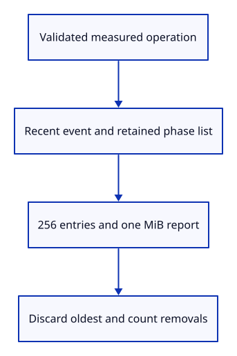

# 4.2.27 · Retain measured loading phases

**Chapter 4 · Browser lifetime and recovery · Section 4.2 · GPU diagnostics and recovery** · [Contents](contents.md)

**Typing: 27–54 minutes.** [Estimate](typing-load.md).

Keep loading durations, byte counts and source names in a separate report list. Retain up to 256 measurements while preserving the one MiB report budget.

## Type

Continue from [Read the viewer’s adapter identity](34gda-browser.md). [Save or recover your work](recovery.md).

### 1. `src/load_phase.rs`

Describe one completed load operation with duration, bytes, sanitized source and completion time.

Create the file and type:

```rust
--8<-- "journey/code/34gdb-phases-01.rs"
```

### 2. `src/diagnostic.rs`

Retain phases outside the recent events; old reports omit both optional fields. Start with no measured phases or discarded entries. Validate retained phases and the existing one MiB report limit. Record validated phases and count entries discarded by either retention limit. Keep phase retention within budget when later errors grow the event window. Account for adapter identity when retaining phase entries.

Edit these blocks from bottom to top. Keep the surrounding lines unchanged.

<details>
<summary>Locate this block</summary>

```rust
        }
        while self.events.len() >= 24 { self.events.pop_front(); }
        self.events.push_back(event);
        Ok(())
    }
}
```

</details>

Replace it with:

```rust
        }
        while self.events.len() >= 24 { self.events.pop_front(); }
        self.events.push_back(event);
        self.trim_phases();
        Ok(())
    }
}
```

<details>
<summary>Locate this block</summary>

```rust

    pub fn set_adapter(&mut self, info: crate::adapter_info::AdapterInfo) -> Result<(), &'static str> {
        if !info.valid() { return Err("Invalid adapter identity"); }
        self.adapter = Some(info); Ok(())
    }

    pub fn record(&mut self, time: String, elapsed_ms: f64, kind: &str, message: &str) -> Result<(), &'static str> {
```

</details>

Replace it with:

```rust

    pub fn set_adapter(&mut self, info: crate::adapter_info::AdapterInfo) -> Result<(), &'static str> {
        if !info.valid() { return Err("Invalid adapter identity"); }
        self.adapter = Some(info); self.trim_phases(); Ok(())
    }

    fn fits(&self) -> bool {
        serde_json::to_vec_pretty(self).is_ok_and(|bytes| bytes.len() <= crate::report_store::MAX_BYTES)
    }

    fn trim_phases(&mut self) {
        // JSON escapes can expand one character into six bytes; trim the oldest measurements against the encoded budget, not character counts.
        while self.phases.len() > 256 || (!self.phases.is_empty() && !self.fits()) {
            self.phases.pop_front(); self.phases_dropped = self.phases_dropped.saturating_add(1);
        }
    }

    pub fn phase(&mut self, time: String, phase: crate::load_phase::Phase) -> Result<(), &'static str> {
        if time.is_empty() || time.chars().count() > 64 || !phase.valid() { return Err("Invalid load phase"); }
        let message = serde_json::to_string(&phase).map_err(|_| "Cannot encode phase")?;
        self.record(time, phase.elapsed_ms, "phase", &message)?;
        self.phases.push_back(phase); self.trim_phases(); Ok(())
    }

    pub fn record(&mut self, time: String, elapsed_ms: f64, kind: &str, message: &str) -> Result<(), &'static str> {
```

<details>
<summary>Locate this block</summary>

```rust
            && !self.context.page.is_empty() && text(&self.context.page, 4096) && !self.context.page.contains(['?', '#'])
            && text(&self.context.browser, 4096) && self.context.device_pixel_ratio.is_finite() && self.context.device_pixel_ratio > 0.0
            && self.adapter.as_ref().is_none_or(|info| info.valid())
            && self.events.len() <= 24 && self.events.iter().all(event)
            && self.events.iter().all(|e| e.kind != "fatal" || self.failure.is_some())
            && match &self.failure {
```

</details>

Replace it with:

```rust
            && !self.context.page.is_empty() && text(&self.context.page, 4096) && !self.context.page.contains(['?', '#'])
            && text(&self.context.browser, 4096) && self.context.device_pixel_ratio.is_finite() && self.context.device_pixel_ratio > 0.0
            && self.adapter.as_ref().is_none_or(|info| info.valid())
            && self.phases.len() <= 256 && self.phases.iter().all(|phase| phase.valid())
            && self.fits()
            && self.events.len() <= 24 && self.events.iter().all(event)
            && self.events.iter().all(|e| e.kind != "fatal" || self.failure.is_some())
            && match &self.failure {
```

<details>
<summary>Locate this block</summary>

```rust
    // An optional field lets old reports decode unchanged; keeping identity outside the event queue preserves it when later events rotate.
    #[serde(default, skip_serializing_if = "Option::is_none")]
    adapter: Option<crate::adapter_info::AdapterInfo>,
}

impl Report {
    pub fn new(tab: String, started: String, context: Context) -> Self {
        Self { version: 1, tab, last_seen: started.clone(), started, outcome: Outcome::Running,
            context, events: Default::default(), failure: None, adapter: None }
    }

    pub fn valid(&self) -> bool {
```

</details>

Replace it with:

```rust
    // An optional field lets old reports decode unchanged; keeping identity outside the event queue preserves it when later events rotate.
    #[serde(default, skip_serializing_if = "Option::is_none")]
    adapter: Option<crate::adapter_info::AdapterInfo>,
    #[serde(default, skip_serializing_if = "std::collections::VecDeque::is_empty")]
    phases: std::collections::VecDeque<crate::load_phase::Phase>,
    #[serde(default, skip_serializing_if = "crate::load_phase::zero")]
    phases_dropped: u64,
}

impl Report {
    pub fn new(tab: String, started: String, context: Context) -> Self {
        Self { version: 1, tab, last_seen: started.clone(), started, outcome: Outcome::Running,
            context, events: Default::default(), failure: None, adapter: None, phases: Default::default(), phases_dropped: 0 }
    }

    pub fn valid(&self) -> bool {
```

<details>
<summary>Complete updated block reference</summary>

```rust
use serde::{Deserialize, Serialize};

#[derive(Clone, Debug, PartialEq, Serialize, Deserialize)]
#[serde(rename_all = "camelCase")]
pub struct Context {
    pub page: String,
    pub browser: String,
    pub secure_context: bool,
    pub webgpu: bool,
    pub viewport: [u32; 2],
    pub canvas: [u32; 2],
    pub device_pixel_ratio: f64,
}

#[derive(Clone, Debug, PartialEq, Serialize, Deserialize)]
#[serde(rename_all = "lowercase")]
pub enum Outcome { Running, Ready, Closed, Failed }

#[derive(Clone, Debug, PartialEq, Serialize, Deserialize)]
#[serde(rename_all = "camelCase")]
pub struct Event {
    pub time: String,
    pub elapsed_ms: f64,
    pub kind: String,
    pub message: String,
}

#[derive(Clone, Debug, PartialEq, Serialize, Deserialize)]
#[serde(rename_all = "camelCase")]
pub struct Report {
    pub version: u32,
    pub tab: String,
    pub started: String,
    pub last_seen: String,
    pub outcome: Outcome,
    #[serde(flatten)]
    pub context: Context,
    events: std::collections::VecDeque<Event>,
    failure: Option<Event>,
    // An optional field lets old reports decode unchanged; keeping identity outside the event queue preserves it when later events rotate.
    #[serde(default, skip_serializing_if = "Option::is_none")]
    adapter: Option<crate::adapter_info::AdapterInfo>,
    #[serde(default, skip_serializing_if = "std::collections::VecDeque::is_empty")]
    phases: std::collections::VecDeque<crate::load_phase::Phase>,
    #[serde(default, skip_serializing_if = "crate::load_phase::zero")]
    phases_dropped: u64,
}

impl Report {
    pub fn new(tab: String, started: String, context: Context) -> Self {
        Self { version: 1, tab, last_seen: started.clone(), started, outcome: Outcome::Running,
            context, events: Default::default(), failure: None, adapter: None, phases: Default::default(), phases_dropped: 0 }
    }

    pub fn valid(&self) -> bool {
        let text = |s: &str, max| s.chars().count() <= max;
        let event = |e: &Event| !e.time.is_empty() && text(&e.time, 64) && !e.kind.is_empty()
            && text(&e.kind, 64) && text(&e.message, 4096) && e.elapsed_ms.is_finite() && e.elapsed_ms >= 0.0;
        self.version == 1 && !self.tab.is_empty() && text(&self.tab, 128)
            && !self.started.is_empty() && text(&self.started, 64) && !self.last_seen.is_empty() && text(&self.last_seen, 64)
            && !self.context.page.is_empty() && text(&self.context.page, 4096) && !self.context.page.contains(['?', '#'])
            && text(&self.context.browser, 4096) && self.context.device_pixel_ratio.is_finite() && self.context.device_pixel_ratio > 0.0
            && self.adapter.as_ref().is_none_or(|info| info.valid())
            && self.phases.len() <= 256 && self.phases.iter().all(|phase| phase.valid())
            && self.fits()
            && self.events.len() <= 24 && self.events.iter().all(event)
            && self.events.iter().all(|e| e.kind != "fatal" || self.failure.is_some())
            && match &self.failure {
                Some(first) => event(first) && first.kind == "fatal" && self.outcome == Outcome::Failed,
                None => self.outcome != Outcome::Failed,
            }
    }

    pub fn heartbeat(&mut self, time: String) -> Result<(), &'static str> {
        if time.is_empty() || time.chars().count() > 64 { return Err("Invalid heartbeat timestamp"); }
        self.last_seen = time; Ok(())
    }

    pub fn close(&mut self, time: String) -> Result<(), &'static str> {
        self.heartbeat(time)?;
        if self.failure.is_none() { self.outcome = Outcome::Closed; }
        Ok(())
    }

    pub fn failure(&self) -> Option<&Event> { self.failure.as_ref() }

    pub fn set_adapter(&mut self, info: crate::adapter_info::AdapterInfo) -> Result<(), &'static str> {
        if !info.valid() { return Err("Invalid adapter identity"); }
        self.adapter = Some(info); self.trim_phases(); Ok(())
    }

    fn fits(&self) -> bool {
        serde_json::to_vec_pretty(self).is_ok_and(|bytes| bytes.len() <= crate::report_store::MAX_BYTES)
    }

    fn trim_phases(&mut self) {
        // JSON escapes can expand one character into six bytes; trim the oldest measurements against the encoded budget, not character counts.
        while self.phases.len() > 256 || (!self.phases.is_empty() && !self.fits()) {
            self.phases.pop_front(); self.phases_dropped = self.phases_dropped.saturating_add(1);
        }
    }

    pub fn phase(&mut self, time: String, phase: crate::load_phase::Phase) -> Result<(), &'static str> {
        if time.is_empty() || time.chars().count() > 64 || !phase.valid() { return Err("Invalid load phase"); }
        let message = serde_json::to_string(&phase).map_err(|_| "Cannot encode phase")?;
        self.record(time, phase.elapsed_ms, "phase", &message)?;
        self.phases.push_back(phase); self.trim_phases(); Ok(())
    }

    pub fn record(&mut self, time: String, elapsed_ms: f64, kind: &str, message: &str) -> Result<(), &'static str> {
        if !elapsed_ms.is_finite() || elapsed_ms < 0.0 { return Err("Invalid elapsed time"); }
        let event = Event { time, elapsed_ms, kind: kind.chars().take(64).collect(), message: message.chars().take(4096).collect() };
        self.last_seen.clone_from(&event.time);
        if kind == "fatal" {
            if self.failure.is_none() { self.failure = Some(event.clone()); }
            self.outcome = Outcome::Failed;
        } else if kind == "milestone" && message == "geometry on screen" && self.failure.is_none() && self.outcome != Outcome::Closed {
            self.outcome = Outcome::Ready;
        }
        while self.events.len() >= 24 { self.events.pop_front(); }
        self.events.push_back(event);
        self.trim_phases();
        Ok(())
    }
}
```

</details>

<details>
<summary>Optional patch references</summary>

Use these original edit fragments when comparing a saved checkpoint. Apply the complete blocks above.

```text
--8<-- "journey/code/34gdb-phases-02.rs"
```

```text
--8<-- "journey/code/34gdb-phases-03.rs"
```

```text
--8<-- "journey/code/34gdb-phases-04.rs"
```

```text
--8<-- "journey/code/34gdb-phases-05.rs"
```

```text
--8<-- "journey/code/34gdb-phases-06.rs"
```

```text
--8<-- "journey/code/34gdb-phases-07.rs"
```

</details>

### 3. `src/report_store.rs`

Admit only the two declared phase fields through saved-report decoding.

<details>
<summary>Locate the existing block</summary>

```rust
        "webgpu", "viewport", "canvas", "devicePixelRatio", "events", "failure", "adapter"];
```

</details>

Edit the existing block to match this code; keep unchanged lines:

```rust
        "webgpu", "viewport", "canvas", "devicePixelRatio", "events", "failure", "adapter", "phases", "phasesDropped"];
```

<details>
<summary>Optional patch references</summary>

Use these original edit fragments when comparing a saved checkpoint. Apply the complete blocks above.

```text
--8<-- "journey/code/34gdb-phases-08.rs"
```

</details>

<details>
<summary>Supplied validation fixture</summary>

Copy this supplied authoring fixture once. Continue with the browser build below; the course does not require running native tests.

### 4. `src/load_phase_tests.rs`

Copy checks for strict decoding, Unicode limits, event rotation and escaped JSON byte retention.

Copy this supplied file:

```text
--8<-- "journey/code/34gdb-phases-09.rs"
```

</details>

### 5. `src/lib.rs`

Register load phase data and its native checks.

<details>
<summary>Locate the existing block</summary>

```rust
pub mod adapter_info;
```

</details>

After that block, type:

```rust
pub mod load_phase;
#[cfg(test)]
mod load_phase_tests;
```

<details>
<summary>Optional patch references</summary>

Use these original edit fragments when comparing a saved checkpoint. Apply the complete blocks above.

```text
--8<-- "journey/code/34gdb-phases-10.rs"
```

</details>

### 6. `src/diagnostic.rs`

Recheck phase retention when current browser context changes. Retain the encoded budget after heartbeat timestamp changes.

Edit these blocks from bottom to top. Keep the surrounding lines unchanged.

<details>
<summary>Locate this block</summary>

```rust
        }
    }

    pub fn phase(&mut self, time: String, phase: crate::load_phase::Phase) -> Result<(), &'static str> {
        if time.is_empty() || time.chars().count() > 64 || !phase.valid() { return Err("Invalid load phase"); }
        let message = serde_json::to_string(&phase).map_err(|_| "Cannot encode phase")?;
```

</details>

Replace it with:

```rust
        }
    }

    pub fn refresh_context(&mut self, context: Context) {
        self.context = context; self.trim_phases();
    }

    pub fn phase(&mut self, time: String, phase: crate::load_phase::Phase) -> Result<(), &'static str> {
        if time.is_empty() || time.chars().count() > 64 || !phase.valid() { return Err("Invalid load phase"); }
        let message = serde_json::to_string(&phase).map_err(|_| "Cannot encode phase")?;
```

<details>
<summary>Locate this block</summary>

```rust

    pub fn heartbeat(&mut self, time: String) -> Result<(), &'static str> {
        if time.is_empty() || time.chars().count() > 64 { return Err("Invalid heartbeat timestamp"); }
        self.last_seen = time; Ok(())
    }

    pub fn close(&mut self, time: String) -> Result<(), &'static str> {
```

</details>

Replace it with:

```rust

    pub fn heartbeat(&mut self, time: String) -> Result<(), &'static str> {
        if time.is_empty() || time.chars().count() > 64 { return Err("Invalid heartbeat timestamp"); }
        self.last_seen = time; self.trim_phases(); Ok(())
    }

    pub fn close(&mut self, time: String) -> Result<(), &'static str> {
```

<details>
<summary>Complete updated block reference</summary>

```rust
use serde::{Deserialize, Serialize};

#[derive(Clone, Debug, PartialEq, Serialize, Deserialize)]
#[serde(rename_all = "camelCase")]
pub struct Context {
    pub page: String,
    pub browser: String,
    pub secure_context: bool,
    pub webgpu: bool,
    pub viewport: [u32; 2],
    pub canvas: [u32; 2],
    pub device_pixel_ratio: f64,
}

#[derive(Clone, Debug, PartialEq, Serialize, Deserialize)]
#[serde(rename_all = "lowercase")]
pub enum Outcome { Running, Ready, Closed, Failed }

#[derive(Clone, Debug, PartialEq, Serialize, Deserialize)]
#[serde(rename_all = "camelCase")]
pub struct Event {
    pub time: String,
    pub elapsed_ms: f64,
    pub kind: String,
    pub message: String,
}

#[derive(Clone, Debug, PartialEq, Serialize, Deserialize)]
#[serde(rename_all = "camelCase")]
pub struct Report {
    pub version: u32,
    pub tab: String,
    pub started: String,
    pub last_seen: String,
    pub outcome: Outcome,
    #[serde(flatten)]
    pub context: Context,
    events: std::collections::VecDeque<Event>,
    failure: Option<Event>,
    // An optional field lets old reports decode unchanged; keeping identity outside the event queue preserves it when later events rotate.
    #[serde(default, skip_serializing_if = "Option::is_none")]
    adapter: Option<crate::adapter_info::AdapterInfo>,
    #[serde(default, skip_serializing_if = "std::collections::VecDeque::is_empty")]
    phases: std::collections::VecDeque<crate::load_phase::Phase>,
    #[serde(default, skip_serializing_if = "crate::load_phase::zero")]
    phases_dropped: u64,
}

impl Report {
    pub fn new(tab: String, started: String, context: Context) -> Self {
        Self { version: 1, tab, last_seen: started.clone(), started, outcome: Outcome::Running,
            context, events: Default::default(), failure: None, adapter: None, phases: Default::default(), phases_dropped: 0 }
    }

    pub fn valid(&self) -> bool {
        let text = |s: &str, max| s.chars().count() <= max;
        let event = |e: &Event| !e.time.is_empty() && text(&e.time, 64) && !e.kind.is_empty()
            && text(&e.kind, 64) && text(&e.message, 4096) && e.elapsed_ms.is_finite() && e.elapsed_ms >= 0.0;
        self.version == 1 && !self.tab.is_empty() && text(&self.tab, 128)
            && !self.started.is_empty() && text(&self.started, 64) && !self.last_seen.is_empty() && text(&self.last_seen, 64)
            && !self.context.page.is_empty() && text(&self.context.page, 4096) && !self.context.page.contains(['?', '#'])
            && text(&self.context.browser, 4096) && self.context.device_pixel_ratio.is_finite() && self.context.device_pixel_ratio > 0.0
            && self.adapter.as_ref().is_none_or(|info| info.valid())
            && self.phases.len() <= 256 && self.phases.iter().all(|phase| phase.valid())
            && self.fits()
            && self.events.len() <= 24 && self.events.iter().all(event)
            && self.events.iter().all(|e| e.kind != "fatal" || self.failure.is_some())
            && match &self.failure {
                Some(first) => event(first) && first.kind == "fatal" && self.outcome == Outcome::Failed,
                None => self.outcome != Outcome::Failed,
            }
    }

    pub fn heartbeat(&mut self, time: String) -> Result<(), &'static str> {
        if time.is_empty() || time.chars().count() > 64 { return Err("Invalid heartbeat timestamp"); }
        self.last_seen = time; self.trim_phases(); Ok(())
    }

    pub fn close(&mut self, time: String) -> Result<(), &'static str> {
        self.heartbeat(time)?;
        if self.failure.is_none() { self.outcome = Outcome::Closed; }
        Ok(())
    }

    pub fn failure(&self) -> Option<&Event> { self.failure.as_ref() }

    pub fn set_adapter(&mut self, info: crate::adapter_info::AdapterInfo) -> Result<(), &'static str> {
        if !info.valid() { return Err("Invalid adapter identity"); }
        self.adapter = Some(info); self.trim_phases(); Ok(())
    }

    fn fits(&self) -> bool {
        serde_json::to_vec_pretty(self).is_ok_and(|bytes| bytes.len() <= crate::report_store::MAX_BYTES)
    }

    fn trim_phases(&mut self) {
        // JSON escapes can expand one character into six bytes; trim the oldest measurements against the encoded budget, not character counts.
        while self.phases.len() > 256 || (!self.phases.is_empty() && !self.fits()) {
            self.phases.pop_front(); self.phases_dropped = self.phases_dropped.saturating_add(1);
        }
    }

    pub fn refresh_context(&mut self, context: Context) {
        self.context = context; self.trim_phases();
    }

    pub fn phase(&mut self, time: String, phase: crate::load_phase::Phase) -> Result<(), &'static str> {
        if time.is_empty() || time.chars().count() > 64 || !phase.valid() { return Err("Invalid load phase"); }
        let message = serde_json::to_string(&phase).map_err(|_| "Cannot encode phase")?;
        self.record(time, phase.elapsed_ms, "phase", &message)?;
        self.phases.push_back(phase); self.trim_phases(); Ok(())
    }

    pub fn record(&mut self, time: String, elapsed_ms: f64, kind: &str, message: &str) -> Result<(), &'static str> {
        if !elapsed_ms.is_finite() || elapsed_ms < 0.0 { return Err("Invalid elapsed time"); }
        let event = Event { time, elapsed_ms, kind: kind.chars().take(64).collect(), message: message.chars().take(4096).collect() };
        self.last_seen.clone_from(&event.time);
        if kind == "fatal" {
            if self.failure.is_none() { self.failure = Some(event.clone()); }
            self.outcome = Outcome::Failed;
        } else if kind == "milestone" && message == "geometry on screen" && self.failure.is_none() && self.outcome != Outcome::Closed {
            self.outcome = Outcome::Ready;
        }
        while self.events.len() >= 24 { self.events.pop_front(); }
        self.events.push_back(event);
        self.trim_phases();
        Ok(())
    }
}
```

</details>

<details>
<summary>Optional patch references</summary>

Use these original edit fragments when comparing a saved checkpoint. Apply the complete blocks above.

```text
--8<-- "journey/code/34gdb-phases-11.rs"
```

```text
--8<-- "journey/code/34gdb-phases-12.rs"
```

</details>

## Run and check

In your project:

```sh
cd workspace/journey
REGEN_PROTO=0 cargo build --lib --locked --target wasm32-unknown-unknown -j1
REGEN_PROTO=0 CARGO_BUILD_JOBS=1 trunk serve --port 8780
```

Open `http://127.0.0.1:8780/`. Keep an existing Trunk server running; saving rebuilds it.

Inspect the supplied state fixtures. Loading phases survive event rotation, and oversized reports discard old measurements without losing the first failure.

### Recorded visual result

**Previous native render — current verification pending.**


*This recorded image predates a source or checker change. Rebuild this checkpoint before using it as current evidence; browser controls require separate acceptance.*

This reference image is shared with [4.2.18 · Own diagnostic page transitions](34gba-lifecycle.md). It does not demonstrate a new feature by itself.

<details>
<summary>Code explanation and diagram</summary>

Count discarded entries so a downloaded report reveals incomplete retention. Old reports still decode. Validate durations and source names before mutation; escaped JSON bytes, rather than character counts, determine the final budget.

validated phase → recent event and retained list → count and byte limits → downloadable report.



Why check encoded bytes when strings already have character limits?

JSON escapes can use six bytes per character. The complete saved report must still fit its existing one MiB limit.

Study estimate, including typing and experiments: 0.75–1.25 hours.

</details>

<details>
<summary>Optional experiment</summary>

Use control characters in a source name. Their JSON escapes reach the byte limit before the 256-entry limit.

</details>

<details>
<summary>Check and save your work</summary>

Restore experimental edits, then run from `session_viewer`:

```sh
npm --prefix ../session_tests run course -- check 4.2.27
npm --prefix ../session_tests run course -- save 4.2.27
```

Source comparison leaves your project untouched. [Save and recovery instructions](recovery.md).

</details>

<details>
<summary>Viewer coverage and verification</summary>

This teaches retained phase data and its bounded report shape. The next lesson measures GPU startup; file read/decode/walk/upload, resources and live replacements follow.

Native checks prove strict nested fields, legacy decoding, count limits, atomic refusal, Unicode and escaped-byte bounds with retained failure and event history.

Drawing and input retain the preceding complete route; this lesson introduces the phase model.

[Full validation scope](release.md).

To reproduce the scripted acceptance of the reference checkpoint, run from `session_viewer` with the [course bundle server](release.md#reproduce) running on port 8781:

```sh
npm --prefix ../session_tests run course -- capture 4.2.27
```

This uses the verified reference bundle; it does not check or change your typed project.

</details>
