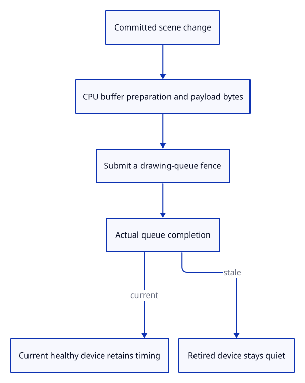

# 4.2.32 · Measure upload preparation and GPU completion

**Chapter 4 · Browser lifetime and recovery · Section 4.2 · GPU diagnostics and recovery** · [Contents](contents.md)

**Typing: 13–26 minutes.** [Estimate](typing-load.md).

Measure scene synchronization on the CPU, then fence the drawing queue. Append completion only while the same healthy device still owns the page.

## Type

Continue from [Measure each document preparation phase](34gdea-import.md). [Save or recover your work](recovery.md).

### 1. `src/geometry_cache.rs`

Count actual geometry payload, independently of resident buffer sizes. Advance only when a new geometry buffer is initialized.

<details>
<summary>Locate the existing block</summary>

```rust
use crate::{gpu_geometry::GpuGeometry, mesh::Mesh};
use std::{collections::HashMap, rc::{Rc, Weak}};

#[derive(Default)]
pub struct GeometryCache {
    entries: HashMap<*const Mesh, Weak<GpuGeometry>>,
    pub uploads: usize,
}

impl GeometryCache {
    pub fn get(&mut self, device: &wgpu::Device, source: &Rc<Mesh>) -> Rc<GpuGeometry> {
        let key = Rc::as_ptr(source);
        if let Some(geometry) = self.entries.get(&key).and_then(Weak::upgrade) {
            return geometry;
        }
        let geometry = Rc::new(GpuGeometry::upload(device, Rc::clone(source)));
        self.entries.insert(key, Rc::downgrade(&geometry));
        self.uploads += 1;
        geometry
    }

    pub fn prune(&mut self) {
        self.entries.retain(|_, geometry| geometry.strong_count() > 0);
    }

    pub fn entries(&self) -> usize { self.entries.len() }
}
```

</details>

Edit the existing block to match this code; keep unchanged lines:

```rust
use crate::{gpu_geometry::GpuGeometry, mesh::Mesh};
use std::{collections::HashMap, rc::{Rc, Weak}};

#[derive(Default)]
pub struct GeometryCache {
    entries: HashMap<*const Mesh, Weak<GpuGeometry>>,
    pub uploads: usize,
    pub uploaded_bytes: u64,
}

impl GeometryCache {
    pub fn get(&mut self, device: &wgpu::Device, source: &Rc<Mesh>) -> Rc<GpuGeometry> {
        let key = Rc::as_ptr(source);
        if let Some(geometry) = self.entries.get(&key).and_then(Weak::upgrade) {
            return geometry;
        }
        let geometry = Rc::new(GpuGeometry::upload(device, Rc::clone(source)));
        self.entries.insert(key, Rc::downgrade(&geometry));
        self.uploads += 1;
        self.uploaded_bytes += (source.vertices().len() * 24 + source.indices().len() * 2) as u64;
        geometry
    }

    pub fn prune(&mut self) {
        self.entries.retain(|_, geometry| geometry.strong_count() > 0);
    }

    pub fn entries(&self) -> usize { self.entries.len() }
}
```

<details>
<summary>Optional patch references</summary>

Use these original edit fragments when comparing a saved checkpoint. Apply the complete blocks above.

```text
--8<-- "journey/code/34gdf-upload-01.rs"
```

```text
--8<-- "journey/code/34gdf-upload-02.rs"
```

</details>

### 2. `src/renderer.rs`

Include initialized object settings and subsequent writes, excluding camera uniforms.

<details>
<summary>Locate the existing block</summary>

```rust
    pub fn stats(&self) -> [usize; 4] {
```

</details>

Edit the existing block to match this code; keep unchanged lines:

```rust
    pub fn uploaded_bytes(&self) -> u64 {
        self.geometry.uploaded_bytes + self.settings_allocations as u64 * 80 + self.settings_bytes as u64
    }

    pub fn stats(&self) -> [usize; 4] {
```

<details>
<summary>Optional patch references</summary>

Use these original edit fragments when comparing a saved checkpoint. Apply the complete blocks above.

```text
--8<-- "journey/code/34gdf-upload-03.rs"
```

</details>

### 3. `src/browser_upload.rs`

Fence the drawing queue and reject completion from a retired or failed device.

Create the file and type:

```rust
--8<-- "journey/code/34gdf-upload-04.rs"
```

### 4. `src/lib.rs`

Register the browser-only queue boundary.

<details>
<summary>Locate the existing block</summary>

```rust
#[cfg(target_arch = "wasm32")]
mod browser_phase;
```

</details>

Edit the existing block to match this code; keep unchanged lines:

```rust
#[cfg(target_arch = "wasm32")]
mod browser_upload;
#[cfg(target_arch = "wasm32")]
mod browser_phase;
```

<details>
<summary>Optional patch references</summary>

Use these original edit fragments when comparing a saved checkpoint. Apply the complete blocks above.

```text
--8<-- "journey/code/34gdf-upload-05.rs"
```

</details>

### 5. `src/browser.rs`

Measure successful scene synchronization after the editor transaction commits.

<details>
<summary>Locate the existing block</summary>

```rust
                Ok(Some(Change::Scene)) => {
                    renderer.set_scene(&editor.scene, editor.selected);
```

</details>

Edit the existing block to match this code; keep unchanged lines:

```rust
                Ok(Some(Change::Scene)) => {
                    crate::browser_upload::prepare(&mut renderer, &editor.scene, editor.selected, active_fault.clone());
```

<details>
<summary>Optional patch references</summary>

Use these original edit fragments when comparing a saved checkpoint. Apply the complete blocks above.

```text
--8<-- "journey/code/34gdf-upload-06.rs"
```

</details>

## Run and check

In your project:

```sh
cd workspace/journey
REGEN_PROTO=0 cargo build --lib --locked --target wasm32-unknown-unknown -j1
REGEN_PROTO=0 CARGO_BUILD_JOBS=1 trunk serve --port 8780
```

Open `http://127.0.0.1:8780/`. Keep an existing Trunk server running; saving rebuilds it.

Open a file and type `Report`. The document phases are followed by `upload preparation` and `GPU upload ready`.

### Recorded visual result

**Previous native render — current verification pending.**


*This recorded image predates a source or checker change. Rebuild this checkpoint before using it as current evidence; browser controls require separate acceptance.*

This reference image is shared with [4.2.18 · Own diagnostic page transitions](34gba-lifecycle.md). It does not demonstrate a new feature by itself.

<details>
<summary>Code explanation and diagram</summary>

Count initialized vertex, index and object-setting bytes, plus later settings writes. Exclude allocation padding and camera uniforms. Queue completion includes prior queued work; it is not an isolated upload benchmark.

scene change → uploaded payload counter → CPU preparation → queue fence → current-device completion.



Does queue completion measure only the upload?

No. It includes earlier queued work and callback delivery. Report it separately from CPU preparation rather than calling it an isolated transfer speed.

Study estimate, including typing and experiments: 0.5–1 hours.

</details>

<details>
<summary>Optional experiment</summary>

Undo and Redo the import. Reused geometry avoids another vertex upload; only changed object settings are counted.

</details>

<details>
<summary>Check and save your work</summary>

Restore experimental edits, then run from `session_viewer`:

```sh
npm --prefix ../session_tests run course -- check 4.2.32
npm --prefix ../session_tests run course -- save 4.2.32
```

Source comparison leaves your project untouched. [Save and recovery instructions](recovery.md).

</details>

<details>
<summary>Viewer coverage and verification</summary>

This measures scene buffer preparation and a completion fence on the actual drawing device. Camera frames are not scene uploads.

The native GPU fixture checks exact upload counters and reuse. Chrome checks real queue calls, delayed completion, typed reports, invalid imports and stale callbacks.

Chrome holds the actual drawing queue’s completion promise, checks measured bytes, and discards completion from exited, lost or replaced runtimes.

[Full validation scope](release.md).

To reproduce the scripted acceptance of the reference checkpoint, run from `session_viewer` with the [course bundle server](release.md#reproduce) running on port 8781:

```sh
npm --prefix ../session_tests run course -- capture 4.2.32
```

This uses the verified reference bundle; it does not check or change your typed project.

</details>
