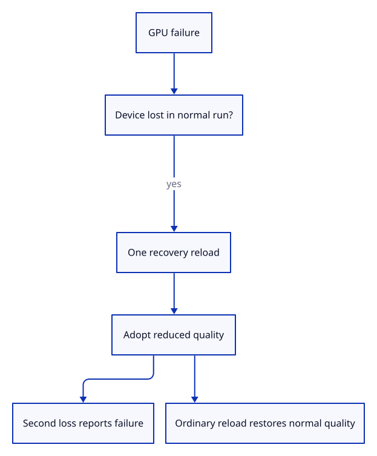

# 4.2.36 · Permit one conservative recovery reload

**Chapter 4 · Browser lifetime and recovery · Section 4.2 · GPU diagnostics and recovery** · [Contents](contents.md)

**Typing: 5–9 minutes.** [Estimate](typing-load.md).

Permit recovery only for device loss and only once. A recovered page starts with reduced quality and refuses another automatic reload.

## Type

Continue from [Keep the document outside the GPU runtime](34ge-owner.md). [Save or recover your work](recovery.md).

### 1. `src/recovery.rs`

Permit one recovery only for a normal run that lost its device.

Create the file and type:

```rust
--8<-- "journey/code/34gea-policy-01.rs"
```

### 2. `src/lib.rs`

Register the one-reload policy and its tests.

<details>
<summary>Locate the existing block</summary>

```rust
pub mod drawing_document;
```

</details>

Edit the existing block to match this code; keep unchanged lines:

```rust
pub mod recovery;
#[cfg(test)]
mod recovery_tests;
pub mod drawing_document;
```

<details>
<summary>Optional patch references</summary>

Use these original edit fragments when comparing a saved checkpoint. Apply the complete blocks above.

```text
--8<-- "journey/code/34gea-policy-02.rs"
```

</details>

<details>
<summary>Supplied validation fixture</summary>

Copy this supplied authoring fixture once. Continue with the browser build below; the course does not require running native tests.

### 3. `src/recovery_tests.rs`

Copy normal, duplicate, recovered and fresh-run checks.

Copy this supplied file:

```text
--8<-- "journey/code/34gea-policy-03.rs"
```

</details>

## Run and check

In your project:

```sh
cd workspace/journey
REGEN_PROTO=0 cargo build --lib --locked --target wasm32-unknown-unknown -j1
REGEN_PROTO=0 CARGO_BUILD_JOBS=1 trunk serve --port 8780
```

Open `http://127.0.0.1:8780/`. Keep an existing Trunk server running; saving rebuilds it.

Run the policy checks. Normal runs permit one device-loss reload; recovered runs refuse another.

### Recorded visual result

**Previous native render — current verification pending.**


*This recorded image predates a source or checker change. Rebuild this checkpoint before using it as current evidence; browser controls require separate acceptance.*

This reference image is shared with [4.2.18 · Own diagnostic page transitions](34gba-lifecycle.md). It does not demonstrate a new feature by itself.

<details>
<summary>Code explanation and diagram</summary>

The policy contains no browser or document handles. Native checks exercise normal, pending and recovered runs. The next lesson connects this decision to the actual URL, saved diagnostic and canvas density.

device loss → one reload request → adopted recovery → reduced quality → next ordinary reload.



Why refuse another recovery when the page is already reduced?

Repeated losses can otherwise create an endless reload loop. A recovered run keeps its diagnostic and reports a second loss without another automatic reload.

Study estimate, including typing and experiments: 0.25–0.5 hours.

</details>

<details>
<summary>Optional experiment</summary>

Request recovery for a validation error, then for device loss. Only the device-loss request is accepted.

</details>

<details>
<summary>Check and save your work</summary>

Restore experimental edits, then run from `session_viewer`:

```sh
npm --prefix ../session_tests run course -- check 4.2.36
npm --prefix ../session_tests run course -- save 4.2.36
```

Source comparison leaves your project untouched. [Save and recovery instructions](recovery.md).

</details>

<details>
<summary>Viewer coverage and verification</summary>

This follows production’s one-reload recovery policy. Reduced quality lasts until the next ordinary reload; it does not preserve unsaved editor state across a page reload.

Native checks reject unrelated errors, duplicate requests and repeated recovery; a fresh policy restores normal quality.

Chrome repeats the preceding telemetry route while the one-reload policy is introduced.

[Full validation scope](release.md).

To reproduce the scripted acceptance of the reference checkpoint, run from `session_viewer` with the [course bundle server](release.md#reproduce) running on port 8781:

```sh
npm --prefix ../session_tests run course -- capture 4.2.36
```

This uses the verified reference bundle; it does not check or change your typed project.

</details>
