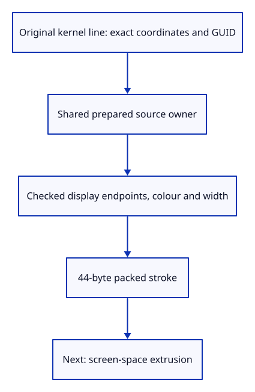

# 5.1.1 · Prepare a stroke without changing its source

**Chapter 5 · Lines, points and curves · Section 5.1 · Original lines** · [Contents](contents.md)

**Typing: 14–27 minutes.** [Estimate](typing-load.md).

Prepare one line for display while keeping its original kernel owner. Store two finite endpoints, colour and a width measured in screen pixels.

## Type

Continue from [Recover once at reduced canvas density](34geb-reload.md). [Save or recover your work](recovery.md).

### 1. `src/stroke.rs`

Keep exact kernel ownership separate from a checked packed display record.

Create the file and type:

```rust
--8<-- "journey/code/35-stroke-01.rs"
```

### 2. `src/lib.rs`

Register stroke preparation and its checks.

<details>
<summary>Locate the existing block</summary>

```rust
pub mod mesh;
```

</details>

Edit the existing block to match this code; keep unchanged lines:

```rust
pub mod stroke;
#[cfg(test)]
mod stroke_tests;
pub mod mesh;
```

<details>
<summary>Optional patch references</summary>

Use these original edit fragments when comparing a saved checkpoint. Apply the complete blocks above.

```text
--8<-- "journey/code/35-stroke-02.rs"
```

</details>

<details>
<summary>Supplied validation fixture</summary>

Copy this supplied authoring fixture once. Continue with the browser build below; the course does not require running native tests.

### 3. `src/stroke_tests.rs`

Copy source ownership, packed layout and invalid-display checks.

Copy this supplied file:

```text
--8<-- "journey/code/35-stroke-03.rs"
```

</details>

## Run and check

In your project:

```sh
cd workspace/journey
REGEN_PROTO=0 cargo build --lib --locked --target wasm32-unknown-unknown -j1
REGEN_PROTO=0 CARGO_BUILD_JOBS=1 trunk serve --port 8780
```

Open `http://127.0.0.1:8780/`. Keep an existing Trunk server running; saving rebuilds it.

The packed stroke record is 44 bytes; exact source coordinates, GUID and colour remain available. This prepares the source owner; the later stroke pipeline connects it to browser drawing.

### Recorded visual result

**Previous native render — current verification pending.**


*This recorded image predates a source or checker change. Rebuild this checkpoint before using it as current evidence; browser controls require separate acceptance.*

This reference image is shared with [4.2.18 · Own diagnostic page transitions](34gba-lifecycle.md). It does not demonstrate a new feature by itself.

<details>
<summary>Code explanation and diagram</summary>

Packing changes display precision only. Invalid coordinates or widths fail before GPU allocation. A zero-length line remains a valid source; the later shader suppresses its empty stroke. Width zero, negative or nonfinite uses the default pen, matching production.

kernel Line → source owner → display record → checked packed bytes → later GPU lane.



Why retain the original line after packing its endpoints into floats?

Display floats cannot preserve exact coordinates or source metadata. Editing and saving must continue to use the original kernel line.

Study estimate, including typing and experiments: 0.5–1 hours.

</details>

<details>
<summary>Optional experiment</summary>

Prepare the same shared line twice and drop one prepared owner. Both used the same source; the other owner still retains it.

</details>

<details>
<summary>Check and save your work</summary>

Restore experimental edits, then run from `session_viewer`:

```sh
npm --prefix ../session_tests run course -- check 5.1.1
npm --prefix ../session_tests run course -- save 5.1.1
```

Source comparison leaves your project untouched. [Save and recovery instructions](recovery.md).

</details>

<details>
<summary>Viewer coverage and verification</summary>

The drawing is unchanged in this preparation step. The next stroke lessons connect this record to screen-space extrusion and a GPU lane; joins, depth visibility and picking follow.

Native tests check packed layout, exact source ownership/precision, width defaults and display-range rejection. Native GPU and Chrome preserve the preceding endpoint.

Chrome repeats the verified recovery route while stroke preparation adds no drawing or input behavior.

[Full validation scope](release.md).

To reproduce the scripted acceptance of the reference checkpoint, run from `session_viewer` with the [course bundle server](release.md#reproduce) running on port 8781:

```sh
npm --prefix ../session_tests run course -- capture 5.1.1
```

This uses the verified reference bundle; it does not check or change your typed project.

</details>
