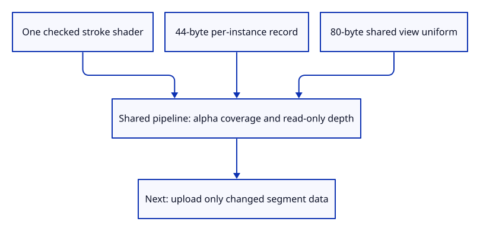

# 5.1.4 · Create the shared stroke pipeline

**Chapter 5 · Lines, points and curves · Section 5.1 · Original lines** · [Contents](contents.md)

**Typing: 24–48 minutes.** [Estimate](typing-load.md).

Create a shared stroke pipeline with an instance record for each segment. The shader generates six corners; the batch supplies endpoints, colour and width.

## Type

Continue from [Extrude a stroke in screen pixels](35b-extrude.md). [Save or recover your work](recovery.md).

### 1. `src/stroke_gpu.rs`

Create one depth-tested instanced lane with alpha coverage and its own view binding.

Create the file and type:

```rust
--8<-- "journey/code/35c-lane-01.rs"
```

### 2. `src/lib.rs`

Register the shared GPU lane.

<details>
<summary>Locate the existing block</summary>

```rust
pub mod stroke;
```

</details>

Edit the existing block to match this code; keep unchanged lines:

```rust
pub mod stroke_gpu;
pub mod stroke;
```

<details>
<summary>Optional patch references</summary>

Use these original edit fragments when comparing a saved checkpoint. Apply the complete blocks above.

```text
--8<-- "journey/code/35c-lane-02.rs"
```

</details>

## Run and check

In your project:

```sh
cd workspace/journey
REGEN_PROTO=0 cargo build --lib --locked --target wasm32-unknown-unknown -j1
REGEN_PROTO=0 CARGO_BUILD_JOBS=1 trunk serve --port 8780
```

Open `http://127.0.0.1:8780/`. Keep an existing Trunk server running; saving rebuilds it.

Build and open the viewer. The existing mesh picture still works; the shared stroke pipeline is ready for drawing in the following checkpoints.

### Recorded visual result

**Previous native render — current verification pending.**


*This recorded image predates a source or checker change. Rebuild this checkpoint before using it as current evidence; browser controls require separate acceptance.*

This reference image is shared with [4.2.18 · Own diagnostic page transitions](34gba-lifecycle.md). It does not demonstrate a new feature by itself.

<details>
<summary>Code explanation and diagram</summary>

Use alpha blending for the shader’s edge coverage and the existing depth format without writing stroke depth. A separate view binding holds the matrix, viewport and density. Allocate segment buffers only when the lane receives data.

checked shader → instance layout → shared view binding → alpha coverage → depth-tested lane.



Why use six generated vertices and one instance record per segment?

Every segment uses the same two-triangle shape. Its endpoints and style change per instance, so no separate mesh or pipeline is needed for each line.

Study estimate, including typing and experiments: 0.75–1.25 hours.

</details>

<details>
<summary>Optional experiment</summary>

Compare the 44-byte instance attributes with the packed stroke record: positions occupy the first 24 bytes, followed by colour and width. The reference GPU fixture validates this layout and the 80-byte view uniform.

From `session_viewer`, run `npm --prefix ../session_tests run course -- verify 35c-lane` to reproduce that reference check. It reconstructs the canonical checkpoint under `target`; it does not test or change your handwritten project. Compare your source with `course -- check 35c-lane` and run your project separately.

</details>

<details>
<summary>Check and save your work</summary>

Restore experimental edits, then run from `session_viewer`:

```sh
npm --prefix ../session_tests run course -- check 5.1.4
npm --prefix ../session_tests run course -- save 5.1.4
```

Source comparison leaves your project untouched. [Save and recovery instructions](recovery.md).

</details>

<details>
<summary>Viewer coverage and verification</summary>

The lane is created once and starts empty. Buffer synchronization and visible drawing are connected next.

The native GPU fixture constructs the actual pipeline under a validation scope. Existing native tests and Chrome keep the preceding route.

The actual native drawing device validates the pipeline; Chrome keeps the preceding behavior until synchronization is connected.

[Full validation scope](release.md).

To reproduce the scripted acceptance of the reference checkpoint, run from `session_viewer` with the [course bundle server](release.md#reproduce) running on port 8781:

```sh
npm --prefix ../session_tests run course -- capture 5.1.4
```

This uses the verified reference bundle; it does not check or change your typed project.

</details>
