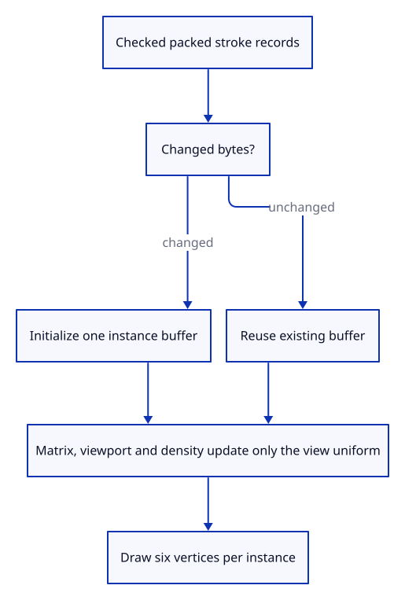

# 5.1.5 · Upload changed stroke instances only

**Chapter 5 · Lines, points and curves · Section 5.1 · Original lines** · [Contents](contents.md)

**Typing: 18–36 minutes.** [Estimate](typing-load.md).

Upload a stroke batch only when its checked packed bytes change. Keep camera, viewport and density in the shared uniform instead of rebuilding segment vertices.

## Type

Continue from [Create the shared stroke pipeline](35c-lane.md). [Save or recover your work](recovery.md).

### 1. `src/stroke_gpu.rs`

Keep segment uploads separate from camera uniforms and release empty batches.

<details>
<summary>Locate the existing block</summary>

```rust
impl Lane {
    pub fn new(device: &wgpu::Device, format: wgpu::TextureFormat) -> Self {
```

</details>

Edit the existing block to match this code; keep unchanged lines:

```rust
impl Lane {
    pub fn set(&mut self, device: &wgpu::Device, strokes: impl IntoIterator<Item = crate::stroke::Stroke>) -> Result<(), &'static str> {
        use wgpu::util::DeviceExt;
        let mut data = Vec::new();
        for stroke in strokes {
            if stroke.width <= 0.0 || stroke.values().iter().any(|value| !value.is_finite()) {
                return Err("Invalid stroke display data");
            }
            data.extend(stroke.bytes());
        }
        u32::try_from(data.len() / 44).map_err(|_| "Too many stroke instances")?;
        if data == self.data { return Ok(()); }
        self.vertices = if data.is_empty() { None } else {
            self.uploads += 1; self.uploaded_bytes += data.len() as u64;
            Some(device.create_buffer_init(&wgpu::util::BufferInitDescriptor {
                label: Some("stroke instances"), contents: &data, usage: wgpu::BufferUsages::VERTEX,
            }))
        };
        self.data = data; Ok(())
    }

    pub fn view(&self, queue: &wgpu::Queue, transform: &[f32; 16], size: [u32; 2], density: f32) {
        if self.vertices.is_none() { return; }
        let bytes: Vec<u8> = transform.iter().copied().chain([size[0] as f32, size[1] as f32, density, 0.0])
            .flat_map(f32::to_ne_bytes).collect();
        queue.write_buffer(&self.uniform, 0, &bytes);
    }

    pub fn draw(&self, pass: &mut wgpu::RenderPass<'_>) {
        let Some(vertices) = &self.vertices else { return; };
        pass.set_pipeline(&self.pipeline); pass.set_bind_group(0, &self.group, &[]);
        pass.set_vertex_buffer(0, vertices.slice(..)); pass.draw(0..6, 0..(self.data.len() / 44) as u32);
    }

    pub fn usage(&self) -> [u64; 2] {
        [self.data.len() as u64 / 44, self.vertices.as_ref().map_or(0, wgpu::Buffer::size)]
    }

    pub fn new(device: &wgpu::Device, format: wgpu::TextureFormat) -> Self {
```

<details>
<summary>Optional patch references</summary>

Use these original edit fragments when comparing a saved checkpoint. Apply the complete blocks above.

```text
--8<-- "journey/code/35ca-sync-01.rs"
```

</details>

## Run and check

In your project:

```sh
cd workspace/journey
REGEN_PROTO=0 cargo build --lib --locked --target wasm32-unknown-unknown -j1
REGEN_PROTO=0 CARGO_BUILD_JOBS=1 trunk serve --port 8780
```

Open `http://127.0.0.1:8780/`. Keep an existing Trunk server running; saving rebuilds it.

Inspect the supplied state fixtures and open the viewer. The stroke lane can now upload and retain checked display records; actual scene drawing follows next.

### Recorded visual result

**Previous native render — current verification pending.**


*This recorded image predates a source or checker change. Rebuild this checkpoint before using it as current evidence; browser controls require separate acceptance.*

This reference image is shared with [4.2.18 · Own diagnostic page transitions](34gba-lifecycle.md). It does not demonstrate a new feature by itself.

<details>
<summary>Code explanation and diagram</summary>

An empty batch drops its buffer. Invalid data leaves the existing batch unchanged. Native GPU renders measure anti-aliased width in linear colour space and verify buffer reuse, exact payload accounting and release.

checked packed strokes → changed bytes → one GPU buffer → view-only updates → six vertices per instance.



Why compare packed data before replacing the vertex buffer?

Camera and unrelated mesh edits do not change stroke endpoints or style. Reusing the buffer avoids uploading the same data on every interaction.

Study estimate, including typing and experiments: 0.75–1.25 hours.

</details>

<details>
<summary>Optional experiment</summary>

The reference GPU fixture checks pen width in both projections at two zooms and DPR1/2, unchanged uploads for an identical batch and camera-only changes, and buffer release on clear.

From `session_viewer`, run `npm --prefix ../session_tests run course -- verify 35ca-sync` to reproduce that reference check. It reconstructs the canonical checkpoint under `target`; it does not test or change your handwritten project. Compare your source with `course -- check 35ca-sync` and run your project separately.

</details>

<details>
<summary>Check and save your work</summary>

Restore experimental edits, then run from `session_viewer`:

```sh
npm --prefix ../session_tests run course -- check 5.1.5
npm --prefix ../session_tests run course -- save 5.1.5
```

Source comparison leaves your project untouched. [Save and recovery instructions](recovery.md).

</details>

<details>
<summary>Viewer coverage and verification</summary>

The lane renders real instances here. The following lesson connects it to the document renderer and browser events.

Twenty-four native GPU renders measure widths 1/3/9 across zoom, projection and density. Buffer reuse, finite input refusal and empty-buffer release also pass; browser-visible strokes follow next.

Native GPU renders verify the actual lane; Chrome preserves the preceding viewer while document wiring follows.

[Full validation scope](release.md).

To reproduce the scripted acceptance of the reference checkpoint, run from `session_viewer` with the [course bundle server](release.md#reproduce) running on port 8781:

```sh
npm --prefix ../session_tests run course -- capture 5.1.5
```

This uses the verified reference bundle; it does not check or change your typed project.

</details>
