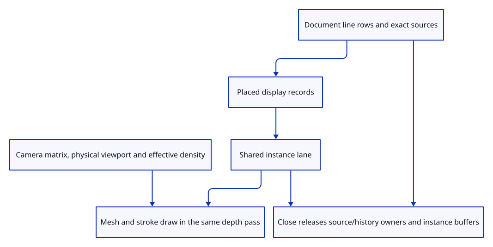

# 5.1.6 · Connect the stroke lane to the document renderer

**Chapter 5 · Lines, points and curves · Section 5.1 · Original lines** · [Contents](contents.md)

**Typing: 25–49 minutes.** [Estimate](typing-load.md).

Synchronize placed line records when the scene changes, then draw their shared lane in the existing depth pass. Camera changes update uniforms while vertex data stays resident.

## Type

Continue from [Upload changed stroke instances only](35ca-sync.md). [Save or recover your work](recovery.md).

### 1. `src/renderer.rs`

Retain one stroke lane and the physical view dimensions. Create the shared lane with the actual drawing device. Initialize native view size and default density. Keep physical viewport dimensions beside the shared depth texture. Reuse unchanged strokes and expose exact instance-buffer accounting. Include stroke payloads in measured scene upload bytes. Update camera and density separately from segment vertices. Use the same scene depth when drawing the stroke batch.

Edit these blocks from bottom to top. Keep the surrounding lines unchanged.

<details>
<summary>Locate this block</summary>

```rust
            for mesh in &self.meshes {
                mesh.draw(&mut pass);
            }
        }
        self.queue.submit([encoder.finish()]);
    }
```

</details>

Replace it with:

```rust
            for mesh in &self.meshes {
                mesh.draw(&mut pass);
            }
            self.strokes.draw(&mut pass);
        }
        self.queue.submit([encoder.finish()]);
    }
```

<details>
<summary>Locate this block</summary>

```rust
    ) {
        let bytes: Vec<u8> = transform.iter().flat_map(|value| value.to_ne_bytes()).collect();
        self.queue.write_buffer(&self.uniform, 0, &bytes);
        let [r, g, b] = background.rgb();
        let mut encoder = self.device.create_command_encoder(&Default::default());
        {
```

</details>

Replace it with:

```rust
    ) {
        let bytes: Vec<u8> = transform.iter().flat_map(|value| value.to_ne_bytes()).collect();
        self.queue.write_buffer(&self.uniform, 0, &bytes);
        self.strokes.view(&self.queue, transform, self.size, self.density);
        let [r, g, b] = background.rgb();
        let mut encoder = self.device.create_command_encoder(&Default::default());
        {
```

<details>
<summary>Locate this block</summary>

```rust

    pub fn uploaded_bytes(&self) -> u64 {
        self.geometry.uploaded_bytes + self.settings_allocations as u64 * 80 + self.settings_bytes as u64
    }

    pub fn stats(&self) -> [usize; 4] {
```

</details>

Replace it with:

```rust

    pub fn uploaded_bytes(&self) -> u64 {
        self.geometry.uploaded_bytes + self.settings_allocations as u64 * 80 + self.settings_bytes as u64
            + self.strokes.uploaded_bytes
    }

    pub fn stats(&self) -> [usize; 4] {
```

<details>
<summary>Locate this block</summary>

```rust
    }

    pub fn resize(&mut self, size: crate::viewport::Viewport) {
        self.depth = Self::depth(&self.device, size.width, size.height);
    }

    pub fn set_scene(&mut self, scene: &Scene, selected: Option<ObjectId>) {
        let layout = self.pipeline.get_bind_group_layout(1);
        let mut old = std::mem::take(&mut self.meshes);
        for object in scene.objects() {
```

</details>

Replace it with:

```rust
    }

    pub fn resize(&mut self, size: crate::viewport::Viewport) {
        self.size = [size.width, size.height];
        self.depth = Self::depth(&self.device, size.width, size.height);
    }

    pub fn set_density(&mut self, density: f32) {
        if density.is_finite() && density > 0.0 { self.density = density; }
    }

    pub fn stroke_usage(&self) -> [u64; 4] {
        let [count, bytes] = self.strokes.usage();
        [count, bytes, self.strokes.uploads, self.strokes.uploaded_bytes]
    }

    pub fn set_scene(&mut self, scene: &Scene, selected: Option<ObjectId>) {
        self.strokes.set(&self.device, scene.lines().iter().map(crate::scene::LineObject::stroke))
            .expect("Prepared line placement fits the display range");
        let layout = self.pipeline.get_bind_group_layout(1);
        let mut old = std::mem::take(&mut self.meshes);
        for object in scene.objects() {
```

<details>
<summary>Locate this block</summary>

```rust
            }],
        });
        let depth = Self::depth(&device, 640, 480);
        let mut renderer = Self { device, queue, pipeline, meshes: Vec::new(),
            geometry: Default::default(), settings_allocations: 0, settings_writes: 0,
            settings_bytes: 0, uniform, view_group, depth };
        renderer.set_scene(scene, None);
        renderer
    }
```

</details>

Replace it with:

```rust
            }],
        });
        let depth = Self::depth(&device, 640, 480);
        let strokes = crate::stroke_gpu::Lane::new(&device, format);
        let mut renderer = Self { device, queue, pipeline, meshes: Vec::new(),
            geometry: Default::default(), settings_allocations: 0, settings_writes: 0,
            settings_bytes: 0, uniform, view_group, depth, strokes, size: [640, 480], density: 1.0 };
        renderer.set_scene(scene, None);
        renderer
    }
```

<details>
<summary>Locate this block</summary>

```rust
    uniform: wgpu::Buffer,
    view_group: wgpu::BindGroup,
    depth: wgpu::TextureView,
}

impl Renderer {
```

</details>

Replace it with:

```rust
    uniform: wgpu::Buffer,
    view_group: wgpu::BindGroup,
    depth: wgpu::TextureView,
    strokes: crate::stroke_gpu::Lane,
    size: [u32; 2],
    density: f32,
}

impl Renderer {
```

<details>
<summary>Complete updated block reference</summary>

```rust
use crate::{gpu_mesh::GpuMesh, scene::{ObjectId, Scene}};

pub struct Renderer {
    pub device: wgpu::Device,
    pub queue: wgpu::Queue,
    pipeline: wgpu::RenderPipeline,
    meshes: Vec<GpuMesh>,
    geometry: crate::geometry_cache::GeometryCache,
    settings_allocations: usize,
    settings_writes: usize,
    settings_bytes: usize,
    uniform: wgpu::Buffer,
    view_group: wgpu::BindGroup,
    depth: wgpu::TextureView,
    strokes: crate::stroke_gpu::Lane,
    size: [u32; 2],
    density: f32,
}

impl Renderer {
    pub fn new(
        device: wgpu::Device,
        queue: wgpu::Queue,
        format: wgpu::TextureFormat,
        scene: &Scene,
    ) -> Self {
        let shader = device.create_shader_module(wgpu::ShaderModuleDescriptor {
            label: Some("triangle"),
            source: wgpu::ShaderSource::Wgsl(include_str!("triangle.wgsl").into()),
        });
        let pipeline = device.create_render_pipeline(&wgpu::RenderPipelineDescriptor {
            label: Some("triangle"),
            layout: None,
            vertex: wgpu::VertexState {
                module: &shader,
                entry_point: Some("vertex"),
                compilation_options: Default::default(),
                buffers: &[wgpu::VertexBufferLayout {
                    array_stride: 24,
                    step_mode: wgpu::VertexStepMode::Vertex,
                    attributes: &wgpu::vertex_attr_array![0 => Float32x3, 1 => Float32x3],
                }],
            },
            fragment: Some(wgpu::FragmentState {
                module: &shader,
                entry_point: Some("fragment"),
                compilation_options: Default::default(),
                targets: &[Some(format.into())],
            }),
            primitive: Default::default(),
            depth_stencil: Some(wgpu::DepthStencilState {
                format: wgpu::TextureFormat::Depth32Float,
                depth_write_enabled: Some(true),
                depth_compare: Some(wgpu::CompareFunction::Less),
                stencil: Default::default(),
                bias: Default::default(),
            }),
            multisample: Default::default(),
            multiview_mask: None,
            cache: None,
        });
        let uniform = device.create_buffer(&wgpu::BufferDescriptor {
            label: Some("view transform"),
            size: 64,
            usage: wgpu::BufferUsages::UNIFORM | wgpu::BufferUsages::COPY_DST,
            mapped_at_creation: false,
        });
        let view_group = device.create_bind_group(&wgpu::BindGroupDescriptor {
            label: Some("view settings"),
            layout: &pipeline.get_bind_group_layout(0),
            entries: &[wgpu::BindGroupEntry {
                binding: 0,
                resource: uniform.as_entire_binding(),
            }],
        });
        let depth = Self::depth(&device, 640, 480);
        let strokes = crate::stroke_gpu::Lane::new(&device, format);
        let mut renderer = Self { device, queue, pipeline, meshes: Vec::new(),
            geometry: Default::default(), settings_allocations: 0, settings_writes: 0,
            settings_bytes: 0, uniform, view_group, depth, strokes, size: [640, 480], density: 1.0 };
        renderer.set_scene(scene, None);
        renderer
    }

    fn depth(device: &wgpu::Device, width: u32, height: u32) -> wgpu::TextureView {
        let depth_texture = device.create_texture(&wgpu::TextureDescriptor {
            label: Some("opaque depth"),
            size: wgpu::Extent3d { width, height, depth_or_array_layers: 1 },
            mip_level_count: 1,
            sample_count: 1,
            dimension: wgpu::TextureDimension::D2,
            format: wgpu::TextureFormat::Depth32Float,
            usage: wgpu::TextureUsages::RENDER_ATTACHMENT,
            view_formats: &[],
        });
        depth_texture.create_view(&Default::default())
    }

    pub fn resize(&mut self, size: crate::viewport::Viewport) {
        self.size = [size.width, size.height];
        self.depth = Self::depth(&self.device, size.width, size.height);
    }

    pub fn set_density(&mut self, density: f32) {
        if density.is_finite() && density > 0.0 { self.density = density; }
    }

    pub fn stroke_usage(&self) -> [u64; 4] {
        let [count, bytes] = self.strokes.usage();
        [count, bytes, self.strokes.uploads, self.strokes.uploaded_bytes]
    }

    pub fn set_scene(&mut self, scene: &Scene, selected: Option<ObjectId>) {
        self.strokes.set(&self.device, scene.lines().iter().map(crate::scene::LineObject::stroke))
            .expect("Prepared line placement fits the display range");
        let layout = self.pipeline.get_bind_group_layout(1);
        let mut old = std::mem::take(&mut self.meshes);
        for object in scene.objects() {
            let matching = old.iter().position(|row| row.id == object.id
                && std::rc::Rc::ptr_eq(&row.geometry.source, &object.mesh));
            let row = if let Some(index) = matching {
                let mut row = old.swap_remove(index);
                let [calls, bytes] = row.update(&self.queue, object, selected == Some(object.id));
                self.settings_writes += calls;
                self.settings_bytes += bytes;
                row
            } else {
                let geometry = self.geometry.get(&self.device, &object.mesh);
                self.settings_allocations += 1;
                GpuMesh::with_geometry(&self.device, &layout, object,
                    selected == Some(object.id), geometry)
            };
            self.meshes.push(row);
        }
        drop(old);
        self.geometry.prune();
    }

    pub fn geometry_owners(&self) -> impl Iterator<Item = &std::rc::Rc<crate::gpu_geometry::GpuGeometry>> {
        self.meshes.iter().map(|row| &row.geometry)
    }

    pub fn usage(&self) -> [u64; 4] { crate::memory::gpu(&self.meshes) }

    pub fn uploaded_bytes(&self) -> u64 {
        self.geometry.uploaded_bytes + self.settings_allocations as u64 * 80 + self.settings_bytes as u64
            + self.strokes.uploaded_bytes
    }

    pub fn stats(&self) -> [usize; 4] {
        [self.geometry.uploads, self.settings_allocations, self.settings_writes, self.settings_bytes]
    }

    pub fn draw(
        &self,
        view: &wgpu::TextureView,
        background: &crate::background::Background,
        transform: &[f32; 16],
    ) {
        let bytes: Vec<u8> = transform.iter().flat_map(|value| value.to_ne_bytes()).collect();
        self.queue.write_buffer(&self.uniform, 0, &bytes);
        self.strokes.view(&self.queue, transform, self.size, self.density);
        let [r, g, b] = background.rgb();
        let mut encoder = self.device.create_command_encoder(&Default::default());
        {
            // The pass borrows the encoder. This scope ends that borrow before finish takes it.
            let mut pass = encoder.begin_render_pass(&wgpu::RenderPassDescriptor {
                label: Some("canvas"),
                depth_stencil_attachment: Some(wgpu::RenderPassDepthStencilAttachment {
                    view: &self.depth,
                    depth_ops: Some(wgpu::Operations {
                        load: wgpu::LoadOp::Clear(1.0),
                        store: wgpu::StoreOp::Store,
                    }),
                    stencil_ops: None,
                }),
                color_attachments: &[Some(wgpu::RenderPassColorAttachment {
                    view,
                    depth_slice: None,
                    resolve_target: None,
                    ops: wgpu::Operations {
                        load: wgpu::LoadOp::Clear(wgpu::Color {
                            r, g, b, a: 1.0,
                        }),
                        store: wgpu::StoreOp::Store,
                    },
                })],
                ..Default::default()
            });
            pass.set_pipeline(&self.pipeline);
            pass.set_bind_group(0, &self.view_group, &[]);
            for mesh in &self.meshes {
                mesh.draw(&mut pass);
            }
            self.strokes.draw(&mut pass);
        }
        self.queue.submit([encoder.finish()]);
    }
}
```

</details>

<details>
<summary>Optional patch references</summary>

Use these original edit fragments when comparing a saved checkpoint. Apply the complete blocks above.

```text
--8<-- "journey/code/35cb-render-01.rs"
```

```text
--8<-- "journey/code/35cb-render-02.rs"
```

```text
--8<-- "journey/code/35cb-render-03.rs"
```

```text
--8<-- "journey/code/35cb-render-04.rs"
```

```text
--8<-- "journey/code/35cb-render-05.rs"
```

```text
--8<-- "journey/code/35cb-render-06.rs"
```

```text
--8<-- "journey/code/35cb-render-07.rs"
```

```text
--8<-- "journey/code/35cb-render-08.rs"
```

</details>

### 2. `src/browser.rs`

Use recovery’s effective density for both canvas size and stroke width. Size the canvas with the same effective density.

Edit these blocks from bottom to top. Keep the surrounding lines unchanged.

<details>
<summary>Locate this block</summary>

```rust
) -> bool {
    let rect = canvas.get_bounding_client_rect();
    let limit = renderer.device.limits().max_texture_dimension_2d;
    let Some(size) = Viewport::from_css(
        rect.width(),
        rect.height(),
        crate::browser_recovery::density(window.device_pixel_ratio()),
        limit,
    ) else {
        return false;
```

</details>

Replace it with:

```rust
) -> bool {
    let rect = canvas.get_bounding_client_rect();
    let limit = renderer.device.limits().max_texture_dimension_2d;
    let density = crate::browser_recovery::density(window.device_pixel_ratio());
    renderer.set_density(density as f32);
    let Some(size) = Viewport::from_css(
        rect.width(),
        rect.height(),
        density,
        limit,
    ) else {
        return false;
```

<details>
<summary>Complete updated block reference</summary>

```rust
use crate::background::Background;
use crate::editor::{Action, Change, Editor};
use crate::gesture::Gesture;
use crate::renderer::Renderer;
use crate::viewport::Viewport;
use wasm_bindgen::{JsCast, JsValue, closure::Closure};

pub fn report(message: &str) {
    if let Some(document) = web_sys::window().and_then(|window| window.document()) {
        if let Some(status) = document.get_element_by_id("status") {
            status.set_text_content(Some(message));
            if message.starts_with("Cannot draw:") { let _ = status.remove_attribute("hidden"); }
        }
    }
}

fn failed(fault: crate::gpu_fault::Fault, message: String) {
    if !fault.remember(message.clone()) { return; }
    wasm_bindgen_futures::spawn_local(async move {
        if crate::browser_runtime::stop_if(&fault) {
            crate::browser_report::fatal(&message);
            if crate::browser_recovery::request(&message) { return; }
            report(&format!("Cannot draw: {message}"));
        }
    });
}

fn save_result(bytes: &[u8]) -> Result<String, String> {
    crate::file_output::download(bytes)
        .map(|()| format!("Saved editable document ({} bytes)", bytes.len()))
        .map_err(|error| format!("Save failed: {error:?}"))
}

pub async fn run() -> Result<(), JsValue> { run_with(crate::drawing_document::new()).await }

pub async fn run_with(shared: crate::drawing_document::Shared) -> Result<(), JsValue> {
    let window = web_sys::window().ok_or("No browser window")?;
    let document = window.document().ok_or("No document")?;
    let canvas: web_sys::HtmlCanvasElement = document
        .get_element_by_id("canvas")
        .ok_or("Missing canvas")?
        .dyn_into()?;
    let recovery = crate::browser_recovery::adopt()?;
    crate::browser_report::start()?;
    let startup = crate::browser_startup::Guard::new()?;
    let instance = wgpu::Instance::new(wgpu::InstanceDescriptor {
        backends: wgpu::Backends::BROWSER_WEBGPU,
        flags: Default::default(),
        memory_budget_thresholds: Default::default(),
        backend_options: Default::default(),
        display: None,
    });
    let surface = instance
        .create_surface(wgpu::SurfaceTarget::Canvas(canvas.clone()))
        .map_err(|error| JsValue::from_str(&error.to_string()))?;
    let adapter_started = crate::browser_phase::now();
    let probe = crate::browser_adapter::Probe::new().ok();
    let adapter = instance
        .request_adapter(&wgpu::RequestAdapterOptions {
            compatible_surface: Some(&surface),
            ..Default::default()
        })
        .await;
    if !startup.permits() { return Ok(()); }
    crate::browser_phase::finish("adapter request", adapter_started, 0, "GPU");
    let adapter = adapter.map_err(|error| JsValue::from_str(&error.to_string()))?;
    if let Some(info) = probe.as_ref().and_then(|probe| probe.info()) { let _ = crate::browser_report::adapter(info); }
    else { let _ = crate::browser_report::observe("diagnostic", "Adapter identity unavailable"); }
    drop(probe);
    let device_started = crate::browser_phase::now();
    let device = adapter
        .request_device(&wgpu::DeviceDescriptor::default())
        .await;
    if !startup.permits() {
        if let Ok((device, _)) = device { device.destroy(); }
        return Ok(());
    }
    crate::browser_phase::finish("device request", device_started, 0, "GPU");
    let (device, queue) = device.map_err(|error| JsValue::from_str(&error.to_string()))?;
    let fault = crate::gpu_fault::Fault::default();
    let errors = fault.clone();
    device.on_uncaptured_error(std::sync::Arc::new(move |error| failed(errors.clone(), format!("WebGPU error: {error}"))));
    let lost = fault.clone();
    device.set_device_lost_callback(move |reason, message| failed(lost.clone(), format!("WebGPU device lost ({reason:?}): {message}")));
    let limit = device.limits().max_texture_dimension_2d;
    let width = (window.inner_width()?.as_f64().ok_or("No window width")? as u32).clamp(1, limit);
    let height = (window.inner_height()?.as_f64().ok_or("No window height")? as u32).clamp(1, limit);
    canvas.set_width(width);
    canvas.set_height(height);
    let mut config = surface
        .get_default_config(&adapter, width, height)
        .ok_or("No compatible surface format")?;
    config.view_formats = vec![config.format.add_srgb_suffix()];
    surface.configure(&device, &config);
    let mut editor = shared.borrow_mut();
    let pipeline_started = crate::browser_phase::now();
    let mut renderer = Renderer::new(
        device,
        queue,
        config.format.add_srgb_suffix(),
        &editor.scene,
    );
    crate::browser_phase::finish("renderer setup", pipeline_started, 0, "GPU");
    renderer.resize(Viewport { width, height });
    inspect(&editor, &renderer)?;
    let mut panel = crate::panel::Panel::new(
        &renderer,
        config.format.add_srgb_suffix(),
        &[
            "Help",
            "Open",
            "Open Replace",
            "Cancel Open",
            "Close",
            "Unload Sources",
            "Reload Sources",
            "Cancel Reload",
            "Save",
            "Report",
            "Report Previous",
            "Example Box",
            "Example Triangle",
            "Select Next",
            "Delete",
            "Undo",
            "Redo",
            "Background",
            "Zoom In",
            "Zoom Out",
            "Pan Left",
            "Pan Right",
            "Orbit Right",
            "Orbit Up",
            "View Isometric",
            "View Perspective",
            "View Orthographic",
            "Fit",
            "Fit Selected",
            "Move",
            "View Reset",
        ],
    );
    if let Some(message) = crate::browser_report::previous_notice() { panel.result(message); }
    if let Some(message) = &recovery { panel.result(message); }
    panel.update(None, &canvas)?;
    if resize(
        &window,
        &canvas,
        &surface,
        &mut config,
        &mut renderer,
        &mut editor,
    ) {
        panel.update(None, &canvas)?;
        let frame_started = crate::browser_phase::now();
        present(
            &surface,
            &renderer,
            &editor.background,
            &editor.camera.uniform(),
            &mut panel,
        )?;
        let completing = fault.clone();
        // Queue completion runs after submitted GPU work; checking the current device prevents a late result from reviving an exited runtime.
        renderer.queue.on_submitted_work_done(move || {
            if crate::browser_runtime::owns(&completing) && completing.message().is_none() {
                crate::browser_phase::finish("first frame complete", frame_started, 0, "GPU");
                let _ = crate::browser_report::observe("milestone", "geometry on screen");
            }
        });
    }
    let input_canvas = canvas.clone();
    let browser_window = window.clone();
    let pointer_canvas = canvas.clone();
    let mut gesture = Gesture::default();
    let request = std::rc::Rc::new(std::cell::RefCell::new(crate::read_gate::ReadGate::default()));
    let read_mode = std::cell::Cell::new(crate::file_input::Mode::Append);
    let delivery: crate::file_input::Delivery = std::rc::Rc::new(std::cell::RefCell::new(None));
    let reload: crate::browser_reload::Shared = std::rc::Rc::new(std::cell::RefCell::new(Default::default()));
    let reload_delivery: crate::browser_reload::Delivery = std::rc::Rc::new(std::cell::RefCell::new(None));
    let owned_request = std::rc::Rc::clone(&request);
    let owned_reload = std::rc::Rc::clone(&reload);
    let active_fault = fault.clone();
    drop(editor);
    let owned_editor = std::rc::Rc::clone(&shared);
    let update = Closure::<dyn FnMut(web_sys::Event)>::new(move |event: web_sys::Event| {
        if active_fault.message().is_some() { return; }
        let mut editor = shared.borrow_mut();
        if event.type_() == "pagehide" {
            gesture.cancel();
            if event.dyn_ref::<web_sys::PageTransitionEvent>().is_some_and(|event| event.persisted()) { return; }
            wasm_bindgen_futures::spawn_local(async { crate::browser_runtime::stop(); });
            return;
        }
        let shortcut = event.dyn_ref::<web_sys::KeyboardEvent>().and_then(|key| panel.shortcut(key));
        let line = if let Some(shortcut) = shortcut {
            event.prevent_default();
            panel.answer(shortcut.command(), "");
            Some(shortcut.command().to_ascii_lowercase())
        } else { match panel.update(Some(&event), &input_canvas) {
            Ok(line) => line,
            Err(error) => {
                report(&format!("Cannot read command: {error:?}"));
                return;
            }
        } };

        let action = if event.type_() == "cancel" && event.target()
            .and_then(|target| target.dyn_into::<web_sys::HtmlInputElement>().ok())
            .is_some_and(|input| input.id() == "open")
        {
            request.borrow_mut().cancel();
            report("Open cancelled.");
            panel.answer("Open", "Open cancelled.");
            None
        } else if event.type_() == "change" {
            crate::file_input::choose(&event, std::rc::Rc::clone(&request), read_mode.get(), std::rc::Rc::clone(&delivery));
            None
        } else if event.type_() == "viewer-file-error" {
            if let Some(message) = event.dyn_ref::<web_sys::CustomEvent>().and_then(|event| event.detail().as_string()) {
                report(&message);
                panel.answer("Open", &message);
            }
            None
        } else if event.type_() == "viewer-reload" {
            if let Some(reply) = reload_delivery.borrow_mut().take() {
                let command = reply.intent.map_or("Reload Sources", |intent| intent.command());
                match reply.complete(&mut editor) {
                    Ok(Some(crate::edit_replay::Reply::Changed(_))) => {
                        crate::browser_upload::prepare(&mut renderer, &editor.scene, editor.selected, active_fault.clone());
                        crate::browser_phase::revision(&editor.scene);
                        let message = if command == "Reload Sources" {
                            "Editable sources restored; display retained.".to_owned()
                        } else { format!("{command} completed after source reload.") };
                        report(&message); panel.answer(command, &message);
                    }
                    Ok(Some(crate::edit_replay::Reply::Saved(bytes))) => {
                        let message = save_result(&bytes).unwrap_or_else(|error| error);
                        report(&message); panel.answer(command, &message);
                    }
                    Ok(None) => {}
                    Err(error) => { report(&error); panel.answer(command, &error); }
                }
            }
            None
        } else if event.type_() == "viewer-file" {
            match crate::file_input::action(&event, &delivery) {
                Ok(action) => action,
                Err(error) => { let message = format!("Cannot retain reload file: {error:?}");
                    report(&message); panel.answer("Open", &message); None }
            }
        } else if let Some(line) = line {
            if line == "reload sources" {
                let result = crate::browser_reload::start(std::rc::Rc::clone(&reload), editor.reload_keys(), std::rc::Rc::clone(&reload_delivery));
                match result {
                    Ok(()) => panel.result("Reloading editable sources…"),
                    Err(error) => { report(&error); panel.result(&error); }
                }
                None
            } else if line == "cancel reload" {
                reload.borrow_mut().cancel();
                report("Reload cancelled."); panel.result("Reload cancelled.");
                None
            } else if line == "unload sources" {
                Some(Action::UnloadSources)
            } else if line == "close" {
                request.borrow_mut().cancel();
                Some(Action::Close)
            } else if line == "cancel open" {
                request.borrow_mut().cancel();
                report("Open cancelled.");
                panel.result("Open cancelled.");
                None
            } else if line == "open" || line == "open replace" {
                let ticket = request.borrow_mut().begin();
                if let Err(error) = ticket { report(error); panel.result(error); return; }
                if line == "open replace" { reload.borrow_mut().cancel(); }
                read_mode.set(if line == "open replace" { crate::file_input::Mode::Replace }
                    else { crate::file_input::Mode::Append });
                if let Some(input) = web_sys::window()
                    .and_then(|window| window.document())
                    .and_then(|document| document.get_element_by_id("open"))
                    .and_then(|element| element.dyn_into::<web_sys::HtmlInputElement>().ok())
                {
                    input.click();
                }
                None
            } else if line == "report" || line == "report previous" {
                let output = if line.ends_with(" previous") { crate::browser_report::download_previous() }
                    else { crate::browser_report::download() };
                let result = output.map(|()| "Diagnostic report downloaded.".to_owned())
                    .unwrap_or_else(|error| format!("Diagnostic report failed: {error:?}"));
                panel.result(&result);
                None
            } else if line == "save" {
                let result = crate::browser_reload::restore_for(crate::edit_intent::Intent::Save,
                    &editor, std::rc::Rc::clone(&reload), std::rc::Rc::clone(&reload_delivery))
                    .and_then(|waiting| {
                        if waiting { Ok("Reloading editable sources…".to_owned()) }
                        else { crate::document::snapshot(&editor.scene).map_err(str::to_owned)
                            .and_then(|bytes| save_result(&bytes)) }
                    });
                panel.result(&result.unwrap_or_else(|error| error));
                None
            } else if line == "move" || line.starts_with("move ") {
                match crate::offset::parse(&line) {
                    Ok(offset) => Some(Action::Translate(offset)),
                    Err(error) => { panel.result(error); None }
                }
            } else {
                let action = match line.as_str() {
                    "example box" => Action::AddBox,
                    "example triangle" => Action::ToggleExtra,
                    "select next" => Action::SelectNext,
                    "delete" => Action::Delete,
                    "undo" => Action::Undo,
                    "redo" => Action::Redo,
                    "background" => Action::Background,
                    "zoom in" => Action::Zoom(2.0),
                    "zoom out" => Action::Zoom(0.5),
                    "pan left" => Action::Pan(-0.25, 0.0),
                    "pan right" => Action::Pan(0.25, 0.0),
                    "orbit right" => Action::Orbit(std::f64::consts::FRAC_PI_4, 0.0),
                    "orbit up" => Action::Orbit(0.0, std::f64::consts::FRAC_PI_6),
                    "view isometric" => Action::Isometric,
                    "view perspective" => {
                        Action::Projection(crate::camera::Projection::Perspective)
                    }
                    "view orthographic" => {
                        Action::Projection(crate::camera::Projection::Orthographic)
                    }
                    "fit" if shortcut.is_some() && editor.selected.is_some() => Action::FitSelected,
                    "fit" => Action::Fit,

                    "fit selected" => Action::FitSelected,
                    "view reset" => Action::ResetView,
                    _ => return,
                };
                Some(action)
            }
        } else if !panel.consumed {
            navigation_action(&event, &pointer_canvas, &mut gesture)
        } else {
            None
        };
        if let Some(action) = action {
            if matches!(&action, Action::Close | Action::UnloadSources | Action::Undo | Action::Redo
                | Action::Replace(_) | Action::ReplaceAt(_, _)) { reload.borrow_mut().cancel(); }
            let replacement = matches!(&action, Action::Replace(_) | Action::ReplaceAt(_, _));
            let closing = matches!(&action, Action::Close);
            let unloading = matches!(&action, Action::UnloadSources);
            let waiting = crate::edit_intent::Intent::capture(&action, editor.selected)
                .map_err(str::to_owned).and_then(|intent| match intent {
                    Some(intent) => crate::browser_reload::restore_for(intent, &editor,
                        std::rc::Rc::clone(&reload), std::rc::Rc::clone(&reload_delivery)),
                    None => Ok(false),
                });
            let change = waiting.and_then(|waiting| {
                if waiting { panel.result("Reloading editable sources…"); Ok(None) }
                else { editor.apply(action).map(Some).map_err(str::to_owned) }
            });
            match change {
                Ok(Some(Change::Scene)) => {
                    crate::browser_upload::prepare(&mut renderer, &editor.scene, editor.selected, active_fault.clone());
                    if unloading {
                        report("Editable sources unloaded; display retained.");
                        panel.result("Editable sources unloaded; display retained.");
                    } else if closing {
                        report("Document closed.");
                        panel.result("Document closed.");
                    } else if event.type_() == "viewer-file" {
                        crate::browser_phase::revision(&editor.scene);
                        let message = if replacement { "Document replaced. Undo restores the previous document." }
                            else { "File imported. Undo removes the entire import." };
                        report(message);
                        panel.answer(if replacement { "Open Replace" } else { "Open" }, message);
                    }
                }
                Ok(Some(Change::View)) | Ok(None) => {}
                Err(error) => {
                    report(&error);
                    if event.type_() == "viewer-file" { panel.answer("Open", &error); }
                    else { panel.result(&error); }
                }
            }
        }
        if let Err(error) = inspect(&editor, &renderer) {
            report(&format!("Cannot report projection: {error:?}"));
            return;
        }
        if resize(
            &browser_window,
            &pointer_canvas,
            &surface,
            &mut config,
            &mut renderer,
            &mut editor,
        ) {
            if let Err(error) = panel.update(None, &input_canvas) {
                report(&format!("Cannot lay out commands: {error:?}"));
                return;
            }
            if let Err(error) = present(
                &surface,
                &renderer,
                &editor.background,
                &editor.camera.uniform(),
                &mut panel,
            ) {
                report(&format!("Cannot redraw: {error:?}"));
            }
        }
    });
    let mut listeners = crate::listeners::Listeners::new(update);
    for name in [
        "pointerdown",
        "pointermove",
        "pointerup",
        "pointercancel",
        "lostpointercapture",
        "contextmenu",
        "keydown",
        "keyup",
        "blur",
    ] {
        listeners.listen(canvas.as_ref(), name)?;
    }
    listeners.listen(canvas.as_ref(), "wheel")?;
    listeners.listen(window.as_ref(), "resize")?;
    listeners.listen(window.as_ref(), "blur")?;
    listeners.listen(document.as_ref(), "change")?;
    listeners.listen(document.as_ref(), "cancel")?;
    listeners.listen(window.as_ref(), "viewer-file")?;
    listeners.listen(window.as_ref(), "viewer-file-error")?;
    listeners.listen(window.as_ref(), "viewer-reload")?;
    listeners.listen(window.as_ref(), "pagehide")?;
    crate::browser_runtime::install(listeners, owned_request, owned_reload, fault, owned_editor);
    report(&recovery.unwrap_or_else(|| "Wheel zooms; type commands anywhere in the drawing. Escape cancels a drag.".into()));
    Ok(())
}

fn inspect(editor: &Editor, renderer: &Renderer) -> Result<(), JsValue> {
    let document = web_sys::window()
        .and_then(|window| window.document())
        .ok_or("No document")?;
    let canvas = document
        .get_element_by_id("canvas")
        .ok_or("Missing canvas")?;
    let placements: Vec<_> = editor.scene.objects().iter().map(|row| (format!("{:?}", row.id), row.model.m)).collect();
    canvas.set_attribute("data-row-placements", &serde_json::to_string(&placements).map_err(|error| JsValue::from_str(&error.to_string()))?)?;
    canvas.set_attribute("data-selected-id", &editor.selected.map(|id| format!("{id:?}")).unwrap_or_default())?;
    canvas.set_attribute("data-camera-matrix", &serde_json::to_string(&editor.camera.view_projection().m).map_err(|error| JsValue::from_str(&error.to_string()))?)?;
    canvas.set_attribute("data-object-count", &editor.scene.objects().len().to_string())?;
    let metadata: Vec<_> = editor.scene.objects().iter().map(|row| {
        let m = &row.metadata;
        (&row.guid, &m.source_guid, &m.name, m.is_visible, m.is_locked)
    }).collect();
    let origins: Vec<_> = editor.scene.objects().iter().filter_map(|row| row.origin().map(|origin|
        (&row.guid, origin.id.to_string(), origin.version.hex(),
            origin.location.as_ref().map(|location| location.value())))).collect();
    let residency: Vec<_> = editor.scene.objects().iter().map(|row|
        (&row.guid, row.geometry().is_some(), row.release_epoch())).collect();
    canvas.set_attribute("data-source-residency", &serde_json::to_string(&residency)
        .map_err(|error| JsValue::from_str(&error.to_string()))?)?;
    canvas.set_attribute("data-source-origins", &serde_json::to_string(&origins)
        .map_err(|error| JsValue::from_str(&error.to_string()))?)?;
    canvas.set_attribute("data-row-metadata", &serde_json::to_string(&metadata)
        .map_err(|error| JsValue::from_str(&error.to_string()))?)?;
    canvas.set_attribute("data-gpu-stats", &format!("{:?}", renderer.stats()))?;
    let cpu = crate::memory::cpu(editor.scenes(), renderer.geometry_owners().map(|owner| &owner.source));
    canvas.set_attribute("data-cpu-usage", &format!("{cpu:?}"))?;
    canvas.set_attribute("data-gpu-usage", &format!("{:?}", renderer.usage()))?;
    canvas.set_attribute("data-projection", &format!("{:?}", editor.camera.projection))
}

fn navigation_action(
    event: &web_sys::Event,
    canvas: &web_sys::HtmlCanvasElement,
    gesture: &mut Gesture,
) -> Option<Action> {
    let action = match event.type_().as_str() {
        "wheel" => {
            let wheel = event.dyn_ref::<web_sys::WheelEvent>()?;
            let mode = wheel.delta_mode();
            crate::navigation::wheel(
                wheel.delta_y(),
                mode,
                canvas.get_bounding_client_rect().height(),
            )
        }
        "keydown" => {
            let key = event.dyn_ref::<web_sys::KeyboardEvent>()?;
            if key.is_composing() || key.alt_key() {
                return None;
            }
            if key.key() == "Escape" {
                gesture.cancel();
                event.prevent_default();
                return None;
            }
            return None;
        }
        _ => return pointer_action(event, canvas, gesture),
    }?;
    event.prevent_default();
    Some(action)
}

fn pointer_action(
    event: &web_sys::Event,
    canvas: &web_sys::HtmlCanvasElement,
    gesture: &mut Gesture,
) -> Option<Action> {
    match event.type_().as_str() {
        "contextmenu" => {
            event.prevent_default();
            return None;
        }
        "blur" | "resize" => {
            gesture.cancel();
            return None;
        }
        _ => {}
    }
    let pointer = event.dyn_ref::<web_sys::PointerEvent>()?;
    let id = pointer.pointer_id();
    let position = [pointer.client_x() as f64, pointer.client_y() as f64];
    let motion = match event.type_().as_str() {
        "pointerdown" => {
            if pointer.is_primary() && gesture.press(id, pointer.button(), position) {
                event.prevent_default();
                let options = web_sys::FocusOptions::new();
                options.set_prevent_scroll(true);
                if canvas.focus_with_options(&options).is_err()
                    || canvas.set_pointer_capture(id).is_err()
                {
                    gesture.cancel();
                }
            }
            None
        }
        "pointermove" => gesture.move_to(id, position),
        "pointerup" => {
            let motion = gesture.release(id, position);
            let _ = canvas.release_pointer_capture(id);
            motion
        }
        "pointercancel" | "lostpointercapture" => {
            gesture.cancel_pointer(id);
            None
        }
        _ => None,
    }?;
    let rect = canvas.get_bounding_client_rect();
    motion.action([rect.left(), rect.top(), rect.width(), rect.height()])
}

fn resize(
    window: &web_sys::Window,
    canvas: &web_sys::HtmlCanvasElement,
    surface: &wgpu::Surface<'_>,
    config: &mut wgpu::SurfaceConfiguration,
    renderer: &mut Renderer,
    editor: &mut Editor,
) -> bool {
    let rect = canvas.get_bounding_client_rect();
    let limit = renderer.device.limits().max_texture_dimension_2d;
    let density = crate::browser_recovery::density(window.device_pixel_ratio());
    renderer.set_density(density as f32);
    let Some(size) = Viewport::from_css(
        rect.width(),
        rect.height(),
        density,
        limit,
    ) else {
        return false;
    };
    if size.width != config.width || size.height != config.height {
        canvas.set_width(size.width);
        canvas.set_height(size.height);
        config.width = size.width;
        config.height = size.height;
        surface.configure(&renderer.device, config);
        renderer.resize(size);
    }
    editor.camera.aspect = size.aspect();
    true
}

fn present(
    surface: &wgpu::Surface<'_>,
    renderer: &Renderer,
    background: &Background,
    transform: &[f32; 16],
    panel: &mut crate::panel::Panel,
) -> Result<(), JsValue> {
    let frame = match surface.get_current_texture() {
        wgpu::CurrentSurfaceTexture::Success(frame)
        | wgpu::CurrentSurfaceTexture::Suboptimal(frame) => frame,
        other => {
            return Err(JsValue::from_str(&format!(
                "Surface unavailable: {other:?}"
            )));
        }
    };
    let view = frame.texture.create_view(&wgpu::TextureViewDescriptor {
        format: Some(frame.texture.format().add_srgb_suffix()),
        ..Default::default()
    });
    renderer.draw(&view, background, transform);
    panel.draw(renderer, &view);
    frame.present();
    Ok(())
}
```

</details>

<details>
<summary>Optional patch references</summary>

Use these original edit fragments when comparing a saved checkpoint. Apply the complete blocks above.

```text
--8<-- "journey/code/35cb-render-09.rs"
```

```text
--8<-- "journey/code/35cb-render-10.rs"
```

</details>

### 3. `src/memory.rs`

Count line rows, distinct kernel owners and allocated row capacity.

<details>
<summary>Locate the existing block</summary>

```rust
pub fn gpu<'a>(rows: impl IntoIterator<Item = &'a crate::gpu_mesh::GpuMesh>) -> [u64; 4] {
```

</details>

Edit the existing block to match this code; keep unchanged lines:

```rust
pub fn lines<'a>(scenes: impl IntoIterator<Item = &'a Scene>) -> [usize; 3] {
    let mut sources = HashSet::new(); let mut count = [0; 3];
    for scene in scenes {
        count[0] += scene.lines().len();
        for row in scene.lines() { sources.insert(Rc::as_ptr(&row.prepared.source)); }
        count[2] += scene.line_capacity_bytes();
    }
    count[1] = sources.len(); count
}

pub fn gpu<'a>(rows: impl IntoIterator<Item = &'a crate::gpu_mesh::GpuMesh>) -> [u64; 4] {
```

<details>
<summary>Optional patch references</summary>

Use these original edit fragments when comparing a saved checkpoint. Apply the complete blocks above.

```text
--8<-- "journey/code/35cb-render-11.rs"
```

</details>

### 4. `src/scene.rs`

Expose actual line table capacity for CPU accounting. Reject unrenderable placed endpoints before changing document state.

Edit these blocks from bottom to top. Keep the surrounding lines unchanged.

<details>
<summary>Locate this block</summary>

```rust
    pub fn place_line(&mut self, id: ObjectId, model: session_rust::Xform) -> Result<(), &'static str> {
        if !crate::placement::valid(&model.m) { return Err("Invalid line placement"); }
        let row = self.lines.iter_mut().find(|row| row.id == id).ok_or("Line not found")?;
        row.model = model; Ok(())
    }
```

</details>

Replace it with:

```rust
    pub fn place_line(&mut self, id: ObjectId, model: session_rust::Xform) -> Result<(), &'static str> {
        if !crate::placement::valid(&model.m) { return Err("Invalid line placement"); }
        let row = self.lines.iter_mut().find(|row| row.id == id).ok_or("Line not found")?;
        for point in [row.prepared.source.start(), row.prepared.source.end()] {
            let placed = model.transform_point(&point);
            if (0..3).any(|i| !(placed[i] as f32).is_finite()) { return Err("Line placement exceeds the display range"); }
        }
        row.model = model; Ok(())
    }
```

<details>
<summary>Locate this block</summary>

```rust
        Some(bounds)
    }

    pub fn lines(&self) -> &[LineObject] { &self.lines }

    pub fn insert_line(&mut self, prepared: crate::stroke::PreparedLine) -> Result<ObjectId, &'static str> {
```

</details>

Replace it with:

```rust
        Some(bounds)
    }

    pub fn line_capacity_bytes(&self) -> usize { self.lines.capacity() * std::mem::size_of::<LineObject>() }

    pub fn lines(&self) -> &[LineObject] { &self.lines }

    pub fn insert_line(&mut self, prepared: crate::stroke::PreparedLine) -> Result<ObjectId, &'static str> {
```

<details>
<summary>Complete updated block reference</summary>

```rust
use crate::{mesh::Mesh, prepared::PreparedMesh};
use std::rc::Rc;

#[derive(Clone, Copy, Debug, PartialEq, Eq)]
pub struct ObjectId(u32);

#[derive(Clone)]
pub struct Object {
    pub id: ObjectId,
    pub guid: String,
    pub metadata: Rc<crate::row_metadata::RowMetadata>,
    pub mesh: Rc<Mesh>,
    pub model: session_rust::Xform,
    editable: crate::edit_source::EditSource,
}

impl Object {
    pub fn geometry(&self) -> Option<&Rc<session_rust::Mesh>> {
        match &self.editable { crate::edit_source::EditSource::Loaded { geometry, .. } => Some(geometry), _ => None }
    }

    pub fn source(&self) -> Option<&crate::document::Source> {
        match &self.editable { crate::edit_source::EditSource::Loaded { source, .. } => source.as_ref(), _ => None }
    }

    pub fn origin(&self) -> Option<&Rc<crate::origin::Origin>> {
        match &self.editable {
            crate::edit_source::EditSource::Loaded { source, .. } => source.as_ref().map(|source| &source.origin),
            crate::edit_source::EditSource::Released { origin, .. } => Some(origin),
        }
    }

    pub fn release_epoch(&self) -> Option<u64> {
        match &self.editable { crate::edit_source::EditSource::Released { epoch, .. } => Some(*epoch), _ => None }
    }

    pub fn can_unload(&self) -> bool {
        let Some(source) = self.source() else { return false; };
        let Some(geometry) = self.geometry() else { return false; };
        source.origin.location.is_some() && self.metadata.source_guid == source.guid
            && geometry.guid() == source.guid && self.metadata.name == geometry.name
            && self.metadata.is_visible == geometry.is_visible && self.metadata.is_locked == geometry.is_locked
            && source.document.objects.meshes.iter().any(|mesh| Rc::ptr_eq(mesh, geometry))
    }

    pub fn world_point(&self, vertex: [f32; 6]) -> [f64; 3] {
        let local = session_rust::Point::new(vertex[0] as f64, vertex[1] as f64, vertex[2] as f64);
        let world = self.model.transform_point(&local);
        [world[0], world[1], world[2]]
    }
}

#[derive(Clone)]
pub struct LineObject {
    pub id: ObjectId,
    pub prepared: crate::stroke::PreparedLine,
    pub model: session_rust::Xform,
}

impl LineObject {
    pub fn endpoints(&self) -> [session_rust::Point; 2] {
        let line = &self.prepared.source;
        [self.model.transform_point(&line.start()), self.model.transform_point(&line.end())]
    }

    pub fn stroke(&self) -> crate::stroke::Stroke {
        let [start, end] = self.endpoints();
        crate::stroke::Stroke { start: std::array::from_fn(|i| start[i] as f32),
            end: std::array::from_fn(|i| end[i] as f32), ..self.prepared.display }
    }
}

#[derive(Clone)]
pub struct Scene {
    lines: Vec<LineObject>,
    objects: Vec<Object>,
    next_id: u32,
    extra: Option<ObjectId>,
}

impl Scene {
    pub fn demo() -> Self {
        let pink = PreparedMesh::triangle([
            [-0.7, -0.6, 0.25], [0.5, -0.6, 0.25], [-0.1, 0.6, 0.25],
        ], [0.9, 0.25, 0.45]).expect("Valid pink triangle");
        let turquoise = PreparedMesh::triangle([
            [-0.4, -0.2, 0.75], [0.8, -0.2, 0.75], [0.2, 0.8, 0.75],
        ], [0.05, 0.7, 0.7]).expect("Valid turquoise triangle");
        let mut scene = Self { objects: Vec::new(), lines: Vec::new(), next_id: 1, extra: None };
        scene.insert(pink).expect("ID available");
        scene.insert(turquoise).expect("ID available");
        scene
    }

    pub fn restore(&mut self, mut saved: Self) {
        saved.next_id = saved.next_id.max(self.next_id);
        *self = saved;
    }

    pub fn bounds(&self) -> Option<crate::bounds::Bounds> {
        let mut bounds: Option<crate::bounds::Bounds> = None;
        for object in &self.objects {
            for vertex in object.mesh.vertices() {
                let point = object.world_point(*vertex);
                match &mut bounds {
                    Some(bounds) => bounds.include(point),
                    None => bounds = Some(crate::bounds::Bounds::point(point)),
                }
            }
        }
        for line in &self.lines {
            for point in line.endpoints() {
                let point = [point[0], point[1], point[2]];
                match &mut bounds {
                    Some(bounds) => bounds.include(point),
                    None => bounds = Some(crate::bounds::Bounds::point(point)),
                }
            }
        }
        bounds
    }

    pub fn selected_bounds(&self, id: ObjectId) -> Option<crate::bounds::Bounds> {
        let object = self.objects.iter().find(|object| object.id == id)?;
        let mut vertices = object.mesh.vertices().iter();
        let first = vertices.next()?;
        let mut bounds = crate::bounds::Bounds::point(object.world_point(*first));
        for vertex in vertices {
            bounds.include(object.world_point(*vertex));
        }
        Some(bounds)
    }

    pub fn line_capacity_bytes(&self) -> usize { self.lines.capacity() * std::mem::size_of::<LineObject>() }

    pub fn lines(&self) -> &[LineObject] { &self.lines }

    pub fn insert_line(&mut self, prepared: crate::stroke::PreparedLine) -> Result<ObjectId, &'static str> {
        let next = self.next_id.checked_add(1).ok_or("Object IDs exhausted")?;
        let id = ObjectId(self.next_id); self.next_id = next;
        self.lines.push(LineObject { id, prepared, model: session_rust::Xform::identity() });
        Ok(id)
    }

    pub fn place_line(&mut self, id: ObjectId, model: session_rust::Xform) -> Result<(), &'static str> {
        if !crate::placement::valid(&model.m) { return Err("Invalid line placement"); }
        let row = self.lines.iter_mut().find(|row| row.id == id).ok_or("Line not found")?;
        for point in [row.prepared.source.start(), row.prepared.source.end()] {
            let placed = model.transform_point(&point);
            if (0..3).any(|i| !(placed[i] as f32).is_finite()) { return Err("Line placement exceeds the display range"); }
        }
        row.model = model; Ok(())
    }

    pub fn objects(&self) -> &[Object] {
        &self.objects
    }

    pub(crate) fn objects_mut(&mut self) -> &mut [Object] { &mut self.objects }

    pub(crate) fn unload(&mut self, origins: &std::collections::HashSet<uuid::Uuid>, epoch: u64) {
        for row in &mut self.objects {
            if let Some(origin) = row.origin().filter(|origin| origins.contains(&origin.id)).cloned() {
                row.editable = crate::edit_source::EditSource::Released { origin, epoch };
            }
        }
    }

    pub(crate) fn hydrate(&mut self, prepared: &crate::rehydrate::PreparedReload) {
        for row in &mut self.objects {
            if !prepared.key.matches(row) { continue; }
            let Some(geometry) = prepared.geometry(&row.metadata.source_guid).cloned() else { continue; };
            let source = crate::document::Source { document: Rc::clone(&prepared.document),
                guid: row.metadata.source_guid.clone(), origin: Rc::clone(&prepared.key.origin) };
            row.editable = crate::edit_source::EditSource::Loaded { geometry, source: Some(source) };
        }
    }

    pub fn insert(&mut self, prepared: PreparedMesh) -> Result<ObjectId, &'static str> {
        let next = self.next_id.checked_add(1).ok_or("Object IDs exhausted")?;
        let id = ObjectId(self.next_id);
        self.next_id = next;
        let mut guid = prepared.geometry.guid().to_owned();
        while self.objects.iter().any(|object| object.guid == guid) {
            guid = uuid::Uuid::new_v4().to_string();
        }
        let metadata = Rc::new(crate::row_metadata::RowMetadata::from_mesh(&prepared.geometry));
        let editable = crate::edit_source::EditSource::Loaded { geometry: prepared.geometry, source: prepared.source };
        self.objects.push(Object { id, guid, metadata, mesh: Rc::new(prepared.display), model: prepared.model, editable });
        Ok(id)
    }

    pub fn clear(&mut self) {
        self.lines = Vec::new();
        self.objects = Vec::new();
        self.extra = None;
    }

    pub fn replace(&mut self, loaded: crate::document::Loaded) -> Result<(), &'static str> {
        self.clear();
        self.import(loaded)
    }

    pub fn import(&mut self, loaded: crate::document::Loaded) -> Result<(), &'static str> {
        for prepared in loaded.meshes {
            self.insert(prepared)?;
        }
        Ok(())
    }

    pub fn place(&mut self, id: ObjectId, model: session_rust::Xform) -> Result<(), &'static str> {
        if !crate::placement::valid(&model.m)
        {
            return Err("Placement must be finite, affine and fit the display range");
        }
        let object = self.objects.iter_mut().find(|o| o.id == id).ok_or("Object not found")?;
        if object.geometry().is_none() { return Err("Reload editable sources before Move"); }
        object.model = model;
        Ok(())
    }

    pub fn remove(&mut self, id: ObjectId) -> bool {
        let Some(index) = self.objects.iter().position(|object| object.id == id) else { return false; };
        self.objects.remove(index);
        if self.extra == Some(id) {
            self.extra = None;
        }
        true
    }

    pub fn contains(&self, id: ObjectId) -> bool {
        self.objects.iter().any(|object| object.id == id)
    }

    pub fn next(&self, current: Option<ObjectId>) -> Option<ObjectId> {
        if self.objects.is_empty() {
            return None;
        }
        let index = self.objects.iter().position(|object| Some(object.id) == current)
            .map_or(0, |index| index + 1);
        Some(self.objects[index % self.objects.len()].id)
    }

    pub fn add_box(&mut self) -> Result<ObjectId, &'static str> {
        let mut source = session_rust::Mesh::create_box(0.8, 0.8, 0.8);
        source.set_objectcolor(session_rust::Color::new(0.65, 0.65, 0.65, 1.0));
        let id = self.insert(PreparedMesh::new(source)?)?;
        self.place(id, session_rust::Xform::translation(0.9, 0.0, 0.4))?;
        Ok(id)
    }

    pub fn toggle_extra(&mut self) {
        if let Some(id) = self.extra.take() {
            self.remove(id);
        } else {
            let extra = PreparedMesh::triangle([
                [-0.9, 0.3, 0.5], [-0.4, 0.3, 0.5], [-0.65, 0.9, 0.5],
            ], [0.2, 0.8, 0.3]).expect("Valid extra triangle");
            self.extra = Some(self.insert(extra).expect("ID available"));
        }
    }
}

#[cfg(test)]
mod tests {
    use super::*;

    #[test]
    fn unloading_policy_protects_generated_unlocated_and_modified_sources() {
        let mut scene = Scene::demo(); assert!(!scene.objects[0].can_unload());
        let bytes = crate::specimen::bytes();
        scene.replace(crate::document::load(&bytes).unwrap()).unwrap(); assert!(!scene.objects[0].can_unload());
        let url = Rc::new(crate::reload_url::ReloadUrl::new("test:policy".into()));
        scene.replace(crate::document::load_at(&bytes, Some(url)).unwrap()).unwrap();
        assert!(scene.objects.iter().all(Object::can_unload));
        let row = &mut scene.objects[0];
        Rc::make_mut(&mut row.metadata).is_locked = true; assert!(!row.can_unload());
        Rc::make_mut(&mut row.metadata).is_locked = row.geometry().unwrap().is_locked;
        assert!(row.can_unload());
        let source = row.source().cloned(); let geometry = Rc::new(session_rust::Mesh::create_box(1.0, 1.0, 1.0));
        row.editable = crate::edit_source::EditSource::Loaded { geometry, source }; assert!(!row.can_unload());
    }

    #[test]
    fn partial_replacement_failure_restores_owners_without_reusing_ids() {
        let mut scene = Scene::demo();
        let before = scene.objects.clone();
        scene.next_id = u32::MAX - 1;
        let loaded = crate::document::load(&crate::specimen::bytes()).unwrap();
        let mut history = crate::history::History::default();
        assert!(history.try_edit(&mut scene, |scene| scene.replace(loaded)).is_err());
        assert_eq!(scene.next_id, u32::MAX);
        assert_eq!(scene.objects.len(), before.len());
        for (object, old) in scene.objects.iter().zip(&before) {
            assert_eq!(object.id, old.id);
            assert!(Rc::ptr_eq(object.geometry().unwrap(), old.geometry().unwrap()));
            assert!(Rc::ptr_eq(&object.mesh, &old.mesh));
        }
        assert!(!history.undo(&mut scene));
    }

    #[test]
    fn removal_moves_a_row_without_changing_its_identity() {
        let mut scene = Scene::demo();
        let first = scene.objects()[0].id;
        let second = scene.objects()[1].id;
        assert!(scene.remove(first));
        assert_eq!(scene.objects()[0].id, second);
        assert_eq!(scene.next(None), Some(second));
        assert!(!scene.contains(first));
        scene.toggle_extra();
        assert_ne!(scene.objects()[1].id, first);
        assert_ne!(scene.objects()[1].id, second);
    }

    #[test]
    fn toggling_the_extra_object_uses_its_id_after_other_removals() {
        let mut scene = Scene::demo();
        scene.toggle_extra();
        let extra = scene.objects()[2].id;
        scene.remove(scene.objects()[0].id);
        scene.toggle_extra();
        assert!(!scene.contains(extra));
        assert_eq!(scene.objects().len(), 1);
    }
}
```

</details>

<details>
<summary>Optional patch references</summary>

Use these original edit fragments when comparing a saved checkpoint. Apply the complete blocks above.

```text
--8<-- "journey/code/35cb-render-12.rs"
```

```text
--8<-- "journey/code/35cb-render-13.rs"
```

</details>

### 5. `src/browser.rs`

Expose the actual new resource counters beside the existing inspector values.

<details>
<summary>Locate the existing block</summary>

```rust
    canvas.set_attribute("data-selected-id", &editor.selected.map(|id| format!("{id:?}")).unwrap_or_default())?;
```

</details>

Edit the existing block to match this code; keep unchanged lines:

```rust
    canvas.set_attribute("data-stroke-usage", &serde_json::to_string(&renderer.stroke_usage()).unwrap())?;
    canvas.set_attribute("data-line-usage", &serde_json::to_string(&crate::memory::lines(editor.scenes())).unwrap())?;
    canvas.set_attribute("data-selected-id", &editor.selected.map(|id| format!("{id:?}")).unwrap_or_default())?;
```

<details>
<summary>Optional patch references</summary>

Use these original edit fragments when comparing a saved checkpoint. Apply the complete blocks above.

```text
--8<-- "journey/code/35cb-render-14.rs"
```

</details>

## Run and check

In your project:

```sh
cd workspace/journey
REGEN_PROTO=0 cargo build --lib --locked --target wasm32-unknown-unknown -j1
REGEN_PROTO=0 CARGO_BUILD_JOBS=1 trunk serve --port 8780
```

Open `http://127.0.0.1:8780/`. Keep an existing Trunk server running; saving rebuilds it.

Build and open the viewer. Existing meshes still draw; the renderer now also draws source lines when present. The next checkpoint adds the command that inserts a line.

### Recorded visual result

**Previous native render — current verification pending.**


*This recorded image predates a source or checker change. Rebuild this checkpoint before using it as current evidence; browser controls require separate acceptance.*

<details>
<summary>Code explanation and diagram</summary>

Pass the effective browser density through recovery’s existing cap. Report line rows and buffer usage separately from the earlier mesh counters. Closing clears line owners, history and GPU instances; the renderer retains no kernel line handle.

scene line owners → unchanged-data reuse → shared drawing pass → density-aware view → buffer release.



Why does the renderer receive packed strokes rather than kernel owners?

The document owns editable sources and history. GPU display data can survive source release without keeping those kernel owners alive.

Study estimate, including typing and experiments: 0.75–1.25 hours.

</details>

<details>
<summary>Optional experiment</summary>

The reference GPU fixture closes a line-bearing document and checks kernel weak-owner expiry and zero stroke allocation.

From `session_viewer`, run `npm --prefix ../session_tests run course -- verify 35cb-render` to reproduce that reference check. It reconstructs the canonical checkpoint under `target`; it does not test or change your handwritten project. Compare your source with `course -- check 35cb-render` and run your project separately.

</details>

<details>
<summary>Check and save your work</summary>

Restore experimental edits, then run from `session_viewer`:

```sh
npm --prefix ../session_tests run course -- check 5.1.6
npm --prefix ../session_tests run course -- save 5.1.6
```

Source comparison leaves your project untouched. [Save and recovery instructions](recovery.md).

</details>

<details>
<summary>Viewer coverage and verification</summary>

The shared drawing pass and resource lifetime are connected here. The next endpoint exposes an Example Line command and checks actual browser pixels.

The native fixture draws mixed geometry and proves source release, view-only reuse, payload counts and empty-buffer release. Twenty-four width renders remain; browser-visible input follows.

Native rendering now includes a prepared line; Chrome keeps the preceding scene until the following input lesson adds the command.

[Full validation scope](release.md).

To reproduce the scripted acceptance of the reference checkpoint, run from `session_viewer` with the [course bundle server](release.md#reproduce) running on port 8781:

```sh
npm --prefix ../session_tests run course -- capture 5.1.6
```

This uses the verified reference bundle; it does not check or change your typed project.

</details>
