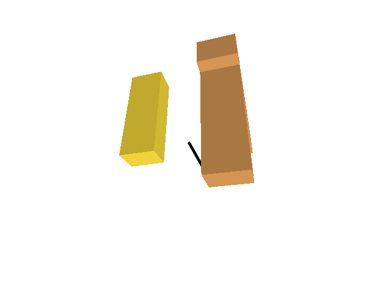
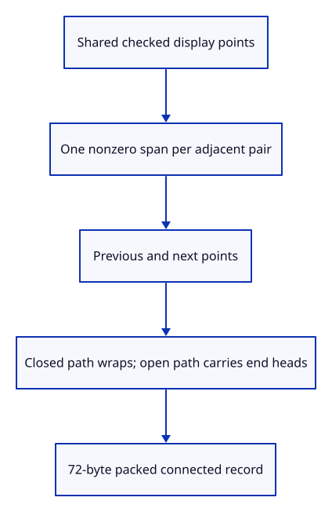

# 5.2.2 · Link adjacent spans and headed ends

**Chapter 5 · Lines, points and curves · Section 5.2 · Connected paths and arrows** · [Contents](contents.md)

**Typing: 12–24 minutes.** [Estimate](typing-load.md).

Turn adjacent display points into connected span records. Repeated display points already have no span; the source still retains them.

## Type

Continue from [Retain connected source geometry](36-chain.md). [Save or recover your work](recovery.md).

### 1. `src/chain.rs`

Describe neighbours and heads without modifying the original source.

<details>
<summary>Locate the existing block</summary>

```rust
        Ok(Self { source, points: Rc::new(points), colour, width, heads })
    }

}
```

</details>

After that block, type:

```rust
--8<-- "journey/code/36a-links-01.rs" skip=84
```

<details>
<summary>Supplied validation fixture</summary>

Copy this supplied authoring fixture once. Continue with the browser build below; the course does not require running native tests.

### 2. `src/chain_link_tests.rs`

Copy closed-neighbour and headed-span checks.

Copy this supplied file:

```text
--8<-- "journey/code/36a-links-02.rs"
```

</details>

### 3. `src/lib.rs`

Register the connected span checks.

<details>
<summary>Locate the existing block</summary>

```rust
pub mod chain;
```

</details>

After that block, type:

```rust
#[cfg(test)]
mod chain_link_tests;
```

<details>
<summary>Optional patch references</summary>

Use these original edit fragments when comparing a saved checkpoint. Apply the complete blocks above.

```text
--8<-- "journey/code/36a-links-03.rs"
```

</details>

## Run and check

In your project:

```sh
cd workspace/journey
REGEN_PROTO=0 cargo build --lib --locked --target wasm32-unknown-unknown -j1
REGEN_PROTO=0 CARGO_BUILD_JOBS=1 trunk serve --port 8780
```

Open `http://127.0.0.1:8780/`. Keep an existing Trunk server running; saving rebuilds it.

Run neighbour checks. A closed chain wraps both ends and suppresses free arrowheads; an open chain uses its first and last nonzero spans.

### Recorded visual result

**Previous native render — current verification pending.**



*This recorded image predates a source or checker change. Rebuild this checkpoint before using it as current evidence; browser controls require separate acceptance.*

This reference image is shared with [5.1.6 · Connect the stroke lane to the document renderer](35cb-render.md). It does not demonstrate a new feature by itself.

<details>
<summary>Code explanation and diagram</summary>

Closed paths wrap their neighbour references and suppress free-end arrows. Open paths carry head flags only at their first and last nonzero spans. Pack each record into an explicit 72-byte instance layout.

shared display points → previous/current/next → closed wraparound → headed free spans → 72-byte payload.



Which original does a prepared path link belong to?

Its source polyline and original span address. Reuse the [display filtering rule](36-chain.md); do not turn sampled or omitted points into new editable originals.

Study estimate, including typing and experiments: 0.75–1.25 hours.

</details>

<details>
<summary>Optional experiment</summary>

Inspect a closed triangle and an open headed chain. Verify their source coordinates survive repeated-point removal exactly.

</details>

<details>
<summary>Check and save your work</summary>

Restore experimental edits, then run from `session_viewer`:

```sh
npm --prefix ../session_tests run course -- check 5.2.2
npm --prefix ../session_tests run course -- save 5.2.2
```

Source comparison leaves your project untouched. [Save and recovery instructions](recovery.md).

</details>

<details>
<summary>Viewer coverage and verification</summary>

Connected records are complete here. The projected join shader, arrowheads and browser drawing follow.

Native tests prove closed wraparound, repeated-point handling, free-end head flags and exact 72-byte packing. Connected GPU pixels follow.

Chrome retains the existing real line example while native tests verify connected instance records.

[Full validation scope](release.md).

To reproduce the scripted acceptance of the reference checkpoint, run from `session_viewer` with the [course bundle server](release.md#reproduce) running on port 8781:

```sh
npm --prefix ../session_tests run course -- capture 5.2.2
```

This uses the verified reference bundle; it does not check or change your typed project.

</details>
