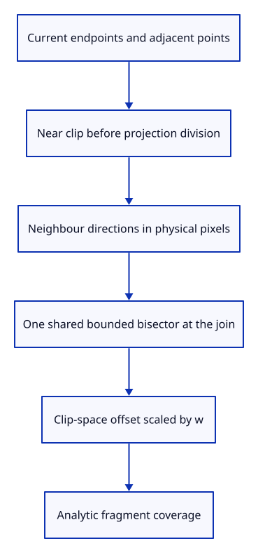

# 5.2.3 · Project neighbours for bounded stroke joins

**Chapter 5 · Lines, points and curves · Section 5.2 · Connected paths and arrows** · [Contents](contents.md)

**Typing: 13–25 minutes.** [Estimate](typing-load.md).

Project adjacent points before calculating their shared joint cross-section. Bound near-reversal joins so an unstable bisector cannot create an unbounded spike.

## Type

Continue from [Link adjacent spans and headed ends](36a-links.md). [Save or recover your work](recovery.md).

### 1. `src/chain.wgsl`

Share bounded projected joins while retaining near clipping and edge coverage.

Create the file and type:

```wgsl
--8<-- "journey/code/36b-join-01.wgsl"
```

### 2. `src/chain.rs`

Expose the actual connected shader source.

<details>
<summary>Locate the existing block</summary>

```rust
use std::rc::Rc;
```

</details>

Edit the existing block to match this code; keep unchanged lines:

```rust
pub const SHADER: &str = include_str!("chain.wgsl");
use std::rc::Rc;
```

<details>
<summary>Optional patch references</summary>

Use these original edit fragments when comparing a saved checkpoint. Apply the complete blocks above.

```text
--8<-- "journey/code/36b-join-02.rs"
```

</details>

## Run and check

In your project:

```sh
cd workspace/journey
REGEN_PROTO=0 cargo build --lib --locked --target wasm32-unknown-unknown -j1
REGEN_PROTO=0 CARGO_BUILD_JOBS=1 trunk serve --port 8780
```

Open `http://127.0.0.1:8780/`. Keep an existing Trunk server running; saving rebuilds it.

The actual drawing device validates the WGSL helper module. Vertex drawing follows next.

### Recorded visual result

**Previous native render — current verification pending.**

This checkpoint was rendered independently and has the same native comparison frame as [Link adjacent spans and headed ends](36a-links.md). Use its state checks and browser exercise to assess the changed behavior.


*This recorded image predates a source or checker change. Rebuild this checkpoint before using it as current evidence; browser controls require separate acceptance.*

This reference image is shared with [5.1.6 · Connect the stroke lane to the document renderer](35cb-render.md). It does not demonstrate a new feature by itself.

<details>
<summary>Code explanation and diagram</summary>

A hidden neighbour or zero-length projected span falls back to the current segment normal. Vertex extrusion and analytic fragment coverage follow next.

project adjacent points → reject hidden or zero spans → bisector → bounded cross-section.



Why bound the join when two projected spans nearly reverse?

Their bisector becomes unstable as the directions oppose. A bounded cross-section avoids unbounded spikes; later visibility checks still use the original source spans.

Study estimate, including typing and experiments: 0.75–1.25 hours.

</details>

<details>
<summary>Optional experiment</summary>

Compare previous/current and current/next directions at a shared endpoint. Both segments must agree on the cross-section.

</details>

<details>
<summary>Check and save your work</summary>

Restore experimental edits, then run from `session_viewer`:

```sh
npm --prefix ../session_tests run course -- check 5.2.3
npm --prefix ../session_tests run course -- save 5.2.3
```

Source comparison leaves your project untouched. [Save and recovery instructions](recovery.md).

</details>

<details>
<summary>Viewer coverage and verification</summary>

This checkpoint introduces connected projection helpers. The following endpoint wires their bounded cross-sections into real vertices.

The actual drawing device validates the complete helper module. Vertex extrusion and connected GPU pixels follow separately.

Chrome retains the existing verified line while the connected shader is introduced.

[Full validation scope](release.md).

To reproduce the scripted acceptance of the reference checkpoint, run from `session_viewer` with the [course bundle server](release.md#reproduce) running on port 8781:

```sh
npm --prefix ../session_tests run course -- capture 5.2.3
```

This uses the verified reference bundle; it does not check or change your typed project.

</details>
