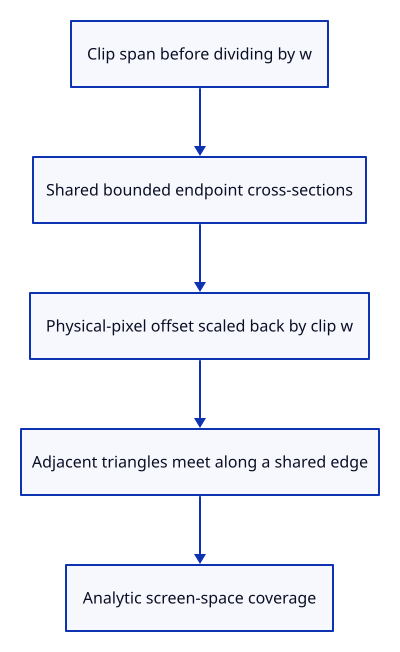

# 5.2.4 · Extrude the joined stroke body

**Chapter 5 · Lines, points and curves · Section 5.2 · Connected paths and arrows** · [Contents](contents.md)

**Typing: 21–41 minutes.** [Estimate](typing-load.md).

Clip each span before dividing by w, then offset its ends along their shared bounded cross-sections. Convert physical-pixel offsets back into clip coordinates using w.

## Type

Continue from [Project neighbours for bounded stroke joins](36b-join.md). [Save or recover your work](recovery.md).

### 1. `src/chain.wgsl`

Clip before projection, meet bounded endpoint sections and cover the stroke analytically.

<details>
<summary>Locate the existing block</summary>

```wgsl
    return bisector / max(dot(bisector, normal), 0.25);
}
```

</details>

After that block, type:

```wgsl
--8<-- "journey/code/36ba-body-01.wgsl" skip=58
```

## Run and check

In your project:

```sh
cd workspace/journey
REGEN_PROTO=0 cargo build --lib --locked --target wasm32-unknown-unknown -j1
REGEN_PROTO=0 CARGO_BUILD_JOBS=1 trunk serve --port 8780
```

Open `http://127.0.0.1:8780/`. Keep an existing Trunk server running; saving rebuilds it.

The actual drawing device validates the complete joined-body shader. Real connected instance drawing follows after arrowhead extrusion.

### Recorded visual result

**Previous native render — current verification pending.**


*This recorded image predates a source or checker change. Rebuild this checkpoint before using it as current evidence; browser controls require separate acceptance.*

This reference image is shared with [5.1.6 · Connect the stroke lane to the document renderer](35cb-render.md). It does not demonstrate a new feature by itself.

<details>
<summary>Code explanation and diagram</summary>

The triangles of adjacent spans meet along their common endpoint section. Fragment coverage measures distance from the span in screen pixels, retaining constant width under camera changes.

clip endpoint → bounded join offset → clip w scaling → shared raster edge → analytic coverage.



Why do both ribbon segments use the same end cross-section?

Their two triangles must meet along one boundary. Reuse the [bounded join](36b-join.md) rather than widening each span independently.

Study estimate, including typing and experiments: 0.75–1.25 hours.

</details>

<details>
<summary>Optional experiment</summary>

Trace both triangles meeting at a shared path point. Their end cross-section comes from the same projected neighbours.

</details>

<details>
<summary>Check and save your work</summary>

Restore experimental edits, then run from `session_viewer`:

```sh
npm --prefix ../session_tests run course -- check 5.2.4
npm --prefix ../session_tests run course -- save 5.2.4
```

Source comparison leaves your project untouched. [Save and recovery instructions](recovery.md).

</details>

<details>
<summary>Viewer coverage and verification</summary>

Connected-body extrusion is complete here. Arrowheads, the instance pipeline and browser drawing follow.

The real native drawing device validates the joined vertex and fragment entry points. Connected body turn and pixel checks follow at the pipeline endpoint.

Chrome retains the existing verified line while the connected shader is introduced.

[Full validation scope](release.md).

To reproduce the scripted acceptance of the reference checkpoint, run from `session_viewer` with the [course bundle server](release.md#reproduce) running on port 8781:

```sh
npm --prefix ../session_tests run course -- capture 5.2.4
```

This uses the verified reference bundle; it does not check or change your typed project.

</details>
