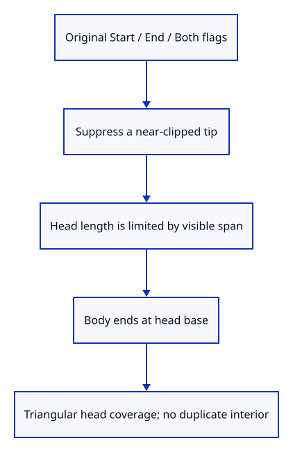

# 5.2.5 · Extrude free-end arrowheads

**Chapter 5 · Lines, points and curves · Section 5.2 · Connected paths and arrows** · [Contents](contents.md)

**Typing: 21–41 minutes.** [Estimate](typing-load.md).

Use the source head flags at free endpoints and suppress a head when clipping removes its tip. Limit the head length so short arrows retain a shaft.

## Type

Continue from [Extrude the joined stroke body](36ba-body.md). [Save or recover your work](recovery.md).

### 1. `src/chain.wgsl`

Carry head shape separately from body coverage. Shape real free-end heads and partition their shaft at the base. Identify body fragments independently of head triangles. Cover triangle edges while preserving a continuous, singly blended shaft seam.

<details>
<summary>Locate the existing block</summary>

```wgsl
struct View { transform: mat4x4<f32>, size: vec2<f32>, density: f32 }
@group(0) @binding(0) var<uniform> view: View;
struct Output {
    @builtin(position) position: vec4<f32>,
    @location(0) colour: vec4<f32>,
    @location(1) @interpolate(linear) pixel: vec2<f32>,
    @location(2) @interpolate(flat) origin: vec2<f32>,
    @location(3) @interpolate(flat) direction: vec2<f32>,
    @location(4) @interpolate(flat) half_width: f32,
}
fn screen(p: vec4<f32>) -> vec2<f32> { return p.xy / p.w * view.size * 0.5; }
fn perpendicular(d: vec2<f32>) -> vec2<f32> { return vec2<f32>(-d.y, d.x); }
fn joint(neighbour: vec4<f32>, endpoint: vec4<f32>, d: vec2<f32>, before: bool) -> vec2<f32> {
    let normal = perpendicular(d);
    if (neighbour.z < 0.0 || neighbour.w <= 0.0) { return normal; }
    let span = select(screen(neighbour) - screen(endpoint), screen(endpoint) - screen(neighbour), before);
    if (dot(span, span) < 0.000001) { return normal; }
    let other = normalize(span); let sum = normal + perpendicular(other);
    if (dot(sum, sum) < 0.000001) { return normal; }
    let bisector = normalize(sum);
    return bisector / max(dot(bisector, normal), 0.25);
}
@vertex
fn vertex(@location(0) start: vec3<f32>, @location(1) end: vec3<f32>,
    @location(2) colour: vec4<f32>, @location(3) width: f32,
    @location(4) previous: vec3<f32>, @location(5) next: vec3<f32>,
    @location(6) heads: u32, @builtin(vertex_index) index: u32) -> Output {
    var hidden: Output; hidden.position = vec4<f32>(2.0, 2.0, 2.0, 1.0);
    var a = view.transform * vec4<f32>(start, 1.0);
    var b = view.transform * vec4<f32>(end, 1.0);
    let clipped_a = a.z < 0.0; let clipped_b = b.z < 0.0;
    if (clipped_a && clipped_b) { return hidden; }
    if (clipped_a) { a = mix(a, b, -a.z / (b.z - a.z)); }
    if (clipped_b) { b = mix(b, a, -b.z / (a.z - b.z)); }
    if (a.w <= 0.0 || b.w <= 0.0) { return hidden; }
    let delta = screen(b) - screen(a);
    if (dot(delta, delta) < 0.000001) { return hidden; }
    let direction = normalize(delta); let normal = perpendicular(direction);
    let back = view.transform * vec4<f32>(previous, 1.0);
    let front = view.transform * vec4<f32>(next, 1.0);
    let left = select(joint(back, a, direction, true), normal, clipped_a);
    let right = select(joint(front, b, direction, false), normal, clipped_b);
    let corners = array<vec2<f32>, 6>(vec2<f32>(0.0, -1.0), vec2<f32>(1.0, -1.0), vec2<f32>(0.0, 1.0),
        vec2<f32>(0.0, 1.0), vec2<f32>(1.0, -1.0), vec2<f32>(1.0, 1.0));
    let corner = corners[index]; let half_width = width * view.density * 0.5;
    var position = select(a, b, corner.x > 0.5);
    let offset = select(left, right, corner.x > 0.5) * (half_width + 0.70711) * corner.y;
    position = vec4<f32>(position.xy + offset * 2.0 / view.size * position.w, position.zw);
    return Output(position, colour, screen(position), screen(a), direction, half_width);
}
@fragment
fn fragment(input: Output) -> @location(0) vec4<f32> {
    let distance = dot(input.pixel - input.origin, perpendicular(input.direction));
    let coverage = clamp(input.half_width + 0.5 - abs(distance), 0.0, 1.0);
    return vec4<f32>(input.colour.rgb, input.colour.a * coverage);
}
```

</details>

Edit the existing block to match this code; keep unchanged lines:

```wgsl
struct View { transform: mat4x4<f32>, size: vec2<f32>, density: f32 }
@group(0) @binding(0) var<uniform> view: View;
struct Output {
    @builtin(position) position: vec4<f32>,
    @location(0) colour: vec4<f32>,
    @location(1) @interpolate(linear) pixel: vec2<f32>,
    @location(2) @interpolate(flat) origin: vec2<f32>,
    @location(3) @interpolate(flat) direction: vec2<f32>,
    @location(4) @interpolate(flat) half_width: f32,
    @location(5) @interpolate(flat) part: u32,
    @location(6) @interpolate(flat) head_length: f32,
}
fn screen(p: vec4<f32>) -> vec2<f32> { return p.xy / p.w * view.size * 0.5; }
fn perpendicular(d: vec2<f32>) -> vec2<f32> { return vec2<f32>(-d.y, d.x); }
fn joint(neighbour: vec4<f32>, endpoint: vec4<f32>, d: vec2<f32>, before: bool) -> vec2<f32> {
    let normal = perpendicular(d);
    if (neighbour.z < 0.0 || neighbour.w <= 0.0) { return normal; }
    let span = select(screen(neighbour) - screen(endpoint), screen(endpoint) - screen(neighbour), before);
    if (dot(span, span) < 0.000001) { return normal; }
    let other = normalize(span); let sum = normal + perpendicular(other);
    if (dot(sum, sum) < 0.000001) { return normal; }
    let bisector = normalize(sum);
    return bisector / max(dot(bisector, normal), 0.25);
}
@vertex
fn vertex(@location(0) start: vec3<f32>, @location(1) end: vec3<f32>,
    @location(2) colour: vec4<f32>, @location(3) width: f32,
    @location(4) previous: vec3<f32>, @location(5) next: vec3<f32>,
    @location(6) heads: u32, @builtin(vertex_index) index: u32) -> Output {
    var hidden: Output; hidden.position = vec4<f32>(2.0, 2.0, 2.0, 1.0);
    var a = view.transform * vec4<f32>(start, 1.0);
    var b = view.transform * vec4<f32>(end, 1.0);
    let clipped_a = a.z < 0.0; let clipped_b = b.z < 0.0;
    if (clipped_a && clipped_b) { return hidden; }
    if (clipped_a) { a = mix(a, b, -a.z / (b.z - a.z)); }
    if (clipped_b) { b = mix(b, a, -b.z / (a.z - b.z)); }
    if (a.w <= 0.0 || b.w <= 0.0) { return hidden; }
    let delta = screen(b) - screen(a);
    if (dot(delta, delta) < 0.000001) { return hidden; }
    let direction = normalize(delta); let normal = perpendicular(direction);
    let back = view.transform * vec4<f32>(previous, 1.0);
    let front = view.transform * vec4<f32>(next, 1.0);
    let left = select(joint(back, a, direction, true), normal, clipped_a);
    let right = select(joint(front, b, direction, false), normal, clipped_b);
    let corners = array<vec2<f32>, 6>(vec2<f32>(0.0, -1.0), vec2<f32>(1.0, -1.0), vec2<f32>(0.0, 1.0),
        vec2<f32>(0.0, 1.0), vec2<f32>(1.0, -1.0), vec2<f32>(1.0, 1.0));
    let corner = corners[index % 6u]; let half_width = width * view.density * 0.5;
    let at_start = (heads & 2u) != 0u && !clipped_a;
    let at_end = (heads & 1u) != 0u && !clipped_b;
    let share = select(1.0, 2.0, at_start && at_end);
    let head_length = min(max(10.0 * view.density, 6.0 * half_width), length(delta) * 0.6 / share);
    let part = index / 6u;
    if (part > 0u) {
        let is_start = part == 2u;
        if ((is_start && !at_start) || (!is_start && !at_end)) { return hidden; }
        let tip = select(b, a, is_start); let aim = select(direction, -direction, is_start);
        let offset = -aim * mix(-0.70711, head_length + 0.70711, corner.x)
            + perpendicular(aim) * (head_length * 0.4 + 0.70711) * corner.y;
        let position = vec4<f32>(tip.xy + offset * 2.0 / view.size * tip.w, tip.zw);
        return Output(position, colour, screen(position), screen(tip), aim, half_width, 1u, head_length);
    }
    let start_offset = direction * select(0.0, head_length, at_start);
    let end_offset = -direction * select(0.0, head_length, at_end);
    var position = select(a, b, corner.x > 0.5);
    position = vec4<f32>(position.xy + select(start_offset, end_offset, corner.x > 0.5)
        * 2.0 / view.size * position.w, position.zw);
    let offset = select(left, right, corner.x > 0.5) * (half_width + 0.70711) * corner.y;
    position = vec4<f32>(position.xy + offset * 2.0 / view.size * position.w, position.zw);
    return Output(position, colour, screen(position), screen(a), direction, half_width, 0u, 0.0);
}
@fragment
fn fragment(input: Output) -> @location(0) vec4<f32> {
    let local = input.pixel - input.origin;
    let distance = dot(local, perpendicular(input.direction));
    var coverage = clamp(input.half_width + 0.5 - abs(distance), 0.0, 1.0);
    if (input.part == 1u) {
        let back = -dot(local, input.direction);
        if (back >= input.head_length) { discard; }
        let side = (0.4 * back - abs(distance)) / sqrt(1.16);
        let base = select(input.head_length - back, 1e6, abs(distance) <= input.half_width);
        coverage = clamp(min(min(side, back), base) + 0.5, 0.0, 1.0);
    }
    return vec4<f32>(input.colour.rgb, input.colour.a * coverage);
}
```

<details>
<summary>Optional patch references</summary>

Use these original edit fragments when comparing a saved checkpoint. Apply the complete blocks above.

```text
--8<-- "journey/code/36bb-heads-01.wgsl"
```

```text
--8<-- "journey/code/36bb-heads-02.wgsl"
```

```text
--8<-- "journey/code/36bb-heads-03.wgsl"
```

```text
--8<-- "journey/code/36bb-heads-04.wgsl"
```

</details>

## Run and check

In your project:

```sh
cd workspace/journey
REGEN_PROTO=0 cargo build --lib --locked --target wasm32-unknown-unknown -j1
REGEN_PROTO=0 CARGO_BUILD_JOBS=1 trunk serve --port 8780
```

Open `http://127.0.0.1:8780/`. Keep an existing Trunk server running; saving rebuilds it.

The actual drawing device validates the headed stroke shader. Connected instance rendering follows next.

### Recorded visual result

**Previous native render — current verification pending.**


*This recorded image predates a source or checker change. Rebuild this checkpoint before using it as current evidence; browser controls require separate acceptance.*

This reference image is shared with [5.1.6 · Connect the stroke lane to the document renderer](35cb-render.md). It does not demonstrate a new feature by itself.

<details>
<summary>Code explanation and diagram</summary>

Draw the body and each head as separate six-vertex parts. Cut the shaft at the head base, and use triangular fragment coverage without blending the same interior twice.

free-end head flags → projected shaft → bounded head length → split shaft/head seam → triangular coverage.



Why must a clipped end lose its arrowhead?

The clipped endpoint is a new display boundary rather than the original source tip. A head there would claim a direction and endpoint the document never contained.

Study estimate, including typing and experiments: 0.75–1.25 hours.

</details>

<details>
<summary>Optional experiment</summary>

Follow Start and End flags through the three six-vertex parts. A closed chain or a near-clipped end must not produce a free arrowhead.

</details>

<details>
<summary>Check and save your work</summary>

Restore experimental edits, then run from `session_viewer`:

```sh
npm --prefix ../session_tests run course -- check 5.2.5
npm --prefix ../session_tests run course -- save 5.2.5
```

Source comparison leaves your project untouched. [Save and recovery instructions](recovery.md).

</details>

<details>
<summary>Viewer coverage and verification</summary>

Shader extrusion now covers joined bodies and free-end heads. The following endpoint connects its complete 72-byte instance layout and pixel checks.

The actual native drawing device validates the headed vertex and fragment entry points. Turn, head flag, short-arrow and opacity pixels follow with the connected pipeline.

Chrome retains the existing verified line while the connected shader is introduced.

[Full validation scope](release.md).

To reproduce the scripted acceptance of the reference checkpoint, run from `session_viewer` with the [course bundle server](release.md#reproduce) running on port 8781:

```sh
npm --prefix ../session_tests run course -- capture 5.2.5
```

This uses the verified reference bundle; it does not check or change your typed project.

</details>
