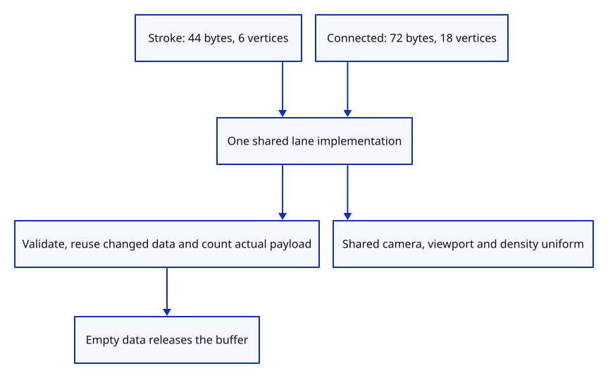

# 5.2.6 · Share instance drawing with connected strokes

**Chapter 5 · Lines, points and curves · Section 5.2 · Connected paths and arrows** · [Contents](contents.md)

**Typing: 25–50 minutes.** [Estimate](typing-load.md).

Parameterize the existing lane by shader, attributes, byte stride and vertex count. Keep its view uniform, changed-data reuse and release policy shared.

## Type

Continue from [Extrude free-end arrowheads](36bb-heads.md). [Save or recover your work](recovery.md).

### 1. `src/stroke_gpu.rs`

Keep format-specific layout beside the shared lane resources. Validate each connected record, then reuse the same changed-byte transaction. Draw the correct number of vertices for either instance format. Count actual instances from their format-specific stride. Construct either layout using one pipeline and view implementation. Use the actual shader belonging to this instance layout. Bind the exact attributes and byte stride. Retain both layout parameters for synchronized draw and accounting. Keep the buffer initialization trait at the method that uses it.

<details>
<summary>Locate the existing block</summary>

```rust
pub struct Lane {
    pipeline: wgpu::RenderPipeline,
    uniform: wgpu::Buffer,
    group: wgpu::BindGroup,
    vertices: Option<wgpu::Buffer>,
    data: Vec<u8>,
    pub uploads: u64,
    pub uploaded_bytes: u64,
}

impl Lane {
    pub fn set(&mut self, device: &wgpu::Device, strokes: impl IntoIterator<Item = crate::stroke::Stroke>) -> Result<(), &'static str> {
        use wgpu::util::DeviceExt;
        let mut data = Vec::new();
        for stroke in strokes {
            if stroke.width <= 0.0 || stroke.values().iter().any(|value| !value.is_finite()) {
                return Err("Invalid stroke display data");
            }
            data.extend(stroke.bytes());
        }
        u32::try_from(data.len() / 44).map_err(|_| "Too many stroke instances")?;
        if data == self.data { return Ok(()); }
        self.vertices = if data.is_empty() { None } else {
            self.uploads += 1; self.uploaded_bytes += data.len() as u64;
            Some(device.create_buffer_init(&wgpu::util::BufferInitDescriptor {
                label: Some("stroke instances"), contents: &data, usage: wgpu::BufferUsages::VERTEX,
            }))
        };
        self.data = data; Ok(())
    }

    pub fn view(&self, queue: &wgpu::Queue, transform: &[f32; 16], size: [u32; 2], density: f32) {
        if self.vertices.is_none() { return; }
        let bytes: Vec<u8> = transform.iter().copied().chain([size[0] as f32, size[1] as f32, density, 0.0])
            .flat_map(f32::to_ne_bytes).collect();
        queue.write_buffer(&self.uniform, 0, &bytes);
    }

    pub fn draw(&self, pass: &mut wgpu::RenderPass<'_>) {
        let Some(vertices) = &self.vertices else { return; };
        pass.set_pipeline(&self.pipeline); pass.set_bind_group(0, &self.group, &[]);
        pass.set_vertex_buffer(0, vertices.slice(..)); pass.draw(0..6, 0..(self.data.len() / 44) as u32);
    }

    pub fn usage(&self) -> [u64; 2] {
        [self.data.len() as u64 / 44, self.vertices.as_ref().map_or(0, wgpu::Buffer::size)]
    }

    pub fn new(device: &wgpu::Device, format: wgpu::TextureFormat) -> Self {
        let shader = device.create_shader_module(wgpu::ShaderModuleDescriptor {
            label: Some("stroke"), source: wgpu::ShaderSource::Wgsl(crate::stroke::SHADER.into()),
        });
        let pipeline = device.create_render_pipeline(&wgpu::RenderPipelineDescriptor {
            label: Some("stroke"), layout: None,
            vertex: wgpu::VertexState { module: &shader, entry_point: Some("vertex"),
                compilation_options: Default::default(),
                buffers: &[wgpu::VertexBufferLayout { array_stride: 44, step_mode: wgpu::VertexStepMode::Instance,
                    attributes: &wgpu::vertex_attr_array![0 => Float32x3, 1 => Float32x3, 2 => Float32x4, 3 => Float32] }],
            },
            fragment: Some(wgpu::FragmentState { module: &shader, entry_point: Some("fragment"),
                compilation_options: Default::default(),
                targets: &[Some(wgpu::ColorTargetState { format, blend: Some(wgpu::BlendState::ALPHA_BLENDING),
                    write_mask: wgpu::ColorWrites::ALL })],
            }),
            primitive: Default::default(),
            depth_stencil: Some(wgpu::DepthStencilState { format: wgpu::TextureFormat::Depth32Float,
                depth_write_enabled: Some(false), depth_compare: Some(wgpu::CompareFunction::LessEqual),
                stencil: Default::default(), bias: Default::default() }),
            multisample: Default::default(), multiview_mask: None, cache: None,
        });
        let uniform = device.create_buffer(&wgpu::BufferDescriptor { label: Some("stroke view"), size: 80,
            usage: wgpu::BufferUsages::UNIFORM | wgpu::BufferUsages::COPY_DST, mapped_at_creation: false });
        let group = device.create_bind_group(&wgpu::BindGroupDescriptor { label: Some("stroke view"),
            layout: &pipeline.get_bind_group_layout(0),
            entries: &[wgpu::BindGroupEntry { binding: 0, resource: uniform.as_entire_binding() }] });
        Self { pipeline, uniform, group, vertices: None, data: Vec::new(), uploads: 0, uploaded_bytes: 0 }
    }
}
```

</details>

Edit the existing block to match this code; keep unchanged lines:

```rust
pub struct Lane {
    pipeline: wgpu::RenderPipeline,
    uniform: wgpu::Buffer,
    group: wgpu::BindGroup,
    vertices: Option<wgpu::Buffer>,
    data: Vec<u8>,
    stride: u64,
    vertices_per_instance: u32,
    pub uploads: u64,
    pub uploaded_bytes: u64,
}

impl Lane {
    pub fn set(&mut self, device: &wgpu::Device, strokes: impl IntoIterator<Item = crate::stroke::Stroke>) -> Result<(), &'static str> {
        let mut data = Vec::new();
        for stroke in strokes {
            if stroke.width <= 0.0 || stroke.values().iter().any(|value| !value.is_finite()) {
                return Err("Invalid stroke display data");
            }
            data.extend(stroke.bytes());
        }
        if self.stride != 44 { return Err("Stroke data needs the stroke layout"); }
        self.set_bytes(device, data)
    }

    pub fn set_chains(&mut self, device: &wgpu::Device, segments: impl IntoIterator<Item = crate::chain::Segment>) -> Result<(), &'static str> {
        if self.stride != 72 { return Err("Connected data needs the connected layout"); }
        let mut data = Vec::new();
        for segment in segments {
            if segment.stroke.width <= 0.0 || segment.heads > 3
                || segment.stroke.values().iter().chain(segment.previous.iter()).chain(segment.next.iter()).any(|v| !v.is_finite()) {
                return Err("Invalid connected display data");
            }
            data.extend(segment.bytes());
        }
        self.set_bytes(device, data)
    }

    fn set_bytes(&mut self, device: &wgpu::Device, data: Vec<u8>) -> Result<(), &'static str> {
        use wgpu::util::DeviceExt;
        u32::try_from(data.len() as u64 / self.stride).map_err(|_| "Too many stroke instances")?;
        if data == self.data { return Ok(()); }
        self.vertices = if data.is_empty() { None } else {
            self.uploads += 1; self.uploaded_bytes += data.len() as u64;
            Some(device.create_buffer_init(&wgpu::util::BufferInitDescriptor {
                label: Some("stroke instances"), contents: &data, usage: wgpu::BufferUsages::VERTEX,
            }))
        };
        self.data = data; Ok(())
    }

    pub fn view(&self, queue: &wgpu::Queue, transform: &[f32; 16], size: [u32; 2], density: f32) {
        if self.vertices.is_none() { return; }
        let bytes: Vec<u8> = transform.iter().copied().chain([size[0] as f32, size[1] as f32, density, 0.0])
            .flat_map(f32::to_ne_bytes).collect();
        queue.write_buffer(&self.uniform, 0, &bytes);
    }

    pub fn draw(&self, pass: &mut wgpu::RenderPass<'_>) {
        let Some(vertices) = &self.vertices else { return; };
        pass.set_pipeline(&self.pipeline); pass.set_bind_group(0, &self.group, &[]);
        pass.set_vertex_buffer(0, vertices.slice(..));
        pass.draw(0..self.vertices_per_instance, 0..(self.data.len() as u64 / self.stride) as u32);
    }

    pub fn usage(&self) -> [u64; 2] {
        [self.data.len() as u64 / self.stride, self.vertices.as_ref().map_or(0, wgpu::Buffer::size)]
    }

    pub fn new(device: &wgpu::Device, format: wgpu::TextureFormat) -> Self {
        Self::layout(device, format, crate::stroke::SHADER, 44, 6,
            &wgpu::vertex_attr_array![0 => Float32x3, 1 => Float32x3, 2 => Float32x4, 3 => Float32])
    }

    pub fn joined(device: &wgpu::Device, format: wgpu::TextureFormat) -> Self {
        Self::layout(device, format, crate::chain::SHADER, 72, 18,
            &wgpu::vertex_attr_array![0 => Float32x3, 1 => Float32x3, 2 => Float32x4, 3 => Float32,
                4 => Float32x3, 5 => Float32x3, 6 => Uint32])
    }

    fn layout(device: &wgpu::Device, format: wgpu::TextureFormat, source: &'static str,
        stride: u64, vertices_per_instance: u32, attributes: &[wgpu::VertexAttribute]) -> Self {
        let shader = device.create_shader_module(wgpu::ShaderModuleDescriptor {
            label: Some("stroke"), source: wgpu::ShaderSource::Wgsl(source.into()),
        });
        let pipeline = device.create_render_pipeline(&wgpu::RenderPipelineDescriptor {
            label: Some("stroke"), layout: None,
            vertex: wgpu::VertexState { module: &shader, entry_point: Some("vertex"),
                compilation_options: Default::default(),
                buffers: &[wgpu::VertexBufferLayout { array_stride: stride, step_mode: wgpu::VertexStepMode::Instance, attributes }],
            },
            fragment: Some(wgpu::FragmentState { module: &shader, entry_point: Some("fragment"),
                compilation_options: Default::default(),
                targets: &[Some(wgpu::ColorTargetState { format, blend: Some(wgpu::BlendState::ALPHA_BLENDING),
                    write_mask: wgpu::ColorWrites::ALL })],
            }),
            primitive: Default::default(),
            depth_stencil: Some(wgpu::DepthStencilState { format: wgpu::TextureFormat::Depth32Float,
                depth_write_enabled: Some(false), depth_compare: Some(wgpu::CompareFunction::LessEqual),
                stencil: Default::default(), bias: Default::default() }),
            multisample: Default::default(), multiview_mask: None, cache: None,
        });
        let uniform = device.create_buffer(&wgpu::BufferDescriptor { label: Some("stroke view"), size: 80,
            usage: wgpu::BufferUsages::UNIFORM | wgpu::BufferUsages::COPY_DST, mapped_at_creation: false });
        let group = device.create_bind_group(&wgpu::BindGroupDescriptor { label: Some("stroke view"),
            layout: &pipeline.get_bind_group_layout(0),
            entries: &[wgpu::BindGroupEntry { binding: 0, resource: uniform.as_entire_binding() }] });
        Self { pipeline, uniform, group, vertices: None, data: Vec::new(), stride, vertices_per_instance, uploads: 0, uploaded_bytes: 0 }
    }
}
```

<details>
<summary>Optional patch references</summary>

Use these original edit fragments when comparing a saved checkpoint. Apply the complete blocks above.

```text
--8<-- "journey/code/36c-lane-01.rs"
```

```text
--8<-- "journey/code/36c-lane-02.rs"
```

```text
--8<-- "journey/code/36c-lane-03.rs"
```

```text
--8<-- "journey/code/36c-lane-04.rs"
```

```text
--8<-- "journey/code/36c-lane-05.rs"
```

```text
--8<-- "journey/code/36c-lane-06.rs"
```

```text
--8<-- "journey/code/36c-lane-07.rs"
```

```text
--8<-- "journey/code/36c-lane-08.rs"
```

```text
--8<-- "journey/code/36c-lane-09.rs"
```

</details>

## Run and check

In your project:

```sh
cd workspace/journey
REGEN_PROTO=0 cargo build --lib --locked --target wasm32-unknown-unknown -j1
REGEN_PROTO=0 CARGO_BUILD_JOBS=1 trunk serve --port 8780
```

Open `http://127.0.0.1:8780/`. Keep an existing Trunk server running; saving rebuilds it.

Build and open the viewer. Existing source lines still draw, and the connected-stroke pipeline is ready. The following document and input checkpoints add path rows and polyline/arrow commands.

### Recorded visual result

**Previous native render — current verification pending.**


*This recorded image predates a source or checker change. Rebuild this checkpoint before using it as current evidence; browser controls require separate acceptance.*

This reference image is shared with [5.1.6 · Connect the stroke lane to the document renderer](35cb-render.md). It does not demonstrate a new feature by itself.

<details>
<summary>Code explanation and diagram</summary>

Validate connected endpoints, neighbours and head flags before changing buffers. Real GPU checks draw turns and all arrowhead options, inspect alpha at the join and retain original line width checks.

checked connected records → one changed-data buffer → same view uniform → 18 vertices → complete release.



Why reuse the same lane rather than copying its upload and lifetime code?

Both formats need identical changed-data reuse, queue writes and Close release. Their shader, attributes, stride and vertex count are the differences.

Study estimate, including typing and experiments: 0.75–1.25 hours.

</details>

<details>
<summary>Optional experiment</summary>

The reference GPU fixture checks actual connected turns and arrowheads, constant density and reuse when only the camera changes.

From `session_viewer`, run `npm --prefix ../session_tests run course -- verify 36c-lane` to reproduce that reference check. It reconstructs the canonical checkpoint under `target`; it does not test or change your handwritten project. Compare your source with `course -- check 36c-lane` and run your project separately.

</details>

<details>
<summary>Check and save your work</summary>

Restore experimental edits, then run from `session_viewer`:

```sh
npm --prefix ../session_tests run course -- check 5.2.6
npm --prefix ../session_tests run course -- save 5.2.6
```

Source comparison leaves your project untouched. [Save and recovery instructions](recovery.md).

</details>

<details>
<summary>Viewer coverage and verification</summary>

Both stroke formats now render on actual GPU instances. Document placement and connected browser commands follow.

Native GPU pixels check joined alpha coverage, all headed ends, stable original widths, actual payload accounting, invalid records and empty release. Connected browser rows follow next.

Chrome retains the existing verified line while the connected shader is introduced.

[Full validation scope](release.md).

To reproduce the scripted acceptance of the reference checkpoint, run from `session_viewer` with the [course bundle server](release.md#reproduce) running on port 8781:

```sh
npm --prefix ../session_tests run course -- capture 5.2.6
```

This uses the verified reference bundle; it does not check or change your typed project.

</details>
