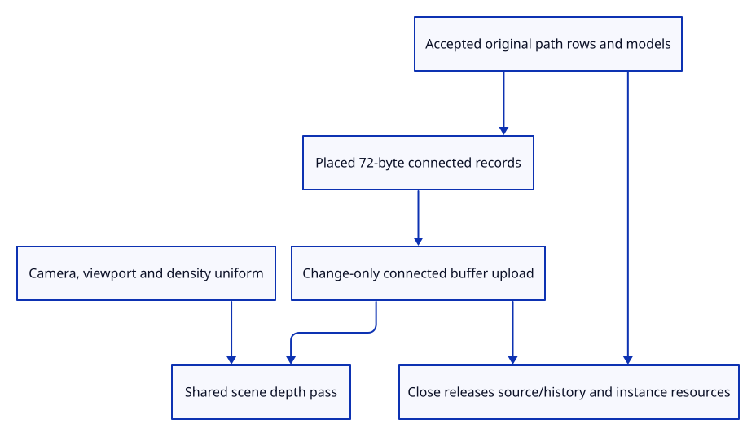

# 5.2.9 · Draw connected document rows

**Chapter 5 · Lines, points and curves · Section 5.2 · Connected paths and arrows** · [Contents](contents.md)

**Typing: 12–24 minutes.** [Estimate](typing-load.md).

Prepare world connected records when accepted document state changes. Draw them through the same depth pass as meshes and independent single strokes.

## Type

Continue from [Place original connected coordinates and count shared owners](36db-placement.md). [Save or recover your work](recovery.md).

### 1. `src/renderer.rs`

Retain one connected lane beside the independent stroke batch. Create the connected pipeline with the actual drawing device and target format. Retain the connected lane in renderer ownership. Reuse checked connected instances and expose their actual allocation counters. Include initialized connected payloads in upload phase measurements. Update camera uniforms independently of connected segment bytes. Draw connected bodies and heads in the existing shared depth pass.

Edit these blocks from bottom to top. Keep the surrounding lines unchanged.

<details>
<summary>Locate this block</summary>

```rust
                mesh.draw(&mut pass);
            }
            self.strokes.draw(&mut pass);
        }
        self.queue.submit([encoder.finish()]);
    }
```

</details>

Replace it with:

```rust
                mesh.draw(&mut pass);
            }
            self.strokes.draw(&mut pass);
            self.paths.draw(&mut pass);
        }
        self.queue.submit([encoder.finish()]);
    }
```

<details>
<summary>Locate this block</summary>

```rust
        let bytes: Vec<u8> = transform.iter().flat_map(|value| value.to_ne_bytes()).collect();
        self.queue.write_buffer(&self.uniform, 0, &bytes);
        self.strokes.view(&self.queue, transform, self.size, self.density);
        let [r, g, b] = background.rgb();
        let mut encoder = self.device.create_command_encoder(&Default::default());
        {
```

</details>

Replace it with:

```rust
        let bytes: Vec<u8> = transform.iter().flat_map(|value| value.to_ne_bytes()).collect();
        self.queue.write_buffer(&self.uniform, 0, &bytes);
        self.strokes.view(&self.queue, transform, self.size, self.density);
        self.paths.view(&self.queue, transform, self.size, self.density);
        let [r, g, b] = background.rgb();
        let mut encoder = self.device.create_command_encoder(&Default::default());
        {
```

<details>
<summary>Locate this block</summary>

```rust

    pub fn uploaded_bytes(&self) -> u64 {
        self.geometry.uploaded_bytes + self.settings_allocations as u64 * 80 + self.settings_bytes as u64
            + self.strokes.uploaded_bytes
    }

    pub fn stats(&self) -> [usize; 4] {
```

</details>

Replace it with:

```rust

    pub fn uploaded_bytes(&self) -> u64 {
        self.geometry.uploaded_bytes + self.settings_allocations as u64 * 80 + self.settings_bytes as u64
            + self.strokes.uploaded_bytes + self.paths.uploaded_bytes
    }

    pub fn stats(&self) -> [usize; 4] {
```

<details>
<summary>Locate this block</summary>

```rust
        [count, bytes, self.strokes.uploads, self.strokes.uploaded_bytes]
    }

    pub fn set_scene(&mut self, scene: &Scene, selected: Option<ObjectId>) {
        self.strokes.set(&self.device, scene.lines().iter().map(crate::scene::LineObject::stroke))
            .expect("Prepared line placement fits the display range");
        let layout = self.pipeline.get_bind_group_layout(1);
```

</details>

Replace it with:

```rust
        [count, bytes, self.strokes.uploads, self.strokes.uploaded_bytes]
    }

    pub fn path_usage(&self) -> [u64; 4] {
        let [count, bytes] = self.paths.usage();
        [count, bytes, self.paths.uploads, self.paths.uploaded_bytes]
    }

    pub fn set_scene(&mut self, scene: &Scene, selected: Option<ObjectId>) {
        self.paths.set_chains(&self.device, scene.paths().iter().flat_map(crate::scene::PathObject::segments))
            .expect("Prepared path placement fits the display range");
        self.strokes.set(&self.device, scene.lines().iter().map(crate::scene::LineObject::stroke))
            .expect("Prepared line placement fits the display range");
        let layout = self.pipeline.get_bind_group_layout(1);
```

<details>
<summary>Locate this block</summary>

```rust
        });
        let depth = Self::depth(&device, 640, 480);
        let strokes = crate::stroke_gpu::Lane::new(&device, format);
        let mut renderer = Self { device, queue, pipeline, meshes: Vec::new(),
            geometry: Default::default(), settings_allocations: 0, settings_writes: 0,
            settings_bytes: 0, uniform, view_group, depth, strokes, size: [640, 480], density: 1.0 };
        renderer.set_scene(scene, None);
        renderer
    }
```

</details>

Replace it with:

```rust
        });
        let depth = Self::depth(&device, 640, 480);
        let strokes = crate::stroke_gpu::Lane::new(&device, format);
        let paths = crate::stroke_gpu::Lane::joined(&device, format);
        let mut renderer = Self { device, queue, pipeline, meshes: Vec::new(),
            geometry: Default::default(), settings_allocations: 0, settings_writes: 0,
            settings_bytes: 0, uniform, view_group, depth, strokes, paths, size: [640, 480], density: 1.0 };
        renderer.set_scene(scene, None);
        renderer
    }
```

<details>
<summary>Locate this block</summary>

```rust
    view_group: wgpu::BindGroup,
    depth: wgpu::TextureView,
    strokes: crate::stroke_gpu::Lane,
    size: [u32; 2],
    density: f32,
}
```

</details>

Replace it with:

```rust
    view_group: wgpu::BindGroup,
    depth: wgpu::TextureView,
    strokes: crate::stroke_gpu::Lane,
    paths: crate::stroke_gpu::Lane,
    size: [u32; 2],
    density: f32,
}
```

<details>
<summary>Complete updated block reference</summary>

```rust
use crate::{gpu_mesh::GpuMesh, scene::{ObjectId, Scene}};

pub struct Renderer {
    pub device: wgpu::Device,
    pub queue: wgpu::Queue,
    pipeline: wgpu::RenderPipeline,
    meshes: Vec<GpuMesh>,
    geometry: crate::geometry_cache::GeometryCache,
    settings_allocations: usize,
    settings_writes: usize,
    settings_bytes: usize,
    uniform: wgpu::Buffer,
    view_group: wgpu::BindGroup,
    depth: wgpu::TextureView,
    strokes: crate::stroke_gpu::Lane,
    paths: crate::stroke_gpu::Lane,
    size: [u32; 2],
    density: f32,
}

impl Renderer {
    pub fn new(
        device: wgpu::Device,
        queue: wgpu::Queue,
        format: wgpu::TextureFormat,
        scene: &Scene,
    ) -> Self {
        let shader = device.create_shader_module(wgpu::ShaderModuleDescriptor {
            label: Some("triangle"),
            source: wgpu::ShaderSource::Wgsl(include_str!("triangle.wgsl").into()),
        });
        let pipeline = device.create_render_pipeline(&wgpu::RenderPipelineDescriptor {
            label: Some("triangle"),
            layout: None,
            vertex: wgpu::VertexState {
                module: &shader,
                entry_point: Some("vertex"),
                compilation_options: Default::default(),
                buffers: &[wgpu::VertexBufferLayout {
                    array_stride: 24,
                    step_mode: wgpu::VertexStepMode::Vertex,
                    attributes: &wgpu::vertex_attr_array![0 => Float32x3, 1 => Float32x3],
                }],
            },
            fragment: Some(wgpu::FragmentState {
                module: &shader,
                entry_point: Some("fragment"),
                compilation_options: Default::default(),
                targets: &[Some(format.into())],
            }),
            primitive: Default::default(),
            depth_stencil: Some(wgpu::DepthStencilState {
                format: wgpu::TextureFormat::Depth32Float,
                depth_write_enabled: Some(true),
                depth_compare: Some(wgpu::CompareFunction::Less),
                stencil: Default::default(),
                bias: Default::default(),
            }),
            multisample: Default::default(),
            multiview_mask: None,
            cache: None,
        });
        let uniform = device.create_buffer(&wgpu::BufferDescriptor {
            label: Some("view transform"),
            size: 64,
            usage: wgpu::BufferUsages::UNIFORM | wgpu::BufferUsages::COPY_DST,
            mapped_at_creation: false,
        });
        let view_group = device.create_bind_group(&wgpu::BindGroupDescriptor {
            label: Some("view settings"),
            layout: &pipeline.get_bind_group_layout(0),
            entries: &[wgpu::BindGroupEntry {
                binding: 0,
                resource: uniform.as_entire_binding(),
            }],
        });
        let depth = Self::depth(&device, 640, 480);
        let strokes = crate::stroke_gpu::Lane::new(&device, format);
        let paths = crate::stroke_gpu::Lane::joined(&device, format);
        let mut renderer = Self { device, queue, pipeline, meshes: Vec::new(),
            geometry: Default::default(), settings_allocations: 0, settings_writes: 0,
            settings_bytes: 0, uniform, view_group, depth, strokes, paths, size: [640, 480], density: 1.0 };
        renderer.set_scene(scene, None);
        renderer
    }

    fn depth(device: &wgpu::Device, width: u32, height: u32) -> wgpu::TextureView {
        let depth_texture = device.create_texture(&wgpu::TextureDescriptor {
            label: Some("opaque depth"),
            size: wgpu::Extent3d { width, height, depth_or_array_layers: 1 },
            mip_level_count: 1,
            sample_count: 1,
            dimension: wgpu::TextureDimension::D2,
            format: wgpu::TextureFormat::Depth32Float,
            usage: wgpu::TextureUsages::RENDER_ATTACHMENT,
            view_formats: &[],
        });
        depth_texture.create_view(&Default::default())
    }

    pub fn resize(&mut self, size: crate::viewport::Viewport) {
        self.size = [size.width, size.height];
        self.depth = Self::depth(&self.device, size.width, size.height);
    }

    pub fn set_density(&mut self, density: f32) {
        if density.is_finite() && density > 0.0 { self.density = density; }
    }

    pub fn stroke_usage(&self) -> [u64; 4] {
        let [count, bytes] = self.strokes.usage();
        [count, bytes, self.strokes.uploads, self.strokes.uploaded_bytes]
    }

    pub fn path_usage(&self) -> [u64; 4] {
        let [count, bytes] = self.paths.usage();
        [count, bytes, self.paths.uploads, self.paths.uploaded_bytes]
    }

    pub fn set_scene(&mut self, scene: &Scene, selected: Option<ObjectId>) {
        self.paths.set_chains(&self.device, scene.paths().iter().flat_map(crate::scene::PathObject::segments))
            .expect("Prepared path placement fits the display range");
        self.strokes.set(&self.device, scene.lines().iter().map(crate::scene::LineObject::stroke))
            .expect("Prepared line placement fits the display range");
        let layout = self.pipeline.get_bind_group_layout(1);
        let mut old = std::mem::take(&mut self.meshes);
        for object in scene.objects() {
            let matching = old.iter().position(|row| row.id == object.id
                && std::rc::Rc::ptr_eq(&row.geometry.source, &object.mesh));
            let row = if let Some(index) = matching {
                let mut row = old.swap_remove(index);
                let [calls, bytes] = row.update(&self.queue, object, selected == Some(object.id));
                self.settings_writes += calls;
                self.settings_bytes += bytes;
                row
            } else {
                let geometry = self.geometry.get(&self.device, &object.mesh);
                self.settings_allocations += 1;
                GpuMesh::with_geometry(&self.device, &layout, object,
                    selected == Some(object.id), geometry)
            };
            self.meshes.push(row);
        }
        drop(old);
        self.geometry.prune();
    }

    pub fn geometry_owners(&self) -> impl Iterator<Item = &std::rc::Rc<crate::gpu_geometry::GpuGeometry>> {
        self.meshes.iter().map(|row| &row.geometry)
    }

    pub fn usage(&self) -> [u64; 4] { crate::memory::gpu(&self.meshes) }

    pub fn uploaded_bytes(&self) -> u64 {
        self.geometry.uploaded_bytes + self.settings_allocations as u64 * 80 + self.settings_bytes as u64
            + self.strokes.uploaded_bytes + self.paths.uploaded_bytes
    }

    pub fn stats(&self) -> [usize; 4] {
        [self.geometry.uploads, self.settings_allocations, self.settings_writes, self.settings_bytes]
    }

    pub fn draw(
        &self,
        view: &wgpu::TextureView,
        background: &crate::background::Background,
        transform: &[f32; 16],
    ) {
        let bytes: Vec<u8> = transform.iter().flat_map(|value| value.to_ne_bytes()).collect();
        self.queue.write_buffer(&self.uniform, 0, &bytes);
        self.strokes.view(&self.queue, transform, self.size, self.density);
        self.paths.view(&self.queue, transform, self.size, self.density);
        let [r, g, b] = background.rgb();
        let mut encoder = self.device.create_command_encoder(&Default::default());
        {
            // The pass borrows the encoder. This scope ends that borrow before finish takes it.
            let mut pass = encoder.begin_render_pass(&wgpu::RenderPassDescriptor {
                label: Some("canvas"),
                depth_stencil_attachment: Some(wgpu::RenderPassDepthStencilAttachment {
                    view: &self.depth,
                    depth_ops: Some(wgpu::Operations {
                        load: wgpu::LoadOp::Clear(1.0),
                        store: wgpu::StoreOp::Store,
                    }),
                    stencil_ops: None,
                }),
                color_attachments: &[Some(wgpu::RenderPassColorAttachment {
                    view,
                    depth_slice: None,
                    resolve_target: None,
                    ops: wgpu::Operations {
                        load: wgpu::LoadOp::Clear(wgpu::Color {
                            r, g, b, a: 1.0,
                        }),
                        store: wgpu::StoreOp::Store,
                    },
                })],
                ..Default::default()
            });
            pass.set_pipeline(&self.pipeline);
            pass.set_bind_group(0, &self.view_group, &[]);
            for mesh in &self.meshes {
                mesh.draw(&mut pass);
            }
            self.strokes.draw(&mut pass);
            self.paths.draw(&mut pass);
        }
        self.queue.submit([encoder.finish()]);
    }
}
```

</details>

<details>
<summary>Optional patch references</summary>

Use these original edit fragments when comparing a saved checkpoint. Apply the complete blocks above.

```text
--8<-- "journey/code/36da-render-01.rs"
```

```text
--8<-- "journey/code/36da-render-02.rs"
```

```text
--8<-- "journey/code/36da-render-03.rs"
```

```text
--8<-- "journey/code/36da-render-04.rs"
```

```text
--8<-- "journey/code/36da-render-05.rs"
```

```text
--8<-- "journey/code/36da-render-06.rs"
```

```text
--8<-- "journey/code/36da-render-07.rs"
```

</details>

### 2. `src/browser.rs`

Inspect real path resources without changing the earlier mesh and line counter meanings.

<details>
<summary>Locate the existing block</summary>

```rust
    canvas.set_attribute("data-stroke-usage", &serde_json::to_string(&renderer.stroke_usage()).unwrap())?;
```

</details>

Edit the existing block to match this code; keep unchanged lines:

```rust
    canvas.set_attribute("data-path-gpu", &serde_json::to_string(&renderer.path_usage()).unwrap())?;
    canvas.set_attribute("data-path-cpu", &serde_json::to_string(&crate::memory::paths(editor.scenes())).unwrap())?;
    canvas.set_attribute("data-stroke-usage", &serde_json::to_string(&renderer.stroke_usage()).unwrap())?;
```

<details>
<summary>Optional patch references</summary>

Use these original edit fragments when comparing a saved checkpoint. Apply the complete blocks above.

```text
--8<-- "journey/code/36da-render-08.rs"
```

</details>

## Run and check

In your project:

```sh
cd workspace/journey
REGEN_PROTO=0 cargo build --lib --locked --target wasm32-unknown-unknown -j1
REGEN_PROTO=0 CARGO_BUILD_JOBS=1 trunk serve --port 8780
```

Open `http://127.0.0.1:8780/`. Keep an existing Trunk server running; saving rebuilds it.

Inspect mixed-document GPU checks. Connected paths draw beside meshes and lines; Close clears all live path and instance resources.

### Recorded visual result

**Previous native render — current verification pending.**


*This recorded image predates a source or checker change. Rebuild this checkpoint before using it as current evidence; browser controls require separate acceptance.*

<details>
<summary>Code explanation and diagram</summary>

Keep camera and density in the shared view uniform, count actual connected payloads separately, and discard empty buffers on Close. GPU values retain no kernel path owner.

accepted document paths → placed connected records → changed-data lane → shared depth pass → complete resource release.



Why does a camera change leave connected vertex uploads unchanged?

The accepted world endpoints and styles have not changed. Projection, viewport and display density live in the shared view uniform.

Study estimate, including typing and experiments: 0.75–1.25 hours.

</details>

<details>
<summary>Optional experiment</summary>

Synchronize unchanged paths and then zoom. The connected upload count must stay unchanged; closing drops its buffer.

</details>

<details>
<summary>Check and save your work</summary>

Restore experimental edits, then run from `session_viewer`:

```sh
npm --prefix ../session_tests run course -- check 5.2.9
npm --prefix ../session_tests run course -- save 5.2.9
```

Source comparison leaves your project untouched. [Save and recovery instructions](recovery.md).

</details>

<details>
<summary>Viewer coverage and verification</summary>

Actual document-connected GPU drawing is complete here. The following endpoint registers connected examples in the real command dock and checks browser pixels.

Native mixed geometry draws a real connected source path. Weak owner, row/cache ledgers, exact instance allocation, view-only reuse and complete Close are verified.

Native rendering includes a connected source path; real browser insertion follows next.

[Full validation scope](release.md).

To reproduce the scripted acceptance of the reference checkpoint, run from `session_viewer` with the [course bundle server](release.md#reproduce) running on port 8781:

```sh
npm --prefix ../session_tests run course -- capture 5.2.9
```

This uses the verified reference bundle; it does not check or change your typed project.

</details>
