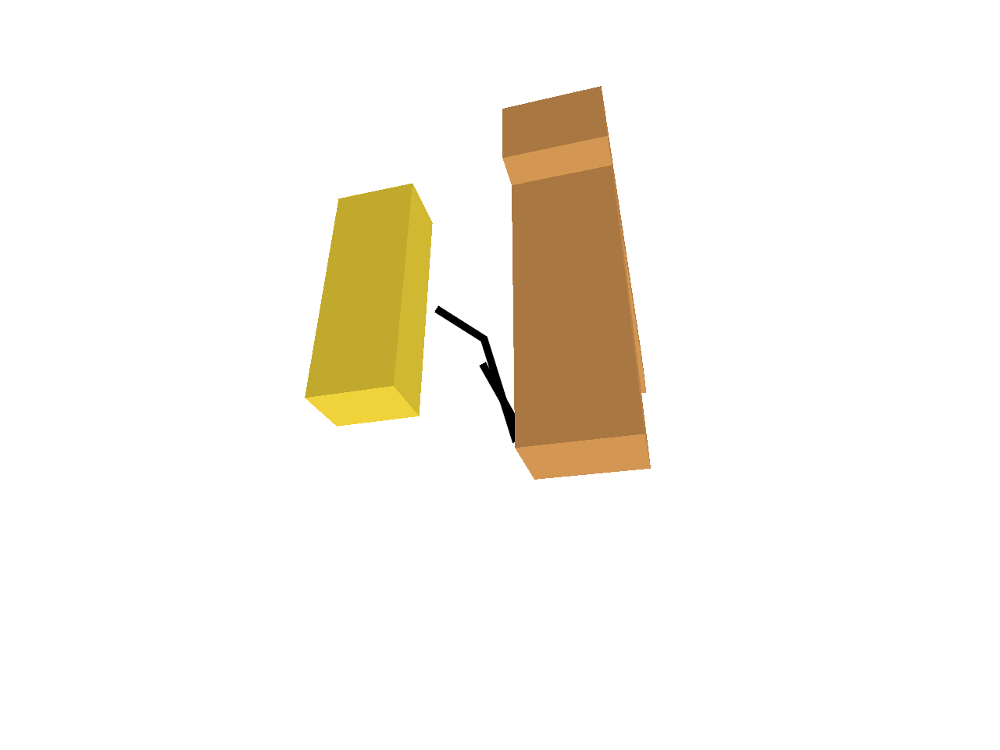
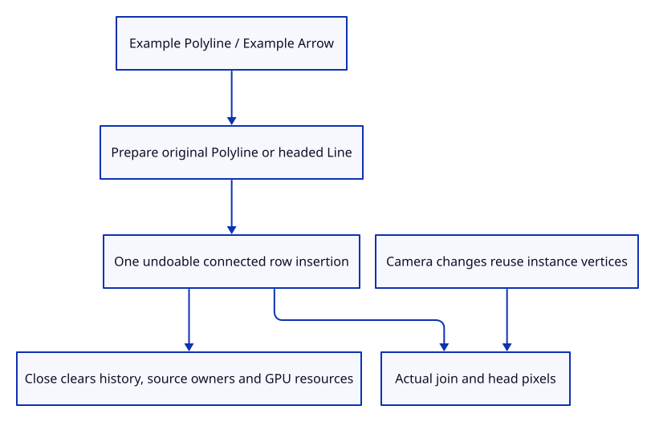

# 5.2.10 · Insert connected paths and arrow examples

**Chapter 5 · Lines, points and curves · Section 5.2 · Connected paths and arrows** · [Contents](contents.md)

**Typing: 14–28 minutes.** [Estimate](typing-load.md).

Register Example Polyline and Example Arrow in the existing command dock. Prepare the original geometry before accepting one undoable insertion.

## Type

Continue from [Draw connected document rows](36da-render.md). [Save or recover your work](recovery.md).

### 1. `src/editor.rs`

Expose connected examples as document actions. Prepare the original path or headed line before accepting one history transaction.

Edit these blocks from bottom to top. Keep the surrounding lines unchanged.

<details>
<summary>Locate this block</summary>

```rust
                let loaded = crate::document::load_at(&bytes, Some(location))?;
                self.history.try_edit(&mut self.scene, |scene| scene.replace(loaded))?;
            }
            Action::AddLine => {
                let mut line = session_rust::Line::new(-0.6, 0.0, 0.0, 0.6, 0.0, 0.0);
                line.width = 5.0; line.linecolor = session_rust::Color::new(0.0, 0.0, 0.0, 1.0);
```

</details>

Replace it with:

```rust
                let loaded = crate::document::load_at(&bytes, Some(location))?;
                self.history.try_edit(&mut self.scene, |scene| scene.replace(loaded))?;
            }
            Action::AddPolyline | Action::AddArrow => {
                let prepared = if matches!(action, Action::AddPolyline) {
                    let mut line = session_rust::Polyline::new(vec![session_rust::Point::new(-0.6, -0.4, 0.0),
                        session_rust::Point::new(0.0, 0.0, 0.0), session_rust::Point::new(0.6, -0.4, 0.0)]);
                    line.width = 6.0; line.linecolor = session_rust::Color::new(0.0, 0.0, 0.0, 0.5);
                    crate::chain::PreparedChain::polyline(std::rc::Rc::new(line))?
                } else {
                    let mut line = session_rust::Line::new(-0.6, 0.3, 0.0, 0.6, 0.3, 0.0);
                    line.width = 5.0; line.linecolor = session_rust::Color::new(0.0, 0.0, 0.0, 1.0);
                    line.arrowhead = session_rust::Arrowhead::BOTH;
                    crate::chain::PreparedChain::line(std::rc::Rc::new(line))?
                };
                self.history.try_edit(&mut self.scene, |scene| scene.insert_path(prepared).map(|_| ()))?;
            }
            Action::AddLine => {
                let mut line = session_rust::Line::new(-0.6, 0.0, 0.0, 0.6, 0.0, 0.0);
                line.width = 5.0; line.linecolor = session_rust::Color::new(0.0, 0.0, 0.0, 1.0);
```

<details>
<summary>Locate this block</summary>

```rust
    UnloadSources,
    AddBox,
    AddLine,
    Translate([f64; 3]),
    ToggleExtra,
    SelectNext,
```

</details>

Replace it with:

```rust
    UnloadSources,
    AddBox,
    AddLine,
    AddPolyline,
    AddArrow,
    Translate([f64; 3]),
    ToggleExtra,
    SelectNext,
```

<details>
<summary>Complete updated block reference</summary>

```rust
use crate::{background::Background, camera::Camera, history::History, scene::{ObjectId, Scene}};

pub enum Action {
    Pick([f32; 2]),
    Import(Vec<u8>),
    Replace(Vec<u8>),
    ImportAt(Vec<u8>, std::rc::Rc<crate::reload_url::ReloadUrl>),
    ReplaceAt(Vec<u8>, std::rc::Rc<crate::reload_url::ReloadUrl>),
    Close,
    UnloadSources,
    AddBox,
    AddLine,
    AddPolyline,
    AddArrow,
    Translate([f64; 3]),
    ToggleExtra,
    SelectNext,
    Delete,
    Undo,
    Redo,
    Background,
    Zoom(f32),
    Pan(f32, f32),
    Orbit(f64, f64),
    Isometric,
    ResetView,
    Fit,
    FitSelected,
    Projection(crate::camera::Projection),
}

#[derive(Debug, PartialEq, Eq)]
pub enum Change {
    View,
    Scene,
}

pub struct Editor {
    pub scene: Scene,
    pub selected: Option<ObjectId>,
    pub camera: Camera,
    pub background: Background,
    history: History,
    last_release: u64,
}

impl Default for Editor {
    fn default() -> Self {
        Self {
            scene: Scene::demo(),
            selected: None,
            camera: Camera::default(),
            background: Background::default(),
            history: History::default(),
            last_release: 0,
        }
    }
}

impl Editor {
    pub fn scenes(&self) -> impl Iterator<Item = &Scene> {
        std::iter::once(&self.scene).chain(self.history.scenes())
    }

    pub fn reload_keys(&self) -> Vec<crate::rehydrate::ReloadKey> {
        let mut seen = std::collections::HashSet::new();
        self.scene.objects().iter().filter_map(crate::rehydrate::ReloadKey::of)
            .filter(|key| seen.insert(key.origin.id)).collect()
    }

    fn scenes_mut(&mut self) -> impl Iterator<Item = &mut Scene> {
        std::iter::once(&mut self.scene).chain(self.history.scenes_mut())
    }

    pub fn hydrate(&mut self, values: Vec<(crate::rehydrate::ReloadKey, Vec<u8>)>) -> Result<bool, &'static str> {
        if values.is_empty() { return Ok(false); }
        let mut seen = std::collections::HashSet::new();
        for (key, _) in &values {
            if !seen.insert(key.origin.id) || !self.scene.objects().iter().any(|row| key.matches(row)) {
                return Ok(false);
            }
        }
        let prepared: Vec<_> = values.into_iter().map(|(key, bytes)|
            crate::rehydrate::PreparedReload::new(key, &bytes)).collect::<Result<_, _>>()?;
        for plan in &prepared {
            if self.scenes().flat_map(|scene| scene.objects()).filter(|row| plan.key.matches(row))
                .any(|row| !plan.validates(row)) { return Err("Reloaded source GUID or metadata does not match"); }
        }
        for scene in self.scenes_mut() {
            for plan in &prepared { scene.hydrate(plan); }
        }
        Ok(true)
    }

    fn unload_sources(&mut self) -> Result<(), &'static str> {
        let mut origins: std::collections::HashSet<_> = self.scenes().flat_map(|scene| scene.objects())
            .filter(|row| row.can_unload()).filter_map(|row| row.origin().map(|origin| origin.id)).collect();
        for row in self.scenes().flat_map(|scene| scene.objects()) {
            if let Some(origin) = row.origin() {
                if !row.can_unload() { origins.remove(&origin.id); }
            }
        }
        if origins.is_empty() { return Err("No eligible imported sources to unload"); }
        let epoch = self.last_release.checked_add(1).ok_or("Release epochs exhausted")?;
        for scene in self.scenes_mut() { scene.unload(&origins, epoch); }
        self.last_release = epoch;
        Ok(())
    }

    pub fn move_object(&mut self, id: ObjectId, offset: [f64; 3]) -> Result<Change, &'static str> {
        if !offset.iter().all(|value| value.is_finite()) { return Err("Move needs finite coordinates"); }
        let object = self.scene.objects().iter().find(|row| row.id == id).ok_or("Object not found")?;
        if offset.iter().all(|&value| value == 0.0) { return Ok(Change::View); }
        let shift = session_rust::Xform::translation(offset[0], offset[1], offset[2]);
        let model = &shift * &object.model;
        self.history.try_edit(&mut self.scene, |scene| scene.place(id, model))?;
        Ok(Change::Scene)
    }

    pub fn delete_object(&mut self, id: ObjectId) -> Result<Change, &'static str> {
        let row = self.scene.objects().iter().find(|row| row.id == id).ok_or("Object not found")?;
        if row.geometry().is_none() { return Err("Reload editable sources before Delete"); }
        self.history.edit(&mut self.scene, |scene| { scene.remove(id); });
        if self.selected == Some(id) { self.selected = None; }
        Ok(Change::Scene)
    }

    pub fn apply(&mut self, action: Action) -> Result<Change, &'static str> {
        match action {
            Action::Pick(screen) => {
                self.selected = self.camera.ray(screen)
                    .and_then(|ray| crate::picking::pick(&self.scene, &ray));
            }
            Action::UnloadSources => self.unload_sources()?,
            Action::Close => {
                self.scene.clear();
                self.history.clear();
                self.selected = None;
            }
            Action::Replace(bytes) => {
                let loaded = crate::document::load(&bytes)?;
                self.history.try_edit(&mut self.scene, |scene| scene.replace(loaded))?;
            }
            Action::Import(bytes) => {
                let loaded = crate::document::load(&bytes)?;
                self.history.try_edit(&mut self.scene, |scene| scene.import(loaded))?;
            }
            Action::ImportAt(bytes, location) => {
                let loaded = crate::document::load_at(&bytes, Some(location))?;
                self.history.try_edit(&mut self.scene, |scene| scene.import(loaded))?;
            }
            Action::ReplaceAt(bytes, location) => {
                let loaded = crate::document::load_at(&bytes, Some(location))?;
                self.history.try_edit(&mut self.scene, |scene| scene.replace(loaded))?;
            }
            Action::AddPolyline | Action::AddArrow => {
                let prepared = if matches!(action, Action::AddPolyline) {
                    let mut line = session_rust::Polyline::new(vec![session_rust::Point::new(-0.6, -0.4, 0.0),
                        session_rust::Point::new(0.0, 0.0, 0.0), session_rust::Point::new(0.6, -0.4, 0.0)]);
                    line.width = 6.0; line.linecolor = session_rust::Color::new(0.0, 0.0, 0.0, 0.5);
                    crate::chain::PreparedChain::polyline(std::rc::Rc::new(line))?
                } else {
                    let mut line = session_rust::Line::new(-0.6, 0.3, 0.0, 0.6, 0.3, 0.0);
                    line.width = 5.0; line.linecolor = session_rust::Color::new(0.0, 0.0, 0.0, 1.0);
                    line.arrowhead = session_rust::Arrowhead::BOTH;
                    crate::chain::PreparedChain::line(std::rc::Rc::new(line))?
                };
                self.history.try_edit(&mut self.scene, |scene| scene.insert_path(prepared).map(|_| ()))?;
            }
            Action::AddLine => {
                let mut line = session_rust::Line::new(-0.6, 0.0, 0.0, 0.6, 0.0, 0.0);
                line.width = 5.0; line.linecolor = session_rust::Color::new(0.0, 0.0, 0.0, 1.0);
                let prepared = crate::stroke::PreparedLine::new(std::rc::Rc::new(line))?;
                self.history.try_edit(&mut self.scene, |scene| scene.insert_line(prepared).map(|_| ()))?;
            }
            Action::AddBox => {
                self.history.try_edit(&mut self.scene, |scene| scene.add_box().map(|_| ()))?;
            }
            Action::Translate(offset) => {
                let id = self.selected.ok_or("Select an object before Move")?;
                return self.move_object(id, offset);
            }
            Action::ToggleExtra => self.history.edit(&mut self.scene, Scene::toggle_extra),
            Action::SelectNext => self.selected = self.scene.next(self.selected),
            Action::Delete => {
                return match self.selected {
                    Some(id) => self.delete_object(id),
                    None => Ok(Change::View),
                };
            }
            Action::Undo => { self.history.undo(&mut self.scene); }
            Action::Redo => { self.history.redo(&mut self.scene); }
            view => {
                match view {
                    Action::Background => self.background.toggle(),
                    Action::Zoom(factor) => self.camera.zoom(factor),
                    Action::Pan(dx, dy) => self.camera.pan(dx, dy),
                    Action::Orbit(yaw, pitch) => self.camera.orbit(yaw, pitch),
                    Action::Isometric => self.camera.isometric(),
                    Action::Projection(mode) => self.camera.projection = mode,
                    Action::Fit => {
                        if let Some(bounds) = self.scene.bounds() {
                            self.camera.fit(&bounds);
                        }
                    }
                    Action::FitSelected => {
                        if let Some(bounds) = self.selected
                            .and_then(|id| self.scene.selected_bounds(id))
                        {
                            self.camera.fit(&bounds);
                        }
                    }
                    Action::ResetView => {
                        let aspect = self.camera.aspect;
                        self.camera = Camera { aspect, ..Camera::default() };
                    }
                    _ => unreachable!("Document actions were handled above"),
                }
                return Ok(Change::View);
            }
        }
        // Deletion and history travel can invalidate selection; repair it in one place.
        self.selected = self.selected.filter(|id| self.scene.contains(*id));
        Ok(Change::Scene)
    }
}

#[cfg(test)]
mod tests {
    use super::*;

    #[test]
    fn a_modified_history_row_protects_only_its_own_import_origin() {
        use std::rc::Rc;
        let mut editor = Editor::default(); let bytes = crate::specimen::bytes();
        let first = Rc::new(crate::reload_url::ReloadUrl::new("test:first".into()));
        editor.apply(Action::ReplaceAt(bytes.clone(), first)).unwrap();
        let origin = editor.scene.objects()[0].origin().unwrap().id;
        let original = Rc::downgrade(editor.scene.objects()[0].geometry().unwrap());
        let second = Rc::new(crate::reload_url::ReloadUrl::new("test:second".into()));
        editor.apply(Action::ImportAt(bytes, second)).unwrap();
        let copy = Rc::downgrade(editor.scene.objects()[3].geometry().unwrap());
        editor.apply(Action::SelectNext).unwrap(); editor.apply(Action::Translate([0.25, 0.0, 0.0])).unwrap();
        editor.apply(Action::Undo).unwrap();
        let saved = editor.history.scenes_mut().last().unwrap();
        assert_eq!(saved.objects()[0].origin().unwrap().id, origin);
        Rc::make_mut(&mut saved.objects_mut()[0].metadata).is_locked = true;
        assert!(editor.scene.objects()[0].can_unload());
        editor.apply(Action::UnloadSources).unwrap();
        assert!(original.upgrade().is_some()); assert!(copy.upgrade().is_none());
        assert!(editor.scene.objects()[0].geometry().is_some());
        assert!(editor.scene.objects()[3].geometry().is_none());
        assert_eq!(editor.last_release, 1);
        assert!(editor.apply(Action::UnloadSources).is_err()); assert_eq!(editor.last_release, 1);
    }

    #[test]
    fn release_epochs_do_not_wrap_or_reset_on_close() {
        use std::rc::Rc;
        let mut editor = Editor::default(); let bytes = crate::specimen::bytes();
        let url = Rc::new(crate::reload_url::ReloadUrl::new("test:epoch".into()));
        editor.apply(Action::ReplaceAt(bytes.clone(), Rc::clone(&url))).unwrap();
        editor.last_release = u64::MAX;
        assert_eq!(editor.apply(Action::UnloadSources), Err("Release epochs exhausted"));
        assert!(editor.scene.objects()[0].geometry().is_some());
        editor.last_release = 0; editor.apply(Action::UnloadSources).unwrap();
        assert_eq!(editor.scene.objects()[0].release_epoch(), Some(1));
        editor.apply(Action::Close).unwrap();
        editor.apply(Action::ImportAt(bytes, url)).unwrap();
        editor.apply(Action::UnloadSources).unwrap();
        assert_eq!(editor.scene.objects()[0].release_epoch(), Some(2));
    }

    #[test]
    fn close_ends_history_and_keeps_issued_ids_and_view_settings() {
        let mut editor = Editor::default();
        editor.apply(Action::Import(crate::specimen::bytes())).unwrap();
        editor.apply(Action::AddBox).unwrap(); editor.apply(Action::Undo).unwrap();
        let old: Vec<_> = editor.scenes().flat_map(|scene| scene.objects().iter().map(|row| row.id)).collect();
        editor.apply(Action::SelectNext).unwrap();
        editor.apply(Action::Pan(0.2, 0.1)).unwrap(); editor.apply(Action::Background).unwrap();
        let view = editor.camera.uniform(); let background = editor.background.rgb();
        editor.apply(Action::Close).unwrap();
        assert!(editor.scene.objects().is_empty() && editor.selected.is_none());
        assert_eq!(editor.scenes().count(), 1);
        editor.apply(Action::Undo).unwrap(); editor.apply(Action::Redo).unwrap();
        assert!(editor.scene.objects().is_empty());
        assert_eq!(editor.camera.uniform(), view); assert_eq!(editor.background.rgb(), background);
        editor.apply(Action::AddBox).unwrap();
        assert!(!old.contains(&editor.scene.objects()[0].id));
    }

    #[test]
    fn repeated_close_is_empty_and_drops_sources_without_gpu_owners() {
        let mut editor = Editor::default();
        let display = std::rc::Rc::downgrade(&editor.scene.objects()[0].mesh);
        let source = std::rc::Rc::downgrade(editor.scene.objects()[0].geometry().unwrap());
        editor.apply(Action::Close).unwrap(); editor.apply(Action::Close).unwrap();
        assert!(display.upgrade().is_none() && source.upgrade().is_none());
        assert_eq!(crate::memory::cpu(editor.scenes(), std::iter::empty()), [0, 0, 0, 0, 0, 1]);
    }

    #[test]
    fn close_releases_imported_history_documents_and_reopening_uses_fresh_ids() {
        use std::rc::Rc;
        let mut editor = Editor::default();
        let bytes = crate::specimen::bytes();
        editor.apply(Action::Import(bytes.clone())).unwrap();
        editor.apply(Action::Replace(bytes.clone())).unwrap();
        let displays: Vec<_> = editor.scenes().flat_map(|scene| scene.objects().iter()
            .map(|row| Rc::downgrade(&row.mesh))).collect();
        let sources: Vec<_> = editor.scenes().flat_map(|scene| scene.objects().iter()
            .map(|row| Rc::downgrade(row.geometry().unwrap()))).collect();
        let documents: Vec<_> = editor.scenes().flat_map(|scene| scene.objects().iter()
            .filter_map(|row| row.source().map(|source| Rc::downgrade(&source.document)))).collect();
        let old: Vec<_> = editor.scenes().flat_map(|scene| scene.objects().iter().map(|row| row.id)).collect();
        assert!(!documents.is_empty());
        editor.apply(Action::Close).unwrap();
        assert!(displays.iter().all(|owner| owner.upgrade().is_none()));
        assert!(sources.iter().all(|owner| owner.upgrade().is_none()));
        assert!(documents.iter().all(|owner| owner.upgrade().is_none()));
        editor.apply(Action::Import(bytes)).unwrap();
        assert!(editor.scene.objects().iter().all(|row| !old.contains(&row.id)));
    }

    #[test]
    fn resetting_the_view_preserves_its_current_aspect() {
        let mut editor = Editor::default();
        editor.camera.aspect = 2.0;
        editor.apply(Action::Zoom(2.0)).unwrap();
        editor.apply(Action::ResetView).unwrap();
        assert_eq!(editor.camera.aspect, 2.0);
        assert_eq!(editor.camera.distance, 3.0);
    }

    #[test]
    fn undo_changes_the_document_without_rewinding_the_view() {
        let mut editor = Editor::default();
        editor.apply(Action::AddBox).unwrap();
        editor.apply(Action::Zoom(2.0)).unwrap();
        editor.apply(Action::Background).unwrap();
        editor.apply(Action::Undo).unwrap();
        assert_eq!(editor.scene.objects().len(), 2);
        assert_eq!(editor.camera.distance, 1.5);
        assert_eq!(editor.background.rgb(), [0.9, 0.9, 0.9]);
    }

    #[test]
    fn undo_repairs_selection_and_empty_delete_preserves_redo() {
        let mut editor = Editor::default();
        editor.apply(Action::AddBox).unwrap();
        for _ in 0..3 {
            editor.apply(Action::SelectNext).unwrap();
        }
        let box_id = editor.selected.unwrap();
        editor.apply(Action::Undo).unwrap();
        assert!(editor.selected.is_none());
        editor.apply(Action::Delete).unwrap();
        editor.apply(Action::Redo).unwrap();
        assert!(editor.scene.contains(box_id));
    }

    #[test]
    fn picking_a_moved_view_uses_the_editors_current_camera() {
        let mut editor = Editor::default();
        editor.apply(Action::Pan(0.2, 0.1)).unwrap();
        let point = session_rust::Point::new(0.2, 0.3, 0.75);
        let screen = editor.camera.view_projection().transform_point(&point);
        assert_eq!(editor.apply(Action::Pick([screen[0] as f32, screen[1] as f32])).unwrap(), Change::Scene);
        assert_eq!(editor.selected, Some(editor.scene.objects()[1].id));
        assert_eq!(editor.apply(Action::Zoom(2.0)).unwrap(), Change::View);
    }
}
```

</details>

<details>
<summary>Optional patch references</summary>

Use these original edit fragments when comparing a saved checkpoint. Apply the complete blocks above.

```text
--8<-- "journey/code/36e-input-01.rs"
```

```text
--8<-- "journey/code/36e-input-02.rs"
```

</details>

### 2. `src/browser.rs`

Expose the two source-backed examples in actual dock completion and Help. Dispatch accepted input through the editor.

Edit these blocks from bottom to top. Keep the surrounding lines unchanged.

<details>
<summary>Locate this block</summary>

```rust
                let action = match line.as_str() {
                    "example box" => Action::AddBox,
                    "example line" => Action::AddLine,
                    "example triangle" => Action::ToggleExtra,
                    "select next" => Action::SelectNext,
                    "delete" => Action::Delete,
```

</details>

Replace it with:

```rust
                let action = match line.as_str() {
                    "example box" => Action::AddBox,
                    "example line" => Action::AddLine,
                    "example polyline" => Action::AddPolyline,
                    "example arrow" => Action::AddArrow,
                    "example triangle" => Action::ToggleExtra,
                    "select next" => Action::SelectNext,
                    "delete" => Action::Delete,
```

<details>
<summary>Locate this block</summary>

```rust
            "Report Previous",
            "Example Box",
            "Example Line",
            "Example Triangle",
            "Select Next",
            "Delete",
```

</details>

Replace it with:

```rust
            "Report Previous",
            "Example Box",
            "Example Line",
            "Example Polyline",
            "Example Arrow",
            "Example Triangle",
            "Select Next",
            "Delete",
```

<details>
<summary>Complete updated block reference</summary>

```rust
use crate::background::Background;
use crate::editor::{Action, Change, Editor};
use crate::gesture::Gesture;
use crate::renderer::Renderer;
use crate::viewport::Viewport;
use wasm_bindgen::{JsCast, JsValue, closure::Closure};

pub fn report(message: &str) {
    if let Some(document) = web_sys::window().and_then(|window| window.document()) {
        if let Some(status) = document.get_element_by_id("status") {
            status.set_text_content(Some(message));
            if message.starts_with("Cannot draw:") { let _ = status.remove_attribute("hidden"); }
        }
    }
}

fn failed(fault: crate::gpu_fault::Fault, message: String) {
    if !fault.remember(message.clone()) { return; }
    wasm_bindgen_futures::spawn_local(async move {
        if crate::browser_runtime::stop_if(&fault) {
            crate::browser_report::fatal(&message);
            if crate::browser_recovery::request(&message) { return; }
            report(&format!("Cannot draw: {message}"));
        }
    });
}

fn save_result(bytes: &[u8]) -> Result<String, String> {
    crate::file_output::download(bytes)
        .map(|()| format!("Saved editable document ({} bytes)", bytes.len()))
        .map_err(|error| format!("Save failed: {error:?}"))
}

pub async fn run() -> Result<(), JsValue> { run_with(crate::drawing_document::new()).await }

pub async fn run_with(shared: crate::drawing_document::Shared) -> Result<(), JsValue> {
    let window = web_sys::window().ok_or("No browser window")?;
    let document = window.document().ok_or("No document")?;
    let canvas: web_sys::HtmlCanvasElement = document
        .get_element_by_id("canvas")
        .ok_or("Missing canvas")?
        .dyn_into()?;
    let recovery = crate::browser_recovery::adopt()?;
    crate::browser_report::start()?;
    let startup = crate::browser_startup::Guard::new()?;
    let instance = wgpu::Instance::new(wgpu::InstanceDescriptor {
        backends: wgpu::Backends::BROWSER_WEBGPU,
        flags: Default::default(),
        memory_budget_thresholds: Default::default(),
        backend_options: Default::default(),
        display: None,
    });
    let surface = instance
        .create_surface(wgpu::SurfaceTarget::Canvas(canvas.clone()))
        .map_err(|error| JsValue::from_str(&error.to_string()))?;
    let adapter_started = crate::browser_phase::now();
    let probe = crate::browser_adapter::Probe::new().ok();
    let adapter = instance
        .request_adapter(&wgpu::RequestAdapterOptions {
            compatible_surface: Some(&surface),
            ..Default::default()
        })
        .await;
    if !startup.permits() { return Ok(()); }
    crate::browser_phase::finish("adapter request", adapter_started, 0, "GPU");
    let adapter = adapter.map_err(|error| JsValue::from_str(&error.to_string()))?;
    if let Some(info) = probe.as_ref().and_then(|probe| probe.info()) { let _ = crate::browser_report::adapter(info); }
    else { let _ = crate::browser_report::observe("diagnostic", "Adapter identity unavailable"); }
    drop(probe);
    let device_started = crate::browser_phase::now();
    let device = adapter
        .request_device(&wgpu::DeviceDescriptor::default())
        .await;
    if !startup.permits() {
        if let Ok((device, _)) = device { device.destroy(); }
        return Ok(());
    }
    crate::browser_phase::finish("device request", device_started, 0, "GPU");
    let (device, queue) = device.map_err(|error| JsValue::from_str(&error.to_string()))?;
    let fault = crate::gpu_fault::Fault::default();
    let errors = fault.clone();
    device.on_uncaptured_error(std::sync::Arc::new(move |error| failed(errors.clone(), format!("WebGPU error: {error}"))));
    let lost = fault.clone();
    device.set_device_lost_callback(move |reason, message| failed(lost.clone(), format!("WebGPU device lost ({reason:?}): {message}")));
    let limit = device.limits().max_texture_dimension_2d;
    let width = (window.inner_width()?.as_f64().ok_or("No window width")? as u32).clamp(1, limit);
    let height = (window.inner_height()?.as_f64().ok_or("No window height")? as u32).clamp(1, limit);
    canvas.set_width(width);
    canvas.set_height(height);
    let mut config = surface
        .get_default_config(&adapter, width, height)
        .ok_or("No compatible surface format")?;
    config.view_formats = vec![config.format.add_srgb_suffix()];
    surface.configure(&device, &config);
    let mut editor = shared.borrow_mut();
    let pipeline_started = crate::browser_phase::now();
    let mut renderer = Renderer::new(
        device,
        queue,
        config.format.add_srgb_suffix(),
        &editor.scene,
    );
    crate::browser_phase::finish("renderer setup", pipeline_started, 0, "GPU");
    renderer.resize(Viewport { width, height });
    inspect(&editor, &renderer)?;
    let mut panel = crate::panel::Panel::new(
        &renderer,
        config.format.add_srgb_suffix(),
        &[
            "Help",
            "Open",
            "Open Replace",
            "Cancel Open",
            "Close",
            "Unload Sources",
            "Reload Sources",
            "Cancel Reload",
            "Save",
            "Report",
            "Report Previous",
            "Example Box",
            "Example Line",
            "Example Polyline",
            "Example Arrow",
            "Example Triangle",
            "Select Next",
            "Delete",
            "Undo",
            "Redo",
            "Background",
            "Zoom In",
            "Zoom Out",
            "Pan Left",
            "Pan Right",
            "Orbit Right",
            "Orbit Up",
            "View Isometric",
            "View Perspective",
            "View Orthographic",
            "Fit",
            "Fit Selected",
            "Move",
            "View Reset",
        ],
    );
    if let Some(message) = crate::browser_report::previous_notice() { panel.result(message); }
    if let Some(message) = &recovery { panel.result(message); }
    panel.update(None, &canvas)?;
    if resize(
        &window,
        &canvas,
        &surface,
        &mut config,
        &mut renderer,
        &mut editor,
    ) {
        panel.update(None, &canvas)?;
        let frame_started = crate::browser_phase::now();
        present(
            &surface,
            &renderer,
            &editor.background,
            &editor.camera.uniform(),
            &mut panel,
        )?;
        let completing = fault.clone();
        // Queue completion runs after submitted GPU work; checking the current device prevents a late result from reviving an exited runtime.
        renderer.queue.on_submitted_work_done(move || {
            if crate::browser_runtime::owns(&completing) && completing.message().is_none() {
                crate::browser_phase::finish("first frame complete", frame_started, 0, "GPU");
                let _ = crate::browser_report::observe("milestone", "geometry on screen");
            }
        });
    }
    let input_canvas = canvas.clone();
    let browser_window = window.clone();
    let pointer_canvas = canvas.clone();
    let mut gesture = Gesture::default();
    let request = std::rc::Rc::new(std::cell::RefCell::new(crate::read_gate::ReadGate::default()));
    let read_mode = std::cell::Cell::new(crate::file_input::Mode::Append);
    let delivery: crate::file_input::Delivery = std::rc::Rc::new(std::cell::RefCell::new(None));
    let reload: crate::browser_reload::Shared = std::rc::Rc::new(std::cell::RefCell::new(Default::default()));
    let reload_delivery: crate::browser_reload::Delivery = std::rc::Rc::new(std::cell::RefCell::new(None));
    let owned_request = std::rc::Rc::clone(&request);
    let owned_reload = std::rc::Rc::clone(&reload);
    let active_fault = fault.clone();
    drop(editor);
    let owned_editor = std::rc::Rc::clone(&shared);
    let update = Closure::<dyn FnMut(web_sys::Event)>::new(move |event: web_sys::Event| {
        if active_fault.message().is_some() { return; }
        let mut editor = shared.borrow_mut();
        if event.type_() == "pagehide" {
            gesture.cancel();
            if event.dyn_ref::<web_sys::PageTransitionEvent>().is_some_and(|event| event.persisted()) { return; }
            wasm_bindgen_futures::spawn_local(async { crate::browser_runtime::stop(); });
            return;
        }
        let shortcut = event.dyn_ref::<web_sys::KeyboardEvent>().and_then(|key| panel.shortcut(key));
        let line = if let Some(shortcut) = shortcut {
            event.prevent_default();
            panel.answer(shortcut.command(), "");
            Some(shortcut.command().to_ascii_lowercase())
        } else { match panel.update(Some(&event), &input_canvas) {
            Ok(line) => line,
            Err(error) => {
                report(&format!("Cannot read command: {error:?}"));
                return;
            }
        } };

        let action = if event.type_() == "cancel" && event.target()
            .and_then(|target| target.dyn_into::<web_sys::HtmlInputElement>().ok())
            .is_some_and(|input| input.id() == "open")
        {
            request.borrow_mut().cancel();
            report("Open cancelled.");
            panel.answer("Open", "Open cancelled.");
            None
        } else if event.type_() == "change" {
            crate::file_input::choose(&event, std::rc::Rc::clone(&request), read_mode.get(), std::rc::Rc::clone(&delivery));
            None
        } else if event.type_() == "viewer-file-error" {
            if let Some(message) = event.dyn_ref::<web_sys::CustomEvent>().and_then(|event| event.detail().as_string()) {
                report(&message);
                panel.answer("Open", &message);
            }
            None
        } else if event.type_() == "viewer-reload" {
            if let Some(reply) = reload_delivery.borrow_mut().take() {
                let command = reply.intent.map_or("Reload Sources", |intent| intent.command());
                match reply.complete(&mut editor) {
                    Ok(Some(crate::edit_replay::Reply::Changed(_))) => {
                        crate::browser_upload::prepare(&mut renderer, &editor.scene, editor.selected, active_fault.clone());
                        crate::browser_phase::revision(&editor.scene);
                        let message = if command == "Reload Sources" {
                            "Editable sources restored; display retained.".to_owned()
                        } else { format!("{command} completed after source reload.") };
                        report(&message); panel.answer(command, &message);
                    }
                    Ok(Some(crate::edit_replay::Reply::Saved(bytes))) => {
                        let message = save_result(&bytes).unwrap_or_else(|error| error);
                        report(&message); panel.answer(command, &message);
                    }
                    Ok(None) => {}
                    Err(error) => { report(&error); panel.answer(command, &error); }
                }
            }
            None
        } else if event.type_() == "viewer-file" {
            match crate::file_input::action(&event, &delivery) {
                Ok(action) => action,
                Err(error) => { let message = format!("Cannot retain reload file: {error:?}");
                    report(&message); panel.answer("Open", &message); None }
            }
        } else if let Some(line) = line {
            if line == "reload sources" {
                let result = crate::browser_reload::start(std::rc::Rc::clone(&reload), editor.reload_keys(), std::rc::Rc::clone(&reload_delivery));
                match result {
                    Ok(()) => panel.result("Reloading editable sources…"),
                    Err(error) => { report(&error); panel.result(&error); }
                }
                None
            } else if line == "cancel reload" {
                reload.borrow_mut().cancel();
                report("Reload cancelled."); panel.result("Reload cancelled.");
                None
            } else if line == "unload sources" {
                Some(Action::UnloadSources)
            } else if line == "close" {
                request.borrow_mut().cancel();
                Some(Action::Close)
            } else if line == "cancel open" {
                request.borrow_mut().cancel();
                report("Open cancelled.");
                panel.result("Open cancelled.");
                None
            } else if line == "open" || line == "open replace" {
                let ticket = request.borrow_mut().begin();
                if let Err(error) = ticket { report(error); panel.result(error); return; }
                if line == "open replace" { reload.borrow_mut().cancel(); }
                read_mode.set(if line == "open replace" { crate::file_input::Mode::Replace }
                    else { crate::file_input::Mode::Append });
                if let Some(input) = web_sys::window()
                    .and_then(|window| window.document())
                    .and_then(|document| document.get_element_by_id("open"))
                    .and_then(|element| element.dyn_into::<web_sys::HtmlInputElement>().ok())
                {
                    input.click();
                }
                None
            } else if line == "report" || line == "report previous" {
                let output = if line.ends_with(" previous") { crate::browser_report::download_previous() }
                    else { crate::browser_report::download() };
                let result = output.map(|()| "Diagnostic report downloaded.".to_owned())
                    .unwrap_or_else(|error| format!("Diagnostic report failed: {error:?}"));
                panel.result(&result);
                None
            } else if line == "save" {
                let result = crate::browser_reload::restore_for(crate::edit_intent::Intent::Save,
                    &editor, std::rc::Rc::clone(&reload), std::rc::Rc::clone(&reload_delivery))
                    .and_then(|waiting| {
                        if waiting { Ok("Reloading editable sources…".to_owned()) }
                        else { crate::document::snapshot(&editor.scene).map_err(str::to_owned)
                            .and_then(|bytes| save_result(&bytes)) }
                    });
                panel.result(&result.unwrap_or_else(|error| error));
                None
            } else if line == "move" || line.starts_with("move ") {
                match crate::offset::parse(&line) {
                    Ok(offset) => Some(Action::Translate(offset)),
                    Err(error) => { panel.result(error); None }
                }
            } else {
                let action = match line.as_str() {
                    "example box" => Action::AddBox,
                    "example line" => Action::AddLine,
                    "example polyline" => Action::AddPolyline,
                    "example arrow" => Action::AddArrow,
                    "example triangle" => Action::ToggleExtra,
                    "select next" => Action::SelectNext,
                    "delete" => Action::Delete,
                    "undo" => Action::Undo,
                    "redo" => Action::Redo,
                    "background" => Action::Background,
                    "zoom in" => Action::Zoom(2.0),
                    "zoom out" => Action::Zoom(0.5),
                    "pan left" => Action::Pan(-0.25, 0.0),
                    "pan right" => Action::Pan(0.25, 0.0),
                    "orbit right" => Action::Orbit(std::f64::consts::FRAC_PI_4, 0.0),
                    "orbit up" => Action::Orbit(0.0, std::f64::consts::FRAC_PI_6),
                    "view isometric" => Action::Isometric,
                    "view perspective" => {
                        Action::Projection(crate::camera::Projection::Perspective)
                    }
                    "view orthographic" => {
                        Action::Projection(crate::camera::Projection::Orthographic)
                    }
                    "fit" if shortcut.is_some() && editor.selected.is_some() => Action::FitSelected,
                    "fit" => Action::Fit,

                    "fit selected" => Action::FitSelected,
                    "view reset" => Action::ResetView,
                    _ => return,
                };
                Some(action)
            }
        } else if !panel.consumed {
            navigation_action(&event, &pointer_canvas, &mut gesture)
        } else {
            None
        };
        if let Some(action) = action {
            if matches!(&action, Action::Close | Action::UnloadSources | Action::Undo | Action::Redo
                | Action::Replace(_) | Action::ReplaceAt(_, _)) { reload.borrow_mut().cancel(); }
            let replacement = matches!(&action, Action::Replace(_) | Action::ReplaceAt(_, _));
            let closing = matches!(&action, Action::Close);
            let unloading = matches!(&action, Action::UnloadSources);
            let waiting = crate::edit_intent::Intent::capture(&action, editor.selected)
                .map_err(str::to_owned).and_then(|intent| match intent {
                    Some(intent) => crate::browser_reload::restore_for(intent, &editor,
                        std::rc::Rc::clone(&reload), std::rc::Rc::clone(&reload_delivery)),
                    None => Ok(false),
                });
            let change = waiting.and_then(|waiting| {
                if waiting { panel.result("Reloading editable sources…"); Ok(None) }
                else { editor.apply(action).map(Some).map_err(str::to_owned) }
            });
            match change {
                Ok(Some(Change::Scene)) => {
                    crate::browser_upload::prepare(&mut renderer, &editor.scene, editor.selected, active_fault.clone());
                    if unloading {
                        report("Editable sources unloaded; display retained.");
                        panel.result("Editable sources unloaded; display retained.");
                    } else if closing {
                        report("Document closed.");
                        panel.result("Document closed.");
                    } else if event.type_() == "viewer-file" {
                        crate::browser_phase::revision(&editor.scene);
                        let message = if replacement { "Document replaced. Undo restores the previous document." }
                            else { "File imported. Undo removes the entire import." };
                        report(message);
                        panel.answer(if replacement { "Open Replace" } else { "Open" }, message);
                    }
                }
                Ok(Some(Change::View)) | Ok(None) => {}
                Err(error) => {
                    report(&error);
                    if event.type_() == "viewer-file" { panel.answer("Open", &error); }
                    else { panel.result(&error); }
                }
            }
        }
        if let Err(error) = inspect(&editor, &renderer) {
            report(&format!("Cannot report projection: {error:?}"));
            return;
        }
        if resize(
            &browser_window,
            &pointer_canvas,
            &surface,
            &mut config,
            &mut renderer,
            &mut editor,
        ) {
            if let Err(error) = panel.update(None, &input_canvas) {
                report(&format!("Cannot lay out commands: {error:?}"));
                return;
            }
            if let Err(error) = present(
                &surface,
                &renderer,
                &editor.background,
                &editor.camera.uniform(),
                &mut panel,
            ) {
                report(&format!("Cannot redraw: {error:?}"));
            }
        }
    });
    let mut listeners = crate::listeners::Listeners::new(update);
    for name in [
        "pointerdown",
        "pointermove",
        "pointerup",
        "pointercancel",
        "lostpointercapture",
        "contextmenu",
        "keydown",
        "keyup",
        "blur",
    ] {
        listeners.listen(canvas.as_ref(), name)?;
    }
    listeners.listen(canvas.as_ref(), "wheel")?;
    listeners.listen(window.as_ref(), "resize")?;
    listeners.listen(window.as_ref(), "blur")?;
    listeners.listen(document.as_ref(), "change")?;
    listeners.listen(document.as_ref(), "cancel")?;
    listeners.listen(window.as_ref(), "viewer-file")?;
    listeners.listen(window.as_ref(), "viewer-file-error")?;
    listeners.listen(window.as_ref(), "viewer-reload")?;
    listeners.listen(window.as_ref(), "pagehide")?;
    crate::browser_runtime::install(listeners, owned_request, owned_reload, fault, owned_editor);
    report(&recovery.unwrap_or_else(|| "Wheel zooms; type commands anywhere in the drawing. Escape cancels a drag.".into()));
    Ok(())
}

fn inspect(editor: &Editor, renderer: &Renderer) -> Result<(), JsValue> {
    let document = web_sys::window()
        .and_then(|window| window.document())
        .ok_or("No document")?;
    let canvas = document
        .get_element_by_id("canvas")
        .ok_or("Missing canvas")?;
    let placements: Vec<_> = editor.scene.objects().iter().map(|row| (format!("{:?}", row.id), row.model.m)).collect();
    canvas.set_attribute("data-row-placements", &serde_json::to_string(&placements).map_err(|error| JsValue::from_str(&error.to_string()))?)?;
    canvas.set_attribute("data-path-gpu", &serde_json::to_string(&renderer.path_usage()).unwrap())?;
    canvas.set_attribute("data-path-cpu", &serde_json::to_string(&crate::memory::paths(editor.scenes())).unwrap())?;
    canvas.set_attribute("data-stroke-usage", &serde_json::to_string(&renderer.stroke_usage()).unwrap())?;
    canvas.set_attribute("data-line-usage", &serde_json::to_string(&crate::memory::lines(editor.scenes())).unwrap())?;
    canvas.set_attribute("data-selected-id", &editor.selected.map(|id| format!("{id:?}")).unwrap_or_default())?;
    canvas.set_attribute("data-camera-matrix", &serde_json::to_string(&editor.camera.view_projection().m).map_err(|error| JsValue::from_str(&error.to_string()))?)?;
    canvas.set_attribute("data-object-count", &editor.scene.objects().len().to_string())?;
    let metadata: Vec<_> = editor.scene.objects().iter().map(|row| {
        let m = &row.metadata;
        (&row.guid, &m.source_guid, &m.name, m.is_visible, m.is_locked)
    }).collect();
    let origins: Vec<_> = editor.scene.objects().iter().filter_map(|row| row.origin().map(|origin|
        (&row.guid, origin.id.to_string(), origin.version.hex(),
            origin.location.as_ref().map(|location| location.value())))).collect();
    let residency: Vec<_> = editor.scene.objects().iter().map(|row|
        (&row.guid, row.geometry().is_some(), row.release_epoch())).collect();
    canvas.set_attribute("data-source-residency", &serde_json::to_string(&residency)
        .map_err(|error| JsValue::from_str(&error.to_string()))?)?;
    canvas.set_attribute("data-source-origins", &serde_json::to_string(&origins)
        .map_err(|error| JsValue::from_str(&error.to_string()))?)?;
    canvas.set_attribute("data-row-metadata", &serde_json::to_string(&metadata)
        .map_err(|error| JsValue::from_str(&error.to_string()))?)?;
    canvas.set_attribute("data-gpu-stats", &format!("{:?}", renderer.stats()))?;
    let cpu = crate::memory::cpu(editor.scenes(), renderer.geometry_owners().map(|owner| &owner.source));
    canvas.set_attribute("data-cpu-usage", &format!("{cpu:?}"))?;
    canvas.set_attribute("data-gpu-usage", &format!("{:?}", renderer.usage()))?;
    canvas.set_attribute("data-projection", &format!("{:?}", editor.camera.projection))
}

fn navigation_action(
    event: &web_sys::Event,
    canvas: &web_sys::HtmlCanvasElement,
    gesture: &mut Gesture,
) -> Option<Action> {
    let action = match event.type_().as_str() {
        "wheel" => {
            let wheel = event.dyn_ref::<web_sys::WheelEvent>()?;
            let mode = wheel.delta_mode();
            crate::navigation::wheel(
                wheel.delta_y(),
                mode,
                canvas.get_bounding_client_rect().height(),
            )
        }
        "keydown" => {
            let key = event.dyn_ref::<web_sys::KeyboardEvent>()?;
            if key.is_composing() || key.alt_key() {
                return None;
            }
            if key.key() == "Escape" {
                gesture.cancel();
                event.prevent_default();
                return None;
            }
            return None;
        }
        _ => return pointer_action(event, canvas, gesture),
    }?;
    event.prevent_default();
    Some(action)
}

fn pointer_action(
    event: &web_sys::Event,
    canvas: &web_sys::HtmlCanvasElement,
    gesture: &mut Gesture,
) -> Option<Action> {
    match event.type_().as_str() {
        "contextmenu" => {
            event.prevent_default();
            return None;
        }
        "blur" | "resize" => {
            gesture.cancel();
            return None;
        }
        _ => {}
    }
    let pointer = event.dyn_ref::<web_sys::PointerEvent>()?;
    let id = pointer.pointer_id();
    let position = [pointer.client_x() as f64, pointer.client_y() as f64];
    let motion = match event.type_().as_str() {
        "pointerdown" => {
            if pointer.is_primary() && gesture.press(id, pointer.button(), position) {
                event.prevent_default();
                let options = web_sys::FocusOptions::new();
                options.set_prevent_scroll(true);
                if canvas.focus_with_options(&options).is_err()
                    || canvas.set_pointer_capture(id).is_err()
                {
                    gesture.cancel();
                }
            }
            None
        }
        "pointermove" => gesture.move_to(id, position),
        "pointerup" => {
            let motion = gesture.release(id, position);
            let _ = canvas.release_pointer_capture(id);
            motion
        }
        "pointercancel" | "lostpointercapture" => {
            gesture.cancel_pointer(id);
            None
        }
        _ => None,
    }?;
    let rect = canvas.get_bounding_client_rect();
    motion.action([rect.left(), rect.top(), rect.width(), rect.height()])
}

fn resize(
    window: &web_sys::Window,
    canvas: &web_sys::HtmlCanvasElement,
    surface: &wgpu::Surface<'_>,
    config: &mut wgpu::SurfaceConfiguration,
    renderer: &mut Renderer,
    editor: &mut Editor,
) -> bool {
    let rect = canvas.get_bounding_client_rect();
    let limit = renderer.device.limits().max_texture_dimension_2d;
    let density = crate::browser_recovery::density(window.device_pixel_ratio());
    renderer.set_density(density as f32);
    let Some(size) = Viewport::from_css(
        rect.width(),
        rect.height(),
        density,
        limit,
    ) else {
        return false;
    };
    if size.width != config.width || size.height != config.height {
        canvas.set_width(size.width);
        canvas.set_height(size.height);
        config.width = size.width;
        config.height = size.height;
        surface.configure(&renderer.device, config);
        renderer.resize(size);
    }
    editor.camera.aspect = size.aspect();
    true
}

fn present(
    surface: &wgpu::Surface<'_>,
    renderer: &Renderer,
    background: &Background,
    transform: &[f32; 16],
    panel: &mut crate::panel::Panel,
) -> Result<(), JsValue> {
    let frame = match surface.get_current_texture() {
        wgpu::CurrentSurfaceTexture::Success(frame)
        | wgpu::CurrentSurfaceTexture::Suboptimal(frame) => frame,
        other => {
            return Err(JsValue::from_str(&format!(
                "Surface unavailable: {other:?}"
            )));
        }
    };
    let view = frame.texture.create_view(&wgpu::TextureViewDescriptor {
        format: Some(frame.texture.format().add_srgb_suffix()),
        ..Default::default()
    });
    renderer.draw(&view, background, transform);
    panel.draw(renderer, &view);
    frame.present();
    Ok(())
}
```

</details>

<details>
<summary>Optional patch references</summary>

Use these original edit fragments when comparing a saved checkpoint. Apply the complete blocks above.

```text
--8<-- "journey/code/36e-input-03.rs"
```

```text
--8<-- "journey/code/36e-input-04.rs"
```

</details>

### 3. `src/lib.rs`

Register the undoable source-kind checks.

<details>
<summary>Locate the existing block</summary>

```rust
pub mod chain;
```

</details>

After that block, type:

```rust
#[cfg(test)]
mod path_input_tests;
```

<details>
<summary>Optional patch references</summary>

Use these original edit fragments when comparing a saved checkpoint. Apply the complete blocks above.

```text
--8<-- "journey/code/36e-input-05.rs"
```

</details>

<details>
<summary>Supplied validation fixture</summary>

Copy this supplied authoring fixture once. Continue with the browser build below; the course does not require running native tests.

### 4. `src/path_input_tests.rs`

Copy source-kind, one-step Undo/Redo, identity and Close checks.

Copy this supplied file:

```text
--8<-- "journey/code/36e-input-06.rs"
```

</details>

## Run and check

In your project:

```sh
cd workspace/journey
REGEN_PROTO=0 cargo build --lib --locked --target wasm32-unknown-unknown -j1
REGEN_PROTO=0 CARGO_BUILD_JOBS=1 trunk serve --port 8780
```

Open `http://127.0.0.1:8780/`. Keep an existing Trunk server running; saving rebuilds it.

Close, type Example Polyline, then zoom. Type Example Arrow to add a source line with heads at both original endpoints.

### Recorded visual result

**Previous native render — current verification pending.**

This checkpoint was rendered independently and has the same native comparison frame as [Draw connected document rows](36da-render.md). Use its state checks and browser exercise to assess the changed behavior.



*This recorded image predates a source or checker change. Rebuild this checkpoint before using it as current evidence; browser controls require separate acceptance.*

This reference image is shared with [5.2.9 · Draw connected document rows](36da-render.md). It does not demonstrate a new feature by itself.

<details>
<summary>Code explanation and diagram</summary>

Chrome checks actual join alpha, headed area, camera-only buffer reuse, high-DPI rendering, Undo/Redo and complete Close. The examples remain source-backed paths, ready for later visibility, picking and editing.

accepted dock command → original source → one history transaction → connected lane → pixel and release checks.



Why are connected examples inserted as original geometry rather than disconnected display spans?

Their source retains identity, original coordinates and arrowhead policy. Display spans can be rebuilt while Undo and future editing still operate on one document object.

Study estimate, including typing and experiments: 0.75–1.25 hours.

</details>

<details>
<summary>Optional experiment</summary>

Undo and Redo each example. Camera changes reuse vertex uploads, and Close clears both the connected GPU buffer and document owners.

</details>

<details>
<summary>Check and save your work</summary>

Restore experimental edits, then run from `session_viewer`:

```sh
npm --prefix ../session_tests run course -- check 5.2.10
npm --prefix ../session_tests run course -- save 5.2.10
```

Source comparison leaves your project untouched. [Save and recovery instructions](recovery.md).

</details>

<details>
<summary>Viewer coverage and verification</summary>

Connected rendering, source ownership and example commands are complete. General interactive curve construction, picking, visibility and mixed-document saving remain in their planned chapters.

Native command checks prove one-step history, original Line/Polyline kinds, stable identity and complete Close. Headed Chrome checks join alpha, real arrow pixels, zoom/projection reuse and DPR1/2.

Actual Chrome draws a joined polyline and both original arrow tips from real command insertion.

[Full validation scope](release.md).

To reproduce the scripted acceptance of the reference checkpoint, run from `session_viewer` with the [course bundle server](release.md#reproduce) running on port 8781:

```sh
npm --prefix ../session_tests run course -- capture 5.2.10
```

This uses the verified reference bundle; it does not check or change your typed project.

</details>
