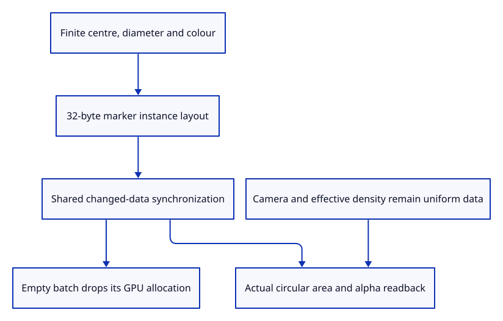

# 5.3.3 · Draw markers with the shared instance lane

**Chapter 5 · Lines, points and curves · Section 5.3 · Original points and controls** · [Contents](contents.md)

**Typing: 8–16 minutes.** [Estimate](typing-load.md).

Add the marker’s 32-byte instance layout to the existing shared lane. Validate its centre, diameter and colour before accepting any new payload.

## Type

Continue from [Extrude a circular marker in screen pixels](37a-disc.md). [Save or recover your work](recovery.md).

### 1. `src/stroke_gpu.rs`

Validate marker payloads before using shared change-only synchronization. Use the exact centre, diameter and colour attributes for marker instances.

Edit these blocks from bottom to top. Keep the surrounding lines unchanged.

<details>
<summary>Locate this block</summary>

```rust
                4 => Float32x3, 5 => Float32x3, 6 => Uint32])
    }

    fn layout(device: &wgpu::Device, format: wgpu::TextureFormat, source: &'static str,
        stride: u64, vertices_per_instance: u32, attributes: &[wgpu::VertexAttribute]) -> Self {
        let shader = device.create_shader_module(wgpu::ShaderModuleDescriptor {
```

</details>

Replace it with:

```rust
                4 => Float32x3, 5 => Float32x3, 6 => Uint32])
    }

    pub fn markers(device: &wgpu::Device, format: wgpu::TextureFormat) -> Self {
        Self::layout(device, format, crate::marker::SHADER, 32, 6,
            &wgpu::vertex_attr_array![0 => Float32x3, 1 => Float32, 2 => Float32x4])
    }

    fn layout(device: &wgpu::Device, format: wgpu::TextureFormat, source: &'static str,
        stride: u64, vertices_per_instance: u32, attributes: &[wgpu::VertexAttribute]) -> Self {
        let shader = device.create_shader_module(wgpu::ShaderModuleDescriptor {
```

<details>
<summary>Locate this block</summary>

```rust
        self.set_bytes(device, data)
    }

    fn set_bytes(&mut self, device: &wgpu::Device, data: Vec<u8>) -> Result<(), &'static str> {
        use wgpu::util::DeviceExt;
        u32::try_from(data.len() as u64 / self.stride).map_err(|_| "Too many stroke instances")?;
```

</details>

Replace it with:

```rust
        self.set_bytes(device, data)
    }

    pub fn set_points(&mut self, device: &wgpu::Device, markers: impl IntoIterator<Item = crate::marker::Marker>) -> Result<(), &'static str> {
        if self.stride != 32 { return Err("Marker data needs the marker layout"); }
        let mut data = Vec::new();
        for marker in markers {
            if marker.diameter <= 0.0 || marker.values().iter().any(|v| !v.is_finite()) { return Err("Invalid marker display data"); }
            data.extend(marker.bytes());
        }
        self.set_bytes(device, data)
    }

    fn set_bytes(&mut self, device: &wgpu::Device, data: Vec<u8>) -> Result<(), &'static str> {
        use wgpu::util::DeviceExt;
        u32::try_from(data.len() as u64 / self.stride).map_err(|_| "Too many stroke instances")?;
```

<details>
<summary>Complete updated block reference</summary>

```rust
pub struct Lane {
    pipeline: wgpu::RenderPipeline,
    uniform: wgpu::Buffer,
    group: wgpu::BindGroup,
    vertices: Option<wgpu::Buffer>,
    data: Vec<u8>,
    stride: u64,
    vertices_per_instance: u32,
    pub uploads: u64,
    pub uploaded_bytes: u64,
}

impl Lane {
    pub fn set(&mut self, device: &wgpu::Device, strokes: impl IntoIterator<Item = crate::stroke::Stroke>) -> Result<(), &'static str> {
        let mut data = Vec::new();
        for stroke in strokes {
            if stroke.width <= 0.0 || stroke.values().iter().any(|value| !value.is_finite()) {
                return Err("Invalid stroke display data");
            }
            data.extend(stroke.bytes());
        }
        if self.stride != 44 { return Err("Stroke data needs the stroke layout"); }
        self.set_bytes(device, data)
    }

    pub fn set_chains(&mut self, device: &wgpu::Device, segments: impl IntoIterator<Item = crate::chain::Segment>) -> Result<(), &'static str> {
        if self.stride != 72 { return Err("Connected data needs the connected layout"); }
        let mut data = Vec::new();
        for segment in segments {
            if segment.stroke.width <= 0.0 || segment.heads > 3
                || segment.stroke.values().iter().chain(segment.previous.iter()).chain(segment.next.iter()).any(|v| !v.is_finite()) {
                return Err("Invalid connected display data");
            }
            data.extend(segment.bytes());
        }
        self.set_bytes(device, data)
    }

    pub fn set_points(&mut self, device: &wgpu::Device, markers: impl IntoIterator<Item = crate::marker::Marker>) -> Result<(), &'static str> {
        if self.stride != 32 { return Err("Marker data needs the marker layout"); }
        let mut data = Vec::new();
        for marker in markers {
            if marker.diameter <= 0.0 || marker.values().iter().any(|v| !v.is_finite()) { return Err("Invalid marker display data"); }
            data.extend(marker.bytes());
        }
        self.set_bytes(device, data)
    }

    fn set_bytes(&mut self, device: &wgpu::Device, data: Vec<u8>) -> Result<(), &'static str> {
        use wgpu::util::DeviceExt;
        u32::try_from(data.len() as u64 / self.stride).map_err(|_| "Too many stroke instances")?;
        if data == self.data { return Ok(()); }
        self.vertices = if data.is_empty() { None } else {
            self.uploads += 1; self.uploaded_bytes += data.len() as u64;
            Some(device.create_buffer_init(&wgpu::util::BufferInitDescriptor {
                label: Some("stroke instances"), contents: &data, usage: wgpu::BufferUsages::VERTEX,
            }))
        };
        self.data = data; Ok(())
    }

    pub fn view(&self, queue: &wgpu::Queue, transform: &[f32; 16], size: [u32; 2], density: f32) {
        if self.vertices.is_none() { return; }
        let bytes: Vec<u8> = transform.iter().copied().chain([size[0] as f32, size[1] as f32, density, 0.0])
            .flat_map(f32::to_ne_bytes).collect();
        queue.write_buffer(&self.uniform, 0, &bytes);
    }

    pub fn draw(&self, pass: &mut wgpu::RenderPass<'_>) {
        let Some(vertices) = &self.vertices else { return; };
        pass.set_pipeline(&self.pipeline); pass.set_bind_group(0, &self.group, &[]);
        pass.set_vertex_buffer(0, vertices.slice(..));
        pass.draw(0..self.vertices_per_instance, 0..(self.data.len() as u64 / self.stride) as u32);
    }

    pub fn usage(&self) -> [u64; 2] {
        [self.data.len() as u64 / self.stride, self.vertices.as_ref().map_or(0, wgpu::Buffer::size)]
    }

    pub fn new(device: &wgpu::Device, format: wgpu::TextureFormat) -> Self {
        Self::layout(device, format, crate::stroke::SHADER, 44, 6,
            &wgpu::vertex_attr_array![0 => Float32x3, 1 => Float32x3, 2 => Float32x4, 3 => Float32])
    }

    pub fn joined(device: &wgpu::Device, format: wgpu::TextureFormat) -> Self {
        Self::layout(device, format, crate::chain::SHADER, 72, 18,
            &wgpu::vertex_attr_array![0 => Float32x3, 1 => Float32x3, 2 => Float32x4, 3 => Float32,
                4 => Float32x3, 5 => Float32x3, 6 => Uint32])
    }

    pub fn markers(device: &wgpu::Device, format: wgpu::TextureFormat) -> Self {
        Self::layout(device, format, crate::marker::SHADER, 32, 6,
            &wgpu::vertex_attr_array![0 => Float32x3, 1 => Float32, 2 => Float32x4])
    }

    fn layout(device: &wgpu::Device, format: wgpu::TextureFormat, source: &'static str,
        stride: u64, vertices_per_instance: u32, attributes: &[wgpu::VertexAttribute]) -> Self {
        let shader = device.create_shader_module(wgpu::ShaderModuleDescriptor {
            label: Some("stroke"), source: wgpu::ShaderSource::Wgsl(source.into()),
        });
        let pipeline = device.create_render_pipeline(&wgpu::RenderPipelineDescriptor {
            label: Some("stroke"), layout: None,
            vertex: wgpu::VertexState { module: &shader, entry_point: Some("vertex"),
                compilation_options: Default::default(),
                buffers: &[wgpu::VertexBufferLayout { array_stride: stride, step_mode: wgpu::VertexStepMode::Instance, attributes }],
            },
            fragment: Some(wgpu::FragmentState { module: &shader, entry_point: Some("fragment"),
                compilation_options: Default::default(),
                targets: &[Some(wgpu::ColorTargetState { format, blend: Some(wgpu::BlendState::ALPHA_BLENDING),
                    write_mask: wgpu::ColorWrites::ALL })],
            }),
            primitive: Default::default(),
            depth_stencil: Some(wgpu::DepthStencilState { format: wgpu::TextureFormat::Depth32Float,
                depth_write_enabled: Some(false), depth_compare: Some(wgpu::CompareFunction::LessEqual),
                stencil: Default::default(), bias: Default::default() }),
            multisample: Default::default(), multiview_mask: None, cache: None,
        });
        let uniform = device.create_buffer(&wgpu::BufferDescriptor { label: Some("stroke view"), size: 80,
            usage: wgpu::BufferUsages::UNIFORM | wgpu::BufferUsages::COPY_DST, mapped_at_creation: false });
        let group = device.create_bind_group(&wgpu::BindGroupDescriptor { label: Some("stroke view"),
            layout: &pipeline.get_bind_group_layout(0),
            entries: &[wgpu::BindGroupEntry { binding: 0, resource: uniform.as_entire_binding() }] });
        Self { pipeline, uniform, group, vertices: None, data: Vec::new(), stride, vertices_per_instance, uploads: 0, uploaded_bytes: 0 }
    }
}
```

</details>

<details>
<summary>Optional patch references</summary>

Use these original edit fragments when comparing a saved checkpoint. Apply the complete blocks above.

```text
--8<-- "journey/code/37b-lane-01.rs"
```

```text
--8<-- "journey/code/37b-lane-02.rs"
```

</details>

## Run and check

In your project:

```sh
cd workspace/journey
REGEN_PROTO=0 cargo build --lib --locked --target wasm32-unknown-unknown -j1
REGEN_PROTO=0 CARGO_BUILD_JOBS=1 trunk serve --port 8780
```

Open `http://127.0.0.1:8780/`. Keep an existing Trunk server running; saving rebuilds it.

Build and open the viewer. Existing geometry still draws, and the marker pipeline is ready. Original point rows and command input follow.

### Recorded visual result

**Previous native render — current verification pending.**


*This recorded image predates a source or checker change. Rebuild this checkpoint before using it as current evidence; browser controls require separate acceptance.*

This reference image is shared with [5.2.9 · Draw connected document rows](36da-render.md). It does not demonstrate a new feature by itself.

<details>
<summary>Code explanation and diagram</summary>

Native texture readback measures real circular area and interior alpha at both projections, zoom levels and densities. Repeated data reuses its buffer; empty data releases it.

finite marker records → format-specific attributes → shared upload/view policy → actual disc pixels → empty release.



Why give markers another layout rather than another resource-management implementation?

Their attributes and shader differ. Changed-data reuse, uniform updates, payload accounting and buffer lifetime remain the same responsibilities.

Study estimate, including typing and experiments: 0.75–1.25 hours.

</details>

<details>
<summary>Optional experiment</summary>

The reference GPU fixture checks marker area and alpha across projections, zoom and DPR1/2, unchanged uploads and atomic refusal of invalid marker input.

From `session_viewer`, run `npm --prefix ../session_tests run course -- verify 37b-lane` to reproduce that reference check. It reconstructs the canonical checkpoint under `target`; it does not test or change your handwritten project. Compare your source with `course -- check 37b-lane` and run your project separately.

</details>

<details>
<summary>Check and save your work</summary>

Restore experimental edits, then run from `session_viewer`:

```sh
npm --prefix ../session_tests run course -- check 5.3.3
npm --prefix ../session_tests run course -- save 5.3.3
```

Source comparison leaves your project untouched. [Save and recovery instructions](recovery.md).

</details>

<details>
<summary>Viewer coverage and verification</summary>

Actual point-marker GPU drawing is complete. Original document IDs, placement, browser input and control ownership follow.

Sixteen actual marker renders check circular area and alpha across sizes6/12, zoom, projection and DPR1/2. Buffer reuse, invalid-record refusal and empty release pass beside the earlier stroke checks.

Chrome retains the existing connected examples while native checks establish point source and payload policy.

[Full validation scope](release.md).

To reproduce the scripted acceptance of the reference checkpoint, run from `session_viewer` with the [course bundle server](release.md#reproduce) running on port 8781:

```sh
npm --prefix ../session_tests run course -- capture 5.3.3
```

This uses the verified reference bundle; it does not check or change your typed project.

</details>
