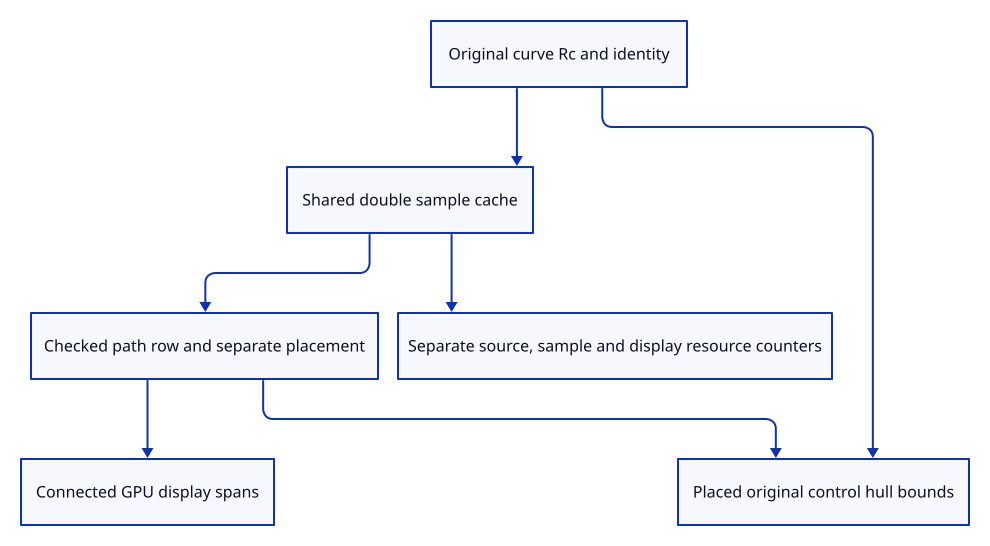

# 5.4.3 · Retain original curves beside their display samples

**Chapter 5 · Lines, points and curves · Section 5.4 · NURBS curves** · [Contents](contents.md)

**Typing: 27–54 minutes.** [Estimate](typing-load.md).

Extend path ownership with the original curve and a shared double-precision sample cache. GPU spans keep their existing connected format.

## Type

Continue from [Sample a validated curve without replacing its source](38a-samples.md). [Save or recover your work](recovery.md).

### 1. `src/chain.rs`

Retain the original curve separately from shared approximation samples. Keep original curve identity under path ownership. Count curve source owners independently of sampled data. Use cached original evaluator positions when placing display chords. Keep stable original control indices and a conservative positive-weight hull. Validate and cache the original curve before accepting connected display preparation. Use the original curve arrowhead policy.

<details>
<summary>Locate the existing block</summary>

```rust
pub const SHADER: &str = include_str!("chain.wgsl");
use std::rc::Rc;
use session_rust::{Arrowhead, Line, Polyline};
use crate::stroke::{PreparedLine};

#[derive(Clone)]
pub enum Source { Line(Rc<Line>), Polyline(Rc<Polyline>) }

#[derive(Clone)]
pub struct PreparedChain { pub source: Source, pub points: Rc<Vec<[f32; 3]>>, pub colour: [f32; 4], pub width: f32, pub heads: u32 }

impl Source {
    pub fn guid(&self) -> &str { match self { Self::Line(line) => line.guid(), Self::Polyline(line) => line.guid() } }

    pub fn owner(&self) -> (u8, usize) {
        match self { Self::Line(line) => (0, Rc::as_ptr(line) as usize), Self::Polyline(line) => (1, Rc::as_ptr(line) as usize) }
    }

    pub fn coordinates(&self) -> Vec<[f64; 3]> {
        match self {
            Self::Line(line) => [line.start(), line.end()].map(|p| [p[0], p[1], p[2]]).to_vec(),
            Self::Polyline(line) => line.coords.chunks_exact(3).map(|p| [p[0], p[1], p[2]]).collect(),
        }
    }
}

impl PreparedChain {
    pub fn line(source: Rc<Line>) -> Result<Self, &'static str> {
        let display = PreparedLine::new(Rc::clone(&source))?.display;
        Self::new(Source::Line(source), display.colour, display.width)
    }

    pub fn polyline(source: Rc<Polyline>) -> Result<Self, &'static str> {
        if source.coords.len() % 3 != 0 || !(6..=30_000).contains(&source.coords.len()) {
            return Err("Polyline needs 2–10,000 complete points");
        }
        let _ = source.guid();
        let mut line = Line::new(0.0, 0.0, 0.0, 1.0, 0.0, 0.0);
        line.linecolor = source.linecolor.clone(); line.width = source.width;
        let display = PreparedLine::new(Rc::new(line))?.display;
        Self::new(Source::Polyline(source), display.colour, display.width)
    }

    fn new(source: Source, colour: [f32; 4], width: f32) -> Result<Self, &'static str> {
        let heads = match &source { Source::Line(line) => line.arrowhead, Source::Polyline(line) => line.arrowhead };
        let heads = match heads { Arrowhead::NONE => 0, Arrowhead::END => 1, Arrowhead::START => 2, Arrowhead::BOTH => 3 };
        let mut points = Vec::new();
        for p in source.coordinates() {
            let p = p.map(|v| v as f32);
            if p.iter().any(|v| !v.is_finite()) { return Err("Chain exceeds the display range"); }
            if points.last() != Some(&p) { points.push(p); }
        }
        Ok(Self { source, points: Rc::new(points), colour, width, heads })
    }

}
use crate::stroke::Stroke;
#[derive(Clone, Copy)]
pub struct Segment { pub stroke: Stroke, pub previous: [f32; 3], pub next: [f32; 3], pub heads: u32 }

impl PreparedChain {
    pub fn segments(&self) -> Vec<Segment> {
        let points = &self.points; let last = points.len().saturating_sub(1);
        let closed = last > 1 && points.first() == points.last();
        points.windows(2).enumerate().map(|(i, ends)| Segment {
            stroke: Stroke { start: ends[0], end: ends[1], colour: self.colour, width: self.width },
            previous: if i > 0 { points[i - 1] } else if closed { points[last - 1] } else { ends[0] },
            next: if i + 2 <= last { points[i + 2] } else if closed { points[1] } else { ends[1] },
            heads: if closed { 0 } else { (if i == 0 { self.heads & 2 } else { 0 }) | (if i + 1 == last { self.heads & 1 } else { 0 }) },
        }).collect()
    }
}

impl Segment {
    pub fn bytes(&self) -> Vec<u8> {
        let mut bytes = self.stroke.bytes();
        bytes.extend(self.previous.into_iter().chain(self.next).flat_map(f32::to_ne_bytes));
        bytes.extend(self.heads.to_ne_bytes()); bytes
    }
}
```

</details>

Edit the existing block to match this code; keep unchanged lines:

```rust
pub const SHADER: &str = include_str!("chain.wgsl");
use std::rc::Rc;
use session_rust::{Arrowhead, Line, Polyline};
use crate::stroke::{PreparedLine};

#[derive(Clone)]
pub enum Source { Line(Rc<Line>), Polyline(Rc<Polyline>), Curve(Rc<session_rust::NurbsCurve>, Rc<Vec<[f64; 3]>>) }

#[derive(Clone)]
pub struct PreparedChain { pub source: Source, pub points: Rc<Vec<[f32; 3]>>, pub colour: [f32; 4], pub width: f32, pub heads: u32 }

impl Source {
    pub fn guid(&self) -> &str { match self { Self::Line(line) => line.guid(), Self::Polyline(line) => line.guid(), Self::Curve(curve, _) => curve.guid() } }

    pub fn owner(&self) -> (u8, usize) {
        match self { Self::Line(line) => (0, Rc::as_ptr(line) as usize), Self::Polyline(line) => (1, Rc::as_ptr(line) as usize), Self::Curve(curve, _) => (2, Rc::as_ptr(curve) as usize) }
    }

    pub fn controls(&self) -> Vec<crate::controls::Control> {
        match self {
            Self::Curve(curve, _) => (0..curve.m_cv_count).map(|index|
                crate::controls::Control::new(Rc::clone(curve), index).expect("Validated original curve control")).collect(),
            _ => Vec::new(),
        }
    }

    pub fn bounds_coordinates(&self) -> Vec<[f64; 3]> {
        if matches!(self, Self::Curve(..)) { self.controls().iter().map(|c| c.position().unwrap()).collect() }
        else { self.coordinates() }
    }

    pub fn coordinates(&self) -> Vec<[f64; 3]> {
        match self {
            Self::Line(line) => [line.start(), line.end()].map(|p| [p[0], p[1], p[2]]).to_vec(),
            Self::Polyline(line) => line.coords.chunks_exact(3).map(|p| [p[0], p[1], p[2]]).collect(),
            Self::Curve(_, samples) => samples.as_ref().clone(),
        }
    }
}

impl PreparedChain {
    pub fn curve(source: Rc<session_rust::NurbsCurve>) -> Result<Self, &'static str> {
        let samples = Rc::new(crate::curve::sample(&source)?); let _ = source.guid();
        for index in 0..source.m_cv_count { crate::controls::Control::new(Rc::clone(&source), index)?.marker()?; }
        let mut line = Line::new(0.0, 0.0, 0.0, 1.0, 0.0, 0.0);
        line.width = source.width;
        line.linecolor = source.linecolors.first().cloned().unwrap_or_else(|| session_rust::Color::new(0.0, 0.0, 0.0, 1.0));
        let display = PreparedLine::new(Rc::new(line))?.display;
        Self::new(Source::Curve(source, samples), display.colour, display.width)
    }

    pub fn line(source: Rc<Line>) -> Result<Self, &'static str> {
        let display = PreparedLine::new(Rc::clone(&source))?.display;
        Self::new(Source::Line(source), display.colour, display.width)
    }

    pub fn polyline(source: Rc<Polyline>) -> Result<Self, &'static str> {
        if source.coords.len() % 3 != 0 || !(6..=30_000).contains(&source.coords.len()) {
            return Err("Polyline needs 2–10,000 complete points");
        }
        let _ = source.guid();
        let mut line = Line::new(0.0, 0.0, 0.0, 1.0, 0.0, 0.0);
        line.linecolor = source.linecolor.clone(); line.width = source.width;
        let display = PreparedLine::new(Rc::new(line))?.display;
        Self::new(Source::Polyline(source), display.colour, display.width)
    }

    fn new(source: Source, colour: [f32; 4], width: f32) -> Result<Self, &'static str> {
        let heads = match &source { Source::Line(line) => line.arrowhead, Source::Polyline(line) => line.arrowhead, Source::Curve(curve, _) => curve.arrowhead };
        let heads = match heads { Arrowhead::NONE => 0, Arrowhead::END => 1, Arrowhead::START => 2, Arrowhead::BOTH => 3 };
        let mut points = Vec::new();
        for p in source.coordinates() {
            let p = p.map(|v| v as f32);
            if p.iter().any(|v| !v.is_finite()) { return Err("Chain exceeds the display range"); }
            if points.last() != Some(&p) { points.push(p); }
        }
        Ok(Self { source, points: Rc::new(points), colour, width, heads })
    }

}
use crate::stroke::Stroke;
#[derive(Clone, Copy)]
pub struct Segment { pub stroke: Stroke, pub previous: [f32; 3], pub next: [f32; 3], pub heads: u32 }

impl PreparedChain {
    pub fn segments(&self) -> Vec<Segment> {
        let points = &self.points; let last = points.len().saturating_sub(1);
        let closed = last > 1 && points.first() == points.last();
        points.windows(2).enumerate().map(|(i, ends)| Segment {
            stroke: Stroke { start: ends[0], end: ends[1], colour: self.colour, width: self.width },
            previous: if i > 0 { points[i - 1] } else if closed { points[last - 1] } else { ends[0] },
            next: if i + 2 <= last { points[i + 2] } else if closed { points[1] } else { ends[1] },
            heads: if closed { 0 } else { (if i == 0 { self.heads & 2 } else { 0 }) | (if i + 1 == last { self.heads & 1 } else { 0 }) },
        }).collect()
    }
}

impl Segment {
    pub fn bytes(&self) -> Vec<u8> {
        let mut bytes = self.stroke.bytes();
        bytes.extend(self.previous.into_iter().chain(self.next).flat_map(f32::to_ne_bytes));
        bytes.extend(self.heads.to_ne_bytes()); bytes
    }
}
```

<details>
<summary>Optional patch references</summary>

Use these original edit fragments when comparing a saved checkpoint. Apply the complete blocks above.

```text
--8<-- "journey/code/38b-source-01.rs"
```

```text
--8<-- "journey/code/38b-source-02.rs"
```

```text
--8<-- "journey/code/38b-source-03.rs"
```

```text
--8<-- "journey/code/38b-source-04.rs"
```

```text
--8<-- "journey/code/38b-source-05.rs"
```

```text
--8<-- "journey/code/38b-source-06.rs"
```

```text
--8<-- "journey/code/38b-source-07.rs"
```

</details>

### 2. `src/scene.rs`

Place conservative curve bounds from original double controls. Include the complete placed control hull in document Fit bounds.

Edit these blocks from bottom to top. Keep the surrounding lines unchanged.

<details>
<summary>Locate this block</summary>

```rust
            }
        }
        for row in &self.paths {
            for point in row.points() {
                let point = [point[0], point[1], point[2]];
                match &mut bounds { Some(bounds) => bounds.include(point), None => bounds = Some(crate::bounds::Bounds::point(point)) }
            }
```

</details>

Replace it with:

```rust
            }
        }
        for row in &self.paths {
            for point in row.bounds_points() {
                let point = [point[0], point[1], point[2]];
                match &mut bounds { Some(bounds) => bounds.include(point), None => bounds = Some(crate::bounds::Bounds::point(point)) }
            }
```

<details>
<summary>Locate this block</summary>

```rust
        crate::chain::PreparedChain { points: Rc::new(points), ..self.prepared.clone() }.segments()
    }

    pub fn points(&self) -> Vec<session_rust::Point> {
        self.prepared.source.coordinates().into_iter().map(|p| self.model.transform_point(&session_rust::Point::new(p[0], p[1], p[2]))).collect()
    }
```

</details>

Replace it with:

```rust
        crate::chain::PreparedChain { points: Rc::new(points), ..self.prepared.clone() }.segments()
    }

    pub fn bounds_points(&self) -> Vec<session_rust::Point> {
        self.prepared.source.bounds_coordinates().into_iter().map(|p|
            self.model.transform_point(&session_rust::Point::new(p[0], p[1], p[2]))).collect()
    }

    pub fn points(&self) -> Vec<session_rust::Point> {
        self.prepared.source.coordinates().into_iter().map(|p| self.model.transform_point(&session_rust::Point::new(p[0], p[1], p[2]))).collect()
    }
```

<details>
<summary>Complete updated block reference</summary>

```rust
use crate::{mesh::Mesh, prepared::PreparedMesh};
use std::rc::Rc;

#[derive(Clone, Copy, Debug, PartialEq, Eq)]
pub struct ObjectId(u32);

#[derive(Clone)]
pub struct Object {
    pub id: ObjectId,
    pub guid: String,
    pub metadata: Rc<crate::row_metadata::RowMetadata>,
    pub mesh: Rc<Mesh>,
    pub model: session_rust::Xform,
    editable: crate::edit_source::EditSource,
}

impl Object {
    pub fn geometry(&self) -> Option<&Rc<session_rust::Mesh>> {
        match &self.editable { crate::edit_source::EditSource::Loaded { geometry, .. } => Some(geometry), _ => None }
    }

    pub fn source(&self) -> Option<&crate::document::Source> {
        match &self.editable { crate::edit_source::EditSource::Loaded { source, .. } => source.as_ref(), _ => None }
    }

    pub fn origin(&self) -> Option<&Rc<crate::origin::Origin>> {
        match &self.editable {
            crate::edit_source::EditSource::Loaded { source, .. } => source.as_ref().map(|source| &source.origin),
            crate::edit_source::EditSource::Released { origin, .. } => Some(origin),
        }
    }

    pub fn release_epoch(&self) -> Option<u64> {
        match &self.editable { crate::edit_source::EditSource::Released { epoch, .. } => Some(*epoch), _ => None }
    }

    pub fn can_unload(&self) -> bool {
        let Some(source) = self.source() else { return false; };
        let Some(geometry) = self.geometry() else { return false; };
        source.origin.location.is_some() && self.metadata.source_guid == source.guid
            && geometry.guid() == source.guid && self.metadata.name == geometry.name
            && self.metadata.is_visible == geometry.is_visible && self.metadata.is_locked == geometry.is_locked
            && source.document.objects.meshes.iter().any(|mesh| Rc::ptr_eq(mesh, geometry))
    }

    pub fn world_point(&self, vertex: [f32; 6]) -> [f64; 3] {
        let local = session_rust::Point::new(vertex[0] as f64, vertex[1] as f64, vertex[2] as f64);
        let world = self.model.transform_point(&local);
        [world[0], world[1], world[2]]
    }
}

#[derive(Clone)]
pub struct LineObject {
    pub id: ObjectId,
    pub prepared: crate::stroke::PreparedLine,
    pub model: session_rust::Xform,
}

impl LineObject {
    pub fn endpoints(&self) -> [session_rust::Point; 2] {
        let line = &self.prepared.source;
        [self.model.transform_point(&line.start()), self.model.transform_point(&line.end())]
    }

    pub fn stroke(&self) -> crate::stroke::Stroke {
        let [start, end] = self.endpoints();
        crate::stroke::Stroke { start: std::array::from_fn(|i| start[i] as f32),
            end: std::array::from_fn(|i| end[i] as f32), ..self.prepared.display }
    }
}

#[derive(Clone)]
pub struct PathObject { pub id: ObjectId, pub guid: String, pub prepared: crate::chain::PreparedChain, pub model: session_rust::Xform }

impl PathObject {
    pub fn segments(&self) -> Vec<crate::chain::Segment> {
        let mut points = Vec::new();
        for p in self.points() {
            let p = std::array::from_fn(|i| p[i] as f32);
            if points.last() != Some(&p) { points.push(p); }
        }
        crate::chain::PreparedChain { points: Rc::new(points), ..self.prepared.clone() }.segments()
    }

    pub fn bounds_points(&self) -> Vec<session_rust::Point> {
        self.prepared.source.bounds_coordinates().into_iter().map(|p|
            self.model.transform_point(&session_rust::Point::new(p[0], p[1], p[2]))).collect()
    }

    pub fn points(&self) -> Vec<session_rust::Point> {
        self.prepared.source.coordinates().into_iter().map(|p| self.model.transform_point(&session_rust::Point::new(p[0], p[1], p[2]))).collect()
    }


}

#[derive(Clone)]
pub struct PointObject { pub id: ObjectId, pub guid: String, pub prepared: crate::marker::PreparedPoint, pub model: session_rust::Xform }

impl PointObject {
    pub fn point(&self) -> session_rust::Point { self.model.transform_point(&self.prepared.source) }
    pub fn marker(&self) -> crate::marker::Marker { crate::marker::Marker { center: self.point().to_f32(), ..self.prepared.display } }
}

#[derive(Clone)]
pub struct Scene {
    points: Vec<PointObject>,
    paths: Vec<PathObject>,
    lines: Vec<LineObject>,
    objects: Vec<Object>,
    next_id: u32,
    extra: Option<ObjectId>,
}

impl Scene {
    pub fn demo() -> Self {
        let pink = PreparedMesh::triangle([
            [-0.7, -0.6, 0.25], [0.5, -0.6, 0.25], [-0.1, 0.6, 0.25],
        ], [0.9, 0.25, 0.45]).expect("Valid pink triangle");
        let turquoise = PreparedMesh::triangle([
            [-0.4, -0.2, 0.75], [0.8, -0.2, 0.75], [0.2, 0.8, 0.75],
        ], [0.05, 0.7, 0.7]).expect("Valid turquoise triangle");
        let mut scene = Self { objects: Vec::new(), points: Vec::new(), paths: Vec::new(), lines: Vec::new(), next_id: 1, extra: None };
        scene.insert(pink).expect("ID available");
        scene.insert(turquoise).expect("ID available");
        scene
    }

    pub fn restore(&mut self, mut saved: Self) {
        saved.next_id = saved.next_id.max(self.next_id);
        *self = saved;
    }

    pub fn bounds(&self) -> Option<crate::bounds::Bounds> {
        let mut bounds: Option<crate::bounds::Bounds> = None;
        for object in &self.objects {
            for vertex in object.mesh.vertices() {
                let point = object.world_point(*vertex);
                match &mut bounds {
                    Some(bounds) => bounds.include(point),
                    None => bounds = Some(crate::bounds::Bounds::point(point)),
                }
            }
        }
        for line in &self.lines {
            for point in line.endpoints() {
                let point = [point[0], point[1], point[2]];
                match &mut bounds {
                    Some(bounds) => bounds.include(point),
                    None => bounds = Some(crate::bounds::Bounds::point(point)),
                }
            }
        }
        for row in &self.paths {
            for point in row.bounds_points() {
                let point = [point[0], point[1], point[2]];
                match &mut bounds { Some(bounds) => bounds.include(point), None => bounds = Some(crate::bounds::Bounds::point(point)) }
            }
        }
        for row in &self.points {
            let p = row.point(); let p = [p[0], p[1], p[2]];
            match &mut bounds { Some(bounds) => bounds.include(p), None => bounds = Some(crate::bounds::Bounds::point(p)) }
        }
        bounds
    }

    pub fn selected_bounds(&self, id: ObjectId) -> Option<crate::bounds::Bounds> {
        let object = self.objects.iter().find(|object| object.id == id)?;
        let mut vertices = object.mesh.vertices().iter();
        let first = vertices.next()?;
        let mut bounds = crate::bounds::Bounds::point(object.world_point(*first));
        for vertex in vertices {
            bounds.include(object.world_point(*vertex));
        }
        Some(bounds)
    }

    pub fn line_capacity_bytes(&self) -> usize { self.lines.capacity() * std::mem::size_of::<LineObject>() }

    pub fn points(&self) -> &[PointObject] { &self.points }

    pub fn point_capacity_bytes(&self) -> usize { self.points.capacity() * std::mem::size_of::<PointObject>() }

    pub fn insert_point(&mut self, prepared: crate::marker::PreparedPoint) -> Result<ObjectId, &'static str> {
        let next = self.next_id.checked_add(1).ok_or("Object IDs exhausted")?;
        let mut guid = prepared.source.guid().to_owned();
        while self.points.iter().any(|row| row.guid == guid) || self.paths.iter().any(|row| row.guid == guid)
            || self.objects.iter().any(|row| row.guid == guid) || self.lines.iter().any(|row| row.prepared.source.guid() == guid) {
            guid = uuid::Uuid::new_v4().to_string();
        }
        let id = ObjectId(self.next_id); self.next_id = next;
        self.points.push(PointObject { id, guid, prepared, model: session_rust::Xform::identity() }); Ok(id)
    }

    pub fn place_point(&mut self, id: ObjectId, model: session_rust::Xform) -> Result<(), &'static str> {
        if !crate::placement::valid(&model.m) { return Err("Invalid point placement"); }
        let row = self.points.iter_mut().find(|row| row.id == id).ok_or("Point not found")?;
        let point = model.transform_point(&row.prepared.source);
        if (0..3).any(|i| !(point[i] as f32).is_finite()) { return Err("Point placement exceeds the display range"); }
        row.model = model; Ok(())
    }

    pub fn paths(&self) -> &[PathObject] { &self.paths }

    pub fn path_capacity_bytes(&self) -> usize { self.paths.capacity() * std::mem::size_of::<PathObject>() }

    pub fn insert_path(&mut self, prepared: crate::chain::PreparedChain) -> Result<ObjectId, &'static str> {
        let next = self.next_id.checked_add(1).ok_or("Object IDs exhausted")?;
        let mut guid = prepared.source.guid().to_owned();
        while self.paths.iter().any(|row| row.guid == guid) || self.objects.iter().any(|row| row.guid == guid)
            || self.lines.iter().any(|row| row.prepared.source.guid() == guid) { guid = uuid::Uuid::new_v4().to_string(); }
        let id = ObjectId(self.next_id); self.next_id = next;
        self.paths.push(PathObject { id, guid, prepared, model: session_rust::Xform::identity() }); Ok(id)
    }

    pub fn place_path(&mut self, id: ObjectId, model: session_rust::Xform) -> Result<(), &'static str> {
        if !crate::placement::valid(&model.m) { return Err("Invalid path placement"); }
        let row = self.paths.iter_mut().find(|row| row.id == id).ok_or("Path not found")?;
        for p in row.prepared.source.coordinates() {
            let p = model.transform_point(&session_rust::Point::new(p[0], p[1], p[2]));
            if (0..3).any(|i| !(p[i] as f32).is_finite()) { return Err("Path placement exceeds the display range"); }
        }
        row.model = model; Ok(())
    }

    pub fn lines(&self) -> &[LineObject] { &self.lines }

    pub fn insert_line(&mut self, prepared: crate::stroke::PreparedLine) -> Result<ObjectId, &'static str> {
        let next = self.next_id.checked_add(1).ok_or("Object IDs exhausted")?;
        let id = ObjectId(self.next_id); self.next_id = next;
        self.lines.push(LineObject { id, prepared, model: session_rust::Xform::identity() });
        Ok(id)
    }

    pub fn place_line(&mut self, id: ObjectId, model: session_rust::Xform) -> Result<(), &'static str> {
        if !crate::placement::valid(&model.m) { return Err("Invalid line placement"); }
        let row = self.lines.iter_mut().find(|row| row.id == id).ok_or("Line not found")?;
        for point in [row.prepared.source.start(), row.prepared.source.end()] {
            let placed = model.transform_point(&point);
            if (0..3).any(|i| !(placed[i] as f32).is_finite()) { return Err("Line placement exceeds the display range"); }
        }
        row.model = model; Ok(())
    }

    pub fn objects(&self) -> &[Object] {
        &self.objects
    }

    pub(crate) fn objects_mut(&mut self) -> &mut [Object] { &mut self.objects }

    pub(crate) fn unload(&mut self, origins: &std::collections::HashSet<uuid::Uuid>, epoch: u64) {
        for row in &mut self.objects {
            if let Some(origin) = row.origin().filter(|origin| origins.contains(&origin.id)).cloned() {
                row.editable = crate::edit_source::EditSource::Released { origin, epoch };
            }
        }
    }

    pub(crate) fn hydrate(&mut self, prepared: &crate::rehydrate::PreparedReload) {
        for row in &mut self.objects {
            if !prepared.key.matches(row) { continue; }
            let Some(geometry) = prepared.geometry(&row.metadata.source_guid).cloned() else { continue; };
            let source = crate::document::Source { document: Rc::clone(&prepared.document),
                guid: row.metadata.source_guid.clone(), origin: Rc::clone(&prepared.key.origin) };
            row.editable = crate::edit_source::EditSource::Loaded { geometry, source: Some(source) };
        }
    }

    pub fn insert(&mut self, prepared: PreparedMesh) -> Result<ObjectId, &'static str> {
        let next = self.next_id.checked_add(1).ok_or("Object IDs exhausted")?;
        let id = ObjectId(self.next_id);
        self.next_id = next;
        let mut guid = prepared.geometry.guid().to_owned();
        while self.objects.iter().any(|object| object.guid == guid) {
            guid = uuid::Uuid::new_v4().to_string();
        }
        let metadata = Rc::new(crate::row_metadata::RowMetadata::from_mesh(&prepared.geometry));
        let editable = crate::edit_source::EditSource::Loaded { geometry: prepared.geometry, source: prepared.source };
        self.objects.push(Object { id, guid, metadata, mesh: Rc::new(prepared.display), model: prepared.model, editable });
        Ok(id)
    }

    pub fn clear(&mut self) {
        self.points = Vec::new();
        self.paths = Vec::new();
        self.lines = Vec::new();
        self.objects = Vec::new();
        self.extra = None;
    }

    pub fn replace(&mut self, loaded: crate::document::Loaded) -> Result<(), &'static str> {
        self.clear();
        self.import(loaded)
    }

    pub fn import(&mut self, loaded: crate::document::Loaded) -> Result<(), &'static str> {
        for prepared in loaded.meshes {
            self.insert(prepared)?;
        }
        Ok(())
    }

    pub fn place(&mut self, id: ObjectId, model: session_rust::Xform) -> Result<(), &'static str> {
        if !crate::placement::valid(&model.m)
        {
            return Err("Placement must be finite, affine and fit the display range");
        }
        let object = self.objects.iter_mut().find(|o| o.id == id).ok_or("Object not found")?;
        if object.geometry().is_none() { return Err("Reload editable sources before Move"); }
        object.model = model;
        Ok(())
    }

    pub fn remove(&mut self, id: ObjectId) -> bool {
        let Some(index) = self.objects.iter().position(|object| object.id == id) else { return false; };
        self.objects.remove(index);
        if self.extra == Some(id) {
            self.extra = None;
        }
        true
    }

    pub fn contains(&self, id: ObjectId) -> bool {
        self.objects.iter().any(|object| object.id == id)
    }

    pub fn next(&self, current: Option<ObjectId>) -> Option<ObjectId> {
        if self.objects.is_empty() {
            return None;
        }
        let index = self.objects.iter().position(|object| Some(object.id) == current)
            .map_or(0, |index| index + 1);
        Some(self.objects[index % self.objects.len()].id)
    }

    pub fn add_box(&mut self) -> Result<ObjectId, &'static str> {
        let mut source = session_rust::Mesh::create_box(0.8, 0.8, 0.8);
        source.set_objectcolor(session_rust::Color::new(0.65, 0.65, 0.65, 1.0));
        let id = self.insert(PreparedMesh::new(source)?)?;
        self.place(id, session_rust::Xform::translation(0.9, 0.0, 0.4))?;
        Ok(id)
    }

    pub fn toggle_extra(&mut self) {
        if let Some(id) = self.extra.take() {
            self.remove(id);
        } else {
            let extra = PreparedMesh::triangle([
                [-0.9, 0.3, 0.5], [-0.4, 0.3, 0.5], [-0.65, 0.9, 0.5],
            ], [0.2, 0.8, 0.3]).expect("Valid extra triangle");
            self.extra = Some(self.insert(extra).expect("ID available"));
        }
    }
}

#[cfg(test)]
mod tests {
    use super::*;

    #[test]
    fn unloading_policy_protects_generated_unlocated_and_modified_sources() {
        let mut scene = Scene::demo(); assert!(!scene.objects[0].can_unload());
        let bytes = crate::specimen::bytes();
        scene.replace(crate::document::load(&bytes).unwrap()).unwrap(); assert!(!scene.objects[0].can_unload());
        let url = Rc::new(crate::reload_url::ReloadUrl::new("test:policy".into()));
        scene.replace(crate::document::load_at(&bytes, Some(url)).unwrap()).unwrap();
        assert!(scene.objects.iter().all(Object::can_unload));
        let row = &mut scene.objects[0];
        Rc::make_mut(&mut row.metadata).is_locked = true; assert!(!row.can_unload());
        Rc::make_mut(&mut row.metadata).is_locked = row.geometry().unwrap().is_locked;
        assert!(row.can_unload());
        let source = row.source().cloned(); let geometry = Rc::new(session_rust::Mesh::create_box(1.0, 1.0, 1.0));
        row.editable = crate::edit_source::EditSource::Loaded { geometry, source }; assert!(!row.can_unload());
    }

    #[test]
    fn partial_replacement_failure_restores_owners_without_reusing_ids() {
        let mut scene = Scene::demo();
        let before = scene.objects.clone();
        scene.next_id = u32::MAX - 1;
        let loaded = crate::document::load(&crate::specimen::bytes()).unwrap();
        let mut history = crate::history::History::default();
        assert!(history.try_edit(&mut scene, |scene| scene.replace(loaded)).is_err());
        assert_eq!(scene.next_id, u32::MAX);
        assert_eq!(scene.objects.len(), before.len());
        for (object, old) in scene.objects.iter().zip(&before) {
            assert_eq!(object.id, old.id);
            assert!(Rc::ptr_eq(object.geometry().unwrap(), old.geometry().unwrap()));
            assert!(Rc::ptr_eq(&object.mesh, &old.mesh));
        }
        assert!(!history.undo(&mut scene));
    }

    #[test]
    fn removal_moves_a_row_without_changing_its_identity() {
        let mut scene = Scene::demo();
        let first = scene.objects()[0].id;
        let second = scene.objects()[1].id;
        assert!(scene.remove(first));
        assert_eq!(scene.objects()[0].id, second);
        assert_eq!(scene.next(None), Some(second));
        assert!(!scene.contains(first));
        scene.toggle_extra();
        assert_ne!(scene.objects()[1].id, first);
        assert_ne!(scene.objects()[1].id, second);
    }

    #[test]
    fn toggling_the_extra_object_uses_its_id_after_other_removals() {
        let mut scene = Scene::demo();
        scene.toggle_extra();
        let extra = scene.objects()[2].id;
        scene.remove(scene.objects()[0].id);
        scene.toggle_extra();
        assert!(!scene.contains(extra));
        assert_eq!(scene.objects().len(), 1);
    }
}
```

</details>

<details>
<summary>Optional patch references</summary>

Use these original edit fragments when comparing a saved checkpoint. Apply the complete blocks above.

```text
--8<-- "journey/code/38b-source-08.rs"
```

```text
--8<-- "journey/code/38b-source-09.rs"
```

</details>

### 3. `src/memory.rs`

Count sampled doubles separately from source owners and packed GPU data.

<details>
<summary>Locate the existing block</summary>

```rust
pub fn paths<'a>(scenes: impl IntoIterator<Item = &'a Scene>) -> [usize; 5] {
```

</details>

Edit the existing block to match this code; keep unchanged lines:

```rust
pub fn curves<'a>(scenes: impl IntoIterator<Item = &'a Scene>) -> [usize; 4] {
    let mut sources = HashSet::new(); let mut samples = HashSet::new(); let mut usage = [0; 4];
    for scene in scenes {
        for row in scene.paths() {
            if let crate::chain::Source::Curve(source, points) = &row.prepared.source {
                usage[0] += 1; sources.insert(Rc::as_ptr(source));
                if samples.insert(Rc::as_ptr(points)) { usage[3] += points.capacity() * 24; }
            }
        }
    }
    usage[1] = sources.len(); usage[2] = samples.len(); usage
}

pub fn paths<'a>(scenes: impl IntoIterator<Item = &'a Scene>) -> [usize; 5] {
```

<details>
<summary>Optional patch references</summary>

Use these original edit fragments when comparing a saved checkpoint. Apply the complete blocks above.

```text
--8<-- "journey/code/38b-source-10.rs"
```

</details>

### 4. `src/lib.rs`

Register retained source and placed bounds checks.

<details>
<summary>Locate the existing block</summary>

```rust
pub mod curve;
```

</details>

After that block, type:

```rust
#[cfg(test)]
mod curve_source_tests;
```

<details>
<summary>Optional patch references</summary>

Use these original edit fragments when comparing a saved checkpoint. Apply the complete blocks above.

```text
--8<-- "journey/code/38b-source-11.rs"
```

</details>

<details>
<summary>Supplied validation fixture</summary>

Copy this supplied authoring fixture once. Continue with the browser build below; the course does not require running native tests.

### 5. `src/curve_source_tests.rs`

Copy retained source identity, distinct IDs, precise placement, conservative bounds and release checks.

Copy this supplied file:

```text
--8<-- "journey/code/38b-source-12.rs"
```

</details>

## Run and check

In your project:

```sh
cd workspace/journey
REGEN_PROTO=0 cargo build --lib --locked --target wasm32-unknown-unknown -j1
REGEN_PROTO=0 CARGO_BUILD_JOBS=1 trunk serve --port 8780
```

Open `http://127.0.0.1:8780/`. Keep an existing Trunk server running; saving rebuilds it.

The original curve owner is prepared. The supplied document fixture shows duplicate rows sharing source and samples while keeping distinct document IDs; browser connection follows.

### Recorded visual result

**Previous native render — current verification pending.**

This checkpoint was rendered independently and has the same native comparison frame as [Sample a validated curve without replacing its source](38a-samples.md). Use its state checks and browser exercise to assess the changed behavior.


*This recorded image predates a source or checker change. Rebuild this checkpoint before using it as current evidence; browser controls require separate acceptance.*

This reference image is shared with [5.3.5 · Draw original point rows and count their resources](37d-render.md). It does not demonstrate a new feature by itself.

<details>
<summary>Code explanation and diagram</summary>

Retain original GUIDs and checked document IDs. Use transformed original controls for conservative curve bounds, and report sampled doubles separately from kernel ownership and packed display vertices.

original NURBS Rc → validated shared double samples → path row and checked ID → placed display chords and conservative bounds.



Why does a curve row retain its original control hull beside sampled chords?

The display approximation can miss an extremum. Positive-weight control bounds conservatively contain the curve, while the original curve remains available for editing and exact measurement.

Study estimate, including typing and experiments: 0.75–1.25 hours.

</details>

<details>
<summary>Optional experiment</summary>

Translate a curve row with high-precision coordinates. Original controls remain unchanged, display endpoints move, and bounds include its placed control hull.

</details>

<details>
<summary>Check and save your work</summary>

Restore experimental edits, then run from `session_viewer`:

```sh
npm --prefix ../session_tests run course -- check 5.4.3
npm --prefix ../session_tests run course -- save 5.4.3
```

Source comparison leaves your project untouched. [Save and recovery instructions](recovery.md).

</details>

<details>
<summary>Viewer coverage and verification</summary>

Original curve path rows and placements are complete. Control drawing and real curve input follow. Bounds here are conservative control hulls; exact command measurements belong to chapter 84.

Native checks prove original identity, shared sample/source lifetime, distinct IDs, precise placed control-hull bounds, real curved segments and complete resource release.

Chrome retains point and connected rendering while native checks guard original curve evaluation.

[Full validation scope](release.md).

To reproduce the scripted acceptance of the reference checkpoint, run from `session_viewer` with the [course bundle server](release.md#reproduce) running on port 8781:

```sh
npm --prefix ../session_tests run course -- capture 5.4.3
```

This uses the verified reference bundle; it does not check or change your typed project.

</details>
