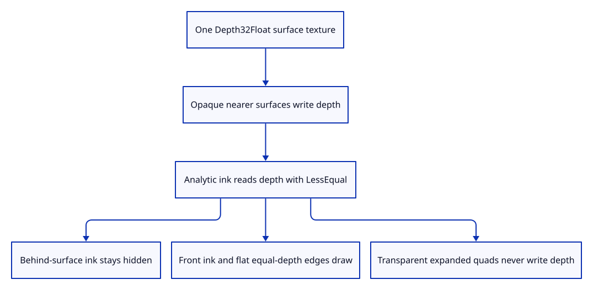

# 5.5.2 · Share surface depth across all ink lanes

**Chapter 5 · Lines, points and curves · Section 5.5 · Visibility and shared ink depth** · [Contents](contents.md)

**Typing: 7–14 minutes.** [Estimate](typing-load.md).

Keep depth format and comparison policy in one module. Opaque surfaces write nearer depth; analytic ink reads that same texture and accepts equal depth without writing its transparent quad.

## Type

Continue from [Resolve original visibility for every drawing kind](39-visible.md). [Save or recover your work](recovery.md).

### 1. `src/depth.rs`

Name one depth format and explicit surface/ink comparison policies.

Create the file and type:

```rust
--8<-- "journey/code/39a-depth-01.rs"
```

### 2. `src/lib.rs`

Register the shared depth contract.

<details>
<summary>Locate the existing block</summary>

```rust
pub mod renderer;
```

</details>

After that block, type:

```rust
pub mod depth;
```

<details>
<summary>Optional patch references</summary>

Use these original edit fragments when comparing a saved checkpoint. Apply the complete blocks above.

```text
--8<-- "journey/code/39a-depth-02.rs"
```

</details>

### 3. `src/renderer.rs`

Use the shared writable nearer-surface policy. Allocate the exact depth format used by every drawing pipeline.

Edit these blocks from bottom to top. Keep the surrounding lines unchanged.

<details>
<summary>Locate this block</summary>

```rust
            mip_level_count: 1,
            sample_count: 1,
            dimension: wgpu::TextureDimension::D2,
            format: wgpu::TextureFormat::Depth32Float,
            usage: wgpu::TextureUsages::RENDER_ATTACHMENT,
            view_formats: &[],
        });
```

</details>

Replace it with:

```rust
            mip_level_count: 1,
            sample_count: 1,
            dimension: wgpu::TextureDimension::D2,
            format: crate::depth::FORMAT,
            usage: wgpu::TextureUsages::RENDER_ATTACHMENT,
            view_formats: &[],
        });
```

<details>
<summary>Locate this block</summary>

```rust
                targets: &[Some(format.into())],
            }),
            primitive: Default::default(),
            depth_stencil: Some(wgpu::DepthStencilState {
                format: wgpu::TextureFormat::Depth32Float,
                depth_write_enabled: Some(true),
                depth_compare: Some(wgpu::CompareFunction::Less),
                stencil: Default::default(),
                bias: Default::default(),
            }),
            multisample: Default::default(),
            multiview_mask: None,
            cache: None,
```

</details>

Replace it with:

```rust
                targets: &[Some(format.into())],
            }),
            primitive: Default::default(),
            depth_stencil: Some(crate::depth::surface()),
            multisample: Default::default(),
            multiview_mask: None,
            cache: None,
```

<details>
<summary>Complete updated block reference</summary>

```rust
use crate::{gpu_mesh::GpuMesh, scene::{ObjectId, Scene}};

pub struct Renderer {
    pub device: wgpu::Device,
    pub queue: wgpu::Queue,
    pipeline: wgpu::RenderPipeline,
    meshes: Vec<GpuMesh>,
    geometry: crate::geometry_cache::GeometryCache,
    settings_allocations: usize,
    settings_writes: usize,
    settings_bytes: usize,
    uniform: wgpu::Buffer,
    view_group: wgpu::BindGroup,
    depth: wgpu::TextureView,
    strokes: crate::stroke_gpu::Lane,
    paths: crate::stroke_gpu::Lane,
    markers: crate::stroke_gpu::Lane,
    size: [u32; 2],
    density: f32,
}

impl Renderer {
    pub fn new(
        device: wgpu::Device,
        queue: wgpu::Queue,
        format: wgpu::TextureFormat,
        scene: &Scene,
    ) -> Self {
        let shader = device.create_shader_module(wgpu::ShaderModuleDescriptor {
            label: Some("triangle"),
            source: wgpu::ShaderSource::Wgsl(include_str!("triangle.wgsl").into()),
        });
        let pipeline = device.create_render_pipeline(&wgpu::RenderPipelineDescriptor {
            label: Some("triangle"),
            layout: None,
            vertex: wgpu::VertexState {
                module: &shader,
                entry_point: Some("vertex"),
                compilation_options: Default::default(),
                buffers: &[wgpu::VertexBufferLayout {
                    array_stride: 24,
                    step_mode: wgpu::VertexStepMode::Vertex,
                    attributes: &wgpu::vertex_attr_array![0 => Float32x3, 1 => Float32x3],
                }],
            },
            fragment: Some(wgpu::FragmentState {
                module: &shader,
                entry_point: Some("fragment"),
                compilation_options: Default::default(),
                targets: &[Some(format.into())],
            }),
            primitive: Default::default(),
            depth_stencil: Some(crate::depth::surface()),
            multisample: Default::default(),
            multiview_mask: None,
            cache: None,
        });
        let uniform = device.create_buffer(&wgpu::BufferDescriptor {
            label: Some("view transform"),
            size: 64,
            usage: wgpu::BufferUsages::UNIFORM | wgpu::BufferUsages::COPY_DST,
            mapped_at_creation: false,
        });
        let view_group = device.create_bind_group(&wgpu::BindGroupDescriptor {
            label: Some("view settings"),
            layout: &pipeline.get_bind_group_layout(0),
            entries: &[wgpu::BindGroupEntry {
                binding: 0,
                resource: uniform.as_entire_binding(),
            }],
        });
        let depth = Self::depth(&device, 640, 480);
        let strokes = crate::stroke_gpu::Lane::new(&device, format);
        let paths = crate::stroke_gpu::Lane::joined(&device, format);
        let markers = crate::stroke_gpu::Lane::markers(&device, format);
        let mut renderer = Self { device, queue, pipeline, meshes: Vec::new(),
            geometry: Default::default(), settings_allocations: 0, settings_writes: 0,
            settings_bytes: 0, uniform, view_group, depth, strokes, paths, markers, size: [640, 480], density: 1.0 };
        renderer.set_scene(scene, None);
        renderer
    }

    fn depth(device: &wgpu::Device, width: u32, height: u32) -> wgpu::TextureView {
        let depth_texture = device.create_texture(&wgpu::TextureDescriptor {
            label: Some("opaque depth"),
            size: wgpu::Extent3d { width, height, depth_or_array_layers: 1 },
            mip_level_count: 1,
            sample_count: 1,
            dimension: wgpu::TextureDimension::D2,
            format: crate::depth::FORMAT,
            usage: wgpu::TextureUsages::RENDER_ATTACHMENT,
            view_formats: &[],
        });
        depth_texture.create_view(&Default::default())
    }

    pub fn resize(&mut self, size: crate::viewport::Viewport) {
        self.size = [size.width, size.height];
        self.depth = Self::depth(&self.device, size.width, size.height);
    }

    pub fn set_density(&mut self, density: f32) {
        if density.is_finite() && density > 0.0 { self.density = density; }
    }

    pub fn stroke_usage(&self) -> [u64; 4] {
        let [count, bytes] = self.strokes.usage();
        [count, bytes, self.strokes.uploads, self.strokes.uploaded_bytes]
    }

    pub fn path_usage(&self) -> [u64; 4] {
        let [count, bytes] = self.paths.usage();
        [count, bytes, self.paths.uploads, self.paths.uploaded_bytes]
    }

    pub fn point_usage(&self) -> [u64; 4] {
        let [count, bytes] = self.markers.usage();
        [count, bytes, self.markers.uploads, self.markers.uploaded_bytes]
    }

    pub fn set_scene(&mut self, scene: &Scene, selected: Option<ObjectId>) {
        self.markers.set_points(&self.device, scene.points().iter().filter(|row| row.visible()).map(crate::scene::PointObject::marker).chain(scene.control_markers().into_iter().map(|c| c.display)))
            .expect("Prepared point placement fits the display range");
        self.paths.set_chains(&self.device, scene.paths().iter().filter(|row| row.visible()).flat_map(crate::scene::PathObject::segments))
            .expect("Prepared path placement fits the display range");
        self.strokes.set(&self.device, scene.lines().iter().filter(|row| row.visible()).map(crate::scene::LineObject::stroke))
            .expect("Prepared line placement fits the display range");
        let layout = self.pipeline.get_bind_group_layout(1);
        let mut old = std::mem::take(&mut self.meshes);
        for object in scene.objects().iter().filter(|row| row.visible()) {
            let matching = old.iter().position(|row| row.id == object.id
                && std::rc::Rc::ptr_eq(&row.geometry.source, &object.mesh));
            let row = if let Some(index) = matching {
                let mut row = old.swap_remove(index);
                let [calls, bytes] = row.update(&self.queue, object, selected == Some(object.id));
                self.settings_writes += calls;
                self.settings_bytes += bytes;
                row
            } else {
                let geometry = self.geometry.get(&self.device, &object.mesh);
                self.settings_allocations += 1;
                GpuMesh::with_geometry(&self.device, &layout, object,
                    selected == Some(object.id), geometry)
            };
            self.meshes.push(row);
        }
        drop(old);
        self.geometry.prune();
    }

    pub fn geometry_owners(&self) -> impl Iterator<Item = &std::rc::Rc<crate::gpu_geometry::GpuGeometry>> {
        self.meshes.iter().map(|row| &row.geometry)
    }

    pub fn usage(&self) -> [u64; 4] { crate::memory::gpu(&self.meshes) }

    pub fn uploaded_bytes(&self) -> u64 {
        self.geometry.uploaded_bytes + self.settings_allocations as u64 * 80 + self.settings_bytes as u64
            + self.strokes.uploaded_bytes + self.paths.uploaded_bytes + self.markers.uploaded_bytes
    }

    pub fn stats(&self) -> [usize; 4] {
        [self.geometry.uploads, self.settings_allocations, self.settings_writes, self.settings_bytes]
    }

    pub fn draw(
        &self,
        view: &wgpu::TextureView,
        background: &crate::background::Background,
        transform: &[f32; 16],
    ) {
        let bytes: Vec<u8> = transform.iter().flat_map(|value| value.to_ne_bytes()).collect();
        self.queue.write_buffer(&self.uniform, 0, &bytes);
        self.strokes.view(&self.queue, transform, self.size, self.density);
        self.paths.view(&self.queue, transform, self.size, self.density);
        self.markers.view(&self.queue, transform, self.size, self.density);
        let [r, g, b] = background.rgb();
        let mut encoder = self.device.create_command_encoder(&Default::default());
        {
            // The pass borrows the encoder. This scope ends that borrow before finish takes it.
            let mut pass = encoder.begin_render_pass(&wgpu::RenderPassDescriptor {
                label: Some("canvas"),
                depth_stencil_attachment: Some(wgpu::RenderPassDepthStencilAttachment {
                    view: &self.depth,
                    depth_ops: Some(wgpu::Operations {
                        load: wgpu::LoadOp::Clear(1.0),
                        store: wgpu::StoreOp::Store,
                    }),
                    stencil_ops: None,
                }),
                color_attachments: &[Some(wgpu::RenderPassColorAttachment {
                    view,
                    depth_slice: None,
                    resolve_target: None,
                    ops: wgpu::Operations {
                        load: wgpu::LoadOp::Clear(wgpu::Color {
                            r, g, b, a: 1.0,
                        }),
                        store: wgpu::StoreOp::Store,
                    },
                })],
                ..Default::default()
            });
            pass.set_pipeline(&self.pipeline);
            pass.set_bind_group(0, &self.view_group, &[]);
            for mesh in &self.meshes {
                mesh.draw(&mut pass);
            }
            self.strokes.draw(&mut pass);
            self.paths.draw(&mut pass);
            self.markers.draw(&mut pass);
        }
        self.queue.submit([encoder.finish()]);
    }
}
```

</details>

<details>
<summary>Optional patch references</summary>

Use these original edit fragments when comparing a saved checkpoint. Apply the complete blocks above.

```text
--8<-- "journey/code/39a-depth-03.rs"
```

```text
--8<-- "journey/code/39a-depth-04.rs"
```

</details>

### 4. `src/stroke_gpu.rs`

Keep all analytic ink lanes read-only against the same surface depth.

<details>
<summary>Locate the existing block</summary>

```rust
            depth_stencil: Some(wgpu::DepthStencilState { format: wgpu::TextureFormat::Depth32Float,
                depth_write_enabled: Some(false), depth_compare: Some(wgpu::CompareFunction::LessEqual),
                stencil: Default::default(), bias: Default::default() }),
```

</details>

Edit the existing block to match this code; keep unchanged lines:

```rust
            depth_stencil: Some(crate::depth::ink()),
```

<details>
<summary>Optional patch references</summary>

Use these original edit fragments when comparing a saved checkpoint. Apply the complete blocks above.

```text
--8<-- "journey/code/39a-depth-05.rs"
```

</details>

## Run and check

In your project:

```sh
cd workspace/journey
REGEN_PROTO=0 cargo build --lib --locked --target wasm32-unknown-unknown -j1
REGEN_PROTO=0 CARGO_BUILD_JOBS=1 trunk serve --port 8780
```

Open `http://127.0.0.1:8780/`. Keep an existing Trunk server running; saving rebuilds it.

Run real surface/ink readback checks. Behind-surface lines, curves and points stay hidden; front ink and a flat coplanar edge draw.

### Recorded visual result

**Previous native render — current verification pending.**

This checkpoint was rendered independently and has the same native comparison frame as [Resolve original visibility for every drawing kind](39-visible.md). Use its state checks and browser exercise to assess the changed behavior.


*This recorded image predates a source or checker change. Rebuild this checkpoint before using it as current evidence; browser controls require separate acceptance.*

This reference image is shared with [5.3.5 · Draw original point rows and count their resources](37d-render.md). It does not demonstrate a new feature by itself.

<details>
<summary>Code explanation and diagram</summary>

Actual texture readback proves behind-surface occlusion for lines, curves and markers, front ink, and a flat coplanar edge at both projections, zoom levels and densities. This is the shared depth contract; curved silhouette coverage is a later subject.

shared depth texture → opaque surface writes → read-only ink comparison → real hidden/front/coplanar pixels.



Why does ink read surface depth without writing its expanded quad?

A ribbon or marker quad contains transparent coverage outside its shape. Writing that quad would hide later geometry in pixels where no visible ink was drawn.

Study estimate, including typing and experiments: 0.75–1.25 hours.

</details>

<details>
<summary>Optional experiment</summary>

Repeat the fixture at both projections, zoom levels and device densities. Compare actual surface pixels before and after behind-surface ink.

</details>

<details>
<summary>Check and save your work</summary>

Restore experimental edits, then run from `session_viewer`:

```sh
npm --prefix ../session_tests run course -- check 5.5.2
npm --prefix ../session_tests run course -- save 5.5.2
```

Source comparison leaves your project untouched. [Save and recovery instructions](recovery.md).

</details>

<details>
<summary>Viewer coverage and verification</summary>

Shared surface depth and read-only ink comparison are verified for the current lanes. Arbitrary curved Arctic outlines and face-coverage silhouettes remain in chapter 91.

Native actual renderer readback compares a solid surface before and after hidden ink and checks front line/point pixels plus a flat coplanar line across eight view/density cases.

Actual Chrome draws a sampled quadratic arch and its three original curve control markers.

[Full validation scope](release.md).

To reproduce the scripted acceptance of the reference checkpoint, run from `session_viewer` with the [course bundle server](release.md#reproduce) running on port 8781:

```sh
npm --prefix ../session_tests run course -- capture 5.5.2
```

This uses the verified reference bundle; it does not check or change your typed project.

</details>
