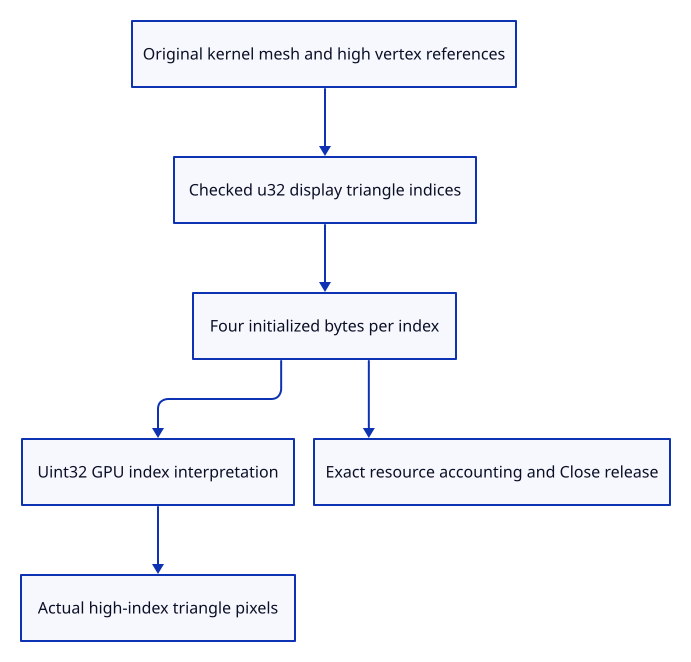

# 5.6.3 · Draw meshes beyond the sixteen-bit index limit

**Chapter 5 · Lines, points and curves · Section 5.6 · Mesh color modes** · [Contents](contents.md)

**Typing: 3–5 minutes.** [Estimate](typing-load.md).

Keep the kernel’s u32 indices through the display adapter and GPU draw call. Do not truncate high vertex references to fit an earlier demonstration layout.

## Type

Continue from [Compare original colour modes through actual input](40a-input.md). [Save or recover your work](recovery.md).

### 1. `src/mesh.rs`

Keep kernel index precision in retained display topology. Accept complete thirty-two-bit triangle references. Retain the authoritative kernel indices without narrowing them. Count actual retained index capacity. Expose the actual display index type to drawing and picking.

Edit these blocks from bottom to top. Keep the surrounding lines unchanged.

<details>
<summary>Locate this block</summary>

```rust
            let [r, g, b, _] = vertex.color;
            [x, y, z, r, g, b]
        }).collect();
        let indices: Result<Vec<u16>, _> = render.indices.into_iter().map(u16::try_from).collect();
        Self::new(vertices, indices.map_err(|_| "Mesh exceeds this lesson's 16-bit index capacity")?)
    }

    pub fn payload_bytes(&self) -> usize {
        self.vertices.capacity() * std::mem::size_of::<[f32; 6]>()
            + self.indices.capacity() * std::mem::size_of::<u16>()
    }

    pub fn vertices(&self) -> &[[f32; 6]] {
        &self.vertices
    }

    pub fn indices(&self) -> &[u16] {
        &self.indices
    }
}
```

</details>

Replace it with:

```rust
            let [r, g, b, _] = vertex.color;
            [x, y, z, r, g, b]
        }).collect();
        Self::new(vertices, render.indices)
    }

    pub fn payload_bytes(&self) -> usize {
        self.vertices.capacity() * std::mem::size_of::<[f32; 6]>()
            + self.indices.capacity() * std::mem::size_of::<u32>()
    }

    pub fn vertices(&self) -> &[[f32; 6]] {
        &self.vertices
    }

    pub fn indices(&self) -> &[u32] {
        &self.indices
    }
}
```

<details>
<summary>Locate this block</summary>

```rust
pub struct Mesh {
    vertices: Vec<[f32; 6]>,
    indices: Vec<u16>,
}

impl Mesh {
    pub fn new(vertices: Vec<[f32; 6]>, indices: Vec<u16>) -> Result<Self, &'static str> {
        if indices.len() % 3 != 0 || indices.len() > u32::MAX as usize {
            return Err("Indices must describe complete triangles within the draw limit");
        }
```

</details>

Replace it with:

```rust
pub struct Mesh {
    vertices: Vec<[f32; 6]>,
    indices: Vec<u32>,
}

impl Mesh {
    pub fn new(vertices: Vec<[f32; 6]>, indices: Vec<u32>) -> Result<Self, &'static str> {
        if indices.len() % 3 != 0 || indices.len() > u32::MAX as usize {
            return Err("Indices must describe complete triangles within the draw limit");
        }
```

<details>
<summary>Complete updated block reference</summary>

```rust
pub struct Mesh {
    vertices: Vec<[f32; 6]>,
    indices: Vec<u32>,
}

impl Mesh {
    pub fn new(vertices: Vec<[f32; 6]>, indices: Vec<u32>) -> Result<Self, &'static str> {
        if indices.len() % 3 != 0 || indices.len() > u32::MAX as usize {
            return Err("Indices must describe complete triangles within the draw limit");
        }
        if indices.iter().any(|&index| index as usize >= vertices.len()) {
            return Err("A triangle refers to a missing vertex");
        }
        if vertices.iter().flatten().any(|value| !value.is_finite()) {
            return Err("Vertex values must be finite");
        }
        Ok(Self { vertices, indices })
    }

    pub fn from_kernel(mesh: &session_rust::Mesh) -> Result<Self, &'static str> {
        let render = mesh.to_render();
        let vertices = render.vertices.iter().map(|vertex| {
            let [x, y, z] = vertex.position;
            let [r, g, b, _] = vertex.color;
            [x, y, z, r, g, b]
        }).collect();
        Self::new(vertices, render.indices)
    }

    pub fn payload_bytes(&self) -> usize {
        self.vertices.capacity() * std::mem::size_of::<[f32; 6]>()
            + self.indices.capacity() * std::mem::size_of::<u32>()
    }

    pub fn vertices(&self) -> &[[f32; 6]] {
        &self.vertices
    }

    pub fn indices(&self) -> &[u32] {
        &self.indices
    }
}

#[cfg(test)]
mod tests {
    use super::*;

    #[test]
    fn a_kernel_box_becomes_eight_vertices_and_twelve_triangles() {
        let source = session_rust::Mesh::create_box(0.8, 0.8, 0.8);
        let mesh = Mesh::from_kernel(&source).unwrap();
        assert_eq!(mesh.vertices().len(), 8);
        assert_eq!(mesh.indices().len(), 36);
    }

    #[test]
    fn invalid_connections_and_nonfinite_vertices_are_rejected() {
        assert!(Mesh::new(vec![[0.0; 6]; 3], vec![0, 1, 3]).is_err());
        assert!(Mesh::new(vec![[0.0; 6]; 3], vec![0, 1]).is_err());
        assert!(Mesh::new(vec![[f32::NAN; 6]; 3], vec![0, 1, 2]).is_err());
        assert!(Mesh::new(vec![[0.0; 6]; 3], vec![0, 1, 2]).is_ok());
    }
}
```

</details>

<details>
<summary>Optional patch references</summary>

Use these original edit fragments when comparing a saved checkpoint. Apply the complete blocks above.

```text
--8<-- "journey/code/40b-indices-01.rs"
```

```text
--8<-- "journey/code/40b-indices-02.rs"
```

```text
--8<-- "journey/code/40b-indices-03.rs"
```

```text
--8<-- "journey/code/40b-indices-04.rs"
```

```text
--8<-- "journey/code/40b-indices-05.rs"
```

</details>

### 2. `src/gpu_geometry.rs`

Interpret uploaded index bytes with their exact GPU format.

<details>
<summary>Locate the existing block</summary>

```rust
        pass.set_index_buffer(self.indices.slice(..), wgpu::IndexFormat::Uint16);
```

</details>

Edit the existing block to match this code; keep unchanged lines:

```rust
        pass.set_index_buffer(self.indices.slice(..), wgpu::IndexFormat::Uint32);
```

<details>
<summary>Optional patch references</summary>

Use these original edit fragments when comparing a saved checkpoint. Apply the complete blocks above.

```text
--8<-- "journey/code/40b-indices-06.rs"
```

</details>

### 3. `src/geometry_cache.rs`

Count initialized index payload bytes independently of driver allocation.

<details>
<summary>Locate the existing block</summary>

```rust
        self.uploaded_bytes += (source.vertices().len() * 24 + source.indices().len() * 2) as u64;
```

</details>

Edit the existing block to match this code; keep unchanged lines:

```rust
        self.uploaded_bytes += (source.vertices().len() * 24 + source.indices().len() * 4) as u64;
```

<details>
<summary>Optional patch references</summary>

Use these original edit fragments when comparing a saved checkpoint. Apply the complete blocks above.

```text
--8<-- "journey/code/40b-indices-07.rs"
```

</details>

<details>
<summary>Supplied validation fixture</summary>

Copy this supplied authoring fixture once. Continue with the browser build below; the course does not require running native tests.

### 4. `src/memory.rs`

Copy the updated spare-capacity oracle for the real index layout.

<details>
<summary>Locate the existing block</summary>

```text
baseline[4] + 16 * 24 + 16 * 2
```

</details>

Update the existing block with this supplied code; keep unchanged lines:

```text
--8<-- "journey/code/40b-indices-08.rs"
```

</details>

### 5. `src/lib.rs`

Register actual original high-index checks.

<details>
<summary>Locate the existing block</summary>

```rust
pub mod mesh;
```

</details>

After that block, type:

```rust
#[cfg(test)]
mod index_width_tests;
```

<details>
<summary>Optional patch references</summary>

Use these original edit fragments when comparing a saved checkpoint. Apply the complete blocks above.

```text
--8<-- "journey/code/40b-indices-09.rs"
```

</details>

<details>
<summary>Supplied validation fixture</summary>

Copy this supplied authoring fixture once. Continue with the browser build below; the course does not require running native tests.

### 6. `src/index_width_tests.rs`

Copy original high-index topology, correct displayed corners and missing-vertex refusal checks.

Copy this supplied file:

```text
--8<-- "journey/code/40b-indices-10.rs"
```

</details>

## Run and check

In your project:

```sh
cd workspace/journey
REGEN_PROTO=0 cargo build --lib --locked --target wasm32-unknown-unknown -j1
REGEN_PROTO=0 CARGO_BUILD_JOBS=1 trunk serve --port 8780
```

Open `http://127.0.0.1:8780/`. Keep an existing Trunk server running; saving rebuilds it.

Run a real source mesh with 65,537 vertices and a triangle referencing the highest vertex. The rendered triangle must appear correctly.

### Recorded visual result

**Previous native render — current verification pending.**


*This recorded image predates a source or checker change. Rebuild this checkpoint before using it as current evidence; browser controls require separate acceptance.*

This reference image is shared with [5.3.5 · Draw original point rows and count their resources](37d-render.md). It does not demonstrate a new feature by itself.

<details>
<summary>Code explanation and diagram</summary>

Update both CPU capacity and initialized GPU-byte accounting. Actual readback draws a source triangle referencing vertex65,536; complete Close still releases its source and display allocation.

original large mesh → checked u32 display indices → Uint32 GPU draw → exact byte counters → real high-index pixels.



Why can a small triangle need a thirty-two-bit index buffer?

Its corners may refer to vertices beyond 65,535 in a larger shared vertex table. Truncating those indices draws the wrong corners or produces a degenerate triangle.

Study estimate, including typing and experiments: 0.75–1.25 hours.

</details>

<details>
<summary>Optional experiment</summary>

Check both initialized index bytes and actual buffer sizes. Thirty-two-bit indices use four bytes each; source geometry and vertex sharing remain unchanged.

</details>

<details>
<summary>Check and save your work</summary>

Restore experimental edits, then run from `session_viewer`:

```sh
npm --prefix ../session_tests run course -- check 5.6.3
npm --prefix ../session_tests run course -- save 5.6.3
```

Source comparison leaves your project untouched. [Save and recovery instructions](recovery.md).

</details>

<details>
<summary>Viewer coverage and verification</summary>

The display index limit is removed while draw count and missing-index checks remain. Large-file budgets, full mixed loading and streaming follow in64–68.

Native original-source checks retain high indices and exact original topology. Actual GPU readback verifies the high-index triangle, allocated/initialized bytes, shared geometry accounting and Close release.

Actual Chrome draws two adjacent source faces with separate red and blue colours.

[Full validation scope](release.md).

To reproduce the scripted acceptance of the reference checkpoint, run from `session_viewer` with the [course bundle server](release.md#reproduce) running on port 8781:

```sh
npm --prefix ../session_tests run course -- capture 5.6.3
```

This uses the verified reference bundle; it does not check or change your typed project.

</details>
