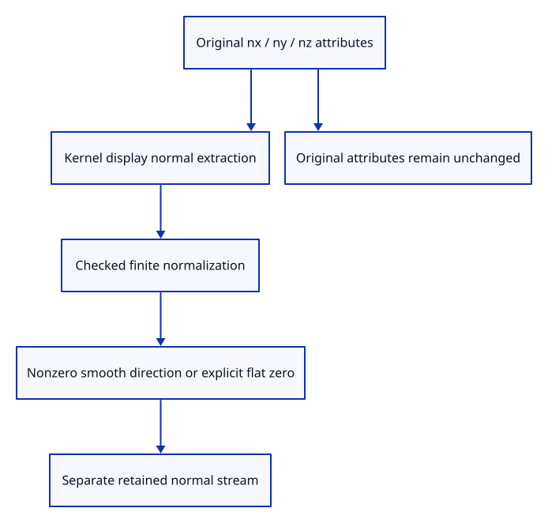

# 5.7.1 · Retain checked source normals beside display positions

**Chapter 5 · Lines, points and curves · Section 5.7 · Normals and construction grids** · [Contents](contents.md)

**Typing: 13–26 minutes.** [Estimate](typing-load.md).

Keep normals in a separate checked stream beside existing display positions and colours. Use the kernel adapter’s source normals; normalize finite nonzero vectors without overflow.

## Type

Continue from [Draw meshes beyond the sixteen-bit index limit](40b-indices.md). [Save or recover your work](recovery.md).

### 1. `src/normals.rs`

Normalize bounded display directions safely while preserving an explicit flat fallback.

Create the file and type:

```rust
--8<-- "journey/code/41-normals-01.rs"
```

### 2. `src/lib.rs`

Register normal preparation and its source checks.

<details>
<summary>Locate the existing block</summary>

```rust
pub mod mesh;
```

</details>

After that block, type:

```rust
pub mod normals;
#[cfg(test)]
mod normal_source_tests;
```

<details>
<summary>Optional patch references</summary>

Use these original edit fragments when comparing a saved checkpoint. Apply the complete blocks above.

```text
--8<-- "journey/code/41-normals-02.rs"
```

</details>

### 3. `src/mesh.rs`

Retain normal data independently of the established position/colour stream. Give manually created display meshes explicit flat normals by default. Carry kernel-extracted normal directions into checked display preparation. Require one finite checked normal per display vertex without touching original geometry. Count actual retained normal capacity in CPU display bytes.

Edit these blocks from bottom to top. Keep the surrounding lines unchanged.

<details>
<summary>Locate this block</summary>

```rust
            let [r, g, b, _] = vertex.color;
            [x, y, z, r, g, b]
        }).collect();
        Self::new(vertices, render.indices)
    }

    pub fn payload_bytes(&self) -> usize {
        self.vertices.capacity() * std::mem::size_of::<[f32; 6]>()
            + self.indices.capacity() * std::mem::size_of::<u32>()
    }

    pub fn vertices(&self) -> &[[f32; 6]] {
```

</details>

Replace it with:

```rust
            let [r, g, b, _] = vertex.color;
            [x, y, z, r, g, b]
        }).collect();
        let normals = render.vertices.iter().map(|vertex| vertex.normal).collect();
        Self::new(vertices, render.indices)?.with_normals(normals)
    }

    pub fn with_normals(mut self, normals: Vec<[f32; 3]>) -> Result<Self, &'static str> {
        if normals.len() != self.vertices.len() { return Err("Each display vertex needs one normal"); }
        self.normals = normals.into_iter().map(crate::normals::unit).collect::<Result<_, _>>()?; Ok(self)
    }

    pub fn normals(&self) -> &[[f32; 3]] { &self.normals }

    pub fn payload_bytes(&self) -> usize {
        self.vertices.capacity() * std::mem::size_of::<[f32; 6]>()
            + self.indices.capacity() * std::mem::size_of::<u32>()
            + self.normals.capacity() * std::mem::size_of::<[f32; 3]>()
    }

    pub fn vertices(&self) -> &[[f32; 6]] {
```

<details>
<summary>Locate this block</summary>

```rust
        if vertices.iter().flatten().any(|value| !value.is_finite()) {
            return Err("Vertex values must be finite");
        }
        Ok(Self { vertices, indices })
    }

    pub fn from_kernel(mesh: &session_rust::Mesh) -> Result<Self, &'static str> {
```

</details>

Replace it with:

```rust
        if vertices.iter().flatten().any(|value| !value.is_finite()) {
            return Err("Vertex values must be finite");
        }
        let normals = vec![[0.0; 3]; vertices.len()];
        Ok(Self { vertices, normals, indices })
    }

    pub fn from_kernel(mesh: &session_rust::Mesh) -> Result<Self, &'static str> {
```

<details>
<summary>Locate this block</summary>

```rust
pub struct Mesh {
    vertices: Vec<[f32; 6]>,
    indices: Vec<u32>,
}
```

</details>

Replace it with:

```rust
pub struct Mesh {
    vertices: Vec<[f32; 6]>,
    normals: Vec<[f32; 3]>,
    indices: Vec<u32>,
}
```

<details>
<summary>Complete updated block reference</summary>

```rust
pub struct Mesh {
    vertices: Vec<[f32; 6]>,
    normals: Vec<[f32; 3]>,
    indices: Vec<u32>,
}

impl Mesh {
    pub fn new(vertices: Vec<[f32; 6]>, indices: Vec<u32>) -> Result<Self, &'static str> {
        if indices.len() % 3 != 0 || indices.len() > u32::MAX as usize {
            return Err("Indices must describe complete triangles within the draw limit");
        }
        if indices.iter().any(|&index| index as usize >= vertices.len()) {
            return Err("A triangle refers to a missing vertex");
        }
        if vertices.iter().flatten().any(|value| !value.is_finite()) {
            return Err("Vertex values must be finite");
        }
        let normals = vec![[0.0; 3]; vertices.len()];
        Ok(Self { vertices, normals, indices })
    }

    pub fn from_kernel(mesh: &session_rust::Mesh) -> Result<Self, &'static str> {
        let render = mesh.to_render();
        let vertices = render.vertices.iter().map(|vertex| {
            let [x, y, z] = vertex.position;
            let [r, g, b, _] = vertex.color;
            [x, y, z, r, g, b]
        }).collect();
        let normals = render.vertices.iter().map(|vertex| vertex.normal).collect();
        Self::new(vertices, render.indices)?.with_normals(normals)
    }

    pub fn with_normals(mut self, normals: Vec<[f32; 3]>) -> Result<Self, &'static str> {
        if normals.len() != self.vertices.len() { return Err("Each display vertex needs one normal"); }
        self.normals = normals.into_iter().map(crate::normals::unit).collect::<Result<_, _>>()?; Ok(self)
    }

    pub fn normals(&self) -> &[[f32; 3]] { &self.normals }

    pub fn payload_bytes(&self) -> usize {
        self.vertices.capacity() * std::mem::size_of::<[f32; 6]>()
            + self.indices.capacity() * std::mem::size_of::<u32>()
            + self.normals.capacity() * std::mem::size_of::<[f32; 3]>()
    }

    pub fn vertices(&self) -> &[[f32; 6]] {
        &self.vertices
    }

    pub fn indices(&self) -> &[u32] {
        &self.indices
    }
}

#[cfg(test)]
mod tests {
    use super::*;

    #[test]
    fn a_kernel_box_becomes_eight_vertices_and_twelve_triangles() {
        let source = session_rust::Mesh::create_box(0.8, 0.8, 0.8);
        let mesh = Mesh::from_kernel(&source).unwrap();
        assert_eq!(mesh.vertices().len(), 8);
        assert_eq!(mesh.indices().len(), 36);
    }

    #[test]
    fn invalid_connections_and_nonfinite_vertices_are_rejected() {
        assert!(Mesh::new(vec![[0.0; 6]; 3], vec![0, 1, 3]).is_err());
        assert!(Mesh::new(vec![[0.0; 6]; 3], vec![0, 1]).is_err());
        assert!(Mesh::new(vec![[f32::NAN; 6]; 3], vec![0, 1, 2]).is_err());
        assert!(Mesh::new(vec![[0.0; 6]; 3], vec![0, 1, 2]).is_ok());
    }
}
```

</details>

<details>
<summary>Optional patch references</summary>

Use these original edit fragments when comparing a saved checkpoint. Apply the complete blocks above.

```text
--8<-- "journey/code/41-normals-03.rs"
```

```text
--8<-- "journey/code/41-normals-04.rs"
```

```text
--8<-- "journey/code/41-normals-05.rs"
```

```text
--8<-- "journey/code/41-normals-06.rs"
```

```text
--8<-- "journey/code/41-normals-07.rs"
```

</details>

<details>
<summary>Supplied validation fixture</summary>

Copy this supplied authoring fixture once. Continue with the browser build below; the course does not require running native tests.

### 4. `src/memory.rs`

Copy the normal-capacity oracle for a display mesh retaining three normals.

<details>
<summary>Locate the existing block</summary>

```text
baseline[4] + 16 * 24 + 16 * 4
```

</details>

After that block, append this supplied code:

```text
--8<-- "journey/code/41-normals-08.rs" skip=30
```

</details>

<details>
<summary>Supplied validation fixture</summary>

Copy this supplied authoring fixture once. Continue with the browser build below; the course does not require running native tests.

### 5. `src/normal_source_tests.rs`

Copy exact original attributes, normalized directions, flat zeros, malformed data and overflow-safe checks.

Copy this supplied file:

```text
--8<-- "journey/code/41-normals-09.rs"
```

</details>

## Run and check

In your project:

```sh
cd workspace/journey
REGEN_PROTO=0 cargo build --lib --locked --target wasm32-unknown-unknown -j1
REGEN_PROTO=0 CARGO_BUILD_JOBS=1 trunk serve --port 8780
```

Open `http://127.0.0.1:8780/`. Keep an existing Trunk server running; saving rebuilds it.

Run normal-stream checks. Original attributes remain exact, valid nonzero normals become bounded unit vectors, and missing normals retain the flat fallback.

### Recorded visual result

**Previous native render — current verification pending.**

This checkpoint was rendered independently and has the same native comparison frame as [Draw meshes beyond the sixteen-bit index limit](40b-indices.md). Use its state checks and browser exercise to assess the changed behavior.


*This recorded image predates a source or checker change. Rebuild this checkpoint before using it as current evidence; browser controls require separate acceptance.*

This reference image is shared with [5.3.5 · Draw original point rows and count their resources](37d-render.md). It does not demonstrate a new feature by itself.

<details>
<summary>Code explanation and diagram</summary>

Zero normals keep the existing flat fallback. Retain original attributes untouched and include normal capacity in CPU display accounting before adding its GPU stream.

original vertex normal attributes → kernel normal extraction → finite normalized display stream → retained payload accounting.



Why does an absent normal remain a zero vector rather than inventing a smooth normal?

Zero explicitly requests the existing flat derivative normal. A present kernel normal is the source’s smoothing choice; preserving that distinction keeps sharp surfaces sharp.

Study estimate, including typing and experiments: 0.75–1.25 hours.

</details>

<details>
<summary>Optional experiment</summary>

Prepare a source normal of length five. Its display direction is unit length while its original nx/ny/nz attributes remain unchanged.

</details>

<details>
<summary>Check and save your work</summary>

Restore experimental edits, then run from `session_viewer`:

```sh
npm --prefix ../session_tests run course -- check 5.7.1
npm --prefix ../session_tests run course -- save 5.7.1
```

Source comparison leaves your project untouched. [Save and recovery instructions](recovery.md).

</details>

<details>
<summary>Viewer coverage and verification</summary>

Normal data and CPU accounting are complete. Correct placement transforms and actual smooth/flat shader drawing follow in the next endpoints.

Native checks prove original attribute preservation, finite normalized normals, explicit flat zeros, mismatch/NaN refusal and true CPU retained capacity. Existing actual colour drawing remains the browser baseline.

Actual Chrome draws two adjacent source faces with separate red and blue colours.

[Full validation scope](release.md).

To reproduce the scripted acceptance of the reference checkpoint, run from `session_viewer` with the [course bundle server](release.md#reproduce) running on port 8781:

```sh
npm --prefix ../session_tests run course -- capture 5.7.1
```

This uses the verified reference bundle; it does not check or change your typed project.

</details>
