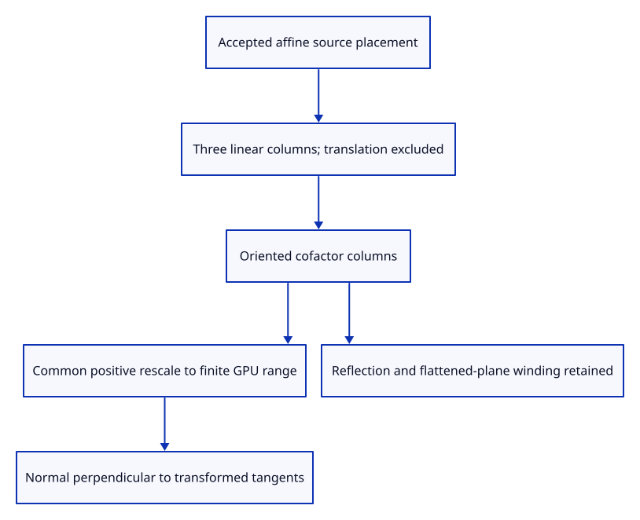

# 5.7.2 · Transform normals with nonuniform surface placement

**Chapter 5 · Lines, points and curves · Section 5.7 · Normals and construction grids** · [Contents](contents.md)

**Typing: 9–18 minutes.** [Estimate](typing-load.md).

Build the normal matrix from cofactors of the placement’s three linear columns. Translation is excluded. A shared positive rescale keeps GPU entries finite without changing direction.

## Type

Continue from [Retain checked source normals beside display positions](41-normals.md). [Save or recover your work](recovery.md).

### 1. `src/normals.rs`

Prepare bounded cofactor columns for oriented affine normal transformation.

<details>
<summary>Locate the existing block</summary>

```rust
    Ok(vector.map(|v| v / length))
}
```

</details>

After that block, type:

```rust

pub fn matrix(model: &session_rust::Xform) -> Result<[f32; 16], &'static str> {
    if !crate::placement::valid(&model.m) { return Err("Normal placement needs a finite affine matrix"); }
    let column = |index: usize| [model.m[index * 4], model.m[index * 4 + 1], model.m[index * 4 + 2]];
    let cross = |a: [f64; 3], b: [f64; 3]| [a[1] * b[2] - a[2] * b[1], a[2] * b[0] - a[0] * b[2], a[0] * b[1] - a[1] * b[0]];
    let [a, b, c] = [column(0), column(1), column(2)];
    let columns = [cross(b, c), cross(c, a), cross(a, b)];
    let scale = columns.iter().flatten().map(|v| v.abs()).fold(0.0, f64::max);
    let mut matrix = [0.0; 16];
    if scale > 0.0 {
        for col in 0..3 { for row in 0..3 { matrix[col * 4 + row] = (columns[col][row] / scale) as f32; } }
    }
    matrix[15] = 1.0; Ok(matrix)
}
```

<details>
<summary>Optional patch references</summary>

Use these original edit fragments when comparing a saved checkpoint. Apply the complete blocks above.

```text
--8<-- "journey/code/41a-placement-01.rs"
```

</details>

### 2. `src/lib.rs`

Register nonuniform, reflected and singular placement checks.

<details>
<summary>Locate the existing block</summary>

```rust
pub mod normals;
```

</details>

After that block, type:

```rust
#[cfg(test)]
mod normal_matrix_tests;
```

<details>
<summary>Optional patch references</summary>

Use these original edit fragments when comparing a saved checkpoint. Apply the complete blocks above.

```text
--8<-- "journey/code/41a-placement-02.rs"
```

</details>

<details>
<summary>Supplied validation fixture</summary>

Copy this supplied authoring fixture once. Continue with the browser build below; the course does not require running native tests.

### 3. `src/normal_matrix_tests.rs`

Copy perpendicularity, translation independence, winding, collapse and finite-range checks.

Copy this supplied file:

```text
--8<-- "journey/code/41a-placement-03.rs"
```

</details>

## Run and check

In your project:

```sh
cd workspace/journey
REGEN_PROTO=0 cargo build --lib --locked --target wasm32-unknown-unknown -j1
REGEN_PROTO=0 CARGO_BUILD_JOBS=1 trunk serve --port 8780
```

Open `http://127.0.0.1:8780/`. Keep an existing Trunk server running; saving rebuilds it.

Inspect perpendicularity, reflection, flattening and extreme-scale tests. Translation does not change the normal matrix.

### Recorded visual result

**Previous native render — current verification pending.**

This checkpoint was rendered independently and has the same native comparison frame as [Retain checked source normals beside display positions](41-normals.md). Use its state checks and browser exercise to assess the changed behavior.


*This recorded image predates a source or checker change. Rebuild this checkpoint before using it as current evidence; browser controls require separate acceptance.*

This reference image is shared with [5.3.5 · Draw original point rows and count their resources](37d-render.md). It does not demonstrate a new feature by itself.

<details>
<summary>Code explanation and diagram</summary>

This follows oriented face winding under reflection and still works for a flattened plane. Rank-one collapse produces zero normals, preserving the flat fallback rather than pretending an inverse exists.

accepted affine placement → cofactor columns → bounded common scale → oriented world-normal matrix.



Why does multiplying a normal by the position matrix fail under nonuniform scale?

A normal must remain perpendicular to transformed tangent vectors. Cofactor columns preserve that relationship and face orientation, including reflections and rank-two flattening.

Study estimate, including typing and experiments: 0.75–1.25 hours.

</details>

<details>
<summary>Optional experiment</summary>

Shear and scale two source tangents differently. Their transformed cross product must align with the transformed source normal.

</details>

<details>
<summary>Check and save your work</summary>

Restore experimental edits, then run from `session_viewer`:

```sh
npm --prefix ../session_tests run course -- check 5.7.2
npm --prefix ../session_tests run course -- save 5.7.2
```

Source comparison leaves your project untouched. [Save and recovery instructions](recovery.md).

</details>

<details>
<summary>Viewer coverage and verification</summary>

Normal placement preparation is complete. GPU settings and smooth/flat drawing follow next; original source normals remain unchanged.

Native tests verify perpendicular transformed tangents, translation independence, oriented reflection, rank-two/rank-one collapse, huge finite scale and invalid affine refusal.

Actual Chrome draws two adjacent source faces with separate red and blue colours.

[Full validation scope](release.md).

To reproduce the scripted acceptance of the reference checkpoint, run from `session_viewer` with the [course bundle server](release.md#reproduce) running on port 8781:

```sh
npm --prefix ../session_tests run course -- capture 5.7.2
```

This uses the verified reference bundle; it does not check or change your typed project.

</details>
