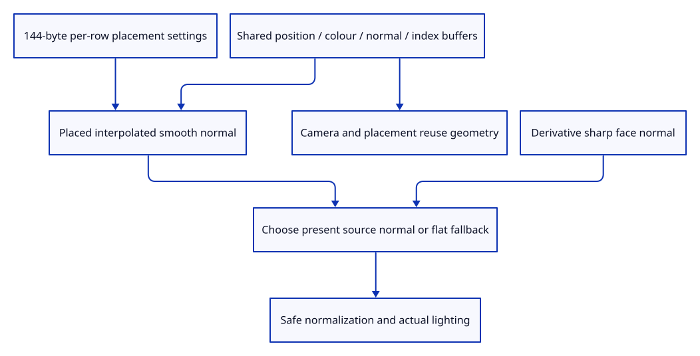

# 5.7.3 · Draw smooth normals and sharp surface faces

**Chapter 5 · Lines, points and curves · Section 5.7 · Normals and construction grids** · [Contents](contents.md)

**Typing: 24–48 minutes.** [Estimate](typing-load.md).

Add one shared normal buffer beside positions and colours. Give each object a bounded cofactor matrix in its placement uniform; translation cannot change its normal direction.

## Type

Continue from [Transform normals with nonuniform surface placement](41a-placement.md). [Save or recover your work](recovery.md).

### 1. `src/gpu_geometry.rs`

Share the checked normal stream with the geometry’s existing GPU lifetime. Upload three finite floats for each display vertex normal. Retain the normal allocation beside position and index buffers. Report actual normal allocation bytes as shared geometry. Bind the normal stream independently from position and colour attributes.

<details>
<summary>Locate the existing block</summary>

```rust
use crate::mesh::Mesh;
use std::rc::Rc;
use wgpu::util::DeviceExt;

pub struct GpuGeometry {
    pub source: Rc<Mesh>,
    vertices: wgpu::Buffer,
    indices: wgpu::Buffer,
    index_count: u32,
}

impl GpuGeometry {
    pub fn upload(device: &wgpu::Device, source: Rc<Mesh>) -> Self {
        let bytes: Vec<u8> = source.vertices().iter().flatten()
            .flat_map(|value| value.to_ne_bytes()).collect();
        let vertices = device.create_buffer_init(&wgpu::util::BufferInitDescriptor {
            label: Some("shared mesh vertices"), contents: &bytes,
            usage: wgpu::BufferUsages::VERTEX,
        });
        let bytes: Vec<u8> = source.indices().iter()
            .flat_map(|index| index.to_ne_bytes()).collect();
        let indices = device.create_buffer_init(&wgpu::util::BufferInitDescriptor {
            label: Some("shared mesh indices"), contents: &bytes,
            usage: wgpu::BufferUsages::INDEX,
        });
        let index_count = source.indices().len() as u32;
        Self { source, vertices, indices, index_count }
    }

    pub fn allocated_bytes(&self) -> u64 { self.vertices.size() + self.indices.size() }

    pub fn draw(&self, pass: &mut wgpu::RenderPass<'_>) {
        pass.set_vertex_buffer(0, self.vertices.slice(..));
        pass.set_index_buffer(self.indices.slice(..), wgpu::IndexFormat::Uint32);
        pass.draw_indexed(0..self.index_count, 0, 0..1);
    }
}
```

</details>

Edit the existing block to match this code; keep unchanged lines:

```rust
use crate::mesh::Mesh;
use std::rc::Rc;
use wgpu::util::DeviceExt;

pub struct GpuGeometry {
    pub source: Rc<Mesh>,
    vertices: wgpu::Buffer,
    normals: wgpu::Buffer,
    indices: wgpu::Buffer,
    index_count: u32,
}

impl GpuGeometry {
    pub fn upload(device: &wgpu::Device, source: Rc<Mesh>) -> Self {
        let bytes: Vec<u8> = source.vertices().iter().flatten()
            .flat_map(|value| value.to_ne_bytes()).collect();
        let vertices = device.create_buffer_init(&wgpu::util::BufferInitDescriptor {
            label: Some("shared mesh vertices"), contents: &bytes,
            usage: wgpu::BufferUsages::VERTEX,
        });
        let bytes: Vec<u8> = source.normals().iter().flatten().flat_map(|value| value.to_ne_bytes()).collect();
        let normals = device.create_buffer_init(&wgpu::util::BufferInitDescriptor {
            label: Some("shared mesh normals"), contents: &bytes, usage: wgpu::BufferUsages::VERTEX,
        });
        let bytes: Vec<u8> = source.indices().iter()
            .flat_map(|index| index.to_ne_bytes()).collect();
        let indices = device.create_buffer_init(&wgpu::util::BufferInitDescriptor {
            label: Some("shared mesh indices"), contents: &bytes,
            usage: wgpu::BufferUsages::INDEX,
        });
        let index_count = source.indices().len() as u32;
        Self { source, vertices, normals, indices, index_count }
    }

    pub fn allocated_bytes(&self) -> u64 { self.vertices.size() + self.normals.size() + self.indices.size() }

    pub fn draw(&self, pass: &mut wgpu::RenderPass<'_>) {
        pass.set_vertex_buffer(0, self.vertices.slice(..));
        pass.set_vertex_buffer(1, self.normals.slice(..));
        pass.set_index_buffer(self.indices.slice(..), wgpu::IndexFormat::Uint32);
        pass.draw_indexed(0..self.index_count, 0, 0..1);
    }
}
```

<details>
<summary>Optional patch references</summary>

Use these original edit fragments when comparing a saved checkpoint. Apply the complete blocks above.

```text
--8<-- "journey/code/41b-drawing-01.rs"
```

```text
--8<-- "journey/code/41b-drawing-02.rs"
```

```text
--8<-- "journey/code/41b-drawing-03.rs"
```

```text
--8<-- "journey/code/41b-drawing-04.rs"
```

```text
--8<-- "journey/code/41b-drawing-05.rs"
```

</details>

### 2. `src/renderer.rs`

Describe three normal floats in shader attribute two.

<details>
<summary>Locate the existing block</summary>

```rust
                    attributes: &wgpu::vertex_attr_array![0 => Float32x3, 1 => Float32x3],
                }],
```

</details>

Edit the existing block to match this code; keep unchanged lines:

```rust
                    attributes: &wgpu::vertex_attr_array![0 => Float32x3, 1 => Float32x3],
                }, wgpu::VertexBufferLayout {
                    array_stride: 12, step_mode: wgpu::VertexStepMode::Vertex,
                    attributes: &wgpu::vertex_attr_array![2 => Float32x3],
                }],
```

<details>
<summary>Optional patch references</summary>

Use these original edit fragments when comparing a saved checkpoint. Apply the complete blocks above.

```text
--8<-- "journey/code/41b-drawing-06.rs"
```

</details>

### 3. `src/gpu_mesh.rs`

Retain previous model, selection and normal-matrix settings for change-only writes. Allocate 64 model bytes, 16 selection bytes and 64 normal-matrix bytes. Serialize bounded normal cofactors after model and selection settings. Rewrite only the settings region whose bytes changed.

Edit these blocks from bottom to top. Keep the surrounding lines unchanged.

<details>
<summary>Locate this block</summary>

```rust
    pub fn update(&mut self, queue: &wgpu::Queue, object: &Object, selected: bool) -> [usize; 2] {
        let next = settings(object, selected);
        let mut writes = [0, 0];
        for (start, end) in [(0, 64), (64, 80)] {
            if next[start..end] != self.previous[start..end] {
                queue.write_buffer(&self.model, start as u64, &next[start..end]);
                writes[0] += 1;
```

</details>

Replace it with:

```rust
    pub fn update(&mut self, queue: &wgpu::Queue, object: &Object, selected: bool) -> [usize; 2] {
        let next = settings(object, selected);
        let mut writes = [0, 0];
        for (start, end) in [(0, 64), (64, 80), (80, 144)] {
            if next[start..end] != self.previous[start..end] {
                queue.write_buffer(&self.model, start as u64, &next[start..end]);
                writes[0] += 1;
```

<details>
<summary>Locate this block</summary>

```rust
    model_group: wgpu::BindGroup,
    pub id: crate::scene::ObjectId,
    model: wgpu::Buffer,
    previous: [u8; 80],
}

fn settings(object: &Object, selected: bool) -> [u8; 80] {
    let mut bytes = [0; 80];
    for (index, value) in object.model.m.iter().enumerate() {
        bytes[index * 4..index * 4 + 4].copy_from_slice(&(*value as f32).to_ne_bytes());
    }
    let flag: f32 = if selected { 1.0 } else { 0.0 };
    bytes[64..68].copy_from_slice(&flag.to_ne_bytes());
    bytes
}
```

</details>

Replace it with:

```rust
    model_group: wgpu::BindGroup,
    pub id: crate::scene::ObjectId,
    model: wgpu::Buffer,
    previous: [u8; 144],
}

fn settings(object: &Object, selected: bool) -> [u8; 144] {
    let mut bytes = [0; 144];
    for (index, value) in object.model.m.iter().enumerate() {
        bytes[index * 4..index * 4 + 4].copy_from_slice(&(*value as f32).to_ne_bytes());
    }
    let flag: f32 = if selected { 1.0 } else { 0.0 };
    bytes[64..68].copy_from_slice(&flag.to_ne_bytes());
    let normals = crate::normals::matrix(&object.model).expect("Scene placements are checked before insertion or editing");
    for (index, value) in normals.iter().enumerate() {
        bytes[80 + index * 4..84 + index * 4].copy_from_slice(&value.to_ne_bytes());
    }
    bytes
}
```

<details>
<summary>Complete updated block reference</summary>

```rust
use crate::{gpu_geometry::GpuGeometry, scene::Object};
use std::rc::Rc;
use wgpu::util::DeviceExt;

pub struct GpuMesh {
    pub geometry: Rc<GpuGeometry>,
    model_group: wgpu::BindGroup,
    pub id: crate::scene::ObjectId,
    model: wgpu::Buffer,
    previous: [u8; 144],
}

fn settings(object: &Object, selected: bool) -> [u8; 144] {
    let mut bytes = [0; 144];
    for (index, value) in object.model.m.iter().enumerate() {
        bytes[index * 4..index * 4 + 4].copy_from_slice(&(*value as f32).to_ne_bytes());
    }
    let flag: f32 = if selected { 1.0 } else { 0.0 };
    bytes[64..68].copy_from_slice(&flag.to_ne_bytes());
    let normals = crate::normals::matrix(&object.model).expect("Scene placements are checked before insertion or editing");
    for (index, value) in normals.iter().enumerate() {
        bytes[80 + index * 4..84 + index * 4].copy_from_slice(&value.to_ne_bytes());
    }
    bytes
}

impl GpuMesh {
    pub fn upload(device: &wgpu::Device, layout: &wgpu::BindGroupLayout, object: &Object, selected: bool) -> Self {
        let geometry = Rc::new(GpuGeometry::upload(device, Rc::clone(&object.mesh)));
        Self::with_geometry(device, layout, object, selected, geometry)
    }

    pub fn with_geometry(device: &wgpu::Device, layout: &wgpu::BindGroupLayout,
        object: &Object, selected: bool, geometry: Rc<GpuGeometry>) -> Self
    {
        let bytes = settings(object, selected);
        let model = device.create_buffer_init(&wgpu::util::BufferInitDescriptor {
            label: Some("object placement"),
            contents: &bytes,
            usage: wgpu::BufferUsages::UNIFORM | wgpu::BufferUsages::COPY_DST,
        });
        let model_group = device.create_bind_group(&wgpu::BindGroupDescriptor {
            label: Some("object placement"),
            layout,
            entries: &[wgpu::BindGroupEntry { binding: 0, resource: model.as_entire_binding() }],
        });
        Self { geometry, model_group, id: object.id, model, previous: bytes }
    }

    pub fn settings_bytes(&self) -> u64 { self.model.size() }

    pub fn update(&mut self, queue: &wgpu::Queue, object: &Object, selected: bool) -> [usize; 2] {
        let next = settings(object, selected);
        let mut writes = [0, 0];
        for (start, end) in [(0, 64), (64, 80), (80, 144)] {
            if next[start..end] != self.previous[start..end] {
                queue.write_buffer(&self.model, start as u64, &next[start..end]);
                writes[0] += 1;
                writes[1] += end - start;
            }
        }
        self.previous = next;
        writes
    }

    pub fn draw(&self, pass: &mut wgpu::RenderPass<'_>) {
        pass.set_bind_group(1, &self.model_group, &[]);
        self.geometry.draw(pass);
    }
}
```

</details>

<details>
<summary>Optional patch references</summary>

Use these original edit fragments when comparing a saved checkpoint. Apply the complete blocks above.

```text
--8<-- "journey/code/41b-drawing-07.rs"
```

```text
--8<-- "journey/code/41b-drawing-08.rs"
```

```text
--8<-- "journey/code/41b-drawing-09.rs"
```

```text
--8<-- "journey/code/41b-drawing-10.rs"
```

</details>

### 4. `src/scene.rs`

Refuse invalid initial placement before consuming an ID or creating a row.

<details>
<summary>Locate the existing block</summary>

```rust
    pub fn insert(&mut self, prepared: PreparedMesh) -> Result<ObjectId, &'static str> {
        let next = self.next_id.checked_add(1).ok_or("Object IDs exhausted")?;
```

</details>

Edit the existing block to match this code; keep unchanged lines:

```rust
    pub fn insert(&mut self, prepared: PreparedMesh) -> Result<ObjectId, &'static str> {
        if !crate::placement::valid(&prepared.model.m) { return Err("Placement must be finite, affine and fit the display range"); }
        let next = self.next_id.checked_add(1).ok_or("Object IDs exhausted")?;
```

<details>
<summary>Optional patch references</summary>

Use these original edit fragments when comparing a saved checkpoint. Apply the complete blocks above.

```text
--8<-- "journey/code/41b-drawing-11.rs"
```

</details>

### 5. `src/geometry_cache.rs`

Count initialized normal payload separately from retained GPU capacity.

<details>
<summary>Locate the existing block</summary>

```rust
        self.uploaded_bytes += (source.vertices().len() * 24 + source.indices().len() * 4) as u64;
```

</details>

Edit the existing block to match this code; keep unchanged lines:

```rust
        self.uploaded_bytes += (source.vertices().len() * 24 + source.normals().len() * 12 + source.indices().len() * 4) as u64;
```

<details>
<summary>Optional patch references</summary>

Use these original edit fragments when comparing a saved checkpoint. Apply the complete blocks above.

```text
--8<-- "journey/code/41b-drawing-12.rs"
```

</details>

### 6. `src/renderer.rs`

Count complete initial object settings without confusing the separate ink view uniform.

<details>
<summary>Locate the existing block</summary>

```rust
        self.geometry.uploaded_bytes + self.settings_allocations as u64 * 80 + self.settings_bytes as u64
```

</details>

Edit the existing block to match this code; keep unchanged lines:

```rust
        self.geometry.uploaded_bytes + self.settings_allocations as u64 * 144 + self.settings_bytes as u64
```

<details>
<summary>Optional patch references</summary>

Use these original edit fragments when comparing a saved checkpoint. Apply the complete blocks above.

```text
--8<-- "journey/code/41b-drawing-13.rs"
```

</details>

### 7. `src/triangle.wgsl`

Keep the shader uniform layout identical to the 144-byte host settings. Interpolate the placed source normal across the rasterized face. Read the normal attribute from the separate shared stream. Transform a direction without adding the object’s translation. Choose source smoothing or sharp derivatives, then normalize without zero division or squaring huge vectors.

<details>
<summary>Locate the existing block</summary>

```wgsl
@group(0) @binding(0) var<uniform> transform: mat4x4<f32>;
struct ObjectSettings {
    model: mat4x4<f32>,
    selection: vec4<f32>,
}
@group(1) @binding(0) var<uniform> object: ObjectSettings;

struct VertexOutput {
    @builtin(position) position: vec4<f32>,
    @location(0) colour: vec3<f32>,
    @location(1) world: vec3<f32>,
}

@vertex
fn vertex(@location(0) position: vec3<f32>, @location(1) colour: vec3<f32>) -> VertexOutput {
    var output: VertexOutput;
    let world = object.model * vec4<f32>(position, 1.0);
    output.position = transform * world;
    output.colour = select(colour, vec3<f32>(1.0, 0.75, 0.05), object.selection.x > 0.5);
    output.world = world.xyz;
    return output;
}

@fragment
fn fragment(input: VertexOutput) -> @location(0) vec4<f32> {
    // Neighbouring fragments give two directions along this triangle's surface.
    let normal = normalize(cross(dpdx(input.world), dpdy(input.world)));
    let light = normalize(vec3<f32>(0.4, -0.6, 1.0));
    // abs lights both sides of an open face; 0.3 keeps unlit faces readable.
    let brightness = 0.3 + 0.7 * abs(dot(normal, light));
    return vec4<f32>(input.colour * brightness, 1.0);
}
```

</details>

Edit the existing block to match this code; keep unchanged lines:

```wgsl
@group(0) @binding(0) var<uniform> transform: mat4x4<f32>;
struct ObjectSettings {
    model: mat4x4<f32>,
    selection: vec4<f32>,
    normal_matrix: mat4x4<f32>,
}
@group(1) @binding(0) var<uniform> object: ObjectSettings;

struct VertexOutput {
    @builtin(position) position: vec4<f32>,
    @location(0) colour: vec3<f32>,
    @location(1) world: vec3<f32>,
    @location(2) normal: vec3<f32>,
}

@vertex
fn vertex(@location(0) position: vec3<f32>, @location(1) colour: vec3<f32>, @location(2) normal: vec3<f32>) -> VertexOutput {
    var output: VertexOutput;
    let world = object.model * vec4<f32>(position, 1.0);
    output.position = transform * world;
    output.colour = select(colour, vec3<f32>(1.0, 0.75, 0.05), object.selection.x > 0.5);
    output.world = world.xyz;
    output.normal = (object.normal_matrix * vec4<f32>(normal, 0.0)).xyz;
    return output;
}

@fragment
fn fragment(input: VertexOutput) -> @location(0) vec4<f32> {
    // Derivatives require neighbouring fragments; calculate the sharp face direction before choosing a potentially smooth interpolated source direction.
    let face = cross(dpdx(input.world), dpdy(input.world));
    let direction = select(face, input.normal, dot(input.normal, input.normal) > 0.0);
    let scale = max(max(abs(direction.x), abs(direction.y)), abs(direction.z));
    let bounded = direction / max(scale, 1e-30);
    let normal = bounded / max(length(bounded), 1e-30);
    let light = normalize(vec3<f32>(0.4, -0.6, 1.0));
    // abs lights both sides of an open face; 0.3 keeps unlit faces readable.
    let brightness = 0.3 + 0.7 * abs(dot(normal, light));
    return vec4<f32>(input.colour * brightness, 1.0);
}
```

<details>
<summary>Optional patch references</summary>

Use these original edit fragments when comparing a saved checkpoint. Apply the complete blocks above.

```text
--8<-- "journey/code/41b-drawing-14.rs"
```

```text
--8<-- "journey/code/41b-drawing-15.rs"
```

```text
--8<-- "journey/code/41b-drawing-16.rs"
```

```text
--8<-- "journey/code/41b-drawing-17.rs"
```

```text
--8<-- "journey/code/41b-drawing-18.rs"
```

</details>

### 8. `src/lib.rs`

Register atomic placement and normal-stream GPU boundary checks.

<details>
<summary>Locate the existing block</summary>

```rust
pub mod normals;
```

</details>

After that block, type:

```rust
#[cfg(test)]
mod normal_gpu_tests;
```

<details>
<summary>Optional patch references</summary>

Use these original edit fragments when comparing a saved checkpoint. Apply the complete blocks above.

```text
--8<-- "journey/code/41b-drawing-19.rs"
```

</details>

<details>
<summary>Supplied validation fixture</summary>

Copy this supplied authoring fixture once. Continue with the browser build below; the course does not require running native tests.

### 9. `src/normal_gpu_tests.rs`

Copy invalid-placement refusal and unchanged identity-allocation checks.

Copy this supplied file:

```text
--8<-- "journey/code/41b-drawing-20.rs"
```

</details>

## Run and check

In your project:

```sh
cd workspace/journey
REGEN_PROTO=0 cargo build --lib --locked --target wasm32-unknown-unknown -j1
REGEN_PROTO=0 CARGO_BUILD_JOBS=1 trunk serve --port 8780
```

Open `http://127.0.0.1:8780/`. Keep an existing Trunk server running; saving rebuilds it.

Inspect the supplied state fixtures, then compare Example Face Colors and Example Point Colors. Their source colours still draw correctly with the new normal stream. The next lesson connects a visible normal diagnostic.

### Recorded visual result

**Previous native render — current verification pending.**

This checkpoint was rendered independently and has the same native comparison frame as [Transform normals with nonuniform surface placement](41a-placement.md). Use its state checks and browser exercise to assess the changed behavior.


*This recorded image predates a source or checker change. Rebuild this checkpoint before using it as current evidence; browser controls require separate acceptance.*

This reference image is shared with [5.3.5 · Draw original point rows and count their resources](37d-render.md). It does not demonstrate a new feature by itself.

<details>
<summary>Code explanation and diagram</summary>

Interpolate present normals across the face, normalize safely in the fragment shader, and use the derivative face normal for explicit zero normals. Count actual normal allocations and initialized bytes separately from later uniform changes.

checked source normals → shared GPU normal buffer → per-row cofactor uniform → interpolated world direction or derivative face normal.



Why calculate the flat derivative normal even when a smooth normal is present?

Fragment derivatives need neighbouring invocations. Calculate them before choosing the normal, then safely normalize the selected finite direction without a zero-vector division.

Study estimate, including typing and experiments: 0.75–1.25 hours.

</details>

<details>
<summary>Optional experiment</summary>

Rotate and zoom the coloured specimens. Missing source normals retain sharp-face lighting; camera movement must not rebuild the geometry buffers.

</details>

<details>
<summary>Check and save your work</summary>

Restore experimental edits, then run from `session_viewer`:

```sh
npm --prefix ../session_tests run course -- check 5.7.3
npm --prefix ../session_tests run course -- save 5.7.3
```

Source comparison leaves your project untouched. [Save and recovery instructions](recovery.md).

</details>

<details>
<summary>Viewer coverage and verification</summary>

The actual renderer now uses source normals and correct affine normal placement. Normal examples, winding inspection and actual command/history/browser checks follow next.

Actual native renderer pixels check smooth interpolation, flat fallback and nonuniform/sheared/reflected/flattened placement. Resource checks prove shared buffer sizes, exact writes, no camera/placement geometry uploads and final Close release.

Actual Chrome draws two adjacent source faces with separate red and blue colours.

[Full validation scope](release.md).

To reproduce the scripted acceptance of the reference checkpoint, run from `session_viewer` with the [course bundle server](release.md#reproduce) running on port 8781:

```sh
npm --prefix ../session_tests run course -- capture 5.7.3
```

This uses the verified reference bundle; it does not check or change your typed project.

</details>
