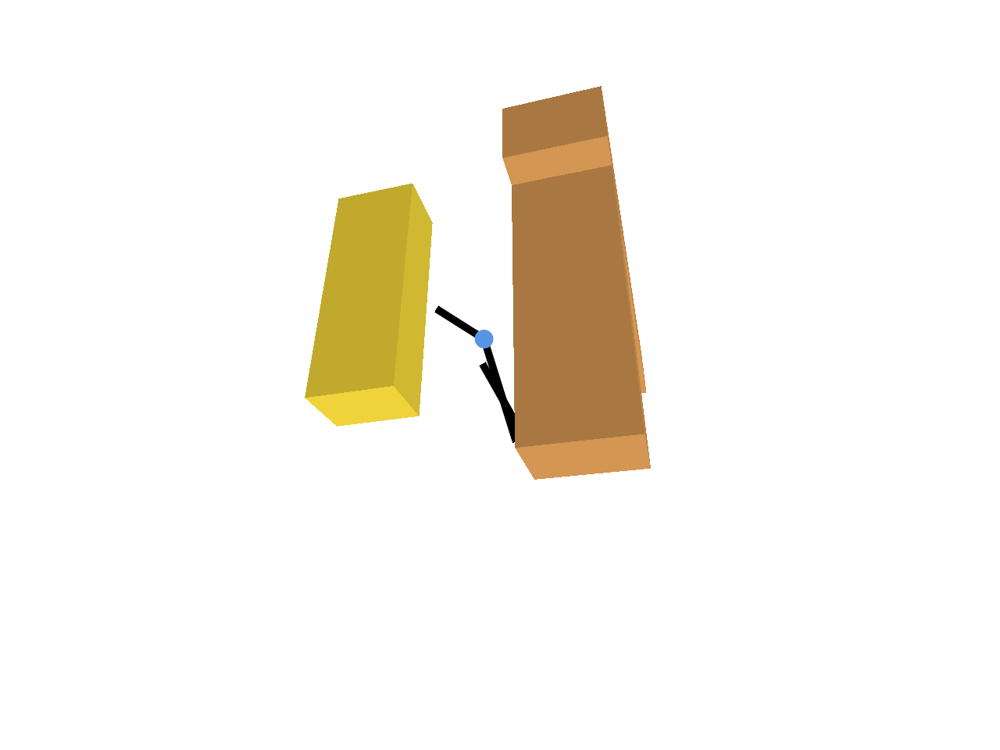
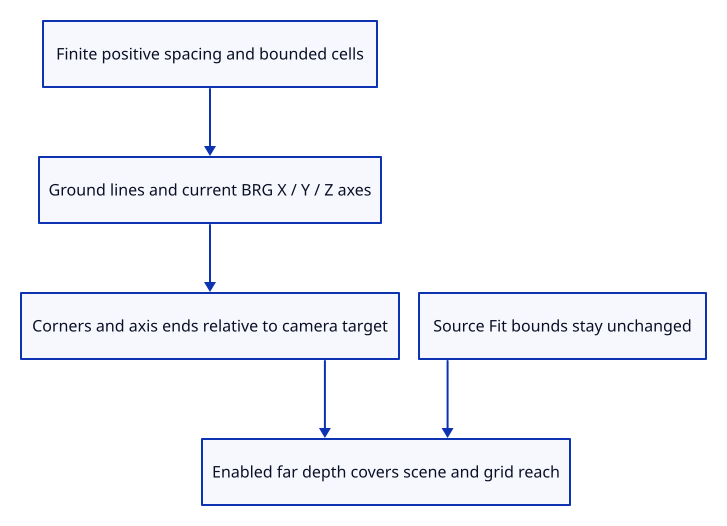

# 5.7.6 · Bound the ground grid and its camera depth range

**Chapter 5 · Lines, points and curves · Section 5.7 · Normals and construction grids** · [Contents](contents.md)

**Typing: 27–53 minutes.** [Estimate](typing-load.md).

Build finite floor lines and the current pink, yellow-green and blue axes. Validate spacing and cap the number of cells before allocating display data.

## Type

Continue from [Inspect smooth normals and face winding through commands](41ca-input.md). [Save or recover your work](recovery.md).

### 1. `src/grid.rs`

Validate and prepare finite grid lines, current axis colours and depth-reach reference points.

Create the file and type:

```rust
--8<-- "journey/code/41d-grid-01.rs"
```

### 2. `src/lib.rs`

Register bounded ground-grid preparation and camera-range checks.

<details>
<summary>Locate the existing block</summary>

```rust
pub mod normal_example;
```

</details>

After that block, type:

```rust
pub mod grid;
#[cfg(test)]
mod grid_source_tests;
```

<details>
<summary>Optional patch references</summary>

Use these original edit fragments when comparing a saved checkpoint. Apply the complete blocks above.

```text
--8<-- "journey/code/41d-grid-02.rs"
```

</details>

### 3. `src/camera.rs`

Retain the enabled grid extent independently of source scene bounds. Keep prior camera drawing unchanged until actual grid input enables it. Include grid corners in enabled far depth without altering source Fit bounds.

Edit these blocks from bottom to top. Keep the surrounding lines unchanged.

<details>
<summary>Locate this block</summary>

```rust
        );
        let view = Xform::look_at_right_handed(&eye, &target, &up);
        let near = self.distance * NEAR_FRACTION;
        let far = (self.distance * 10.0).max(self.distance + self.radius * 2.0);
        let projection = match self.projection {
            Projection::Perspective => Xform::perspective(2.0 * HALF_FOV, self.aspect, near, far),
            Projection::Orthographic => {
```

</details>

Replace it with:

```rust
        );
        let view = Xform::look_at_right_handed(&eye, &target, &up);
        let near = self.distance * NEAR_FRACTION;
        let reach = self.grid.and_then(|grid| grid.reach(self.target).ok()).map_or(self.radius, |reach| self.radius.max(reach));
        let far = (self.distance * 10.0).max(self.distance + 2.0 * reach);
        let projection = match self.projection {
            Projection::Perspective => Xform::perspective(2.0 * HALF_FOV, self.aspect, near, far),
            Projection::Orthographic => {
```

<details>
<summary>Locate this block</summary>

```rust
            orientation: Quaternion::from_axis_angle(Vector::x_axis(), -std::f64::consts::FRAC_PI_2),
            aspect: 640.0 / 480.0,
            projection: Projection::Perspective,
        }
    }
}
```

</details>

Replace it with:

```rust
            orientation: Quaternion::from_axis_angle(Vector::x_axis(), -std::f64::consts::FRAC_PI_2),
            aspect: 640.0 / 480.0,
            projection: Projection::Perspective,
            grid: None,
        }
    }
}
```

<details>
<summary>Locate this block</summary>

```rust
    pub orientation: Quaternion,
    pub aspect: f64,
    pub projection: Projection,
}

impl Default for Camera {
```

</details>

Replace it with:

```rust
    pub orientation: Quaternion,
    pub aspect: f64,
    pub projection: Projection,
    pub grid: Option<crate::grid::Settings>,
}

impl Default for Camera {
```

<details>
<summary>Complete updated block reference</summary>

```rust
use session_rust::{Point, Quaternion, Vector, Xform};

pub const NEAR_FRACTION:f64=1.0e-4;

const HALF_FOV: f64 = std::f64::consts::FRAC_PI_6;

#[derive(Clone, Copy, Debug, PartialEq, Eq)]
pub enum Projection {
    Perspective,
    Orthographic,
}

pub struct Ray {
    pub origin: Point,
    pub direction: Vector,
    pub max_distance: f64,
}

pub struct Camera {
    pub target: [f64; 3],
    pub distance: f64,
    pub radius: f64,
    pub orientation: Quaternion,
    pub aspect: f64,
    pub projection: Projection,
    pub grid: Option<crate::grid::Settings>,
}

impl Default for Camera {
    fn default() -> Self {
        Self {
            target: [0.0; 3],
            distance: 3.0,
            radius: 1.0,
            orientation: Quaternion::from_axis_angle(Vector::x_axis(), -std::f64::consts::FRAC_PI_2),
            aspect: 640.0 / 480.0,
            projection: Projection::Perspective,
            grid: None,
        }
    }
}

impl Camera {
    pub fn fit(&mut self, bounds: &crate::bounds::Bounds) {
        let half_y = HALF_FOV;
        let half_x = (self.aspect * half_y.tan()).atan();
        let radius = bounds.radius();
        self.radius = if radius > 0.0 { radius } else { 1.0 };
        self.target = bounds.centre();
        let opening = match self.projection {
            Projection::Perspective => half_x.min(half_y).sin(),
            Projection::Orthographic => half_y.tan() * self.aspect.min(1.0),
        };
        self.distance = self.radius * 1.1 / opening;
    }

    pub fn pan(&mut self, dx: f32, dy: f32) {
        let right = self.orientation.rotate_vector(Vector::x_axis());
        let up = self.orientation.rotate_vector(Vector::z_axis());
        for i in 0..3 {
            self.target[i] += dx as f64 * right[i] + dy as f64 * up[i];
        }
    }

    pub fn zoom(&mut self, factor: f32) {
        if factor.is_finite() && factor > 0.0 {
            self.distance = (self.distance / factor as f64).clamp(self.radius * 0.2, self.radius * 50.0);
        }
    }

    pub fn rotate(&mut self, radians: f32) {
        self.orbit(radians as f64, 0.0);
    }

    pub fn orbit(&mut self, yaw: f64, pitch: f64) {
        let right = self.orientation.rotate_vector(Vector::x_axis());
        let turn = Quaternion::from_axis_angle(Vector::z_axis(), yaw);
        let tilt = Quaternion::from_axis_angle(right, pitch);
        self.orientation = (turn * (tilt * self.orientation.duplicate())).normalized();
    }

    pub fn isometric(&mut self) {
        let turn = Quaternion::from_axis_angle(Vector::z_axis(), -std::f64::consts::FRAC_PI_6);
        let right = turn.rotate_vector(Vector::x_axis());
        let tilt = Quaternion::from_axis_angle(right, -std::f64::consts::FRAC_PI_6);
        self.orientation = (tilt * turn).normalized();
    }

    pub fn view_projection(&self) -> Xform {
        let forward = self.orientation.rotate_vector(Vector::y_axis());
        let up = self.orientation.rotate_vector(Vector::z_axis());
        let target = Point::new(self.target[0], self.target[1], self.target[2]);
        let eye = Point::new(
            self.target[0] - forward[0] * self.distance,
            self.target[1] - forward[1] * self.distance,
            self.target[2] - forward[2] * self.distance,
        );
        let view = Xform::look_at_right_handed(&eye, &target, &up);
        let near = self.distance * NEAR_FRACTION;
        let reach = self.grid.and_then(|grid| grid.reach(self.target).ok()).map_or(self.radius, |reach| self.radius.max(reach));
        let far = (self.distance * 10.0).max(self.distance + 2.0 * reach);
        let projection = match self.projection {
            Projection::Perspective => Xform::perspective(2.0 * HALF_FOV, self.aspect, near, far),
            Projection::Orthographic => {
                let h = self.distance * HALF_FOV.tan();
                let w = h * self.aspect;
                let depth_range = (self.distance + 2.0 * self.radius).max(1.0e-6);
                Xform::orthographic(-w, w, -h, h, -depth_range, depth_range)
            }
        };
        projection * view
    }

    pub fn uniform(&self) -> [f32; 16] {
        self.view_projection().to_f32()
    }

    pub fn ray(&self, screen: [f32; 2]) -> Option<Ray> {
        if screen.iter().any(|value| !value.is_finite() || value.abs() > 1.0) {
            return None;
        }
        let inverse = self.view_projection().inverse()?;
        let origin = inverse.transform_point(&Point::new(screen[0] as f64, screen[1] as f64, 0.0));
        let end = inverse.transform_point(&Point::new(screen[0] as f64, screen[1] as f64, 1.0));
        let delta = &end - &origin;
        let max_distance = delta.magnitude();
        if !max_distance.is_finite() || max_distance <= 0.0 {
            return None;
        }
        Some(Ray { origin, direction: delta.normalized(), max_distance })
    }
}

#[cfg(test)]
mod tests {
    use super::*;

    #[test]
    fn the_target_stays_centred_after_pan_zoom_and_turn() {
        let mut camera = Camera::default();
        camera.pan(0.25, -0.5);
        camera.zoom(2.0);
        camera.rotate(0.7);
        camera.orbit(0.3, 0.2);
        let target = Point::new(camera.target[0], camera.target[1], camera.target[2]);
        let screen = camera.view_projection().transform_point(&target);
        assert!(screen[0].abs() < 1.0e-9 && screen[1].abs() < 1.0e-9);
        assert!((0.0..1.0).contains(&screen[2]));
    }

    #[test]
    fn repeated_orbit_keeps_the_camera_axes_orthonormal() {
        let mut camera = Camera::default();
        for _ in 0..1_000 {
            camera.orbit(0.01, 0.02);
        }
        let right = camera.orientation.rotate_vector(Vector::x_axis());
        let forward = camera.orientation.rotate_vector(Vector::y_axis());
        let up = camera.orientation.rotate_vector(Vector::z_axis());
        for axis in [&right, &forward, &up] {
            assert!((axis.magnitude() - 1.0).abs() < 1.0e-10);
        }
        assert!(right.dot(&forward).abs() < 1.0e-10);
        assert!(right.dot(&up).abs() < 1.0e-10);
        assert!(forward.dot(&up).abs() < 1.0e-10);
    }

    #[test]
    fn a_projected_point_lies_on_its_unprojected_ray() {
        let camera = Camera::default();
        let world = Point::new(0.4, 0.2, 0.75);
        let screen = camera.view_projection().transform_point(&world);
        let ray = camera.ray([screen[0] as f32, screen[1] as f32]).unwrap();
        let offset = &world - &ray.origin;
        assert!(offset.cross(&ray.direction).magnitude() < 1.0e-6);
        assert!(offset.dot(&ray.direction) > 0.0);
        assert!(offset.magnitude() < ray.max_distance);
        assert!(camera.ray([f32::NAN, 0.0]).is_none());
    }
}

#[cfg(test)]
mod near_range_tests{
 use super::*;
 #[test]
 fn large_scene_radius_does_not_cut_geometry_just_ahead_of_the_eye(){
  for distance in [0.001,1.,1000.]{let mut camera=Camera::default();camera.distance=distance;camera.radius=distance*100000.;
   let forward=camera.orientation.rotate_vector(Vector::y_axis());let point=|gap:f64|Point::new(camera.target[0]+forward[0]*(gap-distance),camera.target[1]+forward[1]*(gap-distance),camera.target[2]+forward[2]*(gap-distance));
   let matrix=camera.view_projection();let inside=matrix.transform_point(&point(distance*NEAR_FRACTION*2.));let cut=matrix.transform_point(&point(distance*NEAR_FRACTION*0.5));
   assert!((0.0..1.0).contains(&inside[2]),"near geometry remains in view: {inside:?}");assert!(cut[2]<0.,"the near plane still cuts ahead of the eye");
  }
 }
}

#[cfg(test)]
mod orthographic_range_tests{
 use super::*;
 #[test]
 fn orthographic_depth_retains_four_millimetres_at_a_distant_camera(){
  let mut camera=Camera::default();camera.projection=Projection::Orthographic;camera.distance=1_000_000.;camera.radius=1000.;
  let forward=camera.orientation.rotate_vector(Vector::y_axis());let center=Point::new(camera.target[0],camera.target[1],camera.target[2]);let behind=&center+&(forward*4.);
  let matrix=camera.view_projection();let a=matrix.transform_point(&center);let b=matrix.transform_point(&behind);
  assert!((0.0..1.0).contains(&a[2])&&(0.0..1.0).contains(&b[2]));let front=a[2]as f32;let rear=b[2]as f32;
  assert!((front-rear).abs()>rear.abs()*1.9073486e-6,"four millimetres exceed the ink visibility tolerance");
 }
}
```

</details>

<details>
<summary>Optional patch references</summary>

Use these original edit fragments when comparing a saved checkpoint. Apply the complete blocks above.

```text
--8<-- "journey/code/41d-grid-03.rs"
```

```text
--8<-- "journey/code/41d-grid-04.rs"
```

```text
--8<-- "journey/code/41d-grid-05.rs"
```

</details>

<details>
<summary>Supplied validation fixture</summary>

Copy this supplied authoring fixture once. Continue with the browser build below; the course does not require running native tests.

### 4. `src/grid_source_tests.rs`

Copy checked grid capacity, source colour values, invalid input and actual camera corner-depth checks.

Copy this supplied file:

```text
--8<-- "journey/code/41d-grid-06.rs"
```

</details>

### 5. `src/camera.rs`

Cover enabled grid corners in the same orthographic depth interval.

<details>
<summary>Locate the existing block</summary>

```rust
                let depth_range = (self.distance + 2.0 * self.radius).max(1.0e-6);
```

</details>

Edit the existing block to match this code; keep unchanged lines:

```rust
                let depth_range = (self.distance + 2.0 * reach).max(1.0e-6);
```

<details>
<summary>Optional patch references</summary>

Use these original edit fragments when comparing a saved checkpoint. Apply the complete blocks above.

```text
--8<-- "journey/code/41d-grid-orthographic-depth.rs"
```

</details>

## Run and check

In your project:

```sh
cd workspace/journey
REGEN_PROTO=0 cargo build --lib --locked --target wasm32-unknown-unknown -j1
REGEN_PROTO=0 CARGO_BUILD_JOBS=1 trunk serve --port 8780
```

Open `http://127.0.0.1:8780/`. Keep an existing Trunk server running; saving rebuilds it.

Run bounded-grid and depth-range checks. Grid data has a fixed checked maximum, current axis colours and camera reach that includes its distant corners.

### Recorded visual result

**Previous native render — current verification pending.**

This checkpoint was rendered independently and has the same native comparison frame as [Inspect smooth normals and face winding through commands](41ca-input.md). Use its state checks and browser exercise to assess the changed behavior.



*This recorded image predates a source or checker change. Rebuild this checkpoint before using it as current evidence; browser controls require separate acceptance.*

<details>
<summary>Code explanation and diagram</summary>

Include grid corners and axis ends in camera depth reach when enabled. Keep Fit tied to source geometry; extending the depth range does not enlarge the source object.

checked spacing and bounded cell count → finite floor lines and BRG axes → corner/axis depth reach → camera far range.



Why can fitting a small object accidentally clip a large ground grid?

The scene radius only covers the object. The far depth range must also reach the grid corners relative to the camera target, without changing the object’s Fit bounds.

Study estimate, including typing and experiments: 0.75–1.25 hours.

</details>

<details>
<summary>Optional experiment</summary>

Fit a small scene and orbit into an isometric view. Compare a distant grid corner’s depth with the grid disabled and enabled.

</details>

<details>
<summary>Check and save your work</summary>

Restore experimental edits, then run from `session_viewer`:

```sh
npm --prefix ../session_tests run course -- check 5.7.6
npm --prefix ../session_tests run course -- save 5.7.6
```

Source comparison leaves your project untouched. [Save and recovery instructions](recovery.md).

</details>

<details>
<summary>Viewer coverage and verification</summary>

Checked grid preparation and camera range are complete. Actual GPU grid drawing and real grid input follow; defaults use metre-sized course units for the same physical5m half-width as production5000mm.

Native tests verify exact bounded line counts, finite coordinates, axis colours, invalid-spacing/range refusal and actual projected corner depth after small-scene Fit. Actual normal-input Chrome remains the browser baseline. Chrome runs the focused normal-view command checks at this preparation checkpoint; the grid input endpoint reruns the cumulative browser suite.

Actual Chrome normals view distinguishes two source faces with opposite winding.

[Full validation scope](release.md).

To reproduce the scripted acceptance of the reference checkpoint, run from `session_viewer` with the [course bundle server](release.md#reproduce) running on port 8781:

```sh
npm --prefix ../session_tests run course -- capture 5.7.6
```

This uses the verified reference bundle; it does not check or change your typed project.

</details>
