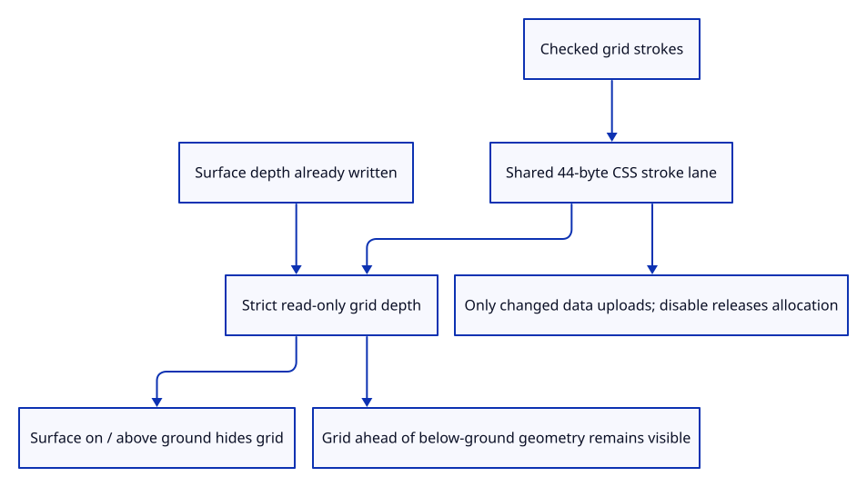

# 5.7.7 · Draw a depth-correct grid with shared stroke buffers

**Chapter 5 · Lines, points and curves · Section 5.7 · Normals and construction grids** · [Contents](contents.md)

**Typing: 20–40 minutes.** [Estimate](typing-load.md).

Reuse the existing CSS stroke lane for the finite grid and axes. Give its pipeline strict read-only surface depth; draw it after surfaces and before source ink.

## Type

Continue from [Bound the ground grid and its camera depth range](41d-grid.md). [Save or recover your work](recovery.md).

### 1. `src/depth.rs`

Hide coplanar grid ink without changing source strokes’ equal-depth drawing policy.

<details>
<summary>Locate the existing block</summary>

```rust
pub fn ink() -> wgpu::DepthStencilState { state(false, wgpu::CompareFunction::LessEqual) }
```

</details>

After that block, type:

```rust
pub fn grid() -> wgpu::DepthStencilState { state(false, wgpu::CompareFunction::Less) }
```

<details>
<summary>Optional patch references</summary>

Use these original edit fragments when comparing a saved checkpoint. Apply the complete blocks above.

```text
--8<-- "journey/code/41e-drawing-01.rs"
```

</details>

### 2. `src/stroke_gpu.rs`

Share stroke preparation while choosing a separate grid depth policy. Use the caller’s explicit ink or grid depth policy.

Edit these blocks from bottom to top. Keep the surrounding lines unchanged.

<details>
<summary>Locate this block</summary>

```rust
                    write_mask: wgpu::ColorWrites::ALL })],
            }),
            primitive: Default::default(),
            depth_stencil: Some(crate::depth::ink()),
            multisample: Default::default(), multiview_mask: None, cache: None,
        });
        let uniform = device.create_buffer(&wgpu::BufferDescriptor { label: Some("stroke view"), size: 80,
```

</details>

Replace it with:

```rust
                    write_mask: wgpu::ColorWrites::ALL })],
            }),
            primitive: Default::default(),
            depth_stencil: Some(depth),
            multisample: Default::default(), multiview_mask: None, cache: None,
        });
        let uniform = device.create_buffer(&wgpu::BufferDescriptor { label: Some("stroke view"), size: 80,
```

<details>
<summary>Locate this block</summary>

```rust

    fn layout(device: &wgpu::Device, format: wgpu::TextureFormat, source: &'static str,
        stride: u64, vertices_per_instance: u32, attributes: &[wgpu::VertexAttribute]) -> Self {
        let shader = device.create_shader_module(wgpu::ShaderModuleDescriptor {
            label: Some("stroke"), source: wgpu::ShaderSource::Wgsl(source.into()),
        });
```

</details>

Replace it with:

```rust

    fn layout(device: &wgpu::Device, format: wgpu::TextureFormat, source: &'static str,
        stride: u64, vertices_per_instance: u32, attributes: &[wgpu::VertexAttribute]) -> Self {
        Self::layout_depth(device, format, source, stride, vertices_per_instance, attributes, crate::depth::ink())
    }

    pub fn grid(device: &wgpu::Device, format: wgpu::TextureFormat) -> Self {
        Self::layout_depth(device, format, crate::stroke::SHADER, 44, 6,
            &wgpu::vertex_attr_array![0 => Float32x3, 1 => Float32x3, 2 => Float32x4, 3 => Float32], crate::depth::grid())
    }

    fn layout_depth(device: &wgpu::Device, format: wgpu::TextureFormat, source: &'static str,
        stride: u64, vertices_per_instance: u32, attributes: &[wgpu::VertexAttribute], depth: wgpu::DepthStencilState,
    ) -> Self {
        let shader = device.create_shader_module(wgpu::ShaderModuleDescriptor {
            label: Some("stroke"), source: wgpu::ShaderSource::Wgsl(source.into()),
        });
```

<details>
<summary>Complete updated block reference</summary>

```rust
pub struct Lane {
    pipeline: wgpu::RenderPipeline,
    uniform: wgpu::Buffer,
    group: wgpu::BindGroup,
    vertices: Option<wgpu::Buffer>,
    data: Vec<u8>,
    stride: u64,
    vertices_per_instance: u32,
    pub uploads: u64,
    pub uploaded_bytes: u64,
}

impl Lane {
    pub fn set(&mut self, device: &wgpu::Device, strokes: impl IntoIterator<Item = crate::stroke::Stroke>) -> Result<(), &'static str> {
        let mut data = Vec::new();
        for stroke in strokes {
            if stroke.width <= 0.0 || stroke.values().iter().any(|value| !value.is_finite()) {
                return Err("Invalid stroke display data");
            }
            data.extend(stroke.bytes());
        }
        if self.stride != 44 { return Err("Stroke data needs the stroke layout"); }
        self.set_bytes(device, data)
    }

    pub fn set_chains(&mut self, device: &wgpu::Device, segments: impl IntoIterator<Item = crate::chain::Segment>) -> Result<(), &'static str> {
        if self.stride != 72 { return Err("Connected data needs the connected layout"); }
        let mut data = Vec::new();
        for segment in segments {
            if segment.stroke.width <= 0.0 || segment.heads > 3
                || segment.stroke.values().iter().chain(segment.previous.iter()).chain(segment.next.iter()).any(|v| !v.is_finite()) {
                return Err("Invalid connected display data");
            }
            data.extend(segment.bytes());
        }
        self.set_bytes(device, data)
    }

    pub fn set_points(&mut self, device: &wgpu::Device, markers: impl IntoIterator<Item = crate::marker::Marker>) -> Result<(), &'static str> {
        if self.stride != 32 { return Err("Marker data needs the marker layout"); }
        let mut data = Vec::new();
        for marker in markers {
            if marker.diameter <= 0.0 || marker.values().iter().any(|v| !v.is_finite()) { return Err("Invalid marker display data"); }
            data.extend(marker.bytes());
        }
        self.set_bytes(device, data)
    }

    fn set_bytes(&mut self, device: &wgpu::Device, data: Vec<u8>) -> Result<(), &'static str> {
        use wgpu::util::DeviceExt;
        u32::try_from(data.len() as u64 / self.stride).map_err(|_| "Too many stroke instances")?;
        if data == self.data { return Ok(()); }
        self.vertices = if data.is_empty() { None } else {
            self.uploads += 1; self.uploaded_bytes += data.len() as u64;
            Some(device.create_buffer_init(&wgpu::util::BufferInitDescriptor {
                label: Some("stroke instances"), contents: &data, usage: wgpu::BufferUsages::VERTEX,
            }))
        };
        self.data = data; Ok(())
    }

    pub fn view(&self, queue: &wgpu::Queue, transform: &[f32; 16], size: [u32; 2], density: f32) {
        if self.vertices.is_none() { return; }
        let bytes: Vec<u8> = transform.iter().copied().chain([size[0] as f32, size[1] as f32, density, 0.0])
            .flat_map(f32::to_ne_bytes).collect();
        queue.write_buffer(&self.uniform, 0, &bytes);
    }

    pub fn draw(&self, pass: &mut wgpu::RenderPass<'_>) {
        let Some(vertices) = &self.vertices else { return; };
        pass.set_pipeline(&self.pipeline); pass.set_bind_group(0, &self.group, &[]);
        pass.set_vertex_buffer(0, vertices.slice(..));
        pass.draw(0..self.vertices_per_instance, 0..(self.data.len() as u64 / self.stride) as u32);
    }

    pub fn usage(&self) -> [u64; 2] {
        [self.data.len() as u64 / self.stride, self.vertices.as_ref().map_or(0, wgpu::Buffer::size)]
    }

    pub fn new(device: &wgpu::Device, format: wgpu::TextureFormat) -> Self {
        Self::layout(device, format, crate::stroke::SHADER, 44, 6,
            &wgpu::vertex_attr_array![0 => Float32x3, 1 => Float32x3, 2 => Float32x4, 3 => Float32])
    }

    pub fn joined(device: &wgpu::Device, format: wgpu::TextureFormat) -> Self {
        Self::layout(device, format, crate::chain::SHADER, 72, 18,
            &wgpu::vertex_attr_array![0 => Float32x3, 1 => Float32x3, 2 => Float32x4, 3 => Float32,
                4 => Float32x3, 5 => Float32x3, 6 => Uint32])
    }

    pub fn markers(device: &wgpu::Device, format: wgpu::TextureFormat) -> Self {
        Self::layout(device, format, crate::marker::SHADER, 32, 6,
            &wgpu::vertex_attr_array![0 => Float32x3, 1 => Float32, 2 => Float32x4])
    }

    fn layout(device: &wgpu::Device, format: wgpu::TextureFormat, source: &'static str,
        stride: u64, vertices_per_instance: u32, attributes: &[wgpu::VertexAttribute]) -> Self {
        Self::layout_depth(device, format, source, stride, vertices_per_instance, attributes, crate::depth::ink())
    }

    pub fn grid(device: &wgpu::Device, format: wgpu::TextureFormat) -> Self {
        Self::layout_depth(device, format, crate::stroke::SHADER, 44, 6,
            &wgpu::vertex_attr_array![0 => Float32x3, 1 => Float32x3, 2 => Float32x4, 3 => Float32], crate::depth::grid())
    }

    fn layout_depth(device: &wgpu::Device, format: wgpu::TextureFormat, source: &'static str,
        stride: u64, vertices_per_instance: u32, attributes: &[wgpu::VertexAttribute], depth: wgpu::DepthStencilState,
    ) -> Self {
        let shader = device.create_shader_module(wgpu::ShaderModuleDescriptor {
            label: Some("stroke"), source: wgpu::ShaderSource::Wgsl(source.into()),
        });
        let pipeline = device.create_render_pipeline(&wgpu::RenderPipelineDescriptor {
            label: Some("stroke"), layout: None,
            vertex: wgpu::VertexState { module: &shader, entry_point: Some("vertex"),
                compilation_options: Default::default(),
                buffers: &[wgpu::VertexBufferLayout { array_stride: stride, step_mode: wgpu::VertexStepMode::Instance, attributes }],
            },
            fragment: Some(wgpu::FragmentState { module: &shader, entry_point: Some("fragment"),
                compilation_options: Default::default(),
                targets: &[Some(wgpu::ColorTargetState { format, blend: Some(wgpu::BlendState::ALPHA_BLENDING),
                    write_mask: wgpu::ColorWrites::ALL })],
            }),
            primitive: Default::default(),
            depth_stencil: Some(depth),
            multisample: Default::default(), multiview_mask: None, cache: None,
        });
        let uniform = device.create_buffer(&wgpu::BufferDescriptor { label: Some("stroke view"), size: 80,
            usage: wgpu::BufferUsages::UNIFORM | wgpu::BufferUsages::COPY_DST, mapped_at_creation: false });
        let group = device.create_bind_group(&wgpu::BindGroupDescriptor { label: Some("stroke view"),
            layout: &pipeline.get_bind_group_layout(0),
            entries: &[wgpu::BindGroupEntry { binding: 0, resource: uniform.as_entire_binding() }] });
        Self { pipeline, uniform, group, vertices: None, data: Vec::new(), stride, vertices_per_instance, uploads: 0, uploaded_bytes: 0 }
    }
}
```

</details>

<details>
<summary>Optional patch references</summary>

Use these original edit fragments when comparing a saved checkpoint. Apply the complete blocks above.

```text
--8<-- "journey/code/41e-drawing-02.rs"
```

```text
--8<-- "journey/code/41e-drawing-03.rs"
```

</details>

### 3. `src/renderer.rs`

Own grid display data independently from document geometry. Create an empty depth-correct grid pipeline. Retain the grid lane for the renderer lifetime. Validate grid settings before mutation and expose actual grid bytes and uploads. Include initialized grid payload in cumulative uploads without mixing current allocations. Update only grid view settings when the camera or display density changes. Draw the grid against actual surface depth before original source ink.

Edit these blocks from bottom to top. Keep the surrounding lines unchanged.

<details>
<summary>Locate this block</summary>

```rust
            for mesh in &self.meshes {
                mesh.draw(&mut pass);
            }
            self.strokes.draw(&mut pass);
            self.paths.draw(&mut pass);
            self.markers.draw(&mut pass);
```

</details>

Replace it with:

```rust
            for mesh in &self.meshes {
                mesh.draw(&mut pass);
            }
            self.grid.draw(&mut pass);
            self.strokes.draw(&mut pass);
            self.paths.draw(&mut pass);
            self.markers.draw(&mut pass);
```

<details>
<summary>Locate this block</summary>

```rust
        self.strokes.view(&self.queue, transform, self.size, self.density);
        self.paths.view(&self.queue, transform, self.size, self.density);
        self.markers.view(&self.queue, transform, self.size, self.density);
        let [r, g, b] = background.rgb();
        let mut encoder = self.device.create_command_encoder(&Default::default());
        {
```

</details>

Replace it with:

```rust
        self.strokes.view(&self.queue, transform, self.size, self.density);
        self.paths.view(&self.queue, transform, self.size, self.density);
        self.markers.view(&self.queue, transform, self.size, self.density);
        self.grid.view(&self.queue, transform, self.size, self.density);
        let [r, g, b] = background.rgb();
        let mut encoder = self.device.create_command_encoder(&Default::default());
        {
```

<details>
<summary>Locate this block</summary>

```rust

    pub fn uploaded_bytes(&self) -> u64 {
        self.geometry.uploaded_bytes + self.settings_allocations as u64 * 144 + self.settings_bytes as u64
            + self.strokes.uploaded_bytes + self.paths.uploaded_bytes + self.markers.uploaded_bytes
    }

    pub fn stats(&self) -> [usize; 4] {
```

</details>

Replace it with:

```rust

    pub fn uploaded_bytes(&self) -> u64 {
        self.geometry.uploaded_bytes + self.settings_allocations as u64 * 144 + self.settings_bytes as u64
            + self.strokes.uploaded_bytes + self.paths.uploaded_bytes + self.markers.uploaded_bytes + self.grid.uploaded_bytes
    }

    pub fn set_grid(&mut self, settings: Option<crate::grid::Settings>) -> Result<(), &'static str> {
        if settings == self.grid_settings { return Ok(()); }
        let strokes = settings.map(crate::grid::Settings::strokes).transpose()?.unwrap_or_default();
        self.grid.set(&self.device, strokes)?; self.grid_settings = settings; Ok(())
    }

    pub fn grid_usage(&self) -> [u64; 4] {
        let [count, bytes] = self.grid.usage(); [count, bytes, self.grid.uploads, self.grid.uploaded_bytes]
    }

    pub fn stats(&self) -> [usize; 4] {
```

<details>
<summary>Locate this block</summary>

```rust
        let strokes = crate::stroke_gpu::Lane::new(&device, format);
        let paths = crate::stroke_gpu::Lane::joined(&device, format);
        let markers = crate::stroke_gpu::Lane::markers(&device, format);
        let mut renderer = Self { device, queue, pipeline, meshes: Vec::new(),
            geometry: Default::default(), settings_allocations: 0, settings_writes: 0,
            settings_bytes: 0, uniform, view_group, depth, strokes, paths, markers, size: [640, 480], density: 1.0 };
        renderer.set_scene(scene, None);
        renderer
    }
```

</details>

Replace it with:

```rust
        let strokes = crate::stroke_gpu::Lane::new(&device, format);
        let paths = crate::stroke_gpu::Lane::joined(&device, format);
        let markers = crate::stroke_gpu::Lane::markers(&device, format);
        let grid = crate::stroke_gpu::Lane::grid(&device, format);
        let mut renderer = Self { device, queue, pipeline, meshes: Vec::new(),
            geometry: Default::default(), settings_allocations: 0, settings_writes: 0,
            settings_bytes: 0, uniform, view_group, depth, strokes, paths, markers, grid, grid_settings: None, size: [640, 480], density: 1.0 };
        renderer.set_scene(scene, None);
        renderer
    }
```

<details>
<summary>Locate this block</summary>

```rust
    strokes: crate::stroke_gpu::Lane,
    paths: crate::stroke_gpu::Lane,
    markers: crate::stroke_gpu::Lane,
    size: [u32; 2],
    density: f32,
}
```

</details>

Replace it with:

```rust
    strokes: crate::stroke_gpu::Lane,
    paths: crate::stroke_gpu::Lane,
    markers: crate::stroke_gpu::Lane,
    grid: crate::stroke_gpu::Lane,
    grid_settings: Option<crate::grid::Settings>,
    size: [u32; 2],
    density: f32,
}
```

<details>
<summary>Complete updated block reference</summary>

```rust
use crate::{gpu_mesh::GpuMesh, scene::{ObjectId, Scene}};

pub struct Renderer {
    pub device: wgpu::Device,
    pub queue: wgpu::Queue,
    pipeline: wgpu::RenderPipeline,
    meshes: Vec<GpuMesh>,
    geometry: crate::geometry_cache::GeometryCache,
    settings_allocations: usize,
    settings_writes: usize,
    settings_bytes: usize,
    uniform: wgpu::Buffer,
    view_group: wgpu::BindGroup,
    depth: wgpu::TextureView,
    strokes: crate::stroke_gpu::Lane,
    paths: crate::stroke_gpu::Lane,
    markers: crate::stroke_gpu::Lane,
    grid: crate::stroke_gpu::Lane,
    grid_settings: Option<crate::grid::Settings>,
    size: [u32; 2],
    density: f32,
}

impl Renderer {
    pub fn new(
        device: wgpu::Device,
        queue: wgpu::Queue,
        format: wgpu::TextureFormat,
        scene: &Scene,
    ) -> Self {
        let shader = device.create_shader_module(wgpu::ShaderModuleDescriptor {
            label: Some("triangle"),
            source: wgpu::ShaderSource::Wgsl(include_str!("triangle.wgsl").into()),
        });
        let pipeline = device.create_render_pipeline(&wgpu::RenderPipelineDescriptor {
            label: Some("triangle"),
            layout: None,
            vertex: wgpu::VertexState {
                module: &shader,
                entry_point: Some("vertex"),
                compilation_options: Default::default(),
                buffers: &[wgpu::VertexBufferLayout {
                    array_stride: 24,
                    step_mode: wgpu::VertexStepMode::Vertex,
                    attributes: &wgpu::vertex_attr_array![0 => Float32x3, 1 => Float32x3],
                }, wgpu::VertexBufferLayout {
                    array_stride: 12, step_mode: wgpu::VertexStepMode::Vertex,
                    attributes: &wgpu::vertex_attr_array![2 => Float32x3],
                }],
            },
            fragment: Some(wgpu::FragmentState {
                module: &shader,
                entry_point: Some("fragment"),
                compilation_options: Default::default(),
                targets: &[Some(format.into())],
            }),
            primitive: Default::default(),
            depth_stencil: Some(crate::depth::surface()),
            multisample: Default::default(),
            multiview_mask: None,
            cache: None,
        });
        let uniform = device.create_buffer(&wgpu::BufferDescriptor {
            label: Some("view transform and normal diagnostic"),
            size: 80,
            usage: wgpu::BufferUsages::UNIFORM | wgpu::BufferUsages::COPY_DST,
            mapped_at_creation: false,
        });
        let view_group = device.create_bind_group(&wgpu::BindGroupDescriptor {
            label: Some("view settings"),
            layout: &pipeline.get_bind_group_layout(0),
            entries: &[wgpu::BindGroupEntry {
                binding: 0,
                resource: uniform.as_entire_binding(),
            }],
        });
        let depth = Self::depth(&device, 640, 480);
        let strokes = crate::stroke_gpu::Lane::new(&device, format);
        let paths = crate::stroke_gpu::Lane::joined(&device, format);
        let markers = crate::stroke_gpu::Lane::markers(&device, format);
        let grid = crate::stroke_gpu::Lane::grid(&device, format);
        let mut renderer = Self { device, queue, pipeline, meshes: Vec::new(),
            geometry: Default::default(), settings_allocations: 0, settings_writes: 0,
            settings_bytes: 0, uniform, view_group, depth, strokes, paths, markers, grid, grid_settings: None, size: [640, 480], density: 1.0 };
        renderer.set_scene(scene, None);
        renderer
    }

    fn depth(device: &wgpu::Device, width: u32, height: u32) -> wgpu::TextureView {
        let depth_texture = device.create_texture(&wgpu::TextureDescriptor {
            label: Some("opaque depth"),
            size: wgpu::Extent3d { width, height, depth_or_array_layers: 1 },
            mip_level_count: 1,
            sample_count: 1,
            dimension: wgpu::TextureDimension::D2,
            format: crate::depth::FORMAT,
            usage: wgpu::TextureUsages::RENDER_ATTACHMENT,
            view_formats: &[],
        });
        depth_texture.create_view(&Default::default())
    }

    pub fn resize(&mut self, size: crate::viewport::Viewport) {
        self.size = [size.width, size.height];
        self.depth = Self::depth(&self.device, size.width, size.height);
    }

    pub fn set_density(&mut self, density: f32) {
        if density.is_finite() && density > 0.0 { self.density = density; }
    }

    pub fn stroke_usage(&self) -> [u64; 4] {
        let [count, bytes] = self.strokes.usage();
        [count, bytes, self.strokes.uploads, self.strokes.uploaded_bytes]
    }

    pub fn path_usage(&self) -> [u64; 4] {
        let [count, bytes] = self.paths.usage();
        [count, bytes, self.paths.uploads, self.paths.uploaded_bytes]
    }

    pub fn point_usage(&self) -> [u64; 4] {
        let [count, bytes] = self.markers.usage();
        [count, bytes, self.markers.uploads, self.markers.uploaded_bytes]
    }

    pub fn set_scene(&mut self, scene: &Scene, selected: Option<ObjectId>) {
        self.markers.set_points(&self.device, scene.points().iter().filter(|row| row.visible()).map(crate::scene::PointObject::marker).chain(scene.control_markers().into_iter().map(|c| c.display)))
            .expect("Prepared point placement fits the display range");
        self.paths.set_chains(&self.device, scene.paths().iter().filter(|row| row.visible()).flat_map(crate::scene::PathObject::segments))
            .expect("Prepared path placement fits the display range");
        self.strokes.set(&self.device, scene.lines().iter().filter(|row| row.visible()).map(crate::scene::LineObject::stroke))
            .expect("Prepared line placement fits the display range");
        let layout = self.pipeline.get_bind_group_layout(1);
        let mut old = std::mem::take(&mut self.meshes);
        for object in scene.objects().iter().filter(|row| row.visible()) {
            let matching = old.iter().position(|row| row.id == object.id
                && std::rc::Rc::ptr_eq(&row.geometry.source, &object.mesh));
            let row = if let Some(index) = matching {
                let mut row = old.swap_remove(index);
                let [calls, bytes] = row.update(&self.queue, object, selected == Some(object.id));
                self.settings_writes += calls;
                self.settings_bytes += bytes;
                row
            } else {
                let geometry = self.geometry.get(&self.device, &object.mesh);
                self.settings_allocations += 1;
                GpuMesh::with_geometry(&self.device, &layout, object,
                    selected == Some(object.id), geometry)
            };
            self.meshes.push(row);
        }
        drop(old);
        self.geometry.prune();
    }

    pub fn geometry_owners(&self) -> impl Iterator<Item = &std::rc::Rc<crate::gpu_geometry::GpuGeometry>> {
        self.meshes.iter().map(|row| &row.geometry)
    }

    pub fn usage(&self) -> [u64; 4] { crate::memory::gpu(&self.meshes) }

    pub fn uploaded_bytes(&self) -> u64 {
        self.geometry.uploaded_bytes + self.settings_allocations as u64 * 144 + self.settings_bytes as u64
            + self.strokes.uploaded_bytes + self.paths.uploaded_bytes + self.markers.uploaded_bytes + self.grid.uploaded_bytes
    }

    pub fn set_grid(&mut self, settings: Option<crate::grid::Settings>) -> Result<(), &'static str> {
        if settings == self.grid_settings { return Ok(()); }
        let strokes = settings.map(crate::grid::Settings::strokes).transpose()?.unwrap_or_default();
        self.grid.set(&self.device, strokes)?; self.grid_settings = settings; Ok(())
    }

    pub fn grid_usage(&self) -> [u64; 4] {
        let [count, bytes] = self.grid.usage(); [count, bytes, self.grid.uploads, self.grid.uploaded_bytes]
    }

    pub fn stats(&self) -> [usize; 4] {
        [self.geometry.uploads, self.settings_allocations, self.settings_writes, self.settings_bytes]
    }

    pub fn draw(
        &self,
        view: &wgpu::TextureView,
        background: &crate::background::Background,
        transform: &[f32; 16],
    ) { self.draw_mode(view, background, transform, false); }

    pub fn draw_mode(&self, view: &wgpu::TextureView, background: &crate::background::Background,
        transform: &[f32; 16], normals: bool,
    ) {
        let mut bytes: Vec<u8> = transform.iter().flat_map(|value| value.to_ne_bytes()).collect();
        let display = [if normals { 1.0f32 } else { 0.0 }, 0.0, 0.0, 0.0];
        bytes.extend(display.iter().flat_map(|value| value.to_ne_bytes()));
        self.queue.write_buffer(&self.uniform, 0, &bytes);
        self.strokes.view(&self.queue, transform, self.size, self.density);
        self.paths.view(&self.queue, transform, self.size, self.density);
        self.markers.view(&self.queue, transform, self.size, self.density);
        self.grid.view(&self.queue, transform, self.size, self.density);
        let [r, g, b] = background.rgb();
        let mut encoder = self.device.create_command_encoder(&Default::default());
        {
            // The pass borrows the encoder. This scope ends that borrow before finish takes it.
            let mut pass = encoder.begin_render_pass(&wgpu::RenderPassDescriptor {
                label: Some("canvas"),
                depth_stencil_attachment: Some(wgpu::RenderPassDepthStencilAttachment {
                    view: &self.depth,
                    depth_ops: Some(wgpu::Operations {
                        load: wgpu::LoadOp::Clear(1.0),
                        store: wgpu::StoreOp::Store,
                    }),
                    stencil_ops: None,
                }),
                color_attachments: &[Some(wgpu::RenderPassColorAttachment {
                    view,
                    depth_slice: None,
                    resolve_target: None,
                    ops: wgpu::Operations {
                        load: wgpu::LoadOp::Clear(wgpu::Color {
                            r, g, b, a: 1.0,
                        }),
                        store: wgpu::StoreOp::Store,
                    },
                })],
                ..Default::default()
            });
            pass.set_pipeline(&self.pipeline);
            pass.set_bind_group(0, &self.view_group, &[]);
            for mesh in &self.meshes {
                mesh.draw(&mut pass);
            }
            self.grid.draw(&mut pass);
            self.strokes.draw(&mut pass);
            self.paths.draw(&mut pass);
            self.markers.draw(&mut pass);
        }
        self.queue.submit([encoder.finish()]);
    }
}
```

</details>

<details>
<summary>Optional patch references</summary>

Use these original edit fragments when comparing a saved checkpoint. Apply the complete blocks above.

```text
--8<-- "journey/code/41e-drawing-04.rs"
```

```text
--8<-- "journey/code/41e-drawing-05.rs"
```

```text
--8<-- "journey/code/41e-drawing-06.rs"
```

```text
--8<-- "journey/code/41e-drawing-07.rs"
```

```text
--8<-- "journey/code/41e-drawing-08.rs"
```

```text
--8<-- "journey/code/41e-drawing-09.rs"
```

```text
--8<-- "journey/code/41e-drawing-10.rs"
```

</details>

## Run and check

In your project:

```sh
cd workspace/journey
REGEN_PROTO=0 cargo build --lib --locked --target wasm32-unknown-unknown -j1
REGEN_PROTO=0 CARGO_BUILD_JOBS=1 trunk serve --port 8780
```

Open `http://127.0.0.1:8780/`. Keep an existing Trunk server running; saving rebuilds it.

Inspect the supplied state fixtures and open the viewer. Its existing normal and colour commands still work. The grid renderer is ready; the next lesson connects View Grid On and Off.

### Recorded visual result

**Previous native render — current verification pending.**

This checkpoint was rendered independently and has the same native comparison frame as [Bound the ground grid and its camera depth range](41d-grid.md). Use its state checks and browser exercise to assess the changed behavior.


*This recorded image predates a source or checker change. Rebuild this checkpoint before using it as current evidence; browser controls require separate acceptance.*

This reference image is shared with [5.3.5 · Draw original point rows and count their resources](37d-render.md). It does not demonstrate a new feature by itself.

<details>
<summary>Code explanation and diagram</summary>

Keep grid buffers independent from document ownership. Upload changed grid data only, count initialized payload separately from current capacity, and release the active allocation when disabled.

Cache accepted grid settings as well as packed bytes, so camera events do not rebuild identical grid data on the CPU.

checked grid strokes → shared 44-byte lane → read-only strict depth → actual floor/axis pixels → change-only buffer ownership.



Why does ground-grid ink use a strict depth comparison?

A source face on or above the ground hides the grid. Read-only Less keeps a coplanar grid from overlaying the face, while grid lines in front of below-ground geometry remain visible.

Study estimate, including typing and experiments: 0.75–1.25 hours.

</details>

<details>
<summary>Optional experiment</summary>

Use View Normals On and Off, then rotate and zoom. The independent grid lane must leave the existing surface view usable.

</details>

<details>
<summary>Check and save your work</summary>

Restore experimental edits, then run from `session_viewer`:

```sh
npm --prefix ../session_tests run course -- check 5.7.7
npm --prefix ../session_tests run course -- save 5.7.7
```

Source comparison leaves your project untouched. [Save and recovery instructions](recovery.md).

</details>

<details>
<summary>Viewer coverage and verification</summary>

Actual finite grid drawing, current axis colours and exact resources are complete. Commands and browser view-state acceptance follow next.

Actual native GPU checks verify BRG axis pixels, surface/grid ordering at three heights, both projections and DPR1/2. Buffer checks cover exact1100-byte default payload, view reuse, invalid-input atomicity and release; actual normal input remains the Chrome baseline. Chrome runs the focused normal-view command checks at this preparation checkpoint; the grid input endpoint reruns the cumulative browser suite.

Actual Chrome normals view distinguishes two source faces with opposite winding.

[Full validation scope](release.md).

To reproduce the scripted acceptance of the reference checkpoint, run from `session_viewer` with the [course bundle server](release.md#reproduce) running on port 8781:

```sh
npm --prefix ../session_tests run course -- capture 5.7.7
```

This uses the verified reference bundle; it does not check or change your typed project.

</details>
