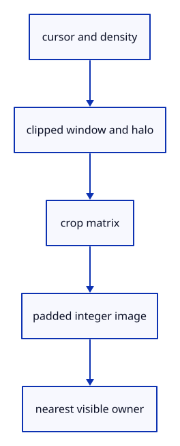

# 6.1.1 · Bound the cursor image and decode a hit

**Chapter 6 · Picking and selection · Section 6.1 · GPU picking** · [Contents](contents.md)

**Typing: 30–60 minutes.** [Estimate](typing-load.md).

Prepare the cursor window, preserving the main view’s homogeneous depth. Decode integer owners inside a circular tolerance and skip row padding.

## Type

Continue from [Inspect the ground grid through actual commands](41f-input.md). [Save or recover your work](recovery.md).

### 1. `src/pick_window.rs`

Bound the cursor window and decode exact integer owners.

Create the file and type:

```rust
--8<-- "journey/code/42-window-01.rs"
```

### 2. `src/lib.rs`

Register the new picking component.

<details>
<summary>Locate the existing block</summary>

```rust
mod browser_upload;
#[cfg(target_arch = "wasm32")]
mod browser_phase;
```

</details>

After that block, type:

```rust
--8<-- "journey/code/42-window-02.rs" skip=70
```

<details>
<summary>Supplied validation fixture</summary>

Copy this supplied authoring fixture once. Continue with the browser build below; the course does not require running native tests.

### 3. `src/pick_window_tests.rs`

Copy the focused checks.

Copy this supplied file:

```text
--8<-- "journey/code/42-window-03.rs"
```

</details>

### 4. `src/lib.rs`

Register the copied checks.

<details>
<summary>Locate the existing block</summary>

```rust
mod browser_phase;

pub mod pick_window;
```

</details>

After that block, type:

```rust
--8<-- "journey/code/42-window-04.rs" skip=41
```

## Run and check

In your project:

```sh
cd workspace/journey
REGEN_PROTO=0 cargo build --lib --locked --target wasm32-unknown-unknown -j1
REGEN_PROTO=0 CARGO_BUILD_JOBS=1 trunk serve --port 8780
```

Open `http://127.0.0.1:8780/`. Keep an existing Trunk server running; saving rebuilds it.

Run the window checks. No new picking behavior appears in the viewer yet.

### Recorded visual result

**Previous native render — current verification pending.**

The native scene is unchanged from [drawing input](41f-input.md). This independently rendered frame does not exercise window-selection event delivery; use the state checks and browser exercise for that behavior.


*This recorded image predates a source or checker change. Rebuild this checkpoint before using it as current evidence; browser controls require separate acceptance.*

This reference image is shared with [5.7.8 · Inspect the ground grid through actual commands](41f-input.md). It does not demonstrate a new feature by itself.

<details>
<summary>Code explanation and diagram</summary>


cursor and density → clipped window and halo → crop matrix → padded integer image → nearest visible owner.



Why read a small window instead of the whole canvas?

A six-CSS-pixel tolerance needs only nearby pixels. A bounded physical radius limits allocation and readback even for a large drawing.

Study estimate, including typing and experiments: 0.5–1 hours.

</details>

<details>
<summary>Optional experiment</summary>

Compare the window at DPR1 and2, a canvas corner and a one-pixel canvas.

</details>

<details>
<summary>Check and save your work</summary>

Restore experimental edits, then run from `session_viewer`:

```sh
npm --prefix ../session_tests run course -- check 6.1.1
npm --prefix ../session_tests run course -- save 6.1.1
```

Source comparison leaves your project untouched. [Save and recovery instructions](recovery.md).

</details>

<details>
<summary>Viewer coverage and verification</summary>

This is preparation within the GPU picking subject. The final input endpoint connects and checks actual canvas clicks; sub-object selection follows in44.

Existing normals commands remain available while the picking components are prepared.

[Full validation scope](release.md).

To reproduce the scripted acceptance of the reference checkpoint, run from `session_viewer` with the [course bundle server](release.md#reproduce) running on port 8781:

```sh
npm --prefix ../session_tests run course -- capture 6.1.1
```

This uses the verified reference bundle; it does not check or change your typed project.

</details>
