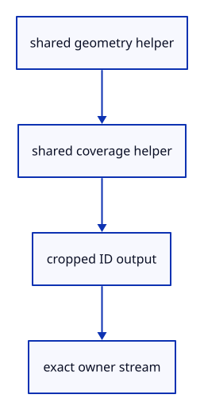

# 6.1.3 · Share point and stroke coverage with picking

**Chapter 6 · Picking and selection · Section 6.1 · GPU picking** · [Contents](contents.md)

**Typing: 30–60 minutes.** [Estimate](typing-load.md).

Extract the existing point and stroke calculations into helpers. Add integer outputs that crop positions after CSS-sized geometry is formed.

## Type

Continue from [Keep exact object IDs in shared GPU settings](42a-id.md). [Save or recover your work](recovery.md).

### 1. `src/stroke.wgsl`

Share the existing geometry and coverage calculations.

<details>
<summary>Locate the existing block</summary>

```wgsl
struct View { transform: mat4x4<f32>, size: vec2<f32>, density: f32 }
@group(0) @binding(0) var<uniform> view: View;

struct Output {
    @builtin(position) position: vec4<f32>,
    @location(0) colour: vec4<f32>,
    @location(1) @interpolate(linear) side: f32,
    @location(2) @interpolate(flat) half_width: f32,
}

fn hidden(colour: vec4<f32>) -> Output {
    return Output(vec4<f32>(2.0, 2.0, 2.0, 1.0), colour, 0.0, 0.0);
}

@vertex
fn vertex(@location(0) start: vec3<f32>, @location(1) end: vec3<f32>,
    @location(2) colour: vec4<f32>, @location(3) width: f32,
    @builtin(vertex_index) index: u32) -> Output {
    var a = view.transform * vec4<f32>(start, 1.0);
    var b = view.transform * vec4<f32>(end, 1.0);
    if (a.z < 0.0 && b.z < 0.0) { return hidden(colour); }
    if (a.z < 0.0) { a = mix(a, b, -a.z / (b.z - a.z)); }
    if (b.z < 0.0) { b = mix(b, a, -b.z / (a.z - b.z)); }
    if (a.w <= 0.0 || b.w <= 0.0) { return hidden(colour); }
    let delta = (b.xy / b.w - a.xy / a.w) * view.size;
    let length2 = dot(delta, delta);
    if (length2 < 0.000001) { return hidden(colour); }
    let normal = vec2<f32>(-delta.y, delta.x) * inverseSqrt(length2);
    let corners = array<vec2<f32>, 6>(vec2<f32>(0.0, -1.0), vec2<f32>(1.0, -1.0),
        vec2<f32>(0.0, 1.0), vec2<f32>(0.0, 1.0), vec2<f32>(1.0, -1.0), vec2<f32>(1.0, 1.0));
    let corner = corners[index];
    let half_width = width * view.density * 0.5;
    let extent = half_width + 0.70711;
    var position = select(a, b, corner.x > 0.5);
    position = vec4<f32>(position.xy + normal * extent * 2.0 / view.size * corner.y * position.w, position.zw);
    return Output(position, colour, corner.y * extent, half_width);
}

@fragment
fn fragment(input: Output) -> @location(0) vec4<f32> {
    let coverage = clamp(input.half_width + 0.5 - abs(input.side), 0.0, 1.0);
    return vec4<f32>(input.colour.rgb, input.colour.a * coverage);
}
```

</details>

Edit the existing block to match this code; keep unchanged lines:

```wgsl
struct View { transform: mat4x4<f32>, size: vec2<f32>, density: f32 }
@group(0) @binding(0) var<uniform> view: View;

struct Output {
    @builtin(position) position: vec4<f32>,
    @location(0) colour: vec4<f32>,
    @location(1) @interpolate(linear) side: f32,
    @location(2) @interpolate(flat) half_width: f32,
}

fn hidden(colour: vec4<f32>) -> Output {
    return Output(vec4<f32>(2.0, 2.0, 2.0, 1.0), colour, 0.0, 0.0);
}

fn geometry(start: vec3<f32>, end: vec3<f32>, colour: vec4<f32>, width: f32, index: u32) -> Output {
    var a = view.transform * vec4<f32>(start, 1.0);
    var b = view.transform * vec4<f32>(end, 1.0);
    if (a.z < 0.0 && b.z < 0.0) { return hidden(colour); }
    if (a.z < 0.0) { a = mix(a, b, -a.z / (b.z - a.z)); }
    if (b.z < 0.0) { b = mix(b, a, -b.z / (a.z - b.z)); }
    if (a.w <= 0.0 || b.w <= 0.0) { return hidden(colour); }
    let delta = (b.xy / b.w - a.xy / a.w) * view.size;
    let length2 = dot(delta, delta);
    if (length2 < 0.000001) { return hidden(colour); }
    let normal = vec2<f32>(-delta.y, delta.x) * inverseSqrt(length2);
    let corners = array<vec2<f32>, 6>(vec2<f32>(0.0, -1.0), vec2<f32>(1.0, -1.0),
        vec2<f32>(0.0, 1.0), vec2<f32>(0.0, 1.0), vec2<f32>(1.0, -1.0), vec2<f32>(1.0, 1.0));
    let corner = corners[index];
    let half_width = width * view.density * 0.5;
    let extent = half_width + 0.70711;
    var position = select(a, b, corner.x > 0.5);
    position = vec4<f32>(position.xy + normal * extent * 2.0 / view.size * corner.y * position.w, position.zw);
    return Output(position, colour, corner.y * extent, half_width);
}

fn colour(input: Output) -> vec4<f32> {
    let coverage = clamp(input.half_width + 0.5 - abs(input.side), 0.0, 1.0);
    return vec4<f32>(input.colour.rgb, input.colour.a * coverage);
}

@vertex
fn vertex(@location(0) start: vec3<f32>, @location(1) end: vec3<f32>,
    @location(2) colour: vec4<f32>, @location(3) width: f32,
    @builtin(vertex_index) index: u32) -> Output { return geometry(start, end, colour, width, index); }
@fragment
fn fragment(input: Output) -> @location(0) vec4<f32> { return colour(input); }
```

<details>
<summary>Optional patch references</summary>

Use these original edit fragments when comparing a saved checkpoint. Apply the complete blocks above.

```text
--8<-- "journey/code/42b-ink-01.wgsl"
```

```text
--8<-- "journey/code/42b-ink-02.wgsl"
```

</details>

### 2. `src/marker.wgsl`

Share the existing geometry and coverage calculations.

<details>
<summary>Locate the existing block</summary>

```wgsl
struct View { transform: mat4x4<f32>, size: vec2<f32>, density: f32 }
@group(0) @binding(0) var<uniform> view: View;
struct Output {
    @builtin(position) position: vec4<f32>,
    @location(0) colour: vec4<f32>,
    @location(1) @interpolate(linear) offset: vec2<f32>,
    @location(2) @interpolate(flat) radius: f32,
}
@vertex
fn vertex(@location(0) center: vec3<f32>, @location(1) diameter: f32,
    @location(2) colour: vec4<f32>, @builtin(vertex_index) index: u32) -> Output {
    var position = view.transform * vec4<f32>(center, 1.0);
    if (position.w <= 0.0 || position.z < 0.0 || position.z > position.w) {
        return Output(vec4<f32>(2.0, 2.0, 2.0, 1.0), colour, vec2<f32>(0.0), 0.0);
    }
    let corners = array<vec2<f32>, 6>(vec2<f32>(-1.0, -1.0), vec2<f32>(1.0, -1.0), vec2<f32>(-1.0, 1.0),
        vec2<f32>(-1.0, 1.0), vec2<f32>(1.0, -1.0), vec2<f32>(1.0, 1.0));
    let radius = diameter * view.density * 0.5;
    let offset = corners[index] * (radius + 0.70711);
    position = vec4<f32>(position.xy + offset * 2.0 / view.size * position.w, position.zw);
    return Output(position, colour, offset, radius);
}
@fragment
fn fragment(input: Output) -> @location(0) vec4<f32> {
    let coverage = clamp(input.radius + 0.5 - length(input.offset), 0.0, 1.0);
    return vec4<f32>(input.colour.rgb, input.colour.a * coverage);
}
```

</details>

Edit the existing block to match this code; keep unchanged lines:

```wgsl
struct View { transform: mat4x4<f32>, size: vec2<f32>, density: f32 }
@group(0) @binding(0) var<uniform> view: View;
struct Output {
    @builtin(position) position: vec4<f32>,
    @location(0) colour: vec4<f32>,
    @location(1) @interpolate(linear) offset: vec2<f32>,
    @location(2) @interpolate(flat) radius: f32,
}
fn geometry(center: vec3<f32>, diameter: f32, colour: vec4<f32>, index: u32) -> Output {
    var position = view.transform * vec4<f32>(center, 1.0);
    if (position.w <= 0.0 || position.z < 0.0 || position.z > position.w) {
        return Output(vec4<f32>(2.0, 2.0, 2.0, 1.0), colour, vec2<f32>(0.0), 0.0);
    }
    let corners = array<vec2<f32>, 6>(vec2<f32>(-1.0, -1.0), vec2<f32>(1.0, -1.0), vec2<f32>(-1.0, 1.0),
        vec2<f32>(-1.0, 1.0), vec2<f32>(1.0, -1.0), vec2<f32>(1.0, 1.0));
    let radius = diameter * view.density * 0.5;
    let offset = corners[index] * (radius + 0.70711);
    position = vec4<f32>(position.xy + offset * 2.0 / view.size * position.w, position.zw);
    return Output(position, colour, offset, radius);
}
fn colour(input: Output) -> vec4<f32> {
    let coverage = clamp(input.radius + 0.5 - length(input.offset), 0.0, 1.0);
    return vec4<f32>(input.colour.rgb, input.colour.a * coverage);
}

@vertex
fn vertex(@location(0) center: vec3<f32>, @location(1) diameter: f32,
    @location(2) colour: vec4<f32>, @builtin(vertex_index) index: u32) -> Output { return geometry(center, diameter, colour, index); }
@fragment
fn fragment(input: Output) -> @location(0) vec4<f32> { return colour(input); }
```

<details>
<summary>Optional patch references</summary>

Use these original edit fragments when comparing a saved checkpoint. Apply the complete blocks above.

```text
--8<-- "journey/code/42b-ink-03.wgsl"
```

```text
--8<-- "journey/code/42b-ink-04.wgsl"
```

</details>

### 3. `src/stroke_pick.wgsl`

Output an integer owner only where ink is visible.

Create the file and type:

```wgsl
--8<-- "journey/code/42b-ink-05.wgsl"
```

### 4. `src/marker_pick.wgsl`

Output an integer owner only where ink is visible.

Create the file and type:

```wgsl
--8<-- "journey/code/42b-ink-06.wgsl"
```

## Run and check

In your project:

```sh
cd workspace/journey
REGEN_PROTO=0 cargo build --lib --locked --target wasm32-unknown-unknown -j1
REGEN_PROTO=0 CARGO_BUILD_JOBS=1 trunk serve --port 8780
```

Open `http://127.0.0.1:8780/`. Keep an existing Trunk server running; saving rebuilds it.

Run the viewer and check existing points and strokes. The ID entry points are ready for the next draw-pass wiring.

### Recorded visual result

**Previous native render — current verification pending.**

The inherited grid and geometry remain visible; copied integer readback checks verify the new picking behavior.


*This recorded image predates a source or checker change. Rebuild this checkpoint before using it as current evidence; browser controls require separate acceptance.*

This reference image is shared with [5.7.8 · Inspect the ground grid through actual commands](41f-input.md). It does not demonstrate a new feature by itself.

<details>
<summary>Code explanation and diagram</summary>


shared geometry helper → shared coverage helper → cropped ID output → exact owner stream.



Why must picking share the visible ink shape?

A bounding rectangle would select invisible point corners and stroke fringes. The ID fragment discards pixels with zero visible coverage.

Study estimate, including typing and experiments: 0.5–1 hours.

</details>

<details>
<summary>Optional experiment</summary>

Create Example Point and Example Line, then zoom and change projection; the visible widths must stay stable.

</details>

<details>
<summary>Check and save your work</summary>

Restore experimental edits, then run from `session_viewer`:

```sh
npm --prefix ../session_tests run course -- check 6.1.3
npm --prefix ../session_tests run course -- save 6.1.3
```

Source comparison leaves your project untouched. [Save and recovery instructions](recovery.md).

</details>

<details>
<summary>Viewer coverage and verification</summary>

This is preparation within the GPU picking subject. The final input endpoint connects and checks actual canvas clicks; sub-object selection follows in44.

Existing normals commands remain available while the picking components are prepared.

[Full validation scope](release.md).

To reproduce the scripted acceptance of the reference checkpoint, run from `session_viewer` with the [course bundle server](release.md#reproduce) running on port 8781:

```sh
npm --prefix ../session_tests run course -- capture 6.1.3
```

This uses the verified reference bundle; it does not check or change your typed project.

</details>
