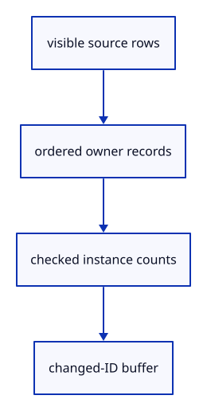

# 6.1.5 · Attach original owners to visible ink instances

**Chapter 6 · Picking and selection · Section 6.1 · GPU picking** · [Contents](contents.md)

**Typing: 29–57 minutes.** [Estimate](typing-load.md).

Build one owner record per visible instance, repeating path owners per segment and resolving control markers to their original parent.

## Type

Continue from [Pick connected paths and arrowheads with their drawn shape](42c-path.md). [Save or recover your work](recovery.md).

### 1. `src/stroke_gpu.rs`

Validate and cache original owners separately from display data.

Edit these blocks from bottom to top. Keep the surrounding lines unchanged.

<details>
<summary>Locate this block</summary>

```rust
        let group = device.create_bind_group(&wgpu::BindGroupDescriptor { label: Some("stroke view"),
            layout: &pipeline.get_bind_group_layout(0),
            entries: &[wgpu::BindGroupEntry { binding: 0, resource: uniform.as_entire_binding() }] });
        Self { pipeline, uniform, group, vertices: None, data: Vec::new(), stride, vertices_per_instance, uploads: 0, uploaded_bytes: 0 }
    }
}
```

</details>

Replace it with:

```rust
        let group = device.create_bind_group(&wgpu::BindGroupDescriptor { label: Some("stroke view"),
            layout: &pipeline.get_bind_group_layout(0),
            entries: &[wgpu::BindGroupEntry { binding: 0, resource: uniform.as_entire_binding() }] });
        Self { pipeline, ids: None, id_data: Vec::new(), uniform, group, vertices: None, data: Vec::new(), stride, vertices_per_instance, uploads: 0, uploaded_bytes: 0 }
    }
}
```

<details>
<summary>Locate this block</summary>

```rust
        pass.draw(0..self.vertices_per_instance, 0..(self.data.len() as u64 / self.stride) as u32);
    }

    pub fn usage(&self) -> [u64; 2] {
        [self.data.len() as u64 / self.stride, self.vertices.as_ref().map_or(0, wgpu::Buffer::size)]
    }
```

</details>

Replace it with:

```rust
        pass.draw(0..self.vertices_per_instance, 0..(self.data.len() as u64 / self.stride) as u32);
    }

    pub fn set_ids(&mut self, device: &wgpu::Device, ids: impl IntoIterator<Item = [u32; 2]>) -> Result<(), &'static str> {
        use wgpu::util::DeviceExt;
        let data: Vec<u8> = ids.into_iter().flatten().flat_map(u32::to_ne_bytes).collect();
        if data.len() as u64 / 8 != self.data.len() as u64 / self.stride { return Err("Pick IDs must match display instances"); }
        if data == self.id_data { return Ok(()); }
        self.ids = if data.is_empty() { None } else { Some(device.create_buffer_init(&wgpu::util::BufferInitDescriptor {
            label: Some("ink IDs"), contents: &data, usage: wgpu::BufferUsages::VERTEX })) };
        self.id_data = data; Ok(())
    }

    pub fn pick_bytes(&self) -> u64 { self.ids.as_ref().map_or(0, wgpu::Buffer::size) }


    pub fn usage(&self) -> [u64; 2] {
        [self.data.len() as u64 / self.stride, self.vertices.as_ref().map_or(0, wgpu::Buffer::size)]
    }
```

<details>
<summary>Locate this block</summary>

```rust
pub struct Lane {
    pipeline: wgpu::RenderPipeline,
    uniform: wgpu::Buffer,
    group: wgpu::BindGroup,
    vertices: Option<wgpu::Buffer>,
```

</details>

Replace it with:

```rust
pub struct Lane {
    pipeline: wgpu::RenderPipeline,
    ids: Option<wgpu::Buffer>,
    id_data: Vec<u8>,
    uniform: wgpu::Buffer,
    group: wgpu::BindGroup,
    vertices: Option<wgpu::Buffer>,
```

<details>
<summary>Complete updated block reference</summary>

```rust
pub struct Lane {
    pipeline: wgpu::RenderPipeline,
    ids: Option<wgpu::Buffer>,
    id_data: Vec<u8>,
    uniform: wgpu::Buffer,
    group: wgpu::BindGroup,
    vertices: Option<wgpu::Buffer>,
    data: Vec<u8>,
    stride: u64,
    vertices_per_instance: u32,
    pub uploads: u64,
    pub uploaded_bytes: u64,
}

impl Lane {
    pub fn set(&mut self, device: &wgpu::Device, strokes: impl IntoIterator<Item = crate::stroke::Stroke>) -> Result<(), &'static str> {
        let mut data = Vec::new();
        for stroke in strokes {
            if stroke.width <= 0.0 || stroke.values().iter().any(|value| !value.is_finite()) {
                return Err("Invalid stroke display data");
            }
            data.extend(stroke.bytes());
        }
        if self.stride != 44 { return Err("Stroke data needs the stroke layout"); }
        self.set_bytes(device, data)
    }

    pub fn set_chains(&mut self, device: &wgpu::Device, segments: impl IntoIterator<Item = crate::chain::Segment>) -> Result<(), &'static str> {
        if self.stride != 72 { return Err("Connected data needs the connected layout"); }
        let mut data = Vec::new();
        for segment in segments {
            if segment.stroke.width <= 0.0 || segment.heads > 3
                || segment.stroke.values().iter().chain(segment.previous.iter()).chain(segment.next.iter()).any(|v| !v.is_finite()) {
                return Err("Invalid connected display data");
            }
            data.extend(segment.bytes());
        }
        self.set_bytes(device, data)
    }

    pub fn set_points(&mut self, device: &wgpu::Device, markers: impl IntoIterator<Item = crate::marker::Marker>) -> Result<(), &'static str> {
        if self.stride != 32 { return Err("Marker data needs the marker layout"); }
        let mut data = Vec::new();
        for marker in markers {
            if marker.diameter <= 0.0 || marker.values().iter().any(|v| !v.is_finite()) { return Err("Invalid marker display data"); }
            data.extend(marker.bytes());
        }
        self.set_bytes(device, data)
    }

    fn set_bytes(&mut self, device: &wgpu::Device, data: Vec<u8>) -> Result<(), &'static str> {
        use wgpu::util::DeviceExt;
        u32::try_from(data.len() as u64 / self.stride).map_err(|_| "Too many stroke instances")?;
        if data == self.data { return Ok(()); }
        self.vertices = if data.is_empty() { None } else {
            self.uploads += 1; self.uploaded_bytes += data.len() as u64;
            Some(device.create_buffer_init(&wgpu::util::BufferInitDescriptor {
                label: Some("stroke instances"), contents: &data, usage: wgpu::BufferUsages::VERTEX,
            }))
        };
        self.data = data; Ok(())
    }

    pub fn view(&self, queue: &wgpu::Queue, transform: &[f32; 16], size: [u32; 2], density: f32) {
        if self.vertices.is_none() { return; }
        let bytes: Vec<u8> = transform.iter().copied().chain([size[0] as f32, size[1] as f32, density, 0.0])
            .flat_map(f32::to_ne_bytes).collect();
        queue.write_buffer(&self.uniform, 0, &bytes);
    }

    pub fn draw(&self, pass: &mut wgpu::RenderPass<'_>) {
        let Some(vertices) = &self.vertices else { return; };
        pass.set_pipeline(&self.pipeline); pass.set_bind_group(0, &self.group, &[]);
        pass.set_vertex_buffer(0, vertices.slice(..));
        pass.draw(0..self.vertices_per_instance, 0..(self.data.len() as u64 / self.stride) as u32);
    }

    pub fn set_ids(&mut self, device: &wgpu::Device, ids: impl IntoIterator<Item = [u32; 2]>) -> Result<(), &'static str> {
        use wgpu::util::DeviceExt;
        let data: Vec<u8> = ids.into_iter().flatten().flat_map(u32::to_ne_bytes).collect();
        if data.len() as u64 / 8 != self.data.len() as u64 / self.stride { return Err("Pick IDs must match display instances"); }
        if data == self.id_data { return Ok(()); }
        self.ids = if data.is_empty() { None } else { Some(device.create_buffer_init(&wgpu::util::BufferInitDescriptor {
            label: Some("ink IDs"), contents: &data, usage: wgpu::BufferUsages::VERTEX })) };
        self.id_data = data; Ok(())
    }

    pub fn pick_bytes(&self) -> u64 { self.ids.as_ref().map_or(0, wgpu::Buffer::size) }


    pub fn usage(&self) -> [u64; 2] {
        [self.data.len() as u64 / self.stride, self.vertices.as_ref().map_or(0, wgpu::Buffer::size)]
    }

    pub fn new(device: &wgpu::Device, format: wgpu::TextureFormat) -> Self {
        Self::layout(device, format, crate::stroke::SHADER, 44, 6,
            &wgpu::vertex_attr_array![0 => Float32x3, 1 => Float32x3, 2 => Float32x4, 3 => Float32])
    }

    pub fn joined(device: &wgpu::Device, format: wgpu::TextureFormat) -> Self {
        Self::layout(device, format, crate::chain::SHADER, 72, 18,
            &wgpu::vertex_attr_array![0 => Float32x3, 1 => Float32x3, 2 => Float32x4, 3 => Float32,
                4 => Float32x3, 5 => Float32x3, 6 => Uint32])
    }

    pub fn markers(device: &wgpu::Device, format: wgpu::TextureFormat) -> Self {
        Self::layout(device, format, crate::marker::SHADER, 32, 6,
            &wgpu::vertex_attr_array![0 => Float32x3, 1 => Float32, 2 => Float32x4])
    }

    fn layout(device: &wgpu::Device, format: wgpu::TextureFormat, source: &'static str,
        stride: u64, vertices_per_instance: u32, attributes: &[wgpu::VertexAttribute]) -> Self {
        Self::layout_depth(device, format, source, stride, vertices_per_instance, attributes, crate::depth::ink())
    }

    pub fn grid(device: &wgpu::Device, format: wgpu::TextureFormat) -> Self {
        Self::layout_depth(device, format, crate::stroke::SHADER, 44, 6,
            &wgpu::vertex_attr_array![0 => Float32x3, 1 => Float32x3, 2 => Float32x4, 3 => Float32], crate::depth::grid())
    }

    fn layout_depth(device: &wgpu::Device, format: wgpu::TextureFormat, source: &'static str,
        stride: u64, vertices_per_instance: u32, attributes: &[wgpu::VertexAttribute], depth: wgpu::DepthStencilState,
    ) -> Self {
        let shader = device.create_shader_module(wgpu::ShaderModuleDescriptor {
            label: Some("stroke"), source: wgpu::ShaderSource::Wgsl(source.into()),
        });
        let pipeline = device.create_render_pipeline(&wgpu::RenderPipelineDescriptor {
            label: Some("stroke"), layout: None,
            vertex: wgpu::VertexState { module: &shader, entry_point: Some("vertex"),
                compilation_options: Default::default(),
                buffers: &[wgpu::VertexBufferLayout { array_stride: stride, step_mode: wgpu::VertexStepMode::Instance, attributes }],
            },
            fragment: Some(wgpu::FragmentState { module: &shader, entry_point: Some("fragment"),
                compilation_options: Default::default(),
                targets: &[Some(wgpu::ColorTargetState { format, blend: Some(wgpu::BlendState::ALPHA_BLENDING),
                    write_mask: wgpu::ColorWrites::ALL })],
            }),
            primitive: Default::default(),
            depth_stencil: Some(depth),
            multisample: Default::default(), multiview_mask: None, cache: None,
        });
        let uniform = device.create_buffer(&wgpu::BufferDescriptor { label: Some("stroke view"), size: 80,
            usage: wgpu::BufferUsages::UNIFORM | wgpu::BufferUsages::COPY_DST, mapped_at_creation: false });
        let group = device.create_bind_group(&wgpu::BindGroupDescriptor { label: Some("stroke view"),
            layout: &pipeline.get_bind_group_layout(0),
            entries: &[wgpu::BindGroupEntry { binding: 0, resource: uniform.as_entire_binding() }] });
        Self { pipeline, ids: None, id_data: Vec::new(), uniform, group, vertices: None, data: Vec::new(), stride, vertices_per_instance, uploads: 0, uploaded_bytes: 0 }
    }
}
```

</details>

<details>
<summary>Optional patch references</summary>

Use these original edit fragments when comparing a saved checkpoint. Apply the complete blocks above.

```text
--8<-- "journey/code/42d-owners-01.rs"
```

```text
--8<-- "journey/code/42d-owners-02.rs"
```

```text
--8<-- "journey/code/42d-owners-03.rs"
```

</details>

### 2. `src/renderer.rs`

Match every visible instance to its source owner in the same order.

<details>
<summary>Locate the existing block</summary>

```rust
            .expect("Prepared path placement fits the display range");
        self.strokes.set(&self.device, scene.lines().iter().filter(|row| row.visible()).map(crate::scene::LineObject::stroke))
            .expect("Prepared line placement fits the display range");
        let layout = self.pipeline.get_bind_group_layout(1);
        let mut old = std::mem::take(&mut self.meshes);
        for object in scene.objects().iter().filter(|row| row.visible()) {
```

</details>

Edit the existing block to match this code; keep unchanged lines:

```rust
--8<-- "journey/code/42d-owners-04.rs"
```

### 3. `src/scene.rs`

Remove a selected original row of any current geometry kind. Retain selection for every original geometry kind.

Edit these blocks from bottom to top. Keep the surrounding lines unchanged.

<details>
<summary>Locate this block</summary>

```rust
    }

    pub fn remove(&mut self, id: ObjectId) -> bool {
        let Some(index) = self.objects.iter().position(|object| object.id == id) else { return false; };
        self.objects.remove(index);
        if self.extra == Some(id) {
            self.extra = None;
        }
        true
    }

    pub fn contains(&self, id: ObjectId) -> bool {
        self.objects.iter().any(|object| object.id == id)
    }

    pub fn next(&self, current: Option<ObjectId>) -> Option<ObjectId> {
```

</details>

Replace it with:

```rust
    }

    pub fn remove(&mut self, id: ObjectId) -> bool {
        let existed = self.contains(id);
        self.objects.retain(|row| row.id != id); self.lines.retain(|row| row.id != id);
        self.paths.retain(|row| row.id != id); self.points.retain(|row| row.id != id);
        if self.extra == Some(id) { self.extra = None; }
        existed
    }

    pub fn contains(&self, id: ObjectId) -> bool {
        self.objects.iter().map(|r| r.id).chain(self.lines.iter().map(|r| r.id))
            .chain(self.paths.iter().map(|r| r.id)).chain(self.points.iter().map(|r| r.id)).any(|row| row == id)
    }

    pub fn next(&self, current: Option<ObjectId>) -> Option<ObjectId> {
```

<details>
<summary>Complete updated block reference</summary>

```rust
use crate::{mesh::Mesh, prepared::PreparedMesh};
use std::rc::Rc;

#[derive(Clone, Copy, Debug, PartialEq, Eq)]
pub struct ObjectId(u32);

impl ObjectId { pub fn value(self) -> u32 { self.0 } }

#[derive(Clone)]
pub struct Object {
    pub id: ObjectId,
    pub guid: String,
    pub metadata: Rc<crate::row_metadata::RowMetadata>,
    pub mesh: Rc<Mesh>,
    pub model: session_rust::Xform,
    editable: crate::edit_source::EditSource,
}

impl Object {
    pub fn visible(&self) -> bool { self.metadata.is_visible }

    pub fn geometry(&self) -> Option<&Rc<session_rust::Mesh>> {
        match &self.editable { crate::edit_source::EditSource::Loaded { geometry, .. } => Some(geometry), _ => None }
    }

    pub fn source(&self) -> Option<&crate::document::Source> {
        match &self.editable { crate::edit_source::EditSource::Loaded { source, .. } => source.as_ref(), _ => None }
    }

    pub fn origin(&self) -> Option<&Rc<crate::origin::Origin>> {
        match &self.editable {
            crate::edit_source::EditSource::Loaded { source, .. } => source.as_ref().map(|source| &source.origin),
            crate::edit_source::EditSource::Released { origin, .. } => Some(origin),
        }
    }

    pub fn release_epoch(&self) -> Option<u64> {
        match &self.editable { crate::edit_source::EditSource::Released { epoch, .. } => Some(*epoch), _ => None }
    }

    pub fn can_unload(&self) -> bool {
        let Some(source) = self.source() else { return false; };
        let Some(geometry) = self.geometry() else { return false; };
        source.origin.location.is_some() && self.metadata.source_guid == source.guid
            && geometry.guid() == source.guid && self.metadata.name == geometry.name
            && self.metadata.is_visible == geometry.is_visible && self.metadata.is_locked == geometry.is_locked
            && source.document.objects.meshes.iter().any(|mesh| Rc::ptr_eq(mesh, geometry))
    }

    pub fn world_point(&self, vertex: [f32; 6]) -> [f64; 3] {
        let local = session_rust::Point::new(vertex[0] as f64, vertex[1] as f64, vertex[2] as f64);
        let world = self.model.transform_point(&local);
        [world[0], world[1], world[2]]
    }
}

#[derive(Clone)]
pub struct LineObject {
    pub id: ObjectId,
    pub prepared: crate::stroke::PreparedLine,
    pub model: session_rust::Xform,
}

impl LineObject {
    pub fn visible(&self) -> bool { self.prepared.source.is_visible }

    pub fn endpoints(&self) -> [session_rust::Point; 2] {
        let line = &self.prepared.source;
        [self.model.transform_point(&line.start()), self.model.transform_point(&line.end())]
    }

    pub fn stroke(&self) -> crate::stroke::Stroke {
        let [start, end] = self.endpoints();
        crate::stroke::Stroke { start: std::array::from_fn(|i| start[i] as f32),
            end: std::array::from_fn(|i| end[i] as f32), ..self.prepared.display }
    }
}

#[derive(Clone)]
pub struct PathObject { pub controls_visible: bool, pub id: ObjectId, pub guid: String, pub prepared: crate::chain::PreparedChain, pub model: session_rust::Xform }

impl PathObject {
    pub fn visible(&self) -> bool { self.prepared.source.visible() }

    pub fn segments(&self) -> Vec<crate::chain::Segment> {
        let mut points = Vec::new();
        for p in self.points() {
            let p = std::array::from_fn(|i| p[i] as f32);
            if points.last() != Some(&p) { points.push(p); }
        }
        crate::chain::PreparedChain { points: Rc::new(points), ..self.prepared.clone() }.segments()
    }

    pub fn bounds_points(&self) -> Vec<session_rust::Point> {
        self.prepared.source.bounds_coordinates().into_iter().map(|p|
            self.model.transform_point(&session_rust::Point::new(p[0], p[1], p[2]))).collect()
    }

    pub fn points(&self) -> Vec<session_rust::Point> {
        self.prepared.source.coordinates().into_iter().map(|p| self.model.transform_point(&session_rust::Point::new(p[0], p[1], p[2]))).collect()
    }


}

pub struct ControlMarker { pub parent: ObjectId, pub control: crate::controls::Control, pub display: crate::marker::Marker }

#[derive(Clone)]
pub struct PointObject { pub id: ObjectId, pub guid: String, pub prepared: crate::marker::PreparedPoint, pub model: session_rust::Xform }

impl PointObject {
    pub fn visible(&self) -> bool { self.prepared.source.is_visible }

    pub fn point(&self) -> session_rust::Point { self.model.transform_point(&self.prepared.source) }
    pub fn marker(&self) -> crate::marker::Marker { crate::marker::Marker { center: self.point().to_f32(), ..self.prepared.display } }
}

#[derive(Clone)]
pub struct Scene {
    points: Vec<PointObject>,
    paths: Vec<PathObject>,
    lines: Vec<LineObject>,
    objects: Vec<Object>,
    next_id: u32,
    extra: Option<ObjectId>,
}

impl Scene {
    pub fn pick_id(&self, value: u32) -> Option<ObjectId> {
        self.objects.iter().filter(|r| r.visible() && !r.metadata.is_locked).map(|r| r.id)
            .chain(self.lines.iter().filter(|r| r.visible() && !r.prepared.source.is_locked).map(|r| r.id))
            .chain(self.paths.iter().filter(|r| r.visible() && !r.prepared.source.locked()).map(|r| r.id))
            .chain(self.points.iter().filter(|r| r.visible() && !r.prepared.source.is_locked).map(|r| r.id))
            .find(|id| id.value() == value)
    }

    pub fn demo() -> Self {
        let pink = PreparedMesh::triangle([
            [-0.7, -0.6, 0.25], [0.5, -0.6, 0.25], [-0.1, 0.6, 0.25],
        ], [0.9, 0.25, 0.45]).expect("Valid pink triangle");
        let turquoise = PreparedMesh::triangle([
            [-0.4, -0.2, 0.75], [0.8, -0.2, 0.75], [0.2, 0.8, 0.75],
        ], [0.05, 0.7, 0.7]).expect("Valid turquoise triangle");
        let mut scene = Self { objects: Vec::new(), points: Vec::new(), paths: Vec::new(), lines: Vec::new(), next_id: 1, extra: None };
        scene.insert(pink).expect("ID available");
        scene.insert(turquoise).expect("ID available");
        scene
    }

    pub fn restore(&mut self, mut saved: Self) {
        saved.next_id = saved.next_id.max(self.next_id);
        *self = saved;
    }

    pub fn visible(&self, id: ObjectId) -> bool {
        if let Some(row) = self.objects.iter().find(|row| row.id == id) { return row.metadata.is_visible; }
        if let Some(row) = self.lines.iter().find(|row| row.id == id) { return row.prepared.source.is_visible; }
        if let Some(row) = self.paths.iter().find(|row| row.id == id) { return row.prepared.source.visible(); }
        self.points.iter().find(|row| row.id == id).is_some_and(|row| row.prepared.source.is_visible)
    }

    pub fn bounds(&self) -> Option<crate::bounds::Bounds> {
        let mut bounds: Option<crate::bounds::Bounds> = None;
        for object in self.objects.iter().filter(|row| row.visible()) {
            for vertex in object.mesh.vertices() {
                let point = object.world_point(*vertex);
                match &mut bounds {
                    Some(bounds) => bounds.include(point),
                    None => bounds = Some(crate::bounds::Bounds::point(point)),
                }
            }
        }
        for line in self.lines.iter().filter(|line| line.visible()) {
            for point in line.endpoints() {
                let point = [point[0], point[1], point[2]];
                match &mut bounds {
                    Some(bounds) => bounds.include(point),
                    None => bounds = Some(crate::bounds::Bounds::point(point)),
                }
            }
        }
        for row in self.paths.iter().filter(|row| row.visible()) {
            for point in row.bounds_points() {
                let point = [point[0], point[1], point[2]];
                match &mut bounds { Some(bounds) => bounds.include(point), None => bounds = Some(crate::bounds::Bounds::point(point)) }
            }
        }
        for row in self.points.iter().filter(|row| row.visible()) {
            let p = row.point(); let p = [p[0], p[1], p[2]];
            match &mut bounds { Some(bounds) => bounds.include(p), None => bounds = Some(crate::bounds::Bounds::point(p)) }
        }
        bounds
    }

    pub fn selected_bounds(&self, id: ObjectId) -> Option<crate::bounds::Bounds> {
        if !self.visible(id) { return None; }
        let object = self.objects.iter().find(|object| object.id == id)?;
        let mut vertices = object.mesh.vertices().iter();
        let first = vertices.next()?;
        let mut bounds = crate::bounds::Bounds::point(object.world_point(*first));
        for vertex in vertices {
            bounds.include(object.world_point(*vertex));
        }
        Some(bounds)
    }

    pub fn line_capacity_bytes(&self) -> usize { self.lines.capacity() * std::mem::size_of::<LineObject>() }

    pub fn points(&self) -> &[PointObject] { &self.points }

    pub fn point_capacity_bytes(&self) -> usize { self.points.capacity() * std::mem::size_of::<PointObject>() }

    pub fn insert_point(&mut self, prepared: crate::marker::PreparedPoint) -> Result<ObjectId, &'static str> {
        let next = self.next_id.checked_add(1).ok_or("Object IDs exhausted")?;
        let mut guid = prepared.source.guid().to_owned();
        while self.points.iter().any(|row| row.guid == guid) || self.paths.iter().any(|row| row.guid == guid)
            || self.objects.iter().any(|row| row.guid == guid) || self.lines.iter().any(|row| row.prepared.source.guid() == guid) {
            guid = uuid::Uuid::new_v4().to_string();
        }
        let id = ObjectId(self.next_id); self.next_id = next;
        self.points.push(PointObject { id, guid, prepared, model: session_rust::Xform::identity() }); Ok(id)
    }

    pub fn place_point(&mut self, id: ObjectId, model: session_rust::Xform) -> Result<(), &'static str> {
        if !crate::placement::valid(&model.m) { return Err("Invalid point placement"); }
        let row = self.points.iter_mut().find(|row| row.id == id).ok_or("Point not found")?;
        let point = model.transform_point(&row.prepared.source);
        if (0..3).any(|i| !(point[i] as f32).is_finite()) { return Err("Point placement exceeds the display range"); }
        row.model = model; Ok(())
    }

    pub fn show_controls(&mut self, visible: bool) {
        for row in &mut self.paths { row.controls_visible = visible && matches!(row.prepared.source, crate::chain::Source::Curve(..)); }
    }

    pub fn control_markers(&self) -> Vec<ControlMarker> {
        let mut markers = Vec::new();
        for row in self.paths.iter().filter(|row| row.controls_visible && row.visible()) {
            for control in row.prepared.source.controls() {
                let p = control.position().expect("Validated original control");
                let p = row.model.transform_point(&session_rust::Point::new(p[0], p[1], p[2]));
                let display = crate::marker::Marker { center: p.to_f32(), ..control.marker().expect("Prepared control marker") };
                markers.push(ControlMarker { parent: row.id, control, display });
            }
        }
        markers
    }

    pub fn paths(&self) -> &[PathObject] { &self.paths }

    pub fn path_capacity_bytes(&self) -> usize { self.paths.capacity() * std::mem::size_of::<PathObject>() }

    pub fn insert_path(&mut self, prepared: crate::chain::PreparedChain) -> Result<ObjectId, &'static str> {
        let next = self.next_id.checked_add(1).ok_or("Object IDs exhausted")?;
        let mut guid = prepared.source.guid().to_owned();
        while self.paths.iter().any(|row| row.guid == guid) || self.objects.iter().any(|row| row.guid == guid)
            || self.lines.iter().any(|row| row.prepared.source.guid() == guid) { guid = uuid::Uuid::new_v4().to_string(); }
        let id = ObjectId(self.next_id); self.next_id = next;
        self.paths.push(PathObject { controls_visible: false, id, guid, prepared, model: session_rust::Xform::identity() }); Ok(id)
    }

    pub fn place_path(&mut self, id: ObjectId, model: session_rust::Xform) -> Result<(), &'static str> {
        if !crate::placement::valid(&model.m) { return Err("Invalid path placement"); }
        let row = self.paths.iter_mut().find(|row| row.id == id).ok_or("Path not found")?;
        for p in row.prepared.source.coordinates().into_iter().chain(row.prepared.source.bounds_coordinates()) {
            let p = model.transform_point(&session_rust::Point::new(p[0], p[1], p[2]));
            if (0..3).any(|i| !(p[i] as f32).is_finite()) { return Err("Path placement exceeds the display range"); }
        }
        row.model = model; Ok(())
    }

    pub fn lines(&self) -> &[LineObject] { &self.lines }

    pub fn insert_line(&mut self, prepared: crate::stroke::PreparedLine) -> Result<ObjectId, &'static str> {
        let next = self.next_id.checked_add(1).ok_or("Object IDs exhausted")?;
        let id = ObjectId(self.next_id); self.next_id = next;
        self.lines.push(LineObject { id, prepared, model: session_rust::Xform::identity() });
        Ok(id)
    }

    pub fn place_line(&mut self, id: ObjectId, model: session_rust::Xform) -> Result<(), &'static str> {
        if !crate::placement::valid(&model.m) { return Err("Invalid line placement"); }
        let row = self.lines.iter_mut().find(|row| row.id == id).ok_or("Line not found")?;
        for point in [row.prepared.source.start(), row.prepared.source.end()] {
            let placed = model.transform_point(&point);
            if (0..3).any(|i| !(placed[i] as f32).is_finite()) { return Err("Line placement exceeds the display range"); }
        }
        row.model = model; Ok(())
    }

    pub fn objects(&self) -> &[Object] {
        &self.objects
    }

    pub(crate) fn objects_mut(&mut self) -> &mut [Object] { &mut self.objects }

    pub(crate) fn unload(&mut self, origins: &std::collections::HashSet<uuid::Uuid>, epoch: u64) {
        for row in &mut self.objects {
            if let Some(origin) = row.origin().filter(|origin| origins.contains(&origin.id)).cloned() {
                row.editable = crate::edit_source::EditSource::Released { origin, epoch };
            }
        }
    }

    pub(crate) fn hydrate(&mut self, prepared: &crate::rehydrate::PreparedReload) {
        for row in &mut self.objects {
            if !prepared.key.matches(row) { continue; }
            let Some(geometry) = prepared.geometry(&row.metadata.source_guid).cloned() else { continue; };
            let source = crate::document::Source { document: Rc::clone(&prepared.document),
                guid: row.metadata.source_guid.clone(), origin: Rc::clone(&prepared.key.origin) };
            row.editable = crate::edit_source::EditSource::Loaded { geometry, source: Some(source) };
        }
    }

    pub fn insert(&mut self, prepared: PreparedMesh) -> Result<ObjectId, &'static str> {
        if !crate::placement::valid(&prepared.model.m) { return Err("Placement must be finite, affine and fit the display range"); }
        let next = self.next_id.checked_add(1).ok_or("Object IDs exhausted")?;
        let id = ObjectId(self.next_id);
        self.next_id = next;
        let mut guid = prepared.geometry.guid().to_owned();
        while self.objects.iter().any(|object| object.guid == guid) {
            guid = uuid::Uuid::new_v4().to_string();
        }
        let metadata = Rc::new(crate::row_metadata::RowMetadata::from_mesh(&prepared.geometry));
        let editable = crate::edit_source::EditSource::Loaded { geometry: prepared.geometry, source: prepared.source };
        self.objects.push(Object { id, guid, metadata, mesh: Rc::new(prepared.display), model: prepared.model, editable });
        Ok(id)
    }

    pub fn clear(&mut self) {
        self.points = Vec::new();
        self.paths = Vec::new();
        self.lines = Vec::new();
        self.objects = Vec::new();
        self.extra = None;
    }

    pub fn replace(&mut self, loaded: crate::document::Loaded) -> Result<(), &'static str> {
        self.clear();
        self.import(loaded)
    }

    pub fn import(&mut self, loaded: crate::document::Loaded) -> Result<(), &'static str> {
        for prepared in loaded.meshes {
            self.insert(prepared)?;
        }
        Ok(())
    }

    pub fn place(&mut self, id: ObjectId, model: session_rust::Xform) -> Result<(), &'static str> {
        if !crate::placement::valid(&model.m)
        {
            return Err("Placement must be finite, affine and fit the display range");
        }
        let object = self.objects.iter_mut().find(|o| o.id == id).ok_or("Object not found")?;
        if object.geometry().is_none() { return Err("Reload editable sources before Move"); }
        object.model = model;
        Ok(())
    }

    pub fn remove(&mut self, id: ObjectId) -> bool {
        let existed = self.contains(id);
        self.objects.retain(|row| row.id != id); self.lines.retain(|row| row.id != id);
        self.paths.retain(|row| row.id != id); self.points.retain(|row| row.id != id);
        if self.extra == Some(id) { self.extra = None; }
        existed
    }

    pub fn contains(&self, id: ObjectId) -> bool {
        self.objects.iter().map(|r| r.id).chain(self.lines.iter().map(|r| r.id))
            .chain(self.paths.iter().map(|r| r.id)).chain(self.points.iter().map(|r| r.id)).any(|row| row == id)
    }

    pub fn next(&self, current: Option<ObjectId>) -> Option<ObjectId> {
        let start = self.objects.iter().position(|object| Some(object.id) == current)
            .map_or(0, |index| index + 1);
        (0..self.objects.len()).map(|offset| &self.objects[(start + offset) % self.objects.len()])
            .find(|row| row.visible()).map(|row| row.id)
    }

    pub fn add_box(&mut self) -> Result<ObjectId, &'static str> {
        let mut source = session_rust::Mesh::create_box(0.8, 0.8, 0.8);
        source.set_objectcolor(session_rust::Color::new(0.65, 0.65, 0.65, 1.0));
        let id = self.insert(PreparedMesh::new(source)?)?;
        self.place(id, session_rust::Xform::translation(0.9, 0.0, 0.4))?;
        Ok(id)
    }

    pub fn toggle_extra(&mut self) {
        if let Some(id) = self.extra.take() {
            self.remove(id);
        } else {
            let extra = PreparedMesh::triangle([
                [-0.9, 0.3, 0.5], [-0.4, 0.3, 0.5], [-0.65, 0.9, 0.5],
            ], [0.2, 0.8, 0.3]).expect("Valid extra triangle");
            self.extra = Some(self.insert(extra).expect("ID available"));
        }
    }
}

#[cfg(test)]
mod tests {
    use super::*;

    #[test]
    fn unloading_policy_protects_generated_unlocated_and_modified_sources() {
        let mut scene = Scene::demo(); assert!(!scene.objects[0].can_unload());
        let bytes = crate::specimen::bytes();
        scene.replace(crate::document::load(&bytes).unwrap()).unwrap(); assert!(!scene.objects[0].can_unload());
        let url = Rc::new(crate::reload_url::ReloadUrl::new("test:policy".into()));
        scene.replace(crate::document::load_at(&bytes, Some(url)).unwrap()).unwrap();
        assert!(scene.objects.iter().all(Object::can_unload));
        let row = &mut scene.objects[0];
        Rc::make_mut(&mut row.metadata).is_locked = true; assert!(!row.can_unload());
        Rc::make_mut(&mut row.metadata).is_locked = row.geometry().unwrap().is_locked;
        assert!(row.can_unload());
        let source = row.source().cloned(); let geometry = Rc::new(session_rust::Mesh::create_box(1.0, 1.0, 1.0));
        row.editable = crate::edit_source::EditSource::Loaded { geometry, source }; assert!(!row.can_unload());
    }

    #[test]
    fn partial_replacement_failure_restores_owners_without_reusing_ids() {
        let mut scene = Scene::demo();
        let before = scene.objects.clone();
        scene.next_id = u32::MAX - 1;
        let loaded = crate::document::load(&crate::specimen::bytes()).unwrap();
        let mut history = crate::history::History::default();
        assert!(history.try_edit(&mut scene, |scene| scene.replace(loaded)).is_err());
        assert_eq!(scene.next_id, u32::MAX);
        assert_eq!(scene.objects.len(), before.len());
        for (object, old) in scene.objects.iter().zip(&before) {
            assert_eq!(object.id, old.id);
            assert!(Rc::ptr_eq(object.geometry().unwrap(), old.geometry().unwrap()));
            assert!(Rc::ptr_eq(&object.mesh, &old.mesh));
        }
        assert!(!history.undo(&mut scene));
    }

    #[test]
    fn removal_moves_a_row_without_changing_its_identity() {
        let mut scene = Scene::demo();
        let first = scene.objects()[0].id;
        let second = scene.objects()[1].id;
        assert!(scene.remove(first));
        assert_eq!(scene.objects()[0].id, second);
        assert_eq!(scene.next(None), Some(second));
        assert!(!scene.contains(first));
        scene.toggle_extra();
        assert_ne!(scene.objects()[1].id, first);
        assert_ne!(scene.objects()[1].id, second);
    }

    #[test]
    fn toggling_the_extra_object_uses_its_id_after_other_removals() {
        let mut scene = Scene::demo();
        scene.toggle_extra();
        let extra = scene.objects()[2].id;
        scene.remove(scene.objects()[0].id);
        scene.toggle_extra();
        assert!(!scene.contains(extra));
        assert_eq!(scene.objects().len(), 1);
    }
}
```

</details>

<details>
<summary>Optional patch references</summary>

Use these original edit fragments when comparing a saved checkpoint. Apply the complete blocks above.

```text
--8<-- "journey/code/42d-owners-05.rs"
```

```text
--8<-- "journey/code/42d-owners-06.rs"
```

</details>

### 4. `src/editor.rs`

Delete ink rows while preserving the existing cold-mesh source guard.

<details>
<summary>Locate the existing block</summary>

```rust
        let row = self.scene.objects().iter().find(|row| row.id == id).ok_or("Object not found")?;
        if row.geometry().is_none() { return Err("Reload editable sources before Delete"); }
```

</details>

Edit the existing block to match this code; keep unchanged lines:

```rust
        if !self.scene.contains(id) { return Err("Object not found"); }
        if self.scene.objects().iter().find(|row| row.id == id).is_some_and(|row| row.geometry().is_none()) {
            return Err("Reload editable sources before Delete");
        }
```

<details>
<summary>Optional patch references</summary>

Use these original edit fragments when comparing a saved checkpoint. Apply the complete blocks above.

```text
--8<-- "journey/code/42d-owners-07.rs"
```

</details>

### 5. `src/edit_intent.rs`

Let original ink deletion proceed without requesting mesh rehydration.

<details>
<summary>Locate the existing block</summary>

```rust
                let row = editor.scene.objects().iter().find(|row| row.id == *id).ok_or("Object not found")?;
                Ok(ReloadKey::of(row).into_iter().collect())
```

</details>

Edit the existing block to match this code; keep unchanged lines:

```rust
                let Some(row) = editor.scene.objects().iter().find(|row| row.id == *id) else {
                    return if editor.scene.contains(*id) { Ok(Vec::new()) }
                        else { Err("Object not found") };
                };
                Ok(ReloadKey::of(row).into_iter().collect())
```

<details>
<summary>Optional patch references</summary>

Use these original edit fragments when comparing a saved checkpoint. Apply the complete blocks above.

```text
--8<-- "journey/code/42d-owners-08.rs"
```

</details>

## Run and check

In your project:

```sh
cd workspace/journey
REGEN_PROTO=0 cargo build --lib --locked --target wasm32-unknown-unknown -j1
REGEN_PROTO=0 CARGO_BUILD_JOBS=1 trunk serve --port 8780
```

Open `http://127.0.0.1:8780/`. Keep an existing Trunk server running; saving rebuilds it.

Run the checks and inspect points, paths and controls. Owner buffers now match their displayed instance order.

### Recorded visual result

**Previous native render — current verification pending.**

The inherited grid and geometry remain visible; copied integer readback checks verify the new picking behavior.


*This recorded image predates a source or checker change. Rebuild this checkpoint before using it as current evidence; browser controls require separate acceptance.*

This reference image is shared with [5.7.8 · Inspect the ground grid through actual commands](41f-input.md). It does not demonstrate a new feature by itself.

<details>
<summary>Code explanation and diagram</summary>

Move and Delete share the no-fetch gate for an already loaded non-mesh row. Reload keys belong to released source owners; they are not a requirement that every movable row be a mesh.

visible source rows → ordered owner records → checked instance counts → changed-ID buffer.



Why cache IDs separately from display bytes?

Two rows may share identical coordinates while owning different identities. Unchanged display bytes cannot prove unchanged ownership.

Study estimate, including typing and experiments: 0.5–1 hours.

</details>

<details>
<summary>Optional experiment</summary>

Create a curve and enable its controls; each marker must retain its original curve parent.

</details>

<details>
<summary>Check and save your work</summary>

Restore experimental edits, then run from `session_viewer`:

```sh
npm --prefix ../session_tests run course -- check 6.1.5
npm --prefix ../session_tests run course -- save 6.1.5
```

Source comparison leaves your project untouched. [Save and recovery instructions](recovery.md).

</details>

<details>
<summary>Viewer coverage and verification</summary>

This is preparation within the GPU picking subject. The final input endpoint connects and checks actual canvas clicks; sub-object selection follows in44.

Existing normals commands remain available while the picking components are prepared.

[Full validation scope](release.md).

To reproduce the scripted acceptance of the reference checkpoint, run from `session_viewer` with the [course bundle server](release.md#reproduce) running on port 8781:

```sh
npm --prefix ../session_tests run course -- capture 6.1.5
```

This uses the verified reference bundle; it does not check or change your typed project.

</details>
