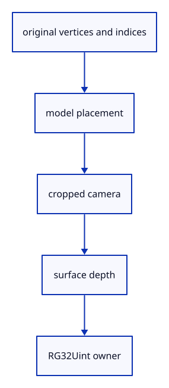

# 6.1.7 · Draw depth-tested mesh owners into an integer attachment

**Chapter 6 · Picking and selection · Section 6.1 · GPU picking** · [Contents](contents.md)

**Typing: 23–45 minutes.** [Estimate](typing-load.md).

Add a mesh ID pipeline with the same vertex layouts, placements and opaque depth policy as visible surface drawing.

## Type

Continue from [Draw integer ink with the shared geometry buffers](42e-pass.md). [Save or recover your work](recovery.md).

### 1. `src/triangle_pick.wgsl`

Draw exact mesh owners at the original placed depth.

Create the file and type:

```wgsl
--8<-- "journey/code/42f-mesh-01.wgsl"
```

### 2. `src/pick_pipeline.rs`

Create the integer mesh attachment and shared bindings.

Create the file and type:

```rust
--8<-- "journey/code/42f-mesh-02.rs"
```

### 3. `src/lib.rs`

Register the new picking component.

<details>
<summary>Locate the existing block</summary>

```rust
mod pick_window_tests;

pub mod gpu_layout;
```

</details>

After that block, type:

```rust
--8<-- "journey/code/42f-mesh-03.rs" skip=44
```

## Run and check

In your project:

```sh
cd workspace/journey
REGEN_PROTO=0 cargo build --lib --locked --target wasm32-unknown-unknown -j1
REGEN_PROTO=0 CARGO_BUILD_JOBS=1 trunk serve --port 8780
```

Open `http://127.0.0.1:8780/`. Keep an existing Trunk server running; saving rebuilds it.

Run the viewer and check existing mesh colors and normals. The mesh ID pipeline is ready.

### Recorded visual result

**Previous native render — current verification pending.**

The inherited grid and geometry remain visible; copied integer readback checks verify the new picking behavior.


*This recorded image predates a source or checker change. Rebuild this checkpoint before using it as current evidence; browser controls require separate acceptance.*

This reference image is shared with [5.7.8 · Inspect the ground grid through actual commands](41f-input.md). It does not demonstrate a new feature by itself.

<details>
<summary>Code explanation and diagram</summary>


original vertices and indices → model placement → cropped camera → surface depth → RG32Uint owner.



Why keep normal surface depth in the ID pass?

Without depth, a hidden face drawn later could replace the front owner. The ID image must represent visible geometry.

Study estimate, including typing and experiments: 0.5–1 hours.

</details>

<details>
<summary>Optional experiment</summary>

Select a mesh and toggle normal view; the original placement and geometry must remain intact.

</details>

<details>
<summary>Check and save your work</summary>

Restore experimental edits, then run from `session_viewer`:

```sh
npm --prefix ../session_tests run course -- check 6.1.7
npm --prefix ../session_tests run course -- save 6.1.7
```

Source comparison leaves your project untouched. [Save and recovery instructions](recovery.md).

</details>

<details>
<summary>Viewer coverage and verification</summary>

This is preparation within the GPU picking subject. The final input endpoint connects and checks actual canvas clicks; sub-object selection follows in44.

Existing normals commands remain available while the picking components are prepared.

[Full validation scope](release.md).

To reproduce the scripted acceptance of the reference checkpoint, run from `session_viewer` with the [course bundle server](release.md#reproduce) running on port 8781:

```sh
npm --prefix ../session_tests run course -- capture 6.1.7
```

This uses the verified reference bundle; it does not check or change your typed project.

</details>
