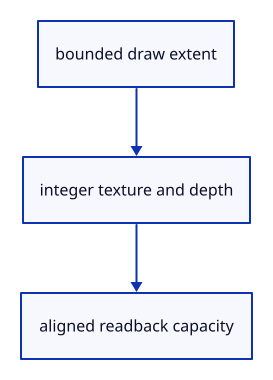

# 6.1.8 · Own a small ID image, depth target and readback buffer

**Chapter 6 · Picking and selection · Section 6.1 · GPU picking** · [Contents](contents.md)

**Typing: 17–33 minutes.** [Estimate](typing-load.md).

Own the integer image, depth attachment and staging buffer together. Their sizes follow the cursor window rather than the whole canvas.

## Type

Continue from [Draw depth-tested mesh owners into an integer attachment](42f-mesh.md). [Save or recover your work](recovery.md).

### 1. `src/pick_image.rs`

Allocate only the bounded target and padded readback.

Create the file and type:

```rust
--8<-- "journey/code/42g-image-01.rs"
```

### 2. `src/lib.rs`

Register the new picking component.

<details>
<summary>Locate the existing block</summary>

```rust
pub mod gpu_layout;

pub mod pick_pipeline;
```

</details>

After that block, type:

```rust
--8<-- "journey/code/42g-image-02.rs" skip=44
```

## Run and check

In your project:

```sh
cd workspace/journey
REGEN_PROTO=0 cargo build --lib --locked --target wasm32-unknown-unknown -j1
REGEN_PROTO=0 CARGO_BUILD_JOBS=1 trunk serve --port 8780
```

Open `http://127.0.0.1:8780/`. Keep an existing Trunk server running; saving rebuilds it.

Run the checks. The bounded image allocator is ready and does not change visible drawing.

### Recorded visual result

**Previous native render — current verification pending.**

The inherited grid and geometry remain visible; copied integer readback checks verify the new picking behavior.


*This recorded image predates a source or checker change. Rebuild this checkpoint before using it as current evidence; browser controls require separate acceptance.*

This reference image is shared with [5.7.8 · Inspect the ground grid through actual commands](41f-input.md). It does not demonstrate a new feature by itself.

<details>
<summary>Code explanation and diagram</summary>


bounded draw extent → integer texture and depth → aligned readback capacity.



Why does the readback buffer exceed width times height times eight?

Each copied row must align to256bytes. Padding belongs to the transfer layout and must never be interpreted as additional pixels.

Study estimate, including typing and experiments: 0.5–1 hours.

</details>

<details>
<summary>Optional experiment</summary>

Calculate the readback bytes for DPR1 and2 using the window checks.

</details>

<details>
<summary>Check and save your work</summary>

Restore experimental edits, then run from `session_viewer`:

```sh
npm --prefix ../session_tests run course -- check 6.1.8
npm --prefix ../session_tests run course -- save 6.1.8
```

Source comparison leaves your project untouched. [Save and recovery instructions](recovery.md).

</details>

<details>
<summary>Viewer coverage and verification</summary>

This is preparation within the GPU picking subject. The final input endpoint connects and checks actual canvas clicks; sub-object selection follows in44.

Existing normals commands remain available while the picking components are prepared.

[Full validation scope](release.md).

To reproduce the scripted acceptance of the reference checkpoint, run from `session_viewer` with the [course bundle server](release.md#reproduce) running on port 8781:

```sh
npm --prefix ../session_tests run course -- capture 6.1.8
```

This uses the verified reference bundle; it does not check or change your typed project.

</details>
