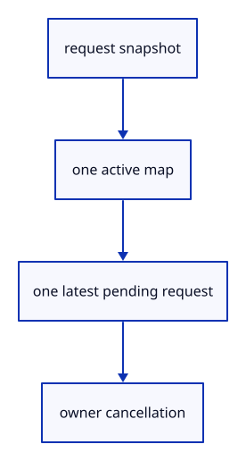

# 6.1.9 · Bound asynchronous picking ownership

**Chapter 6 · Picking and selection · Section 6.1 · GPU picking** · [Contents](contents.md)

**Typing: 25–49 minutes.** [Estimate](typing-load.md).

Own picking uniforms and bounded requests independently of the source geometry. Cancellation releases the image and prevents its result from being adopted.

## Type

Continue from [Own a small ID image, depth target and readback buffer](42g-image.md). [Save or recover your work](recovery.md).

### 1. `src/pick_gpu.rs`

Own bounded requests and release them on cancellation.

Create the file and type:

```rust
--8<-- "journey/code/42h-owner-01.rs"
```

### 2. `src/lib.rs`

Register the new picking component.

<details>
<summary>Locate the existing block</summary>

```rust
pub mod pick_pipeline;

mod pick_image;
```

</details>

After that block, type:

```rust
--8<-- "journey/code/42h-owner-02.rs" skip=40
```

## Run and check

In your project:

```sh
cd workspace/journey
REGEN_PROTO=0 cargo build --lib --locked --target wasm32-unknown-unknown -j1
REGEN_PROTO=0 CARGO_BUILD_JOBS=1 trunk serve --port 8780
```

Open `http://127.0.0.1:8780/`. Keep an existing Trunk server running; saving rebuilds it.

Run the checks. Request ownership is prepared; no asynchronous pick is submitted yet.

### Recorded visual result

**Previous native render — current verification pending.**

The inherited grid and geometry remain visible; copied integer readback checks verify the new picking behavior.


*This recorded image predates a source or checker change. Rebuild this checkpoint before using it as current evidence; browser controls require separate acceptance.*

This reference image is shared with [5.7.8 · Inspect the ground grid through actual commands](41f-input.md). It does not demonstrate a new feature by itself.

<details>
<summary>Code explanation and diagram</summary>


request snapshot → one active map → one latest pending request → owner cancellation.



Why keep only the latest pending cursor?

Old intermediate cursors do not help the learner. Coalescing bounds the queue while input continues to update.

Study estimate, including typing and experiments: 0.5–1 hours.

</details>

<details>
<summary>Optional experiment</summary>

Compare repeated requests with the one-active, one-pending bound.

</details>

<details>
<summary>Check and save your work</summary>

Restore experimental edits, then run from `session_viewer`:

```sh
npm --prefix ../session_tests run course -- check 6.1.9
npm --prefix ../session_tests run course -- save 6.1.9
```

Source comparison leaves your project untouched. [Save and recovery instructions](recovery.md).

</details>

<details>
<summary>Viewer coverage and verification</summary>

This is preparation within the GPU picking subject. The final input endpoint connects and checks actual canvas clicks; sub-object selection follows in44.

Existing normals commands remain available while the picking components are prepared.

[Full validation scope](release.md).

To reproduce the scripted acceptance of the reference checkpoint, run from `session_viewer` with the [course bundle server](release.md#reproduce) running on port 8781:

```sh
npm --prefix ../session_tests run course -- capture 6.1.9
```

This uses the verified reference bundle; it does not check or change your typed project.

</details>
