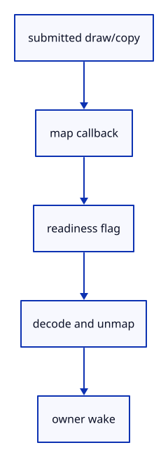

# 6.1.11 · Map the integer hit without blocking browser input

**Chapter 6 · Picking and selection · Section 6.1 · GPU picking** · [Contents](contents.md)

**Typing: 26–51 minutes.** [Estimate](typing-load.md).

Submit bounded draw work and request asynchronous mapping. Read, decode and unmap completed bytes; wake only the owning live runtime.

## Type

Continue from [Record the ID draw and aligned image copy](42i-copy.md). [Save or recover your work](recovery.md).

### 1. `src/pick_gpu.rs`

Map asynchronously and decode only completed bytes.

<details>
<summary>Locate the existing block</summary>

```rust
use crate::pick_window::Window;
use std::sync::{Arc, atomic::{AtomicBool, AtomicU8, Ordering}};

#[derive(Clone, Copy)]
pub struct Request { pub window: Window, pub transform: [f32; 16], pub density: f32 }


pub struct Picker {
    pipeline: wgpu::RenderPipeline,
    view: wgpu::Buffer,
    view_group: wgpu::BindGroup,
    crop: wgpu::Buffer,
    crop_group: wgpu::BindGroup,
    image: Option<crate::pick_image::Image>,
    active: Option<Arc<AtomicU8>>,
    pending: Option<Request>,
    alive: Arc<AtomicBool>,
    pub submitted: u64,
    pub coalesced: u64,
}

impl Drop for Picker { fn drop(&mut self) { self.alive.store(false, Ordering::Release); } }

impl Picker {
    pub fn new(device: &wgpu::Device, view_layout: &wgpu::BindGroupLayout, model_layout: &wgpu::BindGroupLayout) -> Self {
        let crop_layout = crate::gpu_layout::uniform(device, 64);
        let pipeline = crate::pick_pipeline::mesh(device, view_layout, model_layout, &crop_layout);
        let buffer = |size| device.create_buffer(&wgpu::BufferDescriptor { label: Some("pick view"), size,
            usage: wgpu::BufferUsages::UNIFORM | wgpu::BufferUsages::COPY_DST, mapped_at_creation: false });
        let view = buffer(80); let crop = buffer(64);
        let view_group = crate::gpu_layout::group(device, view_layout, &view);
        let crop_group = crate::gpu_layout::group(device, &crop_layout, &crop);
        Self { pipeline, view, view_group, crop, crop_group, image: None, active: None, pending: None,
            alive: Arc::new(AtomicBool::new(true)), submitted: 0, coalesced: 0 }
    }

    pub fn queue(&mut self, request: Request) {
        if self.pending.replace(request).is_some() { self.coalesced += 1; }
    }

    pub fn queued(&self) -> bool { self.pending.is_some() }

    pub fn cancel(&mut self) {
        self.pending = None;
        let mapped = self.active.take().is_some_and(|ready| ready.load(Ordering::Acquire) <= 1);
        if let Some(image) = self.image.take() { if mapped { image.readback.unmap(); } }
    }

    pub fn next(&mut self) -> Option<Request> { if self.active.is_some() { None } else { self.pending.take() } }


    pub fn usage(&self) -> [u64; 3] {
        [u64::from(self.active.is_some()), u64::from(self.pending.is_some()), self.image.as_ref().map_or(0, |image|
            image.readback.size() + u64::from(image.window.draw[2]) * u64::from(image.window.draw[3]) * 12) + 144]
    }
}
```

</details>

Edit the existing block to match this code; keep unchanged lines:

```rust
use crate::{gpu_mesh::GpuMesh, pick_window::Window, stroke_gpu::Lane};
use std::sync::{Arc, atomic::{AtomicBool, AtomicU8, Ordering}};

#[derive(Clone, Copy)]
pub struct Request { pub window: Window, pub transform: [f32; 16], pub density: f32 }


pub struct Picker {
    pipeline: wgpu::RenderPipeline,
    view: wgpu::Buffer,
    view_group: wgpu::BindGroup,
    crop: wgpu::Buffer,
    crop_group: wgpu::BindGroup,
    image: Option<crate::pick_image::Image>,
    active: Option<Arc<AtomicU8>>,
    pending: Option<Request>,
    alive: Arc<AtomicBool>,
    pub submitted: u64,
    pub coalesced: u64,
}

impl Drop for Picker { fn drop(&mut self) { self.alive.store(false, Ordering::Release); } }

impl Picker {
    pub fn new(device: &wgpu::Device, view_layout: &wgpu::BindGroupLayout, model_layout: &wgpu::BindGroupLayout) -> Self {
        let crop_layout = crate::gpu_layout::uniform(device, 64);
        let pipeline = crate::pick_pipeline::mesh(device, view_layout, model_layout, &crop_layout);
        let buffer = |size| device.create_buffer(&wgpu::BufferDescriptor { label: Some("pick view"), size,
            usage: wgpu::BufferUsages::UNIFORM | wgpu::BufferUsages::COPY_DST, mapped_at_creation: false });
        let view = buffer(80); let crop = buffer(64);
        let view_group = crate::gpu_layout::group(device, view_layout, &view);
        let crop_group = crate::gpu_layout::group(device, &crop_layout, &crop);
        Self { pipeline, view, view_group, crop, crop_group, image: None, active: None, pending: None,
            alive: Arc::new(AtomicBool::new(true)), submitted: 0, coalesced: 0 }
    }

    pub fn queue(&mut self, request: Request) {
        if self.pending.replace(request).is_some() { self.coalesced += 1; }
    }

    pub fn queued(&self) -> bool { self.pending.is_some() }

    pub fn cancel(&mut self) {
        self.pending = None;
        let mapped = self.active.take().is_some_and(|ready| ready.load(Ordering::Acquire) <= 1);
        if let Some(image) = self.image.take() { if mapped { image.readback.unmap(); } }
    }

    pub fn next(&mut self) -> Option<Request> { if self.active.is_some() { None } else { self.pending.take() } }


    pub fn submit(&mut self, device: &wgpu::Device, queue: &wgpu::Queue, request: Request, meshes: &[GpuMesh], ink: &[&Lane]) {
        assert!(self.active.is_none(), "Only one pick may be in flight");
        let window = request.window;
        if self.image.as_ref().is_none_or(|image| image.window.draw[2..] != window.draw[2..] || image.readback.size() != window.bytes()) {
            self.image = Some(crate::pick_image::Image::new(device, window));
        }
        let image = self.image.as_mut().unwrap(); image.window = window;
        let mut bytes: Vec<u8> = request.transform.iter().flat_map(|n| n.to_ne_bytes()).collect(); bytes.resize(80, 0);
        queue.write_buffer(&self.view, 0, &bytes);
        let bytes: Vec<u8> = window.crop().iter().flat_map(|n| n.to_ne_bytes()).collect(); queue.write_buffer(&self.crop, 0, &bytes);
        for lane in ink { lane.view(queue, &request.transform, window.full, request.density); }
        queue.submit([crate::pick_encode::draw(device, image, window, &self.pipeline,
            &self.view_group, &self.crop_group, meshes, ink)]);
        let ready = Arc::new(AtomicU8::new(0)); self.active = Some(Arc::clone(&ready)); let alive = Arc::clone(&self.alive);
        // Mapping finishes asynchronously; the callback publishes readiness, and the owner reads the bytes without blocking browser input.
        image.readback.slice(..).map_async(wgpu::MapMode::Read, move |result| {
            ready.store(if result.is_ok() { 1 } else { 2 }, Ordering::Release);
            if alive.load(Ordering::Acquire) {
                #[cfg(target_arch = "wasm32")] crate::browser_pick::wake();
            }
        });
        self.submitted += 1;
    }

    pub fn take(&mut self) -> Option<Result<Option<[u32; 2]>, &'static str>> {
        let status = self.active.as_ref()?.load(Ordering::Acquire);
        if status == 0 { return None; }
        self.active = None;
        let image = self.image.as_ref().unwrap();
        if status != 1 { return Some(Err("Cannot read GPU pick image")); }
        let bytes = image.readback.slice(..).get_mapped_range();
        let result = image.window.closest(&bytes); drop(bytes); image.readback.unmap(); Some(result)
    }

    pub fn usage(&self) -> [u64; 3] {
        [u64::from(self.active.is_some()), u64::from(self.pending.is_some()), self.image.as_ref().map_or(0, |image|
            image.readback.size() + u64::from(image.window.draw[2]) * u64::from(image.window.draw[3]) * 12) + 144]
    }
}
```

<details>
<summary>Optional patch references</summary>

Use these original edit fragments when comparing a saved checkpoint. Apply the complete blocks above.

```text
--8<-- "journey/code/42j-read-01.rs"
```

```text
--8<-- "journey/code/42j-read-02.rs"
```

</details>

### 2. `src/browser_pick.rs`

Wake the browser owner when GPU mapping completes.

Create the file and type:

```rust
--8<-- "journey/code/42j-read-03.rs"
```

### 3. `src/lib.rs`

Register the browser-only completion wakeup.

<details>
<summary>Locate the existing block</summary>

```rust
pub mod pick_gpu;

mod pick_encode;
```

</details>

After that block, type:

```rust
--8<-- "journey/code/42j-read-04.rs" skip=36
```

## Run and check

In your project:

```sh
cd workspace/journey
REGEN_PROTO=0 cargo build --lib --locked --target wasm32-unknown-unknown -j1
REGEN_PROTO=0 CARGO_BUILD_JOBS=1 trunk serve --port 8780
```

Open `http://127.0.0.1:8780/`. Keep an existing Trunk server running; saving rebuilds it.

Run the checks. GPU mapping and completion wakeup are prepared; real canvas input follows next.

### Recorded visual result

**Previous native render — current verification pending.**

The inherited grid and geometry remain visible; copied integer readback checks verify the new picking behavior.


*This recorded image predates a source or checker change. Rebuild this checkpoint before using it as current evidence; browser controls require separate acceptance.*

This reference image is shared with [5.7.8 · Inspect the ground grid through actual commands](41f-input.md). It does not demonstrate a new feature by itself.

<details>
<summary>Code explanation and diagram</summary>


submitted draw/copy → map callback → readiness flag → decode and unmap → owner wake.



Why must the browser not wait synchronously for mapping?

A synchronous wait stalls input and rendering. The callback signals completion, and the owning event handler reads only when mapping is ready.

Study estimate, including typing and experiments: 0.5–1 hours.

</details>

<details>
<summary>Optional experiment</summary>

Trace successful mapping, failed mapping and cancellation; every path must leave the next request usable.

</details>

<details>
<summary>Check and save your work</summary>

Restore experimental edits, then run from `session_viewer`:

```sh
npm --prefix ../session_tests run course -- check 6.1.11
npm --prefix ../session_tests run course -- save 6.1.11
```

Source comparison leaves your project untouched. [Save and recovery instructions](recovery.md).

</details>

<details>
<summary>Viewer coverage and verification</summary>

This is preparation within the GPU picking subject. The final input endpoint connects and checks actual canvas clicks; sub-object selection follows in44.

Run the copied checks, then the existing visible normal-view exercise. The picking subject ends with real GPU hit, depth, density, cancellation and browser-click checks.

Existing normals commands remain available while the picking components are prepared.

[Full validation scope](release.md).

To reproduce the scripted acceptance of the reference checkpoint, run from `session_viewer` with the [course bundle server](release.md#reproduce) running on port 8781:

```sh
npm --prefix ../session_tests run course -- capture 6.1.11
```

This uses the verified reference bundle; it does not check or change your typed project.

</details>
