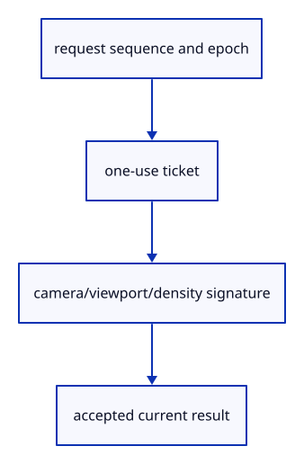

# 6.2.1 · Name the request and view that produced a hit

**Chapter 6 · Picking and selection · Section 6.2 · Pick request lifetime** · [Contents](contents.md)

**Typing: 20–39 minutes.** [Estimate](typing-load.md).

Give every pick a checked request ticket and view signature. An object ID can still exist after Undo while the readback that saw it is already obsolete.

## Type

Continue from [Select original rows through actual GPU canvas clicks](42k-input.md). [Save or recover your work](recovery.md).

### 1. `src/pick_gate.rs`

Create checked request freshness and view signatures.

Create the file and type:

```rust
--8<-- "journey/code/43-ticket-01.rs"
```

### 2. `src/pick_view.rs`

Create checked request freshness and view signatures.

Create the file and type:

```rust
--8<-- "journey/code/43-ticket-02.rs"
```

<details>
<summary>Supplied validation fixture</summary>

Copy this supplied authoring fixture once. Continue with the browser build below; the course does not require running native tests.

### 3. `src/pick_gate_tests.rs`

Copy one-use, superseded, invalidated, closed and exhausted ticket checks.

Copy this supplied file:

```text
--8<-- "journey/code/43-ticket-03.rs"
```

</details>

<details>
<summary>Supplied validation fixture</summary>

Copy this supplied authoring fixture once. Continue with the browser build below; the course does not require running native tests.

### 4. `src/pick_view_tests.rs`

Copy camera, viewport, density and invalid-view checks.

Copy this supplied file:

```text
--8<-- "journey/code/43-ticket-04.rs"
```

</details>

### 5. `src/lib.rs`

Register the freshness component and its checks.

<details>
<summary>Locate the existing block</summary>

```rust

#[cfg(test)]
mod pick_input_tests;
```

</details>

After that block, type:

```rust
--8<-- "journey/code/43-ticket-05.rs" skip=36
```

## Run and check

In your project:

```sh
cd workspace/journey
REGEN_PROTO=0 cargo build --lib --locked --target wasm32-unknown-unknown -j1
REGEN_PROTO=0 CARGO_BUILD_JOBS=1 trunk serve --port 8780
```

Open `http://127.0.0.1:8780/`. Keep an existing Trunk server running; saving rebuilds it.

Run the ticket and view checks, then repeat the existing point-picking exercise.

### Recorded visual result

**Previous native render — current verification pending.**

The inherited grid and geometry remain visible; copied integer readback checks verify the new picking behavior.


*This recorded image predates a source or checker change. Rebuild this checkpoint before using it as current evidence; browser controls require separate acceptance.*

This reference image is shared with [5.7.8 · Inspect the ground grid through actual commands](41f-input.md). It does not demonstrate a new feature by itself.

<details>
<summary>Code explanation and diagram</summary>


request sequence and epoch → one-use ticket → camera/viewport/density signature → accepted current result.



Why is finding the returned object ID insufficient?

Undo can restore that ID after the document and view have changed. The result must also belong to the latest request and current view.

Study estimate, including typing and experiments: 0.5–1 hours.

</details>

<details>
<summary>Optional experiment</summary>

Invalidate a ticket, restore the same scene identity and check that the old ticket remains rejected.

</details>

<details>
<summary>Check and save your work</summary>

Restore experimental edits, then run from `session_viewer`:

```sh
npm --prefix ../session_tests run course -- check 6.2.1
npm --prefix ../session_tests run course -- save 6.2.1
```

Source comparison leaves your project untouched. [Save and recovery instructions](recovery.md).

</details>

<details>
<summary>Viewer coverage and verification</summary>

Object-level picking remains available. This part adds explicit request freshness; full focus and current-view adoption are completed at43b.

Point selection remains available while stale-result protection is added. Browser acceptance is pending.

[Full validation scope](release.md).

To reproduce the scripted acceptance of the reference checkpoint, run from `session_viewer` with the [course bundle server](release.md#reproduce) running on port 8781:

```sh
npm --prefix ../session_tests run course -- capture 6.2.1
```

This uses the verified reference bundle; it does not check or change your typed project.

</details>
