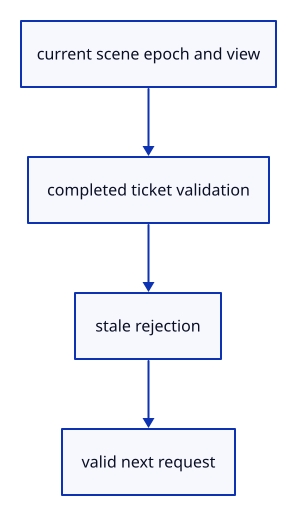

# 6.2.3 · Reject results from an old view or interrupted input

**Chapter 6 · Picking and selection · Section 6.2 · Pick request lifetime** · [Contents](contents.md)

**Typing: 25–49 minutes.** [Estimate](typing-load.md).

Validate the current camera, physical viewport and density when adopting a hit. Cancel unfinished picks on blur and page transitions, including a cached page.

## Type

Continue from [Carry checked tickets through GPU mapping](43a-flight.md). [Save or recover your work](recovery.md).

### 1. `src/pick_gpu.rs`

Adopt only the current view and cancel interrupted input.

Edit these blocks from bottom to top. Keep the surrounding lines unchanged.

<details>
<summary>Locate this block</summary>

```rust
        self.submitted += 1;
    }

    pub fn take(&mut self) -> Option<Result<Option<[u32; 2]>, &'static str>> {
        let status = self.active.as_ref()?.ready.load(Ordering::Acquire);
        if status == 0 { return None; }
        let flight = self.active.take().unwrap();
        let current = self.gate.accept(flight.ticket);
        let image = self.image.as_ref().unwrap();
        if status != 1 { return Some(if current { Err("Cannot read GPU pick image") } else { Ok(None) }); }
        let bytes = image.readback.slice(..).get_mapped_range();
        let result = if current { image.window.closest(&bytes) } else { Ok(None) };
        drop(bytes); image.readback.unmap(); Some(result)
    }
```

</details>

Replace it with:

```rust
        self.submitted += 1;
    }

    pub fn take(&mut self, view: crate::pick_view::View) -> Option<Result<Reply, &'static str>> {
        let status = self.active.as_ref()?.ready.load(Ordering::Acquire);
        if status == 0 { return None; }
        let flight = self.active.take().unwrap();
        let current = self.gate.accept(flight.ticket) && flight.view == view;
        let image = self.image.as_ref().unwrap();
        if status != 1 { return Some(if current { Err("Cannot read GPU pick image") } else { Ok(Reply::Stale) }); }
        let bytes = image.readback.slice(..).get_mapped_range();
        let result = if current { image.window.closest(&bytes).map(Reply::Hit) } else { Ok(Reply::Stale) };
        drop(bytes); image.readback.unmap(); Some(result)
    }
```

<details>
<summary>Locate this block</summary>

```rust
        for lane in ink { lane.view(queue, &request.transform, window.full, request.density); }
        queue.submit([crate::pick_encode::draw(device, image, window, &self.pipeline,
            &self.view_group, &self.crop_group, meshes, ink)]);
        let ready = Arc::new(AtomicU8::new(0)); self.active = Some(Flight { ready: Arc::clone(&ready), ticket: queued.ticket }); let alive = Arc::clone(&self.alive);
        // Mapping finishes asynchronously; the callback publishes readiness, and the owner reads the bytes without blocking browser input.
        image.readback.slice(..).map_async(wgpu::MapMode::Read, move |result| {
            ready.store(if result.is_ok() { 1 } else { 2 }, Ordering::Release);
```

</details>

Replace it with:

```rust
        for lane in ink { lane.view(queue, &request.transform, window.full, request.density); }
        queue.submit([crate::pick_encode::draw(device, image, window, &self.pipeline,
            &self.view_group, &self.crop_group, meshes, ink)]);
        let ready = Arc::new(AtomicU8::new(0)); self.active = Some(Flight { ready: Arc::clone(&ready), ticket: queued.ticket, view: queued.view }); let alive = Arc::clone(&self.alive);
        // Mapping finishes asynchronously; the callback publishes readiness, and the owner reads the bytes without blocking browser input.
        image.readback.slice(..).map_async(wgpu::MapMode::Read, move |result| {
            ready.store(if result.is_ok() { 1 } else { 2 }, Ordering::Release);
```

<details>
<summary>Locate this block</summary>

```rust
        if let Some(image) = self.image.take() { if mapped { image.readback.unmap(); } }
    }

    pub(crate) fn next(&mut self) -> Option<Queued> { if self.active.is_some() { None } else { self.pending.take() } }

    pub(crate) fn submit(&mut self, device: &wgpu::Device, queue: &wgpu::Queue, queued: Queued, meshes: &[GpuMesh], ink: &[&Lane]) {
        assert!(self.active.is_none(), "Only one pick may be in flight");
```

</details>

Replace it with:

```rust
        if let Some(image) = self.image.take() { if mapped { image.readback.unmap(); } }
    }

    pub(crate) fn next(&mut self, view: crate::pick_view::View) -> Option<Queued> {
        if self.active.is_some() { return None; }
        let queued = self.pending.take()?;
        if queued.view == view { Some(queued) } else { self.gate.invalidate(); None }
    }


    pub(crate) fn submit(&mut self, device: &wgpu::Device, queue: &wgpu::Queue, queued: Queued, meshes: &[GpuMesh], ink: &[&Lane]) {
        assert!(self.active.is_none(), "Only one pick may be in flight");
```

<details>
<summary>Locate this block</summary>

```rust
    }

    pub fn queue(&mut self, request: Request) -> Result<(), &'static str> {
        crate::pick_view::View::new(request.transform, request.window.full, request.density)?;
        let ticket = self.gate.issue()?;
        if self.pending.replace(Queued { request, ticket }).is_some() { self.coalesced += 1; }
        Ok(())
    }
```

</details>

Replace it with:

```rust
    }

    pub fn queue(&mut self, request: Request) -> Result<(), &'static str> {
        let view = crate::pick_view::View::new(request.transform, request.window.full, request.density)?;
        let ticket = self.gate.issue()?;
        if self.pending.replace(Queued { request, ticket, view }).is_some() { self.coalesced += 1; }
        Ok(())
    }
```

<details>
<summary>Locate this block</summary>

```rust
#[derive(Clone, Copy)]
pub struct Request { pub window: Window, pub transform: [f32; 16], pub density: f32 }

pub(crate) struct Queued { request: Request, ticket: crate::pick_gate::Ticket }
struct Flight { ready: Arc<AtomicU8>, ticket: crate::pick_gate::Ticket }


pub struct Picker {
```

</details>

Replace it with:

```rust
#[derive(Clone, Copy)]
pub struct Request { pub window: Window, pub transform: [f32; 16], pub density: f32 }

pub(crate) struct Queued { request: Request, ticket: crate::pick_gate::Ticket, view: crate::pick_view::View }
struct Flight { ready: Arc<AtomicU8>, ticket: crate::pick_gate::Ticket, view: crate::pick_view::View }
pub enum Reply { Hit(Option<[u32; 2]>), Stale }


pub struct Picker {
```

<details>
<summary>Complete updated block reference</summary>

```rust
use crate::{gpu_mesh::GpuMesh, pick_window::Window, stroke_gpu::Lane};
use std::sync::{Arc, atomic::{AtomicBool, AtomicU8, Ordering}};

#[derive(Clone, Copy)]
pub struct Request { pub window: Window, pub transform: [f32; 16], pub density: f32 }

pub(crate) struct Queued { request: Request, ticket: crate::pick_gate::Ticket, view: crate::pick_view::View }
struct Flight { ready: Arc<AtomicU8>, ticket: crate::pick_gate::Ticket, view: crate::pick_view::View }
pub enum Reply { Hit(Option<[u32; 2]>), Stale }


pub struct Picker {
    pipeline: wgpu::RenderPipeline,
    view: wgpu::Buffer,
    view_group: wgpu::BindGroup,
    crop: wgpu::Buffer,
    crop_group: wgpu::BindGroup,
    image: Option<crate::pick_image::Image>,
    active: Option<Flight>,
    pending: Option<Queued>,
    alive: Arc<AtomicBool>,
    gate: crate::pick_gate::Gate,
    pub submitted: u64,
    pub coalesced: u64,
}

impl Drop for Picker { fn drop(&mut self) { self.alive.store(false, Ordering::Release); self.gate.close(); } }

impl Picker {
    pub fn new(device: &wgpu::Device, view_layout: &wgpu::BindGroupLayout, model_layout: &wgpu::BindGroupLayout) -> Self {
        let crop_layout = crate::gpu_layout::uniform(device, 64);
        let pipeline = crate::pick_pipeline::mesh(device, view_layout, model_layout, &crop_layout);
        let buffer = |size| device.create_buffer(&wgpu::BufferDescriptor { label: Some("pick view"), size,
            usage: wgpu::BufferUsages::UNIFORM | wgpu::BufferUsages::COPY_DST, mapped_at_creation: false });
        let view = buffer(80); let crop = buffer(64);
        let view_group = crate::gpu_layout::group(device, view_layout, &view);
        let crop_group = crate::gpu_layout::group(device, &crop_layout, &crop);
        Self { pipeline, view, view_group, crop, crop_group, image: None, active: None, pending: None,
            alive: Arc::new(AtomicBool::new(true)), gate: Default::default(), submitted: 0, coalesced: 0 }
    }

    pub fn queue(&mut self, request: Request) -> Result<(), &'static str> {
        let view = crate::pick_view::View::new(request.transform, request.window.full, request.density)?;
        let ticket = self.gate.issue()?;
        if self.pending.replace(Queued { request, ticket, view }).is_some() { self.coalesced += 1; }
        Ok(())
    }

    pub fn queued(&self) -> bool { self.pending.is_some() }

    pub fn cancel(&mut self) {
        self.gate.invalidate(); self.pending = None;
        let mapped = self.active.take().is_some_and(|flight| flight.ready.load(Ordering::Acquire) <= 1);
        if let Some(image) = self.image.take() { if mapped { image.readback.unmap(); } }
    }

    pub(crate) fn next(&mut self, view: crate::pick_view::View) -> Option<Queued> {
        if self.active.is_some() { return None; }
        let queued = self.pending.take()?;
        if queued.view == view { Some(queued) } else { self.gate.invalidate(); None }
    }


    pub(crate) fn submit(&mut self, device: &wgpu::Device, queue: &wgpu::Queue, queued: Queued, meshes: &[GpuMesh], ink: &[&Lane]) {
        assert!(self.active.is_none(), "Only one pick may be in flight");
        let request = queued.request; let window = request.window;
        if self.image.as_ref().is_none_or(|image| image.window.draw[2..] != window.draw[2..] || image.readback.size() != window.bytes()) {
            self.image = Some(crate::pick_image::Image::new(device, window));
        }
        let image = self.image.as_mut().unwrap(); image.window = window;
        let mut bytes: Vec<u8> = request.transform.iter().flat_map(|n| n.to_ne_bytes()).collect(); bytes.resize(80, 0);
        queue.write_buffer(&self.view, 0, &bytes);
        let bytes: Vec<u8> = window.crop().iter().flat_map(|n| n.to_ne_bytes()).collect(); queue.write_buffer(&self.crop, 0, &bytes);
        for lane in ink { lane.view(queue, &request.transform, window.full, request.density); }
        queue.submit([crate::pick_encode::draw(device, image, window, &self.pipeline,
            &self.view_group, &self.crop_group, meshes, ink)]);
        let ready = Arc::new(AtomicU8::new(0)); self.active = Some(Flight { ready: Arc::clone(&ready), ticket: queued.ticket, view: queued.view }); let alive = Arc::clone(&self.alive);
        // Mapping finishes asynchronously; the callback publishes readiness, and the owner reads the bytes without blocking browser input.
        image.readback.slice(..).map_async(wgpu::MapMode::Read, move |result| {
            ready.store(if result.is_ok() { 1 } else { 2 }, Ordering::Release);
            if alive.load(Ordering::Acquire) {
                #[cfg(target_arch = "wasm32")] crate::browser_pick::wake();
            }
        });
        self.submitted += 1;
    }

    pub fn take(&mut self, view: crate::pick_view::View) -> Option<Result<Reply, &'static str>> {
        let status = self.active.as_ref()?.ready.load(Ordering::Acquire);
        if status == 0 { return None; }
        let flight = self.active.take().unwrap();
        let current = self.gate.accept(flight.ticket) && flight.view == view;
        let image = self.image.as_ref().unwrap();
        if status != 1 { return Some(if current { Err("Cannot read GPU pick image") } else { Ok(Reply::Stale) }); }
        let bytes = image.readback.slice(..).get_mapped_range();
        let result = if current { image.window.closest(&bytes).map(Reply::Hit) } else { Ok(Reply::Stale) };
        drop(bytes); image.readback.unmap(); Some(result)
    }

    pub fn usage(&self) -> [u64; 3] {
        [u64::from(self.active.is_some()), u64::from(self.pending.is_some()), self.image.as_ref().map_or(0, |image|
            image.readback.size() + u64::from(image.window.draw[2]) * u64::from(image.window.draw[3]) * 12) + 144]
    }
}
```

</details>

<details>
<summary>Optional patch references</summary>

Use these original edit fragments when comparing a saved checkpoint. Apply the complete blocks above.

```text
--8<-- "journey/code/43b-view-01.rs"
```

```text
--8<-- "journey/code/43b-view-02.rs"
```

```text
--8<-- "journey/code/43b-view-03.rs"
```

```text
--8<-- "journey/code/43b-view-04.rs"
```

```text
--8<-- "journey/code/43b-view-05.rs"
```

</details>

### 2. `src/renderer.rs`

Adopt only the current view and cancel interrupted input.

<details>
<summary>Locate the existing block</summary>

```rust
    pub fn request_pick(&mut self, screen: [f32; 2], transform: [f32; 16]) -> Result<(), &'static str> {
        let window = crate::pick_window::Window::new(screen, self.size, self.density).ok_or("Invalid pick cursor")?;
        self.picker.queue(crate::pick_gpu::Request { window, transform, density: self.density })?;
        self.pump_pick(); Ok(())
    }

    fn pump_pick(&mut self) {
        if let Some(request) = self.picker.next() { self.picker.submit(&self.device, &self.queue, request,
            &self.meshes, &[&self.strokes, &self.paths, &self.markers]); }
    }

    pub fn take_pick(&mut self) -> Option<Result<Option<[u32; 2]>, &'static str>> {
        let result = self.picker.take();
        if result.is_some() && self.picker.queued() { self.pump_pick(); return None; }
        result
    }

    pub fn cancel_pick(&mut self) { self.picker.cancel(); }
```

</details>

Edit the existing block to match this code; keep unchanged lines:

```rust
--8<-- "journey/code/43b-view-06.rs"
```

### 3. `src/browser.rs`

Adopt only the current view and cancel interrupted input.

Edit these blocks from bottom to top. Keep the surrounding lines unchanged.

<details>
<summary>Locate this block</summary>

```rust
            None
        };
        let action = if event.type_() == "viewer-pick" {
            match renderer.take_pick() {
                Some(Ok(hit)) => Some(Action::Picked(hit.and_then(|hit| editor.scene.pick_id(hit[0])))),
                Some(Err(error)) => { report(error); None },
                None => None,
```

</details>

Replace it with:

```rust
            None
        };
        let action = if event.type_() == "viewer-pick" {
            match renderer.take_pick(editor.camera.uniform()) {
                Some(Ok(hit)) => Some(Action::Picked(hit.and_then(|hit| editor.scene.pick_id(hit[0])))),
                Some(Err(error)) => { report(error); None },
                None => None,
```

<details>
<summary>Locate this block</summary>

```rust
    let update = Closure::<dyn FnMut(web_sys::Event)>::new(move |event: web_sys::Event| {
        if active_fault.message().is_some() { return; }
        let mut editor = shared.borrow_mut();
        if event.type_() == "pagehide" {
            gesture.cancel();
            if event.dyn_ref::<web_sys::PageTransitionEvent>().is_some_and(|event| event.persisted()) { return; }
```

</details>

Replace it with:

```rust
    let update = Closure::<dyn FnMut(web_sys::Event)>::new(move |event: web_sys::Event| {
        if active_fault.message().is_some() { return; }
        let mut editor = shared.borrow_mut();
        if matches!(event.type_().as_str(), "blur" | "pagehide" | "viewer-reload") { renderer.cancel_pick(); }
        if event.type_() == "pagehide" {
            gesture.cancel();
            if event.dyn_ref::<web_sys::PageTransitionEvent>().is_some_and(|event| event.persisted()) { return; }
```

<details>
<summary>Complete updated block reference</summary>

```rust
use crate::background::Background;
use crate::editor::{Action, Change, Editor};
use crate::gesture::Gesture;
use crate::renderer::Renderer;
use crate::viewport::Viewport;
use wasm_bindgen::{JsCast, JsValue, closure::Closure};

pub fn report(message: &str) {
    if let Some(document) = web_sys::window().and_then(|window| window.document()) {
        if let Some(status) = document.get_element_by_id("status") {
            status.set_text_content(Some(message));
            if message.starts_with("Cannot draw:") { let _ = status.remove_attribute("hidden"); }
        }
    }
}

fn failed(fault: crate::gpu_fault::Fault, message: String) {
    if !fault.remember(message.clone()) { return; }
    wasm_bindgen_futures::spawn_local(async move {
        if crate::browser_runtime::stop_if(&fault) {
            crate::browser_report::fatal(&message);
            if crate::browser_recovery::request(&message) { return; }
            report(&format!("Cannot draw: {message}"));
        }
    });
}

fn save_result(bytes: &[u8]) -> Result<String, String> {
    crate::file_output::download(bytes)
        .map(|()| format!("Saved editable document ({} bytes)", bytes.len()))
        .map_err(|error| format!("Save failed: {error:?}"))
}

pub async fn run() -> Result<(), JsValue> { run_with(crate::drawing_document::new()).await }

pub async fn run_with(shared: crate::drawing_document::Shared) -> Result<(), JsValue> {
    let window = web_sys::window().ok_or("No browser window")?;
    let document = window.document().ok_or("No document")?;
    let canvas: web_sys::HtmlCanvasElement = document
        .get_element_by_id("canvas")
        .ok_or("Missing canvas")?
        .dyn_into()?;
    let recovery = crate::browser_recovery::adopt()?;
    crate::browser_report::start()?;
    let startup = crate::browser_startup::Guard::new()?;
    let instance = wgpu::Instance::new(wgpu::InstanceDescriptor {
        backends: wgpu::Backends::BROWSER_WEBGPU,
        flags: Default::default(),
        memory_budget_thresholds: Default::default(),
        backend_options: Default::default(),
        display: None,
    });
    let surface = instance
        .create_surface(wgpu::SurfaceTarget::Canvas(canvas.clone()))
        .map_err(|error| JsValue::from_str(&error.to_string()))?;
    let adapter_started = crate::browser_phase::now();
    let probe = crate::browser_adapter::Probe::new().ok();
    let adapter = instance
        .request_adapter(&wgpu::RequestAdapterOptions {
            compatible_surface: Some(&surface),
            ..Default::default()
        })
        .await;
    if !startup.permits() { return Ok(()); }
    crate::browser_phase::finish("adapter request", adapter_started, 0, "GPU");
    let adapter = adapter.map_err(|error| JsValue::from_str(&error.to_string()))?;
    if let Some(info) = probe.as_ref().and_then(|probe| probe.info()) { let _ = crate::browser_report::adapter(info); }
    else { let _ = crate::browser_report::observe("diagnostic", "Adapter identity unavailable"); }
    drop(probe);
    let device_started = crate::browser_phase::now();
    let device = adapter
        .request_device(&wgpu::DeviceDescriptor::default())
        .await;
    if !startup.permits() {
        if let Ok((device, _)) = device { device.destroy(); }
        return Ok(());
    }
    crate::browser_phase::finish("device request", device_started, 0, "GPU");
    let (device, queue) = device.map_err(|error| JsValue::from_str(&error.to_string()))?;
    let fault = crate::gpu_fault::Fault::default();
    let errors = fault.clone();
    device.on_uncaptured_error(std::sync::Arc::new(move |error| failed(errors.clone(), format!("WebGPU error: {error}"))));
    let lost = fault.clone();
    device.set_device_lost_callback(move |reason, message| failed(lost.clone(), format!("WebGPU device lost ({reason:?}): {message}")));
    let limit = device.limits().max_texture_dimension_2d;
    let width = (window.inner_width()?.as_f64().ok_or("No window width")? as u32).clamp(1, limit);
    let height = (window.inner_height()?.as_f64().ok_or("No window height")? as u32).clamp(1, limit);
    canvas.set_width(width);
    canvas.set_height(height);
    let mut config = surface
        .get_default_config(&adapter, width, height)
        .ok_or("No compatible surface format")?;
    config.view_formats = vec![config.format.add_srgb_suffix()];
    surface.configure(&device, &config);
    let mut editor = shared.borrow_mut();
    let pipeline_started = crate::browser_phase::now();
    let mut renderer = Renderer::new(
        device,
        queue,
        config.format.add_srgb_suffix(),
        &editor.scene,
    );
    crate::browser_phase::finish("renderer setup", pipeline_started, 0, "GPU");
    renderer.resize(Viewport { width, height });
    inspect(&editor, &renderer)?;
    let mut panel = crate::panel::Panel::new(
        &renderer,
        config.format.add_srgb_suffix(),
        &[
            "Help",
            "Open",
            "Open Replace",
            "Cancel Open",
            "Close",
            "Unload Sources",
            "Reload Sources",
            "Cancel Reload",
            "Save",
            "Report",
            "Report Previous",
            "Example Box",
            "Example Line",
            "Example Point",
            "Example Curve",
            "Example Object Color",
            "Example Point Colors",
            "Example Face Colors",
            "View Normals On",
            "View Normals Off",
            "View Grid On",
            "View Grid Off",
            "Example Sharp",
            "Example Smooth",
            "Example Winding",


            "Controls On",
            "Controls Off",
            "Example Polyline",
            "Example Arrow",
            "Example Triangle",
            "Select Next",
            "Delete",
            "Undo",
            "Redo",
            "Background",
            "Zoom In",
            "Zoom Out",
            "Pan Left",
            "Pan Right",
            "Orbit Right",
            "Orbit Up",
            "View Isometric",
            "View Perspective",
            "View Orthographic",
            "Fit",
            "Fit Selected",
            "Move",
            "View Reset",
        ],
    );
    if let Some(message) = crate::browser_report::previous_notice() { panel.result(message); }
    if let Some(message) = &recovery { panel.result(message); }
    panel.update(None, &canvas)?;
    if resize(
        &window,
        &canvas,
        &surface,
        &mut config,
        &mut renderer,
        &mut editor,
    ) {
        panel.update(None, &canvas)?;
        let frame_started = crate::browser_phase::now();
        present(
            &surface,
            &renderer,
            &editor.background,
            &editor.camera.uniform(),
            editor.normal_view,
            &mut panel,
        )?;
        let completing = fault.clone();
        // Queue completion runs after submitted GPU work; checking the current device prevents a late result from reviving an exited runtime.
        renderer.queue.on_submitted_work_done(move || {
            if crate::browser_runtime::owns(&completing) && completing.message().is_none() {
                crate::browser_phase::finish("first frame complete", frame_started, 0, "GPU");
                let _ = crate::browser_report::observe("milestone", "geometry on screen");
            }
        });
    }
    let input_canvas = canvas.clone();
    let browser_window = window.clone();
    let pointer_canvas = canvas.clone();
    let mut gesture = Gesture::default();
    let request = std::rc::Rc::new(std::cell::RefCell::new(crate::read_gate::ReadGate::default()));
    let read_mode = std::cell::Cell::new(crate::file_input::Mode::Append);
    let delivery: crate::file_input::Delivery = std::rc::Rc::new(std::cell::RefCell::new(None));
    let reload: crate::browser_reload::Shared = std::rc::Rc::new(std::cell::RefCell::new(Default::default()));
    let reload_delivery: crate::browser_reload::Delivery = std::rc::Rc::new(std::cell::RefCell::new(None));
    let owned_request = std::rc::Rc::clone(&request);
    let owned_reload = std::rc::Rc::clone(&reload);
    let active_fault = fault.clone();
    drop(editor);
    let owned_editor = std::rc::Rc::clone(&shared);
    let update = Closure::<dyn FnMut(web_sys::Event)>::new(move |event: web_sys::Event| {
        if active_fault.message().is_some() { return; }
        let mut editor = shared.borrow_mut();
        if matches!(event.type_().as_str(), "blur" | "pagehide" | "viewer-reload") { renderer.cancel_pick(); }
        if event.type_() == "pagehide" {
            gesture.cancel();
            if event.dyn_ref::<web_sys::PageTransitionEvent>().is_some_and(|event| event.persisted()) { return; }
            wasm_bindgen_futures::spawn_local(async { crate::browser_runtime::stop(); });
            return;
        }
        let shortcut = event.dyn_ref::<web_sys::KeyboardEvent>().and_then(|key| panel.shortcut(key));
        let line = if let Some(shortcut) = shortcut {
            event.prevent_default();
            panel.answer(shortcut.command(), "");
            Some(shortcut.command().to_ascii_lowercase())
        } else { match panel.update(Some(&event), &input_canvas) {
            Ok(line) => line,
            Err(error) => {
                report(&format!("Cannot read command: {error:?}"));
                return;
            }
        } };

        let action = if event.type_() == "cancel" && event.target()
            .and_then(|target| target.dyn_into::<web_sys::HtmlInputElement>().ok())
            .is_some_and(|input| input.id() == "open")
        {
            request.borrow_mut().cancel();
            report("Open cancelled.");
            panel.answer("Open", "Open cancelled.");
            None
        } else if event.type_() == "change" {
            crate::file_input::choose(&event, std::rc::Rc::clone(&request), read_mode.get(), std::rc::Rc::clone(&delivery));
            None
        } else if event.type_() == "viewer-file-error" {
            if let Some(message) = event.dyn_ref::<web_sys::CustomEvent>().and_then(|event| event.detail().as_string()) {
                report(&message);
                panel.answer("Open", &message);
            }
            None
        } else if event.type_() == "viewer-reload" {
            if let Some(reply) = reload_delivery.borrow_mut().take() {
                let command = reply.intent.map_or("Reload Sources", |intent| intent.command());
                match reply.complete(&mut editor) {
                    Ok(Some(crate::edit_replay::Reply::Changed(_))) => {
                        crate::browser_upload::prepare(&mut renderer, &editor.scene, editor.selected, active_fault.clone());
                        crate::browser_phase::revision(&editor.scene);
                        let message = if command == "Reload Sources" {
                            "Editable sources restored; display retained.".to_owned()
                        } else { format!("{command} completed after source reload.") };
                        report(&message); panel.answer(command, &message);
                    }
                    Ok(Some(crate::edit_replay::Reply::Saved(bytes))) => {
                        let message = save_result(&bytes).unwrap_or_else(|error| error);
                        report(&message); panel.answer(command, &message);
                    }
                    Ok(None) => {}
                    Err(error) => { report(&error); panel.answer(command, &error); }
                }
            }
            None
        } else if event.type_() == "viewer-file" {
            match crate::file_input::action(&event, &delivery) {
                Ok(action) => action,
                Err(error) => { let message = format!("Cannot retain reload file: {error:?}");
                    report(&message); panel.answer("Open", &message); None }
            }
        } else if let Some(line) = line {
            if line == "reload sources" {
                let result = crate::browser_reload::start(std::rc::Rc::clone(&reload), editor.reload_keys(), std::rc::Rc::clone(&reload_delivery));
                match result {
                    Ok(()) => panel.result("Reloading editable sources…"),
                    Err(error) => { report(&error); panel.result(&error); }
                }
                None
            } else if line == "cancel reload" {
                reload.borrow_mut().cancel();
                report("Reload cancelled."); panel.result("Reload cancelled.");
                None
            } else if line == "unload sources" {
                Some(Action::UnloadSources)
            } else if line == "close" {
                request.borrow_mut().cancel();
                Some(Action::Close)
            } else if line == "cancel open" {
                request.borrow_mut().cancel();
                report("Open cancelled.");
                panel.result("Open cancelled.");
                None
            } else if line == "open" || line == "open replace" {
                let ticket = request.borrow_mut().begin();
                if let Err(error) = ticket { report(error); panel.result(error); return; }
                if line == "open replace" { reload.borrow_mut().cancel(); }
                read_mode.set(if line == "open replace" { crate::file_input::Mode::Replace }
                    else { crate::file_input::Mode::Append });
                if let Some(input) = web_sys::window()
                    .and_then(|window| window.document())
                    .and_then(|document| document.get_element_by_id("open"))
                    .and_then(|element| element.dyn_into::<web_sys::HtmlInputElement>().ok())
                {
                    input.click();
                }
                None
            } else if line == "report" || line == "report previous" {
                let output = if line.ends_with(" previous") { crate::browser_report::download_previous() }
                    else { crate::browser_report::download() };
                let result = output.map(|()| "Diagnostic report downloaded.".to_owned())
                    .unwrap_or_else(|error| format!("Diagnostic report failed: {error:?}"));
                panel.result(&result);
                None
            } else if line == "save" {
                let result = crate::browser_reload::restore_for(crate::edit_intent::Intent::Save,
                    &editor, std::rc::Rc::clone(&reload), std::rc::Rc::clone(&reload_delivery))
                    .and_then(|waiting| {
                        if waiting { Ok("Reloading editable sources…".to_owned()) }
                        else { crate::document::snapshot(&editor.scene).map_err(str::to_owned)
                            .and_then(|bytes| save_result(&bytes)) }
                    });
                panel.result(&result.unwrap_or_else(|error| error));
                None
            } else if line == "move" || line.starts_with("move ") {
                match crate::offset::parse(&line) {
                    Ok(offset) => Some(Action::Translate(offset)),
                    Err(error) => { panel.result(error); None }
                }
            } else {
                let action = match line.as_str() {
                    "example box" => Action::AddBox,
                    "example line" => Action::AddLine,
                    "example point" => Action::AddPoint,
                    "example curve" => Action::AddCurve,
                    "example object color" => Action::AddColours(crate::colour::Mode::Object),
                    "example point colors" => Action::AddColours(crate::colour::Mode::Points),
                    "example face colors" => Action::AddColours(crate::colour::Mode::Faces),
                    "view normals on" => Action::NormalView(true),
                    "view normals off" => Action::NormalView(false),
                    "view grid on" => Action::Grid(Some(crate::grid::Settings::default())),
                    "view grid off" => Action::Grid(None),
                    "example sharp" => Action::AddNormals(crate::normal_example::Mode::Sharp),
                    "example smooth" => Action::AddNormals(crate::normal_example::Mode::Smooth),
                    "example winding" => Action::AddNormals(crate::normal_example::Mode::Winding),


                    "controls on" => Action::Controls(true),
                    "controls off" => Action::Controls(false),
                    "example polyline" => Action::AddPolyline,
                    "example arrow" => Action::AddArrow,
                    "example triangle" => Action::ToggleExtra,
                    "select next" => Action::SelectNext,
                    "delete" => Action::Delete,
                    "undo" => Action::Undo,
                    "redo" => Action::Redo,
                    "background" => Action::Background,
                    "zoom in" => Action::Zoom(2.0),
                    "zoom out" => Action::Zoom(0.5),
                    "pan left" => Action::Pan(-0.25, 0.0),
                    "pan right" => Action::Pan(0.25, 0.0),
                    "orbit right" => Action::Orbit(std::f64::consts::FRAC_PI_4, 0.0),
                    "orbit up" => Action::Orbit(0.0, std::f64::consts::FRAC_PI_6),
                    "view isometric" => Action::Isometric,
                    "view perspective" => {
                        Action::Projection(crate::camera::Projection::Perspective)
                    }
                    "view orthographic" => {
                        Action::Projection(crate::camera::Projection::Orthographic)
                    }
                    "fit" if shortcut.is_some() && editor.selected.is_some() => Action::FitSelected,
                    "fit" => Action::Fit,

                    "fit selected" => Action::FitSelected,
                    "view reset" => Action::ResetView,
                    _ => return,
                };
                Some(action)
            }
        } else if !panel.consumed {
            navigation_action(&event, &pointer_canvas, &mut gesture)
        } else {
            None
        };
        let action = if event.type_() == "viewer-pick" {
            match renderer.take_pick(editor.camera.uniform()) {
                Some(Ok(hit)) => Some(Action::Picked(hit.and_then(|hit| editor.scene.pick_id(hit[0])))),
                Some(Err(error)) => { report(error); None },
                None => None,
            }
        } else { match action {
            Some(Action::Pick(screen)) => {
                if let Err(error) = renderer.request_pick(screen, editor.camera.uniform()) { report(error); }
                None
            }
            Some(action) => { renderer.cancel_pick(); Some(action) },
            None => None,
        } };
        if let Some(action) = action {
            if matches!(&action, Action::Close | Action::UnloadSources | Action::Undo | Action::Redo
                | Action::Replace(_) | Action::ReplaceAt(_, _)) { reload.borrow_mut().cancel(); }
            let replacement = matches!(&action, Action::Replace(_) | Action::ReplaceAt(_, _));
            let closing = matches!(&action, Action::Close);
            let unloading = matches!(&action, Action::UnloadSources);
            let waiting = crate::edit_intent::Intent::capture(&action, editor.selected)
                .map_err(str::to_owned).and_then(|intent| match intent {
                    Some(intent) => crate::browser_reload::restore_for(intent, &editor,
                        std::rc::Rc::clone(&reload), std::rc::Rc::clone(&reload_delivery)),
                    None => Ok(false),
                });
            let change = waiting.and_then(|waiting| {
                if waiting { panel.result("Reloading editable sources…"); Ok(None) }
                else { editor.apply(action).map(Some).map_err(str::to_owned) }
            });
            match change {
                Ok(Some(Change::Scene)) => {
                    crate::browser_upload::prepare(&mut renderer, &editor.scene, editor.selected, active_fault.clone());
                    if unloading {
                        report("Editable sources unloaded; display retained.");
                        panel.result("Editable sources unloaded; display retained.");
                    } else if closing {
                        report("Document closed.");
                        panel.result("Document closed.");
                    } else if event.type_() == "viewer-file" {
                        crate::browser_phase::revision(&editor.scene);
                        let message = if replacement { "Document replaced. Undo restores the previous document." }
                            else { "File imported. Undo removes the entire import." };
                        report(message);
                        panel.answer(if replacement { "Open Replace" } else { "Open" }, message);
                    }
                }
                Ok(Some(Change::View)) | Ok(None) => {}
                Err(error) => {
                    report(&error);
                    if event.type_() == "viewer-file" { panel.answer("Open", &error); }
                    else { panel.result(&error); }
                }
            }
        }
        if let Err(error) = renderer.set_grid(editor.camera.grid) {
            report(error); return;
        }
        if let Err(error) = inspect(&editor, &renderer) {
            report(&format!("Cannot report projection: {error:?}"));
            return;
        }
        if resize(
            &browser_window,
            &pointer_canvas,
            &surface,
            &mut config,
            &mut renderer,
            &mut editor,
        ) {
            if let Err(error) = panel.update(None, &input_canvas) {
                report(&format!("Cannot lay out commands: {error:?}"));
                return;
            }
            if let Err(error) = present(
                &surface,
                &renderer,
                &editor.background,
                &editor.camera.uniform(),
                editor.normal_view,
                &mut panel,
            ) {
                report(&format!("Cannot redraw: {error:?}"));
            }
        }
    });
    let mut listeners = crate::listeners::Listeners::new(update);
    for name in [
        "pointerdown",
        "pointermove",
        "pointerup",
        "pointercancel",
        "lostpointercapture",
        "contextmenu",
        "keydown",
        "keyup",
        "blur",
    ] {
        listeners.listen(canvas.as_ref(), name)?;
    }
    listeners.listen(canvas.as_ref(), "wheel")?;
    listeners.listen(window.as_ref(), "resize")?;
    listeners.listen(window.as_ref(), "blur")?;
    listeners.listen(document.as_ref(), "change")?;
    listeners.listen(document.as_ref(), "cancel")?;
    listeners.listen(window.as_ref(), "viewer-pick")?;
    listeners.listen(window.as_ref(), "viewer-file")?;
    listeners.listen(window.as_ref(), "viewer-file-error")?;
    listeners.listen(window.as_ref(), "viewer-reload")?;
    listeners.listen(window.as_ref(), "pagehide")?;
    crate::browser_runtime::install(listeners, owned_request, owned_reload, fault, owned_editor);
    report(&recovery.unwrap_or_else(|| "Wheel zooms; type commands anywhere in the drawing. Escape cancels a drag.".into()));
    Ok(())
}

fn inspect(editor: &Editor, renderer: &Renderer) -> Result<(), JsValue> {
    let document = web_sys::window()
        .and_then(|window| window.document())
        .ok_or("No document")?;
    let canvas = document
        .get_element_by_id("canvas")
        .ok_or("Missing canvas")?;
    let placements: Vec<_> = editor.scene.objects().iter().map(|row| (format!("{:?}", row.id), row.model.m)).collect();
    canvas.set_attribute("data-row-placements", &serde_json::to_string(&placements).map_err(|error| JsValue::from_str(&error.to_string()))?)?;
    canvas.set_attribute("data-pick-gpu", &serde_json::to_string(&renderer.pick_usage()).unwrap())?;
    canvas.set_attribute("data-point-gpu", &serde_json::to_string(&renderer.point_usage()).unwrap())?;
    canvas.set_attribute("data-curve-cpu", &serde_json::to_string(&crate::memory::curves(editor.scenes())).unwrap())?;
    canvas.set_attribute("data-control-count", &editor.scene.control_markers().len().to_string())?;
    canvas.set_attribute("data-point-cpu", &serde_json::to_string(&crate::memory::points(editor.scenes())).unwrap())?;
    canvas.set_attribute("data-path-gpu", &serde_json::to_string(&renderer.path_usage()).unwrap())?;
    canvas.set_attribute("data-path-cpu", &serde_json::to_string(&crate::memory::paths(editor.scenes())).unwrap())?;
    canvas.set_attribute("data-stroke-usage", &serde_json::to_string(&renderer.stroke_usage()).unwrap())?;
    canvas.set_attribute("data-line-usage", &serde_json::to_string(&crate::memory::lines(editor.scenes())).unwrap())?;
    canvas.set_attribute("data-selected-id", &editor.selected.map(|id| format!("{id:?}")).unwrap_or_default())?;
    canvas.set_attribute("data-grid-enabled", if editor.camera.grid.is_some() { "true" } else { "false" })?;
    canvas.set_attribute("data-grid-gpu", &serde_json::to_string(&renderer.grid_usage()).unwrap())?;
    canvas.set_attribute("data-normal-view", if editor.normal_view { "true" } else { "false" })?;
    canvas.set_attribute("data-camera-matrix", &serde_json::to_string(&editor.camera.view_projection().m).map_err(|error| JsValue::from_str(&error.to_string()))?)?;
    canvas.set_attribute("data-object-count", &editor.scene.objects().len().to_string())?;
    let metadata: Vec<_> = editor.scene.objects().iter().map(|row| {
        let m = &row.metadata;
        (&row.guid, &m.source_guid, &m.name, m.is_visible, m.is_locked)
    }).collect();
    let origins: Vec<_> = editor.scene.objects().iter().filter_map(|row| row.origin().map(|origin|
        (&row.guid, origin.id.to_string(), origin.version.hex(),
            origin.location.as_ref().map(|location| location.value())))).collect();
    let residency: Vec<_> = editor.scene.objects().iter().map(|row|
        (&row.guid, row.geometry().is_some(), row.release_epoch())).collect();
    canvas.set_attribute("data-source-residency", &serde_json::to_string(&residency)
        .map_err(|error| JsValue::from_str(&error.to_string()))?)?;
    canvas.set_attribute("data-source-origins", &serde_json::to_string(&origins)
        .map_err(|error| JsValue::from_str(&error.to_string()))?)?;
    canvas.set_attribute("data-row-metadata", &serde_json::to_string(&metadata)
        .map_err(|error| JsValue::from_str(&error.to_string()))?)?;
    canvas.set_attribute("data-gpu-stats", &format!("{:?}", renderer.stats()))?;
    let cpu = crate::memory::cpu(editor.scenes(), renderer.geometry_owners().map(|owner| &owner.source));
    canvas.set_attribute("data-cpu-usage", &format!("{cpu:?}"))?;
    canvas.set_attribute("data-gpu-usage", &format!("{:?}", renderer.usage()))?;
    canvas.set_attribute("data-projection", &format!("{:?}", editor.camera.projection))
}

fn navigation_action(
    event: &web_sys::Event,
    canvas: &web_sys::HtmlCanvasElement,
    gesture: &mut Gesture,
) -> Option<Action> {
    let action = match event.type_().as_str() {
        "wheel" => {
            let wheel = event.dyn_ref::<web_sys::WheelEvent>()?;
            let mode = wheel.delta_mode();
            crate::navigation::wheel(
                wheel.delta_y(),
                mode,
                canvas.get_bounding_client_rect().height(),
            )
        }
        "keydown" => {
            let key = event.dyn_ref::<web_sys::KeyboardEvent>()?;
            if key.is_composing() || key.alt_key() {
                return None;
            }
            if key.key() == "Escape" {
                gesture.cancel();
                event.prevent_default();
                return None;
            }
            return None;
        }
        _ => return pointer_action(event, canvas, gesture),
    }?;
    event.prevent_default();
    Some(action)
}

fn pointer_action(
    event: &web_sys::Event,
    canvas: &web_sys::HtmlCanvasElement,
    gesture: &mut Gesture,
) -> Option<Action> {
    match event.type_().as_str() {
        "contextmenu" => {
            event.prevent_default();
            return None;
        }
        "blur" | "resize" => {
            gesture.cancel();
            return None;
        }
        _ => {}
    }
    let pointer = event.dyn_ref::<web_sys::PointerEvent>()?;
    let id = pointer.pointer_id();
    let position = [pointer.client_x() as f64, pointer.client_y() as f64];
    let motion = match event.type_().as_str() {
        "pointerdown" => {
            if pointer.is_primary() && gesture.press(id, pointer.button(), position) {
                event.prevent_default();
                let options = web_sys::FocusOptions::new();
                options.set_prevent_scroll(true);
                if canvas.focus_with_options(&options).is_err()
                    || canvas.set_pointer_capture(id).is_err()
                {
                    gesture.cancel();
                }
            }
            None
        }
        "pointermove" => gesture.move_to(id, position),
        "pointerup" => {
            let motion = gesture.release(id, position);
            let _ = canvas.release_pointer_capture(id);
            motion
        }
        "pointercancel" | "lostpointercapture" => {
            gesture.cancel_pointer(id);
            None
        }
        _ => None,
    }?;
    let rect = canvas.get_bounding_client_rect();
    motion.action([rect.left(), rect.top(), rect.width(), rect.height()])
}

fn resize(
    window: &web_sys::Window,
    canvas: &web_sys::HtmlCanvasElement,
    surface: &wgpu::Surface<'_>,
    config: &mut wgpu::SurfaceConfiguration,
    renderer: &mut Renderer,
    editor: &mut Editor,
) -> bool {
    let rect = canvas.get_bounding_client_rect();
    let limit = renderer.device.limits().max_texture_dimension_2d;
    let density = crate::browser_recovery::density(window.device_pixel_ratio());
    renderer.set_density(density as f32);
    let Some(size) = Viewport::from_css(
        rect.width(),
        rect.height(),
        density,
        limit,
    ) else {
        return false;
    };
    if size.width != config.width || size.height != config.height {
        canvas.set_width(size.width);
        canvas.set_height(size.height);
        config.width = size.width;
        config.height = size.height;
        surface.configure(&renderer.device, config);
        renderer.resize(size);
    }
    editor.camera.aspect = size.aspect();
    true
}

fn present(
    surface: &wgpu::Surface<'_>,
    renderer: &Renderer,
    background: &Background,
    transform: &[f32; 16],
    normals: bool,
    panel: &mut crate::panel::Panel,
) -> Result<(), JsValue> {
    let frame = match surface.get_current_texture() {
        wgpu::CurrentSurfaceTexture::Success(frame)
        | wgpu::CurrentSurfaceTexture::Suboptimal(frame) => frame,
        other => {
            return Err(JsValue::from_str(&format!(
                "Surface unavailable: {other:?}"
            )));
        }
    };
    let view = frame.texture.create_view(&wgpu::TextureViewDescriptor {
        format: Some(frame.texture.format().add_srgb_suffix()),
        ..Default::default()
    });
    renderer.draw_mode(&view, background, transform, normals);
    panel.draw(renderer, &view);
    frame.present();
    Ok(())
}
```

</details>

<details>
<summary>Optional patch references</summary>

Use these original edit fragments when comparing a saved checkpoint. Apply the complete blocks above.

```text
--8<-- "journey/code/43b-view-07.rs"
```

```text
--8<-- "journey/code/43b-view-08.rs"
```

</details>

<details>
<summary>Supplied validation fixture</summary>

Copy this supplied authoring fixture once. Continue with the browser build below; the course does not require running native tests.

### 4. `src/pick_gpu_tests.rs`

Copy actual GPU old-view and cancelled-request checks.

<details>
<summary>Locate the existing block</summary>

```text

fn finish(renderer: &mut Renderer) -> Option<[u32; 2]> {
    renderer.device.poll(wgpu::PollType::Wait { submission_index: None, timeout: Some(std::time::Duration::from_secs(5)) }).unwrap();
    renderer.take_pick().expect("Map callback completed").unwrap()
}

fn identity() -> [f32; 16] { session_rust::Xform::identity().m.map(|n| n as f32) }
```

</details>

Update the existing block with this supplied code; keep unchanged lines:

```text
--8<-- "journey/code/43b-view-09.rs"
```

</details>

<details>
<summary>Supplied validation fixture</summary>

Copy this supplied authoring fixture once. Continue with the browser build below; the course does not require running native tests.

### 5. `src/pick_gpu_tests.rs`

Copy actual GPU old-view and cancelled-request checks.

<details>
<summary>Locate the existing block</summary>

```text
    for _ in 0..20 { renderer.request_pick([0.95, 0.95], identity()).unwrap(); }
    assert_eq!(&renderer.pick_usage()[..2], &[1, 1]); assert_eq!(renderer.pick_usage()[4], 19);
    renderer.device.poll(wgpu::PollType::Wait { submission_index: None, timeout: Some(std::time::Duration::from_secs(5)) }).unwrap();
    assert!(renderer.take_pick().is_none(), "A newer cursor supersedes the first result");
    assert_eq!(finish(&mut renderer), None);
    assert_eq!(&renderer.pick_usage()[..2], &[0, 0]);
    assert!(renderer.pick_usage()[2] <= 25 * 256 + 31 * 31 * 12 + 176, "Readback does not grow with the full drawing");
```

</details>

Update the existing block with this supplied code; keep unchanged lines:

```text
--8<-- "journey/code/43b-view-10.rs"
```

</details>

<details>
<summary>Supplied validation fixture</summary>

Copy this supplied authoring fixture once. Continue with the browser build below; the course does not require running native tests.

### 6. `src/pick_gpu_tests.rs`

Copy actual GPU old-view and cancelled-request checks.

<details>
<summary>Locate the existing block</summary>

```text
    assert!(weak.upgrade().is_none()); assert_eq!(&renderer.pick_usage()[..3], &[0, 0, 144]);
    let new = scene.insert(triangle(0.3)).unwrap(); assert_ne!(old, new); renderer.set_scene(&scene, None);
    renderer.request_pick([0.0, 0.0], identity()).unwrap(); assert_eq!(finish(&mut renderer), Some([new.value(), 0]));
    assert!(renderer.take_pick().is_none(), "The cancelled map has no result for the replacement");
    let uploads = renderer.stats(); renderer.request_pick([0.0, 0.0], identity()).unwrap(); renderer.cancel_pick();
    renderer.device.poll(wgpu::PollType::Wait { submission_index: None, timeout: Some(std::time::Duration::from_secs(5)) }).unwrap();
    assert!(renderer.take_pick().is_none()); assert_eq!(renderer.stats(), uploads);
}
```

</details>

Update the existing block with this supplied code; keep unchanged lines:

```text
--8<-- "journey/code/43b-view-11.rs"
```

</details>

## Run and check

In your project:

```sh
cd workspace/journey
REGEN_PROTO=0 cargo build --lib --locked --target wasm32-unknown-unknown -j1
REGEN_PROTO=0 CARGO_BUILD_JOBS=1 trunk serve --port 8780
```

Open `http://127.0.0.1:8780/`. Keep an existing Trunk server running; saving rebuilds it.

Click Example Point, then navigate and click again. Undo still removes the source insertion; an old readback cannot revive selection after Close.

### Recorded visual result

**Previous native render — current verification pending.**

The inherited grid and geometry remain visible; copied integer readback checks verify the new picking behavior.


*This recorded image predates a source or checker change. Rebuild this checkpoint before using it as current evidence; browser controls require separate acceptance.*

This reference image is shared with [5.7.8 · Inspect the ground grid through actual commands](41f-input.md). It does not demonstrate a new feature by itself.

<details>
<summary>Code explanation and diagram</summary>


current scene epoch and view → completed ticket validation → stale rejection → valid next request.



What changes if the camera moves but the document does not?

The same pixel refers to another ray. A readback from the older matrix must not select an object in the new picture.

Study estimate, including typing and experiments: 0.5–1 hours.

</details>

<details>
<summary>Optional experiment</summary>

Hold a genuine GPU map in the browser checker, then pan, resize, Undo, Close or blur before releasing it.

</details>

<details>
<summary>Check and save your work</summary>

Restore experimental edits, then run from `session_viewer`:

```sh
npm --prefix ../session_tests run course -- check 6.2.3
npm --prefix ../session_tests run course -- save 6.2.3
```

Source comparison leaves your project untouched. [Save and recovery instructions](recovery.md).

</details>

<details>
<summary>Viewer coverage and verification</summary>

Object picking now checks request, scene epoch, camera, viewport, density and input lifetime before selection adoption. Individual face/edge/control identities and multi-selection follow in44–45.

Native actual GPU checks reject an old-camera readback, density changes, cancelled and superseded requests, invalid view admission and replacement-document hits. Copied ticket tests cover one-use, closed-owner and overflow cases. The browser checker holds genuine map promises across navigation, Undo, Close, resize, blur and cached pagehide; capture remains pending under current sandbox restrictions.

Point selection remains available while stale-result protection is added. Browser acceptance is pending.

[Full validation scope](release.md).

To reproduce the scripted acceptance of the reference checkpoint, run from `session_viewer` with the [course bundle server](release.md#reproduce) running on port 8781:

```sh
npm --prefix ../session_tests run course -- capture 6.2.3
```

This uses the verified reference bundle; it does not check or change your typed project.

</details>
