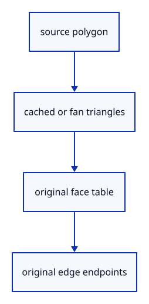

# 6.3.1 · Preserve source faces and edges

**Chapter 6 · Picking and selection · Section 6.3 · Faces, edges and original controls** · [Contents](contents.md)

**Typing: 24–48 minutes.** [Estimate](typing-load.md).

A rendered polygon may become several triangles. Retain the original face keys and boundary edges alongside display data.

## Type

Continue from [Reject results from an old view or interrupted input](43b-view.md). [Save or recover your work](recovery.md).

### 1. `src/mesh_parts.rs`

Retain source keys, triangle ownership and original edge endpoints.

Create the file and type:

```rust
--8<-- "journey/code/44-topology-01.rs"
```

### 2. `src/lib.rs`

Register the component and copied checks.

<details>
<summary>Locate the existing block</summary>

```rust
pub mod pick_view;
#[cfg(test)]
mod pick_view_tests;
```

</details>

After that block, type:

```rust
--8<-- "journey/code/44-topology-02.rs" skip=53
```

### 3. `src/mesh.rs`

Attach original topology to prepared display meshes and count its capacity.

Edit these blocks from bottom to top. Keep the surrounding lines unchanged.

<details>
<summary>Locate this block</summary>

```rust
    pub fn payload_bytes(&self) -> usize {
        self.vertices.capacity() * std::mem::size_of::<[f32; 6]>()
            + self.indices.capacity() * std::mem::size_of::<u32>()
            + self.normals.capacity() * std::mem::size_of::<[f32; 3]>()
    }

    pub fn vertices(&self) -> &[[f32; 6]] {
```

</details>

Replace it with:

```rust
    pub fn payload_bytes(&self) -> usize {
        self.vertices.capacity() * std::mem::size_of::<[f32; 6]>()
            + self.indices.capacity() * std::mem::size_of::<u32>()
            + self.normals.capacity() * std::mem::size_of::<[f32; 3]>() + self.parts.bytes()
    }

    pub fn vertices(&self) -> &[[f32; 6]] {
```

<details>
<summary>Locate this block</summary>

```rust
            [x, y, z, r, g, b]
        }).collect();
        let normals = render.vertices.iter().map(|vertex| vertex.normal).collect();
        Self::new(vertices, render.indices)?.with_normals(normals)
    }

    pub fn with_normals(mut self, normals: Vec<[f32; 3]>) -> Result<Self, &'static str> {
```

</details>

Replace it with:

```rust
            [x, y, z, r, g, b]
        }).collect();
        let normals = render.vertices.iter().map(|vertex| vertex.normal).collect();
        let parts = crate::mesh_parts::Parts::new(mesh, render.indices.len() / 3)?;
        let mut display = Self::new(vertices, render.indices)?.with_normals(normals)?;
        display.parts = parts; Ok(display)
    }

    pub fn with_normals(mut self, normals: Vec<[f32; 3]>) -> Result<Self, &'static str> {
```

<details>
<summary>Locate this block</summary>

```rust
            return Err("Vertex values must be finite");
        }
        let normals = vec![[0.0; 3]; vertices.len()];
        Ok(Self { vertices, normals, indices })
    }

    pub fn from_kernel(mesh: &session_rust::Mesh) -> Result<Self, &'static str> {
```

</details>

Replace it with:

```rust
            return Err("Vertex values must be finite");
        }
        let normals = vec![[0.0; 3]; vertices.len()];
        Ok(Self { vertices, normals, indices, parts: Default::default() })
    }

    pub fn from_kernel(mesh: &session_rust::Mesh) -> Result<Self, &'static str> {
```

<details>
<summary>Locate this block</summary>

```rust
    vertices: Vec<[f32; 6]>,
    normals: Vec<[f32; 3]>,
    indices: Vec<u32>,
}

impl Mesh {
```

</details>

Replace it with:

```rust
    vertices: Vec<[f32; 6]>,
    normals: Vec<[f32; 3]>,
    indices: Vec<u32>,
    pub parts: crate::mesh_parts::Parts,
}

impl Mesh {
```

<details>
<summary>Complete updated block reference</summary>

```rust
pub struct Mesh {
    vertices: Vec<[f32; 6]>,
    normals: Vec<[f32; 3]>,
    indices: Vec<u32>,
    pub parts: crate::mesh_parts::Parts,
}

impl Mesh {
    pub fn new(vertices: Vec<[f32; 6]>, indices: Vec<u32>) -> Result<Self, &'static str> {
        if indices.len() % 3 != 0 || indices.len() > u32::MAX as usize {
            return Err("Indices must describe complete triangles within the draw limit");
        }
        if indices.iter().any(|&index| index as usize >= vertices.len()) {
            return Err("A triangle refers to a missing vertex");
        }
        if vertices.iter().flatten().any(|value| !value.is_finite()) {
            return Err("Vertex values must be finite");
        }
        let normals = vec![[0.0; 3]; vertices.len()];
        Ok(Self { vertices, normals, indices, parts: Default::default() })
    }

    pub fn from_kernel(mesh: &session_rust::Mesh) -> Result<Self, &'static str> {
        let render = mesh.to_render();
        let vertices = render.vertices.iter().map(|vertex| {
            let [x, y, z] = vertex.position;
            let [r, g, b, _] = vertex.color;
            [x, y, z, r, g, b]
        }).collect();
        let normals = render.vertices.iter().map(|vertex| vertex.normal).collect();
        let parts = crate::mesh_parts::Parts::new(mesh, render.indices.len() / 3)?;
        let mut display = Self::new(vertices, render.indices)?.with_normals(normals)?;
        display.parts = parts; Ok(display)
    }

    pub fn with_normals(mut self, normals: Vec<[f32; 3]>) -> Result<Self, &'static str> {
        if normals.len() != self.vertices.len() { return Err("Each display vertex needs one normal"); }
        self.normals = normals.into_iter().map(crate::normals::unit).collect::<Result<_, _>>()?; Ok(self)
    }

    pub fn normals(&self) -> &[[f32; 3]] { &self.normals }

    pub fn payload_bytes(&self) -> usize {
        self.vertices.capacity() * std::mem::size_of::<[f32; 6]>()
            + self.indices.capacity() * std::mem::size_of::<u32>()
            + self.normals.capacity() * std::mem::size_of::<[f32; 3]>() + self.parts.bytes()
    }

    pub fn vertices(&self) -> &[[f32; 6]] {
        &self.vertices
    }

    pub fn indices(&self) -> &[u32] {
        &self.indices
    }
}

#[cfg(test)]
mod tests {
    use super::*;

    #[test]
    fn a_kernel_box_becomes_eight_vertices_and_twelve_triangles() {
        let source = session_rust::Mesh::create_box(0.8, 0.8, 0.8);
        let mesh = Mesh::from_kernel(&source).unwrap();
        assert_eq!(mesh.vertices().len(), 8);
        assert_eq!(mesh.indices().len(), 36);
    }

    #[test]
    fn invalid_connections_and_nonfinite_vertices_are_rejected() {
        assert!(Mesh::new(vec![[0.0; 6]; 3], vec![0, 1, 3]).is_err());
        assert!(Mesh::new(vec![[0.0; 6]; 3], vec![0, 1]).is_err());
        assert!(Mesh::new(vec![[f32::NAN; 6]; 3], vec![0, 1, 2]).is_err());
        assert!(Mesh::new(vec![[0.0; 6]; 3], vec![0, 1, 2]).is_ok());
    }
}
```

</details>

<details>
<summary>Optional patch references</summary>

Use these original edit fragments when comparing a saved checkpoint. Apply the complete blocks above.

```text
--8<-- "journey/code/44-topology-03.rs"
```

```text
--8<-- "journey/code/44-topology-04.rs"
```

```text
--8<-- "journey/code/44-topology-05.rs"
```

```text
--8<-- "journey/code/44-topology-06.rs"
```

</details>

<details>
<summary>Supplied validation fixture</summary>

Copy this supplied authoring fixture once. Continue with the browser build below; the course does not require running native tests.

### 4. `src/mesh_parts_tests.rs`

Copy original face and diagonal checks.

Copy this supplied file:

```text
--8<-- "journey/code/44-topology-07.rs"
```

</details>

### 5. `src/lib.rs`

Register the component and copied checks.

<details>
<summary>Locate the existing block</summary>

```rust
mod pick_view_tests;

pub mod mesh_parts;
```

</details>

After that block, type:

```rust
--8<-- "journey/code/44-topology-08.rs" skip=42
```

## Run and check

In your project:

```sh
cd workspace/journey
REGEN_PROTO=0 cargo build --lib --locked --target wasm32-unknown-unknown -j1
REGEN_PROTO=0 CARGO_BUILD_JOBS=1 trunk serve --port 8780
```

Open `http://127.0.0.1:8780/`. Keep an existing Trunk server running; saving rebuilds it.

Run the source polygon checks; the drawing remains unchanged.

### Recorded visual result

**Previous native render — current verification pending.**

The inherited placed boxes, source ink and ground grid remain visible. The image proves drawing; copied tests prove the new metadata.


*This recorded image predates a source or checker change. Rebuild this checkpoint before using it as current evidence; browser controls require separate acceptance.*

This reference image is shared with [5.7.8 · Inspect the ground grid through actual commands](41f-input.md). It does not demonstrate a new feature by itself.

<details>
<summary>Code explanation and diagram</summary>


source polygon → cached or fan triangles → original face table → original edge endpoints.



Is a triangulation diagonal a source edge?

No. Only the kernel’s original topology supplies editable boundary edges.

Study estimate, including typing and experiments: 0.5–1 hours.

</details>

<details>
<summary>Optional experiment</summary>

Compare cached triangulation with the fan fallback and verify the same original face key.

</details>

<details>
<summary>Check and save your work</summary>

Restore experimental edits, then run from `session_viewer`:

```sh
npm --prefix ../session_tests run course -- check 6.3.1
npm --prefix ../session_tests run course -- save 6.3.1
```

Source comparison leaves your project untouched. [Save and recovery instructions](recovery.md).

</details>

<details>
<summary>Viewer coverage and verification</summary>

This preparation retains whole-object input. Source part modes and highlights become interactive together at44l. Original source topology is distinct from display triangulation.

The existing point-picking exercise remains available. Part selection is connected at44l; browser acceptance is pending.

[Full validation scope](release.md).

To reproduce the scripted acceptance of the reference checkpoint, run from `session_viewer` with the [course bundle server](release.md#reproduce) running on port 8781:

```sh
npm --prefix ../session_tests run course -- capture 6.3.1
```

This uses the verified reference bundle; it does not check or change your typed project.

</details>
