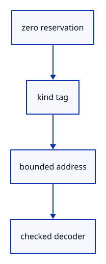

# 6.3.2 · Tag the kind of a picked part

**Chapter 6 · Picking and selection · Section 6.3 · Faces, edges and original controls** · [Contents](contents.md)

**Typing: 21–41 minutes.** [Estimate](typing-load.md).

Keep zero reserved and encode a bounded address with its face, edge or control kind. The address is local to one source table.

## Type

Continue from [Preserve source faces and edges](44-topology.md). [Save or recover your work](recovery.md).

### 1. `src/sub_id.rs`

Encode source part kinds without zero or tag collisions.

Create the file and type:

```rust
--8<-- "journey/code/44a-tags-01.rs"
```

### 2. `src/pick_sources.rs`

Define typed targets, modes and bounded source tables.

Create the file and type:

```rust
--8<-- "journey/code/44a-tags-02.rs"
```

### 3. `src/lib.rs`

Register the component and copied checks.

<details>
<summary>Locate the existing block</summary>

```rust

#[cfg(test)]
mod mesh_parts_tests;
```

</details>

After that block, type:

```rust
--8<-- "journey/code/44a-tags-03.rs" skip=36
```

<details>
<summary>Supplied validation fixture</summary>

Copy this supplied authoring fixture once. Continue with the browser build below; the course does not require running native tests.

### 4. `src/mesh_parts_tests.rs`

Copy tag boundaries and collision checks.

<details>
<summary>Locate the existing block</summary>

```text
    assert!(Parts::new(&source, 3).is_err());
}
```

</details>

After that block, append this supplied code:

```text
--8<-- "journey/code/44a-tags-04.rs" skip=49
```

</details>

## Run and check

In your project:

```sh
cd workspace/journey
REGEN_PROTO=0 cargo build --lib --locked --target wasm32-unknown-unknown -j1
REGEN_PROTO=0 CARGO_BUILD_JOBS=1 trunk serve --port 8780
```

Open `http://127.0.0.1:8780/`. Keep an existing Trunk server running; saving rebuilds it.

Run the boundary and collision checks; object picking stays available.

### Recorded visual result

**Previous native render — current verification pending.**

The inherited placed boxes, source ink and ground grid remain visible. The image proves drawing; copied tests prove the new metadata.


*This recorded image predates a source or checker change. Rebuild this checkpoint before using it as current evidence; browser controls require separate acceptance.*

This reference image is shared with [5.7.8 · Inspect the ground grid through actual commands](41f-input.md). It does not demonstrate a new feature by itself.

<details>
<summary>Code explanation and diagram</summary>


zero reservation → kind tag → bounded address → checked decoder.



Can this address replace a saved source key?

No. It addresses this display snapshot; the source table translates it back to the original key.

Study estimate, including typing and experiments: 0.5–1 hours.

</details>

<details>
<summary>Optional experiment</summary>

Roundtrip address zero and the largest supported address for every kind.

</details>

<details>
<summary>Check and save your work</summary>

Restore experimental edits, then run from `session_viewer`:

```sh
npm --prefix ../session_tests run course -- check 6.3.2
npm --prefix ../session_tests run course -- save 6.3.2
```

Source comparison leaves your project untouched. [Save and recovery instructions](recovery.md).

</details>

<details>
<summary>Viewer coverage and verification</summary>

This preparation retains whole-object input. Source part modes and highlights become interactive together at44l. Original source topology is distinct from display triangulation.

The existing point-picking exercise remains available. Part selection is connected at44l; browser acceptance is pending.

[Full validation scope](release.md).

To reproduce the scripted acceptance of the reference checkpoint, run from `session_viewer` with the [course bundle server](release.md#reproduce) running on port 8781:

```sh
npm --prefix ../session_tests run course -- capture 6.3.2
```

This uses the verified reference bundle; it does not check or change your typed project.

</details>
