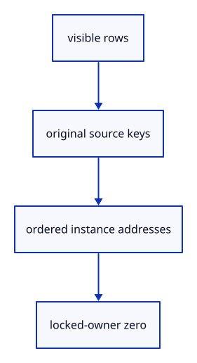

# 6.3.3 · Map visible ink back to original sources

**Chapter 6 · Picking and selection · Section 6.3 · Faces, edges and original controls** · [Contents](contents.md)

**Typing: 25–50 minutes.** [Estimate](typing-load.md).

Build source tables in the same order as the GPU instance lanes. A sampled curve segment still belongs to its original curve.

## Type

Continue from [Tag the kind of a picked part](44a-tags.md). [Save or recover your work](recovery.md).

### 1. `src/pick_sources.rs`

Build ordered face, edge, control and GPU owner streams.

<details>
<summary>Locate the existing block</summary>

```rust
    let tag = sub_id::encode(kind, rows.len())?; rows.push(target); Ok([target.owner.value(), tag])
}
```

</details>

After that block, type:

```rust
--8<-- "journey/code/44b-sources-01.rs" skip=103
```

## Run and check

In your project:

```sh
cd workspace/journey
REGEN_PROTO=0 cargo build --lib --locked --target wasm32-unknown-unknown -j1
REGEN_PROTO=0 CARGO_BUILD_JOBS=1 trunk serve --port 8780
```

Open `http://127.0.0.1:8780/`. Keep an existing Trunk server running; saving rebuilds it.

Inspect the table-building code; the inherited drawing and input still work.

### Recorded visual result

**Previous native render — current verification pending.**

The inherited placed boxes, source ink and ground grid remain visible. The image proves drawing; copied tests prove the new metadata.


*This recorded image predates a source or checker change. Rebuild this checkpoint before using it as current evidence; browser controls require separate acceptance.*

This reference image is shared with [5.7.8 · Inspect the ground grid through actual commands](41f-input.md). It does not demonstrate a new feature by itself.

<details>
<summary>Code explanation and diagram</summary>


visible rows → original source keys → ordered instance addresses → locked-owner zero.



Why keep the original polyline segment index?

Removing a zero-length display segment must not renumber the original source segments.

Study estimate, including typing and experiments: 0.5–1 hours.

</details>

<details>
<summary>Optional experiment</summary>

Trace a polyline with a repeated point and identify which original segment produces ink.

</details>

<details>
<summary>Check and save your work</summary>

Restore experimental edits, then run from `session_viewer`:

```sh
npm --prefix ../session_tests run course -- check 6.3.3
npm --prefix ../session_tests run course -- save 6.3.3
```

Source comparison leaves your project untouched. [Save and recovery instructions](recovery.md).

</details>

<details>
<summary>Viewer coverage and verification</summary>

This preparation retains whole-object input. Source part modes and highlights become interactive together at44l. Original source topology is distinct from display triangulation.

The existing point-picking exercise remains available. Part selection is connected at44l; browser acceptance is pending.

[Full validation scope](release.md).

To reproduce the scripted acceptance of the reference checkpoint, run from `session_viewer` with the [course bundle server](release.md#reproduce) running on port 8781:

```sh
npm --prefix ../session_tests run course -- capture 6.3.3
```

This uses the verified reference bundle; it does not check or change your typed project.

</details>
