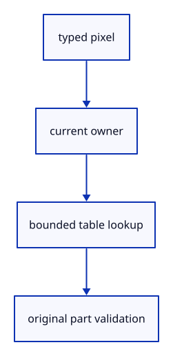

# 6.3.4 · Validate a part against the current source

**Chapter 6 · Picking and selection · Section 6.3 · Faces, edges and original controls** · [Contents](contents.md)

**Typing: 24–48 minutes.** [Estimate](typing-load.md).

Decode the kind, check the owner and confirm that the original part still exists in the current visible, unlocked scene.

## Type

Continue from [Map visible ink back to original sources](44b-sources.md). [Save or recover your work](recovery.md).

### 1. `src/selection.rs`

Check original part ownership and visibility.

Create the file and type:

```rust
--8<-- "journey/code/44c-resolve-01.rs"
```

### 2. `src/lib.rs`

Register the component and copied checks.

<details>
<summary>Locate the existing block</summary>

```rust

pub mod sub_id;
pub mod pick_sources;
```

</details>

After that block, type:

```rust
--8<-- "journey/code/44c-resolve-02.rs" skip=39
```

### 3. `src/pick_sources.rs`

Resolve typed addresses and count source table capacities.

<details>
<summary>Locate the existing block</summary>

```rust
        Ok(sources)
    }

}
```

</details>

Edit the existing block to match this code; keep unchanged lines:

```rust
--8<-- "journey/code/44c-resolve-03.rs"
```

<details>
<summary>Supplied validation fixture</summary>

Copy this supplied authoring fixture once. Continue with the browser build below; the course does not require running native tests.

### 4. `src/pick_sources_tests.rs`

Copy current-owner, wrong-kind and original segment checks.

Copy this supplied file:

```text
--8<-- "journey/code/44c-resolve-04.rs"
```

</details>

### 5. `src/lib.rs`

Register the component and copied checks.

<details>
<summary>Locate the existing block</summary>

```rust
pub mod pick_sources;

pub mod selection;
```

</details>

After that block, type:

```rust
--8<-- "journey/code/44c-resolve-05.rs" skip=42
```

## Run and check

In your project:

```sh
cd workspace/journey
REGEN_PROTO=0 cargo build --lib --locked --target wasm32-unknown-unknown -j1
REGEN_PROTO=0 CARGO_BUILD_JOBS=1 trunk serve --port 8780
```

Open `http://127.0.0.1:8780/`. Keep an existing Trunk server running; saving rebuilds it.

Run current-owner and degenerate-segment checks. Close must invalidate every old target.

### Recorded visual result

**Previous native render — current verification pending.**

The inherited placed boxes, source ink and ground grid remain visible. The image proves drawing; copied tests prove the new metadata.


*This recorded image predates a source or checker change. Rebuild this checkpoint before using it as current evidence; browser controls require separate acceptance.*

This reference image is shared with [5.7.8 · Inspect the ground grid through actual commands](41f-input.md). It does not demonstrate a new feature by itself.

<details>
<summary>Code explanation and diagram</summary>


typed pixel → current owner → bounded table lookup → original part validation.



Does a matching owner make any address valid?

No. The kind, table bounds and original face, edge or control must match too.

Study estimate, including typing and experiments: 0.5–1 hours.

</details>

<details>
<summary>Optional experiment</summary>

Try a maximal invalid segment index and a hidden control; both must be refused safely.

</details>

<details>
<summary>Check and save your work</summary>

Restore experimental edits, then run from `session_viewer`:

```sh
npm --prefix ../session_tests run course -- check 6.3.4
npm --prefix ../session_tests run course -- save 6.3.4
```

Source comparison leaves your project untouched. [Save and recovery instructions](recovery.md).

</details>

<details>
<summary>Viewer coverage and verification</summary>

This preparation retains whole-object input. Source part modes and highlights become interactive together at44l. Original source topology is distinct from display triangulation.

The existing point-picking exercise remains available. Part selection is connected at44l; browser acceptance is pending.

[Full validation scope](release.md).

To reproduce the scripted acceptance of the reference checkpoint, run from `session_viewer` with the [course bundle server](release.md#reproduce) running on port 8781:

```sh
npm --prefix ../session_tests run course -- capture 6.3.4
```

This uses the verified reference bundle; it does not check or change your typed project.

</details>
