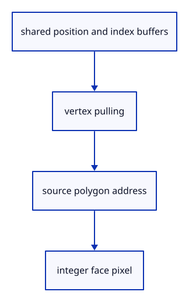

# 6.3.5 · Reuse visible geometry for face identities

**Chapter 6 · Picking and selection · Section 6.3 · Faces, edges and original controls** · [Contents](contents.md)

**Typing: 21–41 minutes.** [Estimate](typing-load.md).

Read the existing vertex and index buffers in the face shader. One per-triangle metadata value identifies the original polygon.

## Type

Continue from [Validate a part against the current source](44c-resolve.md). [Save or recover your work](recovery.md).

### 1. `src/pick_crop.wgsl`

Define the shared mode crop and original-face shader.

Create the file and type:

```wgsl
--8<-- "journey/code/44d-pulling-01.wgsl"
```

### 2. `src/face_pick.wgsl`

Define the shared mode crop and original-face shader.

Create the file and type:

```wgsl
--8<-- "journey/code/44d-pulling-02.wgsl"
```

### 3. `src/gpu_geometry.rs`

Expose existing geometry to source-face drawing without another position buffer.

<details>
<summary>Locate the existing block</summary>

```rust
use crate::mesh::Mesh;
use std::rc::Rc;
use wgpu::util::DeviceExt;

pub struct GpuGeometry {
    pub source: Rc<Mesh>,
    vertices: wgpu::Buffer,
    normals: wgpu::Buffer,
    indices: wgpu::Buffer,
    index_count: u32,
}

impl GpuGeometry {
    pub fn upload(device: &wgpu::Device, source: Rc<Mesh>) -> Self {
        let bytes: Vec<u8> = source.vertices().iter().flatten()
            .flat_map(|value| value.to_ne_bytes()).collect();
        let vertices = device.create_buffer_init(&wgpu::util::BufferInitDescriptor {
            label: Some("shared mesh vertices"), contents: &bytes,
            usage: wgpu::BufferUsages::VERTEX,
        });
        let bytes: Vec<u8> = source.normals().iter().flatten().flat_map(|value| value.to_ne_bytes()).collect();
        let normals = device.create_buffer_init(&wgpu::util::BufferInitDescriptor {
            label: Some("shared mesh normals"), contents: &bytes, usage: wgpu::BufferUsages::VERTEX,
        });
        let bytes: Vec<u8> = source.indices().iter()
            .flat_map(|index| index.to_ne_bytes()).collect();
        let indices = device.create_buffer_init(&wgpu::util::BufferInitDescriptor {
            label: Some("shared mesh indices"), contents: &bytes,
            usage: wgpu::BufferUsages::INDEX,
        });
        let index_count = source.indices().len() as u32;
        Self { source, vertices, normals, indices, index_count }
    }

    pub fn allocated_bytes(&self) -> u64 { self.vertices.size() + self.normals.size() + self.indices.size() }

    pub fn draw(&self, pass: &mut wgpu::RenderPass<'_>) {
        pass.set_vertex_buffer(0, self.vertices.slice(..));
        pass.set_vertex_buffer(1, self.normals.slice(..));
        pass.set_index_buffer(self.indices.slice(..), wgpu::IndexFormat::Uint32);
        pass.draw_indexed(0..self.index_count, 0, 0..1);
    }
}
```

</details>

Edit the existing block to match this code; keep unchanged lines:

```rust
use crate::mesh::Mesh;
use std::rc::Rc;
use wgpu::util::DeviceExt;

pub struct GpuGeometry {
    pub source: Rc<Mesh>,
    pub(crate) vertices: wgpu::Buffer,
    normals: wgpu::Buffer,
    pub(crate) indices: wgpu::Buffer,
    pub(crate) index_count: u32,
}

impl GpuGeometry {
    pub fn upload(device: &wgpu::Device, source: Rc<Mesh>) -> Self {
        let bytes: Vec<u8> = source.vertices().iter().flatten()
            .flat_map(|value| value.to_ne_bytes()).collect();
        let vertices = device.create_buffer_init(&wgpu::util::BufferInitDescriptor {
            label: Some("shared mesh vertices"), contents: &bytes,
            usage: wgpu::BufferUsages::VERTEX | wgpu::BufferUsages::STORAGE,
        });
        let bytes: Vec<u8> = source.normals().iter().flatten().flat_map(|value| value.to_ne_bytes()).collect();
        let normals = device.create_buffer_init(&wgpu::util::BufferInitDescriptor {
            label: Some("shared mesh normals"), contents: &bytes, usage: wgpu::BufferUsages::VERTEX,
        });
        let bytes: Vec<u8> = source.indices().iter()
            .flat_map(|index| index.to_ne_bytes()).collect();
        let indices = device.create_buffer_init(&wgpu::util::BufferInitDescriptor {
            label: Some("shared mesh indices"), contents: &bytes,
            usage: wgpu::BufferUsages::INDEX | wgpu::BufferUsages::STORAGE,
        });
        let index_count = source.indices().len() as u32;
        Self { source, vertices, normals, indices, index_count }
    }

    pub fn allocated_bytes(&self) -> u64 { self.vertices.size() + self.normals.size() + self.indices.size() }

    pub fn draw(&self, pass: &mut wgpu::RenderPass<'_>) {
        pass.set_vertex_buffer(0, self.vertices.slice(..));
        pass.set_vertex_buffer(1, self.normals.slice(..));
        pass.set_index_buffer(self.indices.slice(..), wgpu::IndexFormat::Uint32);
        pass.draw_indexed(0..self.index_count, 0, 0..1);
    }
}
```

<details>
<summary>Optional patch references</summary>

Use these original edit fragments when comparing a saved checkpoint. Apply the complete blocks above.

```text
--8<-- "journey/code/44d-pulling-03.rs"
```

```text
--8<-- "journey/code/44d-pulling-04.rs"
```

```text
--8<-- "journey/code/44d-pulling-05.rs"
```

</details>

### 4. `src/gpu_mesh.rs`

Expose existing geometry to source-face drawing without another position buffer.

<details>
<summary>Locate the existing block</summary>

```rust
        writes
    }

    pub fn draw(&self, pass: &mut wgpu::RenderPass<'_>) {
        pass.set_bind_group(1, &self.model_group, &[]);
        self.geometry.draw(pass);
```

</details>

Edit the existing block to match this code; keep unchanged lines:

```rust
--8<-- "journey/code/44d-pulling-06.rs"
```

### 5. `src/triangle.wgsl`

Expose existing geometry to source-face drawing without another position buffer.

<details>
<summary>Locate the existing block</summary>

```wgsl
struct ViewSettings { transform: mat4x4<f32>, display: vec4<f32>, }
@group(0) @binding(0) var<uniform> view: ViewSettings;
struct ObjectSettings {
    model: mat4x4<f32>,
    selection: vec4<u32>,
    normal_matrix: mat4x4<f32>,
}
@group(1) @binding(0) var<uniform> object: ObjectSettings;

struct VertexOutput {
    @builtin(position) position: vec4<f32>,
    @location(0) colour: vec3<f32>,
    @location(1) world: vec3<f32>,
    @location(2) normal: vec3<f32>,
}

@vertex
fn vertex(@location(0) position: vec3<f32>, @location(1) colour: vec3<f32>, @location(2) normal: vec3<f32>) -> VertexOutput {
    var output: VertexOutput;
    let world = object.model * vec4<f32>(position, 1.0);
    output.position = view.transform * world;
    output.colour = select(colour, vec3<f32>(1.0, 0.75, 0.05), object.selection.x != 0u);
    output.world = world.xyz;
    output.normal = (object.normal_matrix * vec4<f32>(normal, 0.0)).xyz;
    return output;
}

@fragment
fn fragment(input: VertexOutput, @builtin(front_facing) front: bool) -> @location(0) vec4<f32> {
    // Derivatives require neighbouring fragments; calculate the sharp face direction before choosing a potentially smooth interpolated source direction.
    let derivative = cross(dpdx(input.world), dpdy(input.world));
    // Screen derivatives ignore vertex order; front-facing restores the original face orientation for reversed winding and world-normal inspection.
    let face = select(derivative, -derivative, front);
    let direction = select(face, input.normal, dot(input.normal, input.normal) > 0.0);
    let scale = max(max(abs(direction.x), abs(direction.y)), abs(direction.z));
    let bounded = direction / max(scale, 1e-30);
    let normal = bounded / max(length(bounded), 1e-30);
    if view.display.x > 0.5 { return vec4<f32>(normal * 0.5 + vec3<f32>(0.5), 1.0); }
    let light = normalize(vec3<f32>(0.4, -0.6, 1.0));
    // abs lights both sides of an open face; 0.3 keeps unlit faces readable.
    let brightness = 0.3 + 0.7 * abs(dot(normal, light));
    return vec4<f32>(input.colour * brightness, 1.0);
}
```

</details>

Edit the existing block to match this code; keep unchanged lines:

```wgsl
struct ViewSettings { transform: mat4x4<f32>, display: vec4<f32>, }
@group(0) @binding(0) var<uniform> view: ViewSettings;
struct ObjectSettings {
    model: mat4x4<f32>,
    selection: vec4<u32>,
    normal_matrix: mat4x4<f32>,
}
@group(1) @binding(0) var<uniform> object: ObjectSettings;

struct VertexOutput {
    @builtin(position) position: vec4<f32>,
    @location(0) colour: vec3<f32>,
    @location(1) world: vec3<f32>,
    @location(2) normal: vec3<f32>,
}

fn geometry(position: vec3<f32>, colour: vec3<f32>, normal: vec3<f32>) -> VertexOutput {
    var output: VertexOutput;
    let world = object.model * vec4<f32>(position, 1.0);
    output.position = view.transform * world;
    output.colour = select(colour, vec3<f32>(1.0, 0.75, 0.05), object.selection.x != 0u);
    output.world = world.xyz;
    output.normal = (object.normal_matrix * vec4<f32>(normal, 0.0)).xyz;
    return output;
}

@fragment
fn fragment(input: VertexOutput, @builtin(front_facing) front: bool) -> @location(0) vec4<f32> {
    // Derivatives require neighbouring fragments; calculate the sharp face direction before choosing a potentially smooth interpolated source direction.
    let derivative = cross(dpdx(input.world), dpdy(input.world));
    // Screen derivatives ignore vertex order; front-facing restores the original face orientation for reversed winding and world-normal inspection.
    let face = select(derivative, -derivative, front);
    let direction = select(face, input.normal, dot(input.normal, input.normal) > 0.0);
    let scale = max(max(abs(direction.x), abs(direction.y)), abs(direction.z));
    let bounded = direction / max(scale, 1e-30);
    let normal = bounded / max(length(bounded), 1e-30);
    if view.display.x > 0.5 { return vec4<f32>(normal * 0.5 + vec3<f32>(0.5), 1.0); }
    let light = normalize(vec3<f32>(0.4, -0.6, 1.0));
    // abs lights both sides of an open face; 0.3 keeps unlit faces readable.
    let brightness = 0.3 + 0.7 * abs(dot(normal, light));
    return vec4<f32>(input.colour * brightness, 1.0);
}

@vertex
fn vertex(@location(0) position: vec3<f32>, @location(1) colour: vec3<f32>, @location(2) normal: vec3<f32>) -> VertexOutput { return geometry(position, colour, normal); }
```

<details>
<summary>Optional patch references</summary>

Use these original edit fragments when comparing a saved checkpoint. Apply the complete blocks above.

```text
--8<-- "journey/code/44d-pulling-07.wgsl"
```

```text
--8<-- "journey/code/44d-pulling-08.wgsl"
```

</details>

## Run and check

In your project:

```sh
cd workspace/journey
REGEN_PROTO=0 cargo build --lib --locked --target wasm32-unknown-unknown -j1
REGEN_PROTO=0 CARGO_BUILD_JOBS=1 trunk serve --port 8780
```

Open `http://127.0.0.1:8780/`. Keep an existing Trunk server running; saving rebuilds it.

The inherited mesh keeps the same shape and primary geometry allocation.

### Recorded visual result

**Previous native render — current verification pending.**

The inherited placed boxes, source ink and ground grid remain visible. The image proves drawing; copied tests prove the new metadata.


*This recorded image predates a source or checker change. Rebuild this checkpoint before using it as current evidence; browser controls require separate acceptance.*

This reference image is shared with [5.7.8 · Inspect the ground grid through actual commands](41f-input.md). It does not demonstrate a new feature by itself.

<details>
<summary>Code explanation and diagram</summary>


shared position and index buffers → vertex pulling → source polygon address → integer face pixel.



Why is the face shader non-indexed?

Each invocation can use its triangle position to read both the original vertex index and that triangle’s source face address.

Study estimate, including typing and experiments: 0.5–1 hours.

</details>

<details>
<summary>Optional experiment</summary>

Check that the shader uses the shared placement helper before applying the cursor crop.

</details>

<details>
<summary>Check and save your work</summary>

Restore experimental edits, then run from `session_viewer`:

```sh
npm --prefix ../session_tests run course -- check 6.3.5
npm --prefix ../session_tests run course -- save 6.3.5
```

Source comparison leaves your project untouched. [Save and recovery instructions](recovery.md).

</details>

<details>
<summary>Viewer coverage and verification</summary>

This preparation retains whole-object input. Source part modes and highlights become interactive together at44l. Original source topology is distinct from display triangulation.

The existing point-picking exercise remains available. Part selection is connected at44l; browser acceptance is pending.

[Full validation scope](release.md).

To reproduce the scripted acceptance of the reference checkpoint, run from `session_viewer` with the [course bundle server](release.md#reproduce) running on port 8781:

```sh
npm --prefix ../session_tests run course -- capture 6.3.5
```

This uses the verified reference bundle; it does not check or change your typed project.

</details>
