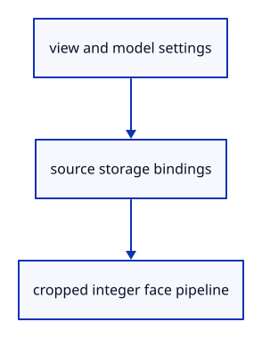

# 6.3.6 · Create the integer source-face pipeline

**Chapter 6 · Picking and selection · Section 6.3 · Faces, edges and original controls** · [Contents](contents.md)

**Typing: 23–46 minutes.** [Estimate](typing-load.md).

Bind existing geometry, per-triangle source addresses and a small face-base uniform. Read-only depth keeps the visible surface authoritative.

## Type

Continue from [Reuse visible geometry for face identities](44d-pulling.md). [Save or recover your work](recovery.md).

### 1. `src/face_pick.rs`

Create the compatible source-face layout and pipeline.

Create the file and type:

```rust
--8<-- "journey/code/44e-pipeline-01.rs"
```

### 2. `src/lib.rs`

Register the component and copied checks.

<details>
<summary>Locate the existing block</summary>

```rust

#[cfg(test)]
mod pick_sources_tests;
```

</details>

After that block, type:

```rust
--8<-- "journey/code/44e-pipeline-02.rs" skip=38
```

## Run and check

In your project:

```sh
cd workspace/journey
REGEN_PROTO=0 cargo build --lib --locked --target wasm32-unknown-unknown -j1
REGEN_PROTO=0 CARGO_BUILD_JOBS=1 trunk serve --port 8780
```

Open `http://127.0.0.1:8780/`. Keep an existing Trunk server running; saving rebuilds it.

The face pipeline validates on the drawing device; object input remains unchanged.

### Recorded visual result

**Previous native render — current verification pending.**

The inherited placed boxes, source ink and ground grid remain visible. The image proves drawing; copied tests prove the new metadata.


*This recorded image predates a source or checker change. Rebuild this checkpoint before using it as current evidence; browser controls require separate acceptance.*

This reference image is shared with [5.7.8 · Inspect the ground grid through actual commands](41f-input.md). It does not demonstrate a new feature by itself.

<details>
<summary>Code explanation and diagram</summary>


view and model settings → source storage bindings → cropped integer face pipeline.



Why use read-only depth for face IDs?

The surface pass establishes occlusion first; source-face IDs must match that depth without moving the visible surface.

Study estimate, including typing and experiments: 0.5–1 hours.

</details>

<details>
<summary>Optional experiment</summary>

Find the four storage-group bindings and identify which buffers contain new data.

</details>

<details>
<summary>Check and save your work</summary>

Restore experimental edits, then run from `session_viewer`:

```sh
npm --prefix ../session_tests run course -- check 6.3.6
npm --prefix ../session_tests run course -- save 6.3.6
```

Source comparison leaves your project untouched. [Save and recovery instructions](recovery.md).

</details>

<details>
<summary>Viewer coverage and verification</summary>

This preparation retains whole-object input. Source part modes and highlights become interactive together at44l. Original source topology is distinct from display triangulation.

The existing point-picking exercise remains available. Part selection is connected at44l; browser acceptance is pending.

[Full validation scope](release.md).

To reproduce the scripted acceptance of the reference checkpoint, run from `session_viewer` with the [course bundle server](release.md#reproduce) running on port 8781:

```sh
npm --prefix ../session_tests run course -- capture 6.3.6
```

This uses the verified reference bundle; it does not check or change your typed project.

</details>
