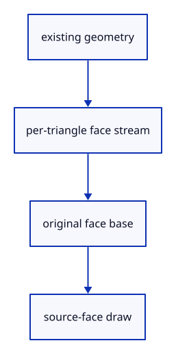

# 6.3.7 · Upload only original-face metadata

**Chapter 6 · Picking and selection · Section 6.3 · Faces, edges and original controls** · [Contents](contents.md)

**Typing: 24–48 minutes.** [Estimate](typing-load.md).

Keep one small address stream per mesh. Draw source-face IDs from shared positions and indices, then release metadata on a changed scene.

## Type

Continue from [Create the integer source-face pipeline](44e-pipeline.md). [Save or recover your work](recovery.md).

### 1. `src/face_pick.rs`

Upload bounded face metadata and draw from existing geometry.

<details>
<summary>Locate the existing block</summary>

```rust
        Self { pipeline, rows: Vec::new() }
    }

}
```

</details>

Edit the existing block to match this code; keep unchanged lines:

```rust
--8<-- "journey/code/44f-metadata-01.rs"
```

## Run and check

In your project:

```sh
cd workspace/journey
REGEN_PROTO=0 cargo build --lib --locked --target wasm32-unknown-unknown -j1
REGEN_PROTO=0 CARGO_BUILD_JOBS=1 trunk serve --port 8780
```

Open `http://127.0.0.1:8780/`. Keep an existing Trunk server running; saving rebuilds it.

The copied source-key checks remain green; GPU face integration follows next.

### Recorded visual result

**Previous native render — current verification pending.**

The inherited placed boxes, source ink and ground grid remain visible. The image proves drawing; copied tests prove the new metadata.


*This recorded image predates a source or checker change. Rebuild this checkpoint before using it as current evidence; browser controls require separate acceptance.*

This reference image is shared with [5.7.8 · Inspect the ground grid through actual commands](41f-input.md). It does not demonstrate a new feature by itself.

<details>
<summary>Code explanation and diagram</summary>


existing geometry → per-triangle face stream → original face base → source-face draw.



Does each face need another mesh upload?

No. The face-ID pass shares existing geometry and adds only triangle addresses plus the base uniform.

Study estimate, including typing and experiments: 0.5–1 hours.

</details>

<details>
<summary>Optional experiment</summary>

Count metadata bytes for a quad made from two triangles: eight address bytes plus sixteen uniform bytes.

</details>

<details>
<summary>Check and save your work</summary>

Restore experimental edits, then run from `session_viewer`:

```sh
npm --prefix ../session_tests run course -- check 6.3.7
npm --prefix ../session_tests run course -- save 6.3.7
```

Source comparison leaves your project untouched. [Save and recovery instructions](recovery.md).

</details>

<details>
<summary>Viewer coverage and verification</summary>

This preparation retains whole-object input. Source part modes and highlights become interactive together at44l. Original source topology is distinct from display triangulation.

The existing point-picking exercise remains available. Part selection is connected at44l; browser acceptance is pending.

[Full validation scope](release.md).

To reproduce the scripted acceptance of the reference checkpoint, run from `session_viewer` with the [course bundle server](release.md#reproduce) running on port 8781:

```sh
npm --prefix ../session_tests run course -- capture 6.3.7
```

This uses the verified reference bundle; it does not check or change your typed project.

</details>
