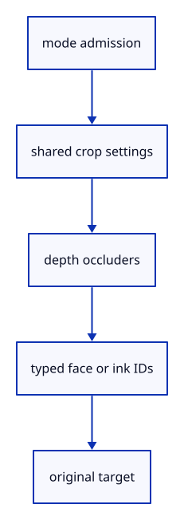

# 6.3.9 · Pick source parts with visible coverage

**Chapter 6 · Picking and selection · Section 6.3 · Faces, edges and original controls** · [Contents](contents.md)

**Typing: 25–49 minutes.** [Estimate](typing-load.md).

Carry the selected mode through crop settings and filter ink by kind. Draw original face IDs lazily and retain surface occlusion in every mode.

## Type

Continue from [Draw original boundary edges consistently](44g-edge-ink.md). [Save or recover your work](recovery.md).

### 1. `src/pick_gpu.rs`

Use mode-aware coverage and compatible eighty-byte crop settings.

<details>
<summary>Locate the existing block</summary>

```rust
use crate::{gpu_mesh::GpuMesh, pick_window::Window, stroke_gpu::Lane};
use std::sync::{Arc, atomic::{AtomicBool, AtomicU8, Ordering}};

#[derive(Clone, Copy)]
pub struct Request { pub window: Window, pub transform: [f32; 16], pub density: f32 }

pub(crate) struct Queued { request: Request, ticket: crate::pick_gate::Ticket, view: crate::pick_view::View }
struct Flight { ready: Arc<AtomicU8>, ticket: crate::pick_gate::Ticket, view: crate::pick_view::View }
pub enum Reply { Hit(Option<[u32; 2]>), Stale }


pub struct Picker {
    pipeline: wgpu::RenderPipeline,
    view: wgpu::Buffer,
    view_group: wgpu::BindGroup,
    crop: wgpu::Buffer,
    crop_group: wgpu::BindGroup,
    image: Option<crate::pick_image::Image>,
    active: Option<Flight>,
    pending: Option<Queued>,
    alive: Arc<AtomicBool>,
    gate: crate::pick_gate::Gate,
    pub submitted: u64,
    pub coalesced: u64,
}

impl Drop for Picker { fn drop(&mut self) { self.alive.store(false, Ordering::Release); self.gate.close(); } }

impl Picker {
    pub fn new(device: &wgpu::Device, view_layout: &wgpu::BindGroupLayout, model_layout: &wgpu::BindGroupLayout) -> Self {
        let crop_layout = crate::gpu_layout::uniform(device, 64);
        let pipeline = crate::pick_pipeline::mesh(device, view_layout, model_layout, &crop_layout);
        let buffer = |size| device.create_buffer(&wgpu::BufferDescriptor { label: Some("pick view"), size,
            usage: wgpu::BufferUsages::UNIFORM | wgpu::BufferUsages::COPY_DST, mapped_at_creation: false });
        let view = buffer(80); let crop = buffer(64);
        let view_group = crate::gpu_layout::group(device, view_layout, &view);
        let crop_group = crate::gpu_layout::group(device, &crop_layout, &crop);
        Self { pipeline, view, view_group, crop, crop_group, image: None, active: None, pending: None,
            alive: Arc::new(AtomicBool::new(true)), gate: Default::default(), submitted: 0, coalesced: 0 }
    }

    pub fn queue(&mut self, request: Request) -> Result<(), &'static str> {
        let view = crate::pick_view::View::new(request.transform, request.window.full, request.density)?;
        let ticket = self.gate.issue()?;
        if self.pending.replace(Queued { request, ticket, view }).is_some() { self.coalesced += 1; }
        Ok(())
    }

    pub fn queued(&self) -> bool { self.pending.is_some() }

    pub fn cancel(&mut self) {
        self.gate.invalidate(); self.pending = None;
        let mapped = self.active.take().is_some_and(|flight| flight.ready.load(Ordering::Acquire) <= 1);
        if let Some(image) = self.image.take() { if mapped { image.readback.unmap(); } }
    }

    pub(crate) fn next(&mut self, view: crate::pick_view::View) -> Option<Queued> {
        if self.active.is_some() { return None; }
        let queued = self.pending.take()?;
        if queued.view == view { Some(queued) } else { self.gate.invalidate(); None }
    }


    pub(crate) fn submit(&mut self, device: &wgpu::Device, queue: &wgpu::Queue, queued: Queued, meshes: &[GpuMesh], ink: &[&Lane]) {
        assert!(self.active.is_none(), "Only one pick may be in flight");
        let request = queued.request; let window = request.window;
        if self.image.as_ref().is_none_or(|image| image.window.draw[2..] != window.draw[2..] || image.readback.size() != window.bytes()) {
            self.image = Some(crate::pick_image::Image::new(device, window));
        }
        let image = self.image.as_mut().unwrap(); image.window = window;
        let mut bytes: Vec<u8> = request.transform.iter().flat_map(|n| n.to_ne_bytes()).collect(); bytes.resize(80, 0);
        queue.write_buffer(&self.view, 0, &bytes);
        let bytes: Vec<u8> = window.crop().iter().flat_map(|n| n.to_ne_bytes()).collect(); queue.write_buffer(&self.crop, 0, &bytes);
        for lane in ink { lane.view(queue, &request.transform, window.full, request.density); }
        queue.submit([crate::pick_encode::draw(device, image, window, &self.pipeline,
            &self.view_group, &self.crop_group, meshes, ink)]);
        let ready = Arc::new(AtomicU8::new(0)); self.active = Some(Flight { ready: Arc::clone(&ready), ticket: queued.ticket, view: queued.view }); let alive = Arc::clone(&self.alive);
        // Mapping finishes asynchronously; the callback publishes readiness, and the owner reads the bytes without blocking browser input.
        image.readback.slice(..).map_async(wgpu::MapMode::Read, move |result| {
            ready.store(if result.is_ok() { 1 } else { 2 }, Ordering::Release);
            if alive.load(Ordering::Acquire) {
                #[cfg(target_arch = "wasm32")] crate::browser_pick::wake();
            }
        });
        self.submitted += 1;
    }

    pub fn take(&mut self, view: crate::pick_view::View) -> Option<Result<Reply, &'static str>> {
        let status = self.active.as_ref()?.ready.load(Ordering::Acquire);
        if status == 0 { return None; }
        let flight = self.active.take().unwrap();
        let current = self.gate.accept(flight.ticket) && flight.view == view;
        let image = self.image.as_ref().unwrap();
        if status != 1 { return Some(if current { Err("Cannot read GPU pick image") } else { Ok(Reply::Stale) }); }
        let bytes = image.readback.slice(..).get_mapped_range();
        let result = if current { image.window.closest(&bytes).map(Reply::Hit) } else { Ok(Reply::Stale) };
        drop(bytes); image.readback.unmap(); Some(result)
    }

    pub fn usage(&self) -> [u64; 3] {
        [u64::from(self.active.is_some()), u64::from(self.pending.is_some()), self.image.as_ref().map_or(0, |image|
            image.readback.size() + u64::from(image.window.draw[2]) * u64::from(image.window.draw[3]) * 12) + 144]
    }
}
```

</details>

Edit the existing block to match this code; keep unchanged lines:

```rust
use crate::{gpu_mesh::GpuMesh, pick_window::Window, stroke_gpu::Lane};
use std::sync::{Arc, atomic::{AtomicBool, AtomicU8, Ordering}};

#[derive(Clone, Copy)]
pub struct Request { pub window: Window, pub transform: [f32; 16], pub density: f32, pub mode: crate::pick_sources::Mode }

pub(crate) struct Queued { request: Request, ticket: crate::pick_gate::Ticket, view: crate::pick_view::View }
struct Flight { ready: Arc<AtomicU8>, ticket: crate::pick_gate::Ticket, view: crate::pick_view::View }
pub enum Reply { Hit(Option<[u32; 2]>), Stale }


pub struct Picker {
    pipeline: wgpu::RenderPipeline,
    view: wgpu::Buffer,
    view_group: wgpu::BindGroup,
    crop: wgpu::Buffer,
    crop_group: wgpu::BindGroup,
    image: Option<crate::pick_image::Image>,
    active: Option<Flight>,
    pending: Option<Queued>,
    alive: Arc<AtomicBool>,
    gate: crate::pick_gate::Gate,
    pub submitted: u64,
    pub coalesced: u64,
}

impl Drop for Picker { fn drop(&mut self) { self.alive.store(false, Ordering::Release); self.gate.close(); } }

impl Picker {
    pub fn new(device: &wgpu::Device, view_layout: &wgpu::BindGroupLayout, model_layout: &wgpu::BindGroupLayout) -> Self {
        let crop_layout = crate::gpu_layout::uniform(device, 80);
        let pipeline = crate::pick_pipeline::mesh(device, view_layout, model_layout, &crop_layout);
        let buffer = |size| device.create_buffer(&wgpu::BufferDescriptor { label: Some("pick view"), size,
            usage: wgpu::BufferUsages::UNIFORM | wgpu::BufferUsages::COPY_DST, mapped_at_creation: false });
        let view = buffer(80); let crop = buffer(80);
        let view_group = crate::gpu_layout::group(device, view_layout, &view);
        let crop_group = crate::gpu_layout::group(device, &crop_layout, &crop);
        Self { pipeline, view, view_group, crop, crop_group, image: None, active: None, pending: None,
            alive: Arc::new(AtomicBool::new(true)), gate: Default::default(), submitted: 0, coalesced: 0 }
    }

    pub fn queue(&mut self, request: Request) -> Result<(), &'static str> {
        let view = crate::pick_view::View::new(request.transform, request.window.full, request.density)?;
        let ticket = self.gate.issue()?;
        if self.pending.replace(Queued { request, ticket, view }).is_some() { self.coalesced += 1; }
        Ok(())
    }

    pub fn queued(&self) -> bool { self.pending.is_some() }

    pub fn cancel(&mut self) {
        self.gate.invalidate(); self.pending = None;
        let mapped = self.active.take().is_some_and(|flight| flight.ready.load(Ordering::Acquire) <= 1);
        if let Some(image) = self.image.take() { if mapped { image.readback.unmap(); } }
    }

    pub(crate) fn next(&mut self, view: crate::pick_view::View) -> Option<Queued> {
        if self.active.is_some() { return None; }
        let queued = self.pending.take()?;
        if queued.view == view { Some(queued) } else { self.gate.invalidate(); None }
    }


    pub(crate) fn submit(&mut self, device: &wgpu::Device, queue: &wgpu::Queue, queued: Queued, meshes: &[GpuMesh], ink: &[&Lane], faces: &crate::face_pick::Faces) {
        assert!(self.active.is_none(), "Only one pick may be in flight");
        let request = queued.request; let window = request.window;
        if self.image.as_ref().is_none_or(|image| image.window.draw[2..] != window.draw[2..] || image.readback.size() != window.bytes()) {
            self.image = Some(crate::pick_image::Image::new(device, window));
        }
        let image = self.image.as_mut().unwrap(); image.window = window;
        let mut bytes: Vec<u8> = request.transform.iter().flat_map(|n| n.to_ne_bytes()).collect(); bytes.resize(80, 0);
        queue.write_buffer(&self.view, 0, &bytes);
        let mut bytes: Vec<u8> = window.crop().iter().flat_map(|n| n.to_ne_bytes()).collect();
        bytes.extend((request.mode as u32).to_ne_bytes()); bytes.resize(80, 0); queue.write_buffer(&self.crop, 0, &bytes);
        for lane in ink { lane.view(queue, &request.transform, window.full, request.density); }
        queue.submit([crate::pick_encode::draw(device, image, window, &self.pipeline,
            &self.view_group, &self.crop_group, meshes, ink, faces, request.mode)]);
        let ready = Arc::new(AtomicU8::new(0)); self.active = Some(Flight { ready: Arc::clone(&ready), ticket: queued.ticket, view: queued.view }); let alive = Arc::clone(&self.alive);
        // Mapping finishes asynchronously; the callback publishes readiness, and the owner reads the bytes without blocking browser input.
        image.readback.slice(..).map_async(wgpu::MapMode::Read, move |result| {
            ready.store(if result.is_ok() { 1 } else { 2 }, Ordering::Release);
            if alive.load(Ordering::Acquire) {
                #[cfg(target_arch = "wasm32")] crate::browser_pick::wake();
            }
        });
        self.submitted += 1;
    }

    pub fn take(&mut self, view: crate::pick_view::View) -> Option<Result<Reply, &'static str>> {
        let status = self.active.as_ref()?.ready.load(Ordering::Acquire);
        if status == 0 { return None; }
        let flight = self.active.take().unwrap();
        let current = self.gate.accept(flight.ticket) && flight.view == view;
        let image = self.image.as_ref().unwrap();
        if status != 1 { return Some(if current { Err("Cannot read GPU pick image") } else { Ok(Reply::Stale) }); }
        let bytes = image.readback.slice(..).get_mapped_range();
        let result = if current { image.window.closest(&bytes).map(Reply::Hit) } else { Ok(Reply::Stale) };
        drop(bytes); image.readback.unmap(); Some(result)
    }

    pub fn usage(&self) -> [u64; 3] {
        [u64::from(self.active.is_some()), u64::from(self.pending.is_some()), self.image.as_ref().map_or(0, |image|
            image.readback.size() + u64::from(image.window.draw[2]) * u64::from(image.window.draw[3]) * 12) + 160]
    }
}
```

<details>
<summary>Optional patch references</summary>

Use these original edit fragments when comparing a saved checkpoint. Apply the complete blocks above.

```text
--8<-- "journey/code/44h-mode-gpu-01.rs"
```

```text
--8<-- "journey/code/44h-mode-gpu-02.rs"
```

```text
--8<-- "journey/code/44h-mode-gpu-03.rs"
```

```text
--8<-- "journey/code/44h-mode-gpu-04.rs"
```

```text
--8<-- "journey/code/44h-mode-gpu-05.rs"
```

</details>

### 2. `src/pick_encode.rs`

Use mode-aware coverage and compatible eighty-byte crop settings.

<details>
<summary>Locate the existing block</summary>

```rust
use crate::{gpu_mesh::GpuMesh, pick_image::Image, pick_window::Window, stroke_gpu::Lane};

pub(crate) fn draw(device: &wgpu::Device, image: &Image, window: Window, pipeline: &wgpu::RenderPipeline,
    view_group: &wgpu::BindGroup, crop_group: &wgpu::BindGroup, meshes: &[GpuMesh], ink: &[&Lane]) -> wgpu::CommandBuffer {
        let mut encoder = device.create_command_encoder(&Default::default());
        {
            let mut pass = encoder.begin_render_pass(&wgpu::RenderPassDescriptor { label: Some("IDs"),
                color_attachments: &[Some(wgpu::RenderPassColorAttachment { view: &image.colour, depth_slice: None, resolve_target: None,
                    ops: wgpu::Operations { load: wgpu::LoadOp::Clear(wgpu::Color::TRANSPARENT), store: wgpu::StoreOp::Store } })],
                depth_stencil_attachment: Some(wgpu::RenderPassDepthStencilAttachment { view: &image.depth,
                    depth_ops: Some(wgpu::Operations { load: wgpu::LoadOp::Clear(1.0), store: wgpu::StoreOp::Store }), stencil_ops: None }), ..Default::default() });
            pass.set_pipeline(pipeline); pass.set_bind_group(0, view_group, &[]); pass.set_bind_group(2, crop_group, &[]);
            for mesh in meshes { mesh.draw(&mut pass); }
            for lane in ink { lane.pick(&mut pass, crop_group); }
        }
        // The surrounding halo supports rasterization; only the smaller cursor window is copied back for hit testing.
        encoder.copy_texture_to_buffer(wgpu::TexelCopyTextureInfo { texture: &image.texture, mip_level: 0,
            origin: wgpu::Origin3d { x: window.copy[0] - window.draw[0], y: window.copy[1] - window.draw[1], z: 0 }, aspect: wgpu::TextureAspect::All },
            wgpu::TexelCopyBufferInfo { buffer: &image.readback, layout: wgpu::TexelCopyBufferLayout { offset: 0,
                bytes_per_row: Some(window.row_bytes()), rows_per_image: Some(window.copy[3]) } },
            wgpu::Extent3d { width: window.copy[2], height: window.copy[3], depth_or_array_layers: 1 });
        encoder.finish()
}
```

</details>

Edit the existing block to match this code; keep unchanged lines:

```rust
use crate::{gpu_mesh::GpuMesh, pick_image::Image, pick_window::Window, stroke_gpu::Lane};

pub(crate) fn draw(device: &wgpu::Device, image: &Image, window: Window, pipeline: &wgpu::RenderPipeline,
    view_group: &wgpu::BindGroup, crop_group: &wgpu::BindGroup, meshes: &[GpuMesh], ink: &[&Lane], faces: &crate::face_pick::Faces, mode: crate::pick_sources::Mode) -> wgpu::CommandBuffer {
        let mut encoder = device.create_command_encoder(&Default::default());
        {
            let mut pass = encoder.begin_render_pass(&wgpu::RenderPassDescriptor { label: Some("IDs"),
                color_attachments: &[Some(wgpu::RenderPassColorAttachment { view: &image.colour, depth_slice: None, resolve_target: None,
                    ops: wgpu::Operations { load: wgpu::LoadOp::Clear(wgpu::Color::TRANSPARENT), store: wgpu::StoreOp::Store } })],
                depth_stencil_attachment: Some(wgpu::RenderPassDepthStencilAttachment { view: &image.depth,
                    depth_ops: Some(wgpu::Operations { load: wgpu::LoadOp::Clear(1.0), store: wgpu::StoreOp::Store }), stencil_ops: None }), ..Default::default() });
            pass.set_pipeline(pipeline); pass.set_bind_group(0, view_group, &[]); pass.set_bind_group(2, crop_group, &[]);
            for mesh in meshes { mesh.draw(&mut pass); }
            if mode == crate::pick_sources::Mode::Face { faces.draw(&mut pass, meshes, view_group, crop_group); }
            for lane in ink { lane.pick(&mut pass, crop_group); }
        }
        // The surrounding halo supports rasterization; only the smaller cursor window is copied back for hit testing.
        encoder.copy_texture_to_buffer(wgpu::TexelCopyTextureInfo { texture: &image.texture, mip_level: 0,
            origin: wgpu::Origin3d { x: window.copy[0] - window.draw[0], y: window.copy[1] - window.draw[1], z: 0 }, aspect: wgpu::TextureAspect::All },
            wgpu::TexelCopyBufferInfo { buffer: &image.readback, layout: wgpu::TexelCopyBufferLayout { offset: 0,
                bytes_per_row: Some(window.row_bytes()), rows_per_image: Some(window.copy[3]) } },
            wgpu::Extent3d { width: window.copy[2], height: window.copy[3], depth_or_array_layers: 1 });
        encoder.finish()
}
```

<details>
<summary>Optional patch references</summary>

Use these original edit fragments when comparing a saved checkpoint. Apply the complete blocks above.

```text
--8<-- "journey/code/44h-mode-gpu-06.rs"
```

```text
--8<-- "journey/code/44h-mode-gpu-07.rs"
```

</details>

### 3. `src/pick_pipeline.rs`

Use mode-aware coverage and compatible eighty-byte crop settings.

<details>
<summary>Locate the existing block</summary>

```rust
        let layout = device.create_pipeline_layout(&wgpu::PipelineLayoutDescriptor { label: Some("mesh IDs"),
            bind_group_layouts: &[Some(view_layout), Some(model_layout), Some(crop_layout)], immediate_size: 0 });
        let shader = device.create_shader_module(wgpu::ShaderModuleDescriptor { label: Some("mesh IDs"),
            source: wgpu::ShaderSource::Wgsl(concat!(include_str!("triangle.wgsl"), "\n", include_str!("triangle_pick.wgsl")).into()) });
        // An integer attachment stores exact owner IDs; opaque depth rejects hidden faces before any pixel is read back.
        device.create_render_pipeline(&wgpu::RenderPipelineDescriptor {
            label: Some("mesh IDs"), layout: Some(&layout),
```

</details>

Edit the existing block to match this code; keep unchanged lines:

```rust
--8<-- "journey/code/44h-mode-gpu-08.rs"
```

### 4. `src/stroke_gpu.rs`

Use mode-aware coverage and compatible eighty-byte crop settings.

<details>
<summary>Locate the existing block</summary>

```rust
        stride: u64, vertices_per_instance: u32, attributes: &[wgpu::VertexAttribute], depth: wgpu::DepthStencilState,
    ) -> Self {
        let view_layout = crate::gpu_layout::uniform(device, 80);
        let crop_layout = crate::gpu_layout::uniform(device, 64);
        let layout = device.create_pipeline_layout(&wgpu::PipelineLayoutDescriptor {
            label: Some("ink settings"), bind_group_layouts: &[Some(&view_layout)], immediate_size: 0 });
        let pick_layout = device.create_pipeline_layout(&wgpu::PipelineLayoutDescriptor {
            label: Some("ink pick settings"), bind_group_layouts: &[Some(&view_layout), Some(&crop_layout)], immediate_size: 0 });
        let pick_source = match stride { 44 => include_str!("stroke_pick.wgsl"), 72 => include_str!("chain_pick.wgsl"), 32 => include_str!("marker_pick.wgsl"), _ => unreachable!() };
        let pick_shader = device.create_shader_module(wgpu::ShaderModuleDescriptor { label: Some("ink IDs"),
            source: wgpu::ShaderSource::Wgsl(format!("{source}\n{pick_source}").into()) });
        let shader = device.create_shader_module(wgpu::ShaderModuleDescriptor {
            label: Some("stroke"), source: wgpu::ShaderSource::Wgsl(source.into()),
        });
```

</details>

Edit the existing block to match this code; keep unchanged lines:

```rust
--8<-- "journey/code/44h-mode-gpu-09.rs"
```

### 5. `src/triangle_pick.wgsl`

Use mode-aware coverage and compatible eighty-byte crop settings.

<details>
<summary>Locate the existing block</summary>

```wgsl
@group(2) @binding(0) var<uniform> crop: mat4x4<f32>;
@vertex
fn pick_vertex(@location(0) position: vec3<f32>, @location(1) colour: vec3<f32>, @location(2) normal: vec3<f32>) -> @builtin(position) vec4<f32> {
    return crop * view.transform * object.model * vec4<f32>(position, 1.0);
}
@fragment
fn pick_fragment() -> @location(0) vec2<u32> { return vec2<u32>(object.selection.y, 0u); }
```

</details>

Edit the existing block to match this code; keep unchanged lines:

```wgsl
--8<-- "journey/code/44h-mode-gpu-10.wgsl"
```

### 6. `src/stroke_pick.wgsl`

Use mode-aware coverage and compatible eighty-byte crop settings.

<details>
<summary>Locate the existing block</summary>

```wgsl
@group(1) @binding(0) var<uniform> crop: mat4x4<f32>;
struct PickOutput {
    @builtin(position) position: vec4<f32>,
    @location(0) colour: vec4<f32>,
    @location(1) @interpolate(linear) side: f32,
    @location(2) @interpolate(flat) half_width: f32,
    @location(7) @interpolate(flat) id: vec2<u32>,
}
@vertex
fn pick_vertex(@location(0) start: vec3<f32>, @location(1) end: vec3<f32>,
    @location(2) colour: vec4<f32>, @location(3) width: f32,
    @builtin(vertex_index) index: u32, @location(7) id: vec2<u32>) -> PickOutput {
    let source = geometry(start, end, colour, width, index);
    var output: PickOutput;
    output.position = crop * source.position;
    output.colour = source.colour;
    output.side = source.side;
    output.half_width = source.half_width;
    output.id = id; return output;
}
@fragment
fn pick_fragment(input: PickOutput) -> @location(0) vec2<u32> {
    let source = Output(input.position, input.colour, input.side, input.half_width);
    if (colour(source).a <= 0.0) { discard; }
    return input.id;
}
```

</details>

Edit the existing block to match this code; keep unchanged lines:

```wgsl
@group(1) @binding(0) var<uniform> crop: Crop;
struct PickOutput {
    @builtin(position) position: vec4<f32>,
    @location(0) colour: vec4<f32>,
    @location(1) @interpolate(linear) side: f32,
    @location(2) @interpolate(flat) half_width: f32,
    @location(7) @interpolate(flat) id: vec2<u32>,
}
@vertex
fn pick_vertex(@location(0) start: vec3<f32>, @location(1) end: vec3<f32>,
    @location(2) colour: vec4<f32>, @location(3) width: f32,
    @builtin(vertex_index) index: u32, @location(7) id: vec2<u32>) -> PickOutput {
    let source = geometry(start, end, colour, width, index);
    var output: PickOutput;
    output.position = crop.transform * source.position;
    output.colour = source.colour;
    output.side = source.side;
    output.half_width = source.half_width;
    output.id = id; return output;
}
@fragment
fn pick_fragment(input: PickOutput) -> @location(0) vec2<u32> {
    let source = Output(input.position, input.colour, input.side, input.half_width);
    if (!wanted(input.id.y, crop.mode)) { discard; }
    if (colour(source).a <= 0.0) { discard; }
    return input.id;
}
```

<details>
<summary>Optional patch references</summary>

Use these original edit fragments when comparing a saved checkpoint. Apply the complete blocks above.

```text
--8<-- "journey/code/44h-mode-gpu-11.wgsl"
```

```text
--8<-- "journey/code/44h-mode-gpu-12.wgsl"
```

```text
--8<-- "journey/code/44h-mode-gpu-13.wgsl"
```

</details>

### 7. `src/marker_pick.wgsl`

Use mode-aware coverage and compatible eighty-byte crop settings.

<details>
<summary>Locate the existing block</summary>

```wgsl
@group(1) @binding(0) var<uniform> crop: mat4x4<f32>;
struct PickOutput {
    @builtin(position) position: vec4<f32>,
    @location(0) colour: vec4<f32>,
    @location(1) @interpolate(linear) offset: vec2<f32>,
    @location(2) @interpolate(flat) radius: f32,
    @location(7) @interpolate(flat) id: vec2<u32>,
}
@vertex
fn pick_vertex(@location(0) center: vec3<f32>, @location(1) diameter: f32,
    @location(2) colour: vec4<f32>, @builtin(vertex_index) index: u32, @location(7) id: vec2<u32>) -> PickOutput {
    let source = geometry(center, diameter, colour, index);
    var output: PickOutput;
    output.position = crop * source.position;
    output.colour = source.colour;
    output.offset = source.offset;
    output.radius = source.radius;
    output.id = id; return output;
}
@fragment
fn pick_fragment(input: PickOutput) -> @location(0) vec2<u32> {
    let source = Output(input.position, input.colour, input.offset, input.radius);
    if (colour(source).a <= 0.0) { discard; }
    return input.id;
}
```

</details>

Edit the existing block to match this code; keep unchanged lines:

```wgsl
@group(1) @binding(0) var<uniform> crop: Crop;
struct PickOutput {
    @builtin(position) position: vec4<f32>,
    @location(0) colour: vec4<f32>,
    @location(1) @interpolate(linear) offset: vec2<f32>,
    @location(2) @interpolate(flat) radius: f32,
    @location(7) @interpolate(flat) id: vec2<u32>,
}
@vertex
fn pick_vertex(@location(0) center: vec3<f32>, @location(1) diameter: f32,
    @location(2) colour: vec4<f32>, @builtin(vertex_index) index: u32, @location(7) id: vec2<u32>) -> PickOutput {
    let source = geometry(center, diameter, colour, index);
    var output: PickOutput;
    output.position = crop.transform * source.position;
    output.colour = source.colour;
    output.offset = source.offset;
    output.radius = source.radius;
    output.id = id; return output;
}
@fragment
fn pick_fragment(input: PickOutput) -> @location(0) vec2<u32> {
    let source = Output(input.position, input.colour, input.offset, input.radius);
    if (!wanted(input.id.y, crop.mode)) { discard; }
    if (colour(source).a <= 0.0) { discard; }
    return input.id;
}
```

<details>
<summary>Optional patch references</summary>

Use these original edit fragments when comparing a saved checkpoint. Apply the complete blocks above.

```text
--8<-- "journey/code/44h-mode-gpu-14.wgsl"
```

```text
--8<-- "journey/code/44h-mode-gpu-15.wgsl"
```

```text
--8<-- "journey/code/44h-mode-gpu-16.wgsl"
```

</details>

### 8. `src/chain_pick.wgsl`

Use mode-aware coverage and compatible eighty-byte crop settings.

<details>
<summary>Locate the existing block</summary>

```wgsl
@group(1) @binding(0) var<uniform> crop: mat4x4<f32>;
struct PickOutput {
    @builtin(position) position: vec4<f32>,
    @location(0) colour: vec4<f32>,
    @location(1) @interpolate(linear) pixel: vec2<f32>,
    @location(2) @interpolate(flat) origin: vec2<f32>,
    @location(3) @interpolate(flat) direction: vec2<f32>,
    @location(4) @interpolate(flat) half_width: f32,
    @location(5) @interpolate(flat) part: u32,
    @location(6) @interpolate(flat) head_length: f32,
    @location(7) @interpolate(flat) id: vec2<u32>,
}
@vertex
fn pick_vertex(@location(0) start: vec3<f32>, @location(1) end: vec3<f32>,
    @location(2) colour: vec4<f32>, @location(3) width: f32,
    @location(4) previous: vec3<f32>, @location(5) next: vec3<f32>,
    @location(6) heads: u32, @builtin(vertex_index) index: u32, @location(7) id: vec2<u32>) -> PickOutput {
    let source = geometry(start, end, colour, width, previous, next, heads, index);
    var output: PickOutput;
    output.position = crop * source.position;
    output.colour = source.colour;
    output.pixel = source.pixel;
    output.origin = source.origin;
    output.direction = source.direction;
    output.half_width = source.half_width;
    output.part = source.part;
    output.head_length = source.head_length;
    output.id = id; return output;
}
@fragment
fn pick_fragment(input: PickOutput) -> @location(0) vec2<u32> {
    let source = Output(input.position, input.colour, input.pixel, input.origin, input.direction, input.half_width, input.part, input.head_length);
    if (colour(source).a <= 0.0) { discard; }
    return input.id;
}
```

</details>

Edit the existing block to match this code; keep unchanged lines:

```wgsl
@group(1) @binding(0) var<uniform> crop: Crop;
struct PickOutput {
    @builtin(position) position: vec4<f32>,
    @location(0) colour: vec4<f32>,
    @location(1) @interpolate(linear) pixel: vec2<f32>,
    @location(2) @interpolate(flat) origin: vec2<f32>,
    @location(3) @interpolate(flat) direction: vec2<f32>,
    @location(4) @interpolate(flat) half_width: f32,
    @location(5) @interpolate(flat) part: u32,
    @location(6) @interpolate(flat) head_length: f32,
    @location(7) @interpolate(flat) id: vec2<u32>,
}
@vertex
fn pick_vertex(@location(0) start: vec3<f32>, @location(1) end: vec3<f32>,
    @location(2) colour: vec4<f32>, @location(3) width: f32,
    @location(4) previous: vec3<f32>, @location(5) next: vec3<f32>,
    @location(6) heads: u32, @builtin(vertex_index) index: u32, @location(7) id: vec2<u32>) -> PickOutput {
    let source = geometry(start, end, colour, width, previous, next, heads, index);
    var output: PickOutput;
    output.position = crop.transform * source.position;
    output.colour = source.colour;
    output.pixel = source.pixel;
    output.origin = source.origin;
    output.direction = source.direction;
    output.half_width = source.half_width;
    output.part = source.part;
    output.head_length = source.head_length;
    output.id = id; return output;
}
@fragment
fn pick_fragment(input: PickOutput) -> @location(0) vec2<u32> {
    let source = Output(input.position, input.colour, input.pixel, input.origin, input.direction, input.half_width, input.part, input.head_length);
    if (!wanted(input.id.y, crop.mode)) { discard; }
    if (colour(source).a <= 0.0) { discard; }
    return input.id;
}
```

<details>
<summary>Optional patch references</summary>

Use these original edit fragments when comparing a saved checkpoint. Apply the complete blocks above.

```text
--8<-- "journey/code/44h-mode-gpu-17.wgsl"
```

```text
--8<-- "journey/code/44h-mode-gpu-18.wgsl"
```

```text
--8<-- "journey/code/44h-mode-gpu-19.wgsl"
```

</details>

### 9. `src/renderer.rs`

Submit source faces and original edge ink in the current mode.

Edit these blocks from bottom to top. Keep the surrounding lines unchanged.

<details>
<summary>Locate this block</summary>

```rust
            self.faces.set(&self.device, &self.meshes, &self.sources.mesh_bases);
        }
        if let Some(request) = self.picker.next(view) { self.picker.submit(&self.device, &self.queue, request,
            &self.meshes, &[&self.mesh_ink, &self.strokes, &self.paths, &self.markers]); }
    }

    pub fn take_pick(&mut self, transform: [f32; 16]) -> Option<Result<Option<[u32; 2]>, &'static str>> {
```

</details>

Replace it with:

```rust
            self.faces.set(&self.device, &self.meshes, &self.sources.mesh_bases);
        }
        if let Some(request) = self.picker.next(view) { self.picker.submit(&self.device, &self.queue, request,
            &self.meshes, &[&self.mesh_ink, &self.strokes, &self.paths, &self.markers], &self.faces); }
    }

    pub fn take_pick(&mut self, transform: [f32; 16]) -> Option<Result<Option<[u32; 2]>, &'static str>> {
```

<details>
<summary>Locate this block</summary>

```rust

    pub fn request_pick(&mut self, screen: [f32; 2], transform: [f32; 16]) -> Result<(), &'static str> {
        let window = crate::pick_window::Window::new(screen, self.size, self.density).ok_or("Invalid pick cursor")?;
        self.picker.queue(crate::pick_gpu::Request { window, transform, density: self.density })?;
        self.pump_pick(transform); Ok(())
    }
```

</details>

Replace it with:

```rust

    pub fn request_pick(&mut self, screen: [f32; 2], transform: [f32; 16]) -> Result<(), &'static str> {
        let window = crate::pick_window::Window::new(screen, self.size, self.density).ok_or("Invalid pick cursor")?;
        self.picker.queue(crate::pick_gpu::Request { window, transform, density: self.density, mode: self.pick_mode })?;
        self.pump_pick(transform); Ok(())
    }
```

<details>
<summary>Complete updated block reference</summary>

```rust
use crate::{gpu_mesh::GpuMesh, scene::{ObjectId, Scene}};

pub struct Renderer {
    pub device: wgpu::Device,
    pub queue: wgpu::Queue,
    pipeline: wgpu::RenderPipeline,
    meshes: Vec<GpuMesh>,
    geometry: crate::geometry_cache::GeometryCache,
    settings_allocations: usize,
    settings_writes: usize,
    settings_bytes: usize,
    uniform: wgpu::Buffer,
    view_group: wgpu::BindGroup,
    depth: wgpu::TextureView,
    strokes: crate::stroke_gpu::Lane,
    paths: crate::stroke_gpu::Lane,
    markers: crate::stroke_gpu::Lane,
    grid: crate::stroke_gpu::Lane,
    grid_settings: Option<crate::grid::Settings>,
    size: [u32; 2],
    density: f32,
    picker: crate::pick_gpu::Picker,
    sources: crate::pick_sources::Sources,
    faces: crate::face_pick::Faces,
    mesh_ink: crate::stroke_gpu::Lane,
    pick_mode: crate::pick_sources::Mode,
}

impl Renderer {
    pub fn new(
        device: wgpu::Device,
        queue: wgpu::Queue,
        format: wgpu::TextureFormat,
        scene: &Scene,
    ) -> Self {
        let shader = device.create_shader_module(wgpu::ShaderModuleDescriptor {
            label: Some("triangle"),
            source: wgpu::ShaderSource::Wgsl(include_str!("triangle.wgsl").into()),
        });
        let view_layout = crate::gpu_layout::uniform(&device, 80);
        let model_layout = crate::gpu_layout::uniform(&device, 144);
        let layout = device.create_pipeline_layout(&wgpu::PipelineLayoutDescriptor {
            label: Some("mesh settings"), bind_group_layouts: &[Some(&view_layout), Some(&model_layout)], immediate_size: 0 });
        let pipeline = device.create_render_pipeline(&wgpu::RenderPipelineDescriptor {
            label: Some("triangle"),
            layout: Some(&layout),
            vertex: wgpu::VertexState {
                module: &shader,
                entry_point: Some("vertex"),
                compilation_options: Default::default(),
                buffers: &[wgpu::VertexBufferLayout {
                    array_stride: 24,
                    step_mode: wgpu::VertexStepMode::Vertex,
                    attributes: &wgpu::vertex_attr_array![0 => Float32x3, 1 => Float32x3],
                }, wgpu::VertexBufferLayout {
                    array_stride: 12, step_mode: wgpu::VertexStepMode::Vertex,
                    attributes: &wgpu::vertex_attr_array![2 => Float32x3],
                }],
            },
            fragment: Some(wgpu::FragmentState {
                module: &shader,
                entry_point: Some("fragment"),
                compilation_options: Default::default(),
                targets: &[Some(format.into())],
            }),
            primitive: Default::default(),
            depth_stencil: Some(crate::depth::surface()),
            multisample: Default::default(),
            multiview_mask: None,
            cache: None,
        });
        let uniform = device.create_buffer(&wgpu::BufferDescriptor {
            label: Some("view transform and normal diagnostic"),
            size: 80,
            usage: wgpu::BufferUsages::UNIFORM | wgpu::BufferUsages::COPY_DST,
            mapped_at_creation: false,
        });
        let view_group = device.create_bind_group(&wgpu::BindGroupDescriptor {
            label: Some("view settings"),
            layout: &pipeline.get_bind_group_layout(0),
            entries: &[wgpu::BindGroupEntry {
                binding: 0,
                resource: uniform.as_entire_binding(),
            }],
        });
        let depth = Self::depth(&device, 640, 480);
        let strokes = crate::stroke_gpu::Lane::new(&device, format);
        let paths = crate::stroke_gpu::Lane::joined(&device, format);
        let markers = crate::stroke_gpu::Lane::markers(&device, format);
        let grid = crate::stroke_gpu::Lane::grid(&device, format);
        let picker = crate::pick_gpu::Picker::new(&device, &view_layout, &model_layout);
        let faces = crate::face_pick::Faces::new(&device);
        let mesh_ink = crate::stroke_gpu::Lane::new(&device, format);
        let mut renderer = Self { device, queue, pipeline, meshes: Vec::new(),
            geometry: Default::default(), settings_allocations: 0, settings_writes: 0,
            settings_bytes: 0, uniform, view_group, depth, strokes, paths, markers, grid, grid_settings: None, size: [640, 480], density: 1.0, picker, faces, mesh_ink, sources: Default::default(), pick_mode: Default::default() };
        renderer.set_scene(scene, None);
        renderer
    }

    fn depth(device: &wgpu::Device, width: u32, height: u32) -> wgpu::TextureView {
        let depth_texture = device.create_texture(&wgpu::TextureDescriptor {
            label: Some("opaque depth"),
            size: wgpu::Extent3d { width, height, depth_or_array_layers: 1 },
            mip_level_count: 1,
            sample_count: 1,
            dimension: wgpu::TextureDimension::D2,
            format: crate::depth::FORMAT,
            usage: wgpu::TextureUsages::RENDER_ATTACHMENT,
            view_formats: &[],
        });
        depth_texture.create_view(&Default::default())
    }

    pub fn resize(&mut self, size: crate::viewport::Viewport) {
        if self.size != [size.width, size.height] { self.picker.cancel(); }
        self.size = [size.width, size.height];
        self.depth = Self::depth(&self.device, size.width, size.height);
    }

    pub fn set_density(&mut self, density: f32) {
        if density.is_finite() && density > 0.0 && density != self.density { self.picker.cancel(); self.density = density; }
    }

    pub fn stroke_usage(&self) -> [u64; 4] {
        let [count, bytes] = self.strokes.usage();
        [count, bytes, self.strokes.uploads, self.strokes.uploaded_bytes]
    }

    pub fn path_usage(&self) -> [u64; 4] {
        let [count, bytes] = self.paths.usage();
        [count, bytes, self.paths.uploads, self.paths.uploaded_bytes]
    }

    pub fn point_usage(&self) -> [u64; 4] {
        let [count, bytes] = self.markers.usage();
        [count, bytes, self.markers.uploads, self.markers.uploaded_bytes]
    }

    pub fn set_scene(&mut self, scene: &Scene, selected: Option<ObjectId>) {
        self.picker.cancel(); self.faces.clear();
        self.sources = crate::pick_sources::Sources::new(scene).expect("Prepared source topology is bounded");
        self.mesh_ink.set(&self.device, self.sources.mesh_ink.iter().copied()).expect("Prepared source edges");
        self.mesh_ink.set_ids(&self.device, self.sources.mesh_ids.iter().copied()).expect("Source edge IDs match");
        self.markers.set_points(&self.device, scene.points().iter().filter(|row| row.visible()).map(crate::scene::PointObject::marker).chain(scene.control_markers().into_iter().map(|c| c.display)))
            .expect("Prepared point placement fits the display range");
        self.paths.set_chains(&self.device, scene.paths().iter().filter(|row| row.visible()).flat_map(crate::scene::PathObject::segments))
            .expect("Prepared path placement fits the display range");
        self.strokes.set(&self.device, scene.lines().iter().filter(|row| row.visible()).map(crate::scene::LineObject::stroke))
            .expect("Prepared line placement fits the display range");
        self.markers.set_ids(&self.device, self.sources.marker_ids.iter().copied()).expect("Marker owners match");
        self.paths.set_ids(&self.device, self.sources.path_ids.iter().copied()).expect("Path owners match");
        self.strokes.set_ids(&self.device, self.sources.line_ids.iter().copied()).expect("Line owners match");
        let layout = self.pipeline.get_bind_group_layout(1);
        let mut old = std::mem::take(&mut self.meshes);
        for object in scene.objects().iter().filter(|row| row.visible()) {
            let matching = old.iter().position(|row| row.id == object.id
                && std::rc::Rc::ptr_eq(&row.geometry.source, &object.mesh));
            let row = if let Some(index) = matching {
                let mut row = old.swap_remove(index);
                let [calls, bytes] = row.update(&self.queue, object, selected == Some(object.id));
                self.settings_writes += calls;
                self.settings_bytes += bytes;
                row
            } else {
                let geometry = self.geometry.get(&self.device, &object.mesh);
                self.settings_allocations += 1;
                GpuMesh::with_geometry(&self.device, &layout, object,
                    selected == Some(object.id), geometry)
            };
            self.meshes.push(row);
        }
        drop(old);
        self.geometry.prune();
    }

    pub fn request_pick(&mut self, screen: [f32; 2], transform: [f32; 16]) -> Result<(), &'static str> {
        let window = crate::pick_window::Window::new(screen, self.size, self.density).ok_or("Invalid pick cursor")?;
        self.picker.queue(crate::pick_gpu::Request { window, transform, density: self.density, mode: self.pick_mode })?;
        self.pump_pick(transform); Ok(())
    }

    fn pump_pick(&mut self, transform: [f32; 16]) {
        let Ok(view) = crate::pick_view::View::new(transform, self.size, self.density) else { self.picker.cancel(); return; };
        if self.pick_mode == crate::pick_sources::Mode::Face && !self.faces.ready(self.meshes.len()) {
            self.faces.set(&self.device, &self.meshes, &self.sources.mesh_bases);
        }
        if let Some(request) = self.picker.next(view) { self.picker.submit(&self.device, &self.queue, request,
            &self.meshes, &[&self.mesh_ink, &self.strokes, &self.paths, &self.markers], &self.faces); }
    }

    pub fn take_pick(&mut self, transform: [f32; 16]) -> Option<Result<Option<[u32; 2]>, &'static str>> {
        let view = match crate::pick_view::View::new(transform, self.size, self.density) { Ok(view) => view, Err(error) => {
            self.picker.cancel(); return Some(Err(error));
        } };
        match self.picker.take(view) {
            Some(Ok(crate::pick_gpu::Reply::Hit(hit))) => Some(Ok(hit)),
            Some(Ok(crate::pick_gpu::Reply::Stale)) => { self.pump_pick(transform); None },
            Some(Err(error)) => Some(Err(error)), None => None,
        }
    }

    pub fn set_pick_mode(&mut self, mode: crate::pick_sources::Mode) {
        if self.pick_mode != mode { self.picker.cancel(); self.pick_mode = mode; }
    }

    pub fn resolve_pick(&self, scene: &Scene, pixel: [u32; 2]) -> Option<crate::pick_sources::Target> {
        self.sources.resolve(scene, pixel, self.pick_mode)
    }

    pub fn part_usage(&self) -> [u64; 4] { let [count, bytes] = self.mesh_ink.usage(); [count, bytes, self.faces.bytes(), self.sources.bytes() as u64] }

    pub fn cancel_pick(&mut self) { self.picker.cancel(); }

    pub fn pick_usage(&self) -> [u64; 5] {
        let [active, pending, bytes] = self.picker.usage();
        [active, pending, bytes + self.strokes.pick_bytes() + self.paths.pick_bytes() + self.markers.pick_bytes() + self.mesh_ink.pick_bytes() + self.mesh_ink.usage()[1] + self.faces.bytes(),
            self.picker.submitted, self.picker.coalesced]
    }

    pub fn geometry_owners(&self) -> impl Iterator<Item = &std::rc::Rc<crate::gpu_geometry::GpuGeometry>> {
        self.meshes.iter().map(|row| &row.geometry)
    }

    pub fn usage(&self) -> [u64; 4] { crate::memory::gpu(&self.meshes) }

    pub fn uploaded_bytes(&self) -> u64 {
        self.geometry.uploaded_bytes + self.settings_allocations as u64 * 144 + self.settings_bytes as u64
            + self.strokes.uploaded_bytes + self.paths.uploaded_bytes + self.markers.uploaded_bytes + self.grid.uploaded_bytes
    }

    pub fn set_grid(&mut self, settings: Option<crate::grid::Settings>) -> Result<(), &'static str> {
        if settings == self.grid_settings { return Ok(()); }
        let strokes = settings.map(crate::grid::Settings::strokes).transpose()?.unwrap_or_default();
        self.grid.set(&self.device, strokes)?; self.grid_settings = settings; Ok(())
    }

    pub fn grid_usage(&self) -> [u64; 4] {
        let [count, bytes] = self.grid.usage(); [count, bytes, self.grid.uploads, self.grid.uploaded_bytes]
    }

    pub fn stats(&self) -> [usize; 4] {
        [self.geometry.uploads, self.settings_allocations, self.settings_writes, self.settings_bytes]
    }

    pub fn draw(
        &self,
        view: &wgpu::TextureView,
        background: &crate::background::Background,
        transform: &[f32; 16],
    ) { self.draw_mode(view, background, transform, false); }

    pub fn draw_mode(&self, view: &wgpu::TextureView, background: &crate::background::Background,
        transform: &[f32; 16], normals: bool,
    ) {
        let mut bytes: Vec<u8> = transform.iter().flat_map(|value| value.to_ne_bytes()).collect();
        let display = [if normals { 1.0f32 } else { 0.0 }, 0.0, 0.0, 0.0];
        bytes.extend(display.iter().flat_map(|value| value.to_ne_bytes()));
        self.queue.write_buffer(&self.uniform, 0, &bytes);
        self.strokes.view(&self.queue, transform, self.size, self.density);
        self.paths.view(&self.queue, transform, self.size, self.density);
        self.markers.view(&self.queue, transform, self.size, self.density);
        self.grid.view(&self.queue, transform, self.size, self.density);
        self.mesh_ink.view(&self.queue, transform, self.size, self.density);
        let [r, g, b] = background.rgb();
        let mut encoder = self.device.create_command_encoder(&Default::default());
        {
            // The pass borrows the encoder. This scope ends that borrow before finish takes it.
            let mut pass = encoder.begin_render_pass(&wgpu::RenderPassDescriptor {
                label: Some("canvas"),
                depth_stencil_attachment: Some(wgpu::RenderPassDepthStencilAttachment {
                    view: &self.depth,
                    depth_ops: Some(wgpu::Operations {
                        load: wgpu::LoadOp::Clear(1.0),
                        store: wgpu::StoreOp::Store,
                    }),
                    stencil_ops: None,
                }),
                color_attachments: &[Some(wgpu::RenderPassColorAttachment {
                    view,
                    depth_slice: None,
                    resolve_target: None,
                    ops: wgpu::Operations {
                        load: wgpu::LoadOp::Clear(wgpu::Color {
                            r, g, b, a: 1.0,
                        }),
                        store: wgpu::StoreOp::Store,
                    },
                })],
                ..Default::default()
            });
            pass.set_pipeline(&self.pipeline);
            pass.set_bind_group(0, &self.view_group, &[]);
            for mesh in &self.meshes {
                mesh.draw(&mut pass);
            }
            self.mesh_ink.draw(&mut pass);
            self.grid.draw(&mut pass);
            self.strokes.draw(&mut pass);
            self.paths.draw(&mut pass);
            self.markers.draw(&mut pass);
        }
        self.queue.submit([encoder.finish()]);
    }
}
```

</details>

<details>
<summary>Optional patch references</summary>

Use these original edit fragments when comparing a saved checkpoint. Apply the complete blocks above.

```text
--8<-- "journey/code/44h-mode-gpu-20.rs"
```

```text
--8<-- "journey/code/44h-mode-gpu-21.rs"
```

</details>

<details>
<summary>Supplied validation fixture</summary>

Copy this supplied authoring fixture once. Continue with the browser build below; the course does not require running native tests.

### 10. `src/pick_gpu_tests.rs`

Copy actual sparse-key, diagonal and original-control GPU checks.

<details>
<summary>Locate the existing block</summary>

```text
    assert!(renderer.take_pick(identity()).is_none(), "A newer cursor supersedes the first result");
    assert_eq!(finish(&mut renderer), None);
    assert_eq!(&renderer.pick_usage()[..2], &[0, 0]);
    assert!(renderer.pick_usage()[2] <= 25 * 256 + 31 * 31 * 12 + 176, "Readback does not grow with the full drawing");
}

#[test]
```

</details>

Update the existing block with this supplied code; keep unchanged lines:

```text
--8<-- "journey/code/44h-mode-gpu-22.rs"
```

</details>

<details>
<summary>Supplied validation fixture</summary>

Copy this supplied authoring fixture once. Continue with the browser build below; the course does not require running native tests.

### 11. `src/pick_gpu_tests.rs`

Copy actual sparse-key, diagonal and original-control GPU checks.

<details>
<summary>Locate the existing block</summary>

```text
    let mut scene = Scene::demo(); scene.clear(); let old = scene.insert(triangle(0.2)).unwrap();
    let weak = Rc::downgrade(&scene.objects[0].mesh); let mut renderer = renderer(&scene);
    renderer.request_pick([0.0, 0.0], identity()).unwrap(); scene.clear(); renderer.set_scene(&scene, None);
    assert!(weak.upgrade().is_none()); assert_eq!(&renderer.pick_usage()[..3], &[0, 0, 144]);
    let new = scene.insert(triangle(0.3)).unwrap(); assert_ne!(old, new); renderer.set_scene(&scene, None);
    renderer.request_pick([0.0, 0.0], identity()).unwrap(); assert_eq!(finish(&mut renderer), Some([new.value(), 0]));
    assert!(renderer.take_pick(identity()).is_none(), "The cancelled map has no result for the replacement");
```

</details>

Update the existing block with this supplied code; keep unchanged lines:

```text
--8<-- "journey/code/44h-mode-gpu-23.rs"
```

</details>

<details>
<summary>Supplied validation fixture</summary>

Copy this supplied authoring fixture once. Continue with the browser build below; the course does not require running native tests.

### 12. `src/pick_gpu_tests.rs`

Copy actual sparse-key, diagonal and original-control GPU checks.

<details>
<summary>Locate the existing block</summary>

```text
    renderer.device.poll(wgpu::PollType::Wait { submission_index: None, timeout: Some(std::time::Duration::from_secs(5)) }).unwrap();
    assert!(renderer.take_pick(identity()).is_none(), "Density changed while the map was pending");
}
```

</details>

After that block, append this supplied code:

```text
--8<-- "journey/code/44h-mode-gpu-24.rs" skip=236
```

</details>

## Run and check

In your project:

```sh
cd workspace/journey
REGEN_PROTO=0 cargo build --lib --locked --target wasm32-unknown-unknown -j1
REGEN_PROTO=0 CARGO_BUILD_JOBS=1 trunk serve --port 8780
```

Open `http://127.0.0.1:8780/`. Keep an existing Trunk server running; saving rebuilds it.

Run actual GPU source-face, source-edge and original-control checks. Browser mode commands follow at44l.

### Recorded visual result

**Previous native render — current verification pending.**

The inherited placed boxes, source ink and ground grid remain visible. The image proves drawing; copied tests prove the new metadata.


*This recorded image predates a source or checker change. Rebuild this checkpoint before using it as current evidence; browser controls require separate acceptance.*

This reference image is shared with [6.3.8 · Draw original boundary edges consistently](44g-edge-ink.md). It does not demonstrate a new feature by itself.

<details>
<summary>Code explanation and diagram</summary>


mode admission → shared crop settings → depth occluders → typed face or ink IDs → original target.



Can a hidden surface expose parts behind it?

No. All visible surfaces still write depth, even when their object IDs are excluded by the current mode.

Study estimate, including typing and experiments: 0.5–1 hours.

</details>

<details>
<summary>Optional experiment</summary>

Pick an original polygon, its boundary and its internal diagonal; only the first two resolve.

</details>

<details>
<summary>Check and save your work</summary>

Restore experimental edits, then run from `session_viewer`:

```sh
npm --prefix ../session_tests run course -- check 6.3.9
npm --prefix ../session_tests run course -- save 6.3.9
```

Source comparison leaves your project untouched. [Save and recovery instructions](recovery.md).

</details>

<details>
<summary>Viewer coverage and verification</summary>

This preparation retains whole-object input. Source part modes and highlights become interactive together at44l. Original source topology is distinct from display triangulation.

The existing point-picking exercise remains available. Part selection is connected at44l; browser acceptance is pending.

[Full validation scope](release.md).

To reproduce the scripted acceptance of the reference checkpoint, run from `session_viewer` with the [course bundle server](release.md#reproduce) running on port 8781:

```sh
npm --prefix ../session_tests run course -- capture 6.3.9
```

This uses the verified reference bundle; it does not check or change your typed project.

</details>
