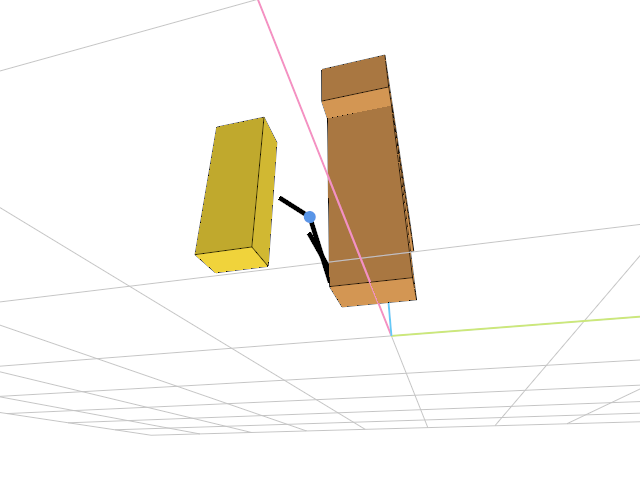
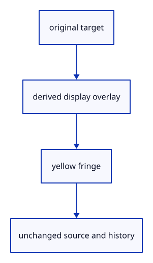

# 6.3.10 · Highlight original edges and controls

**Chapter 6 · Picking and selection · Section 6.3 · Faces, edges and original controls** · [Contents](contents.md)

**Typing: 12–23 minutes.** [Estimate](typing-load.md).

Keep presentation overlays separate from source geometry. Wider yellow ink surrounds an original black edge or control marker.

## Type

Continue from [Pick source parts with visible coverage](44h-mode-gpu.md). [Save or recover your work](recovery.md).

### 1. `src/highlight.rs`

Own derived overlay lanes, drawing and GPU byte accounting.

Create the file and type:

```rust
--8<-- "journey/code/44i-ink-highlight-01.rs"
```

### 2. `src/lib.rs`

Register the component and copied checks.

<details>
<summary>Locate the existing block</summary>

```rust
mod pick_sources_tests;

pub mod face_pick;
```

</details>

After that block, type:

```rust
--8<-- "journey/code/44i-ink-highlight-02.rs" skip=44
```

## Run and check

In your project:

```sh
cd workspace/journey
REGEN_PROTO=0 cargo build --lib --locked --target wasm32-unknown-unknown -j1
REGEN_PROTO=0 CARGO_BUILD_JOBS=1 trunk serve --port 8780
```

Open `http://127.0.0.1:8780/`. Keep an existing Trunk server running; saving rebuilds it.

Overlay lanes are ready; mode commands and interactive highlights are connected at44l.

### Recorded visual result

**Previous native render — current verification pending.**

The inherited placed boxes, source ink and ground grid remain visible. The image proves drawing; copied tests prove the new metadata.



*This recorded image predates a source or checker change. Rebuild this checkpoint before using it as current evidence; browser controls require separate acceptance.*

This reference image is shared with [6.3.8 · Draw original boundary edges consistently](44g-edge-ink.md). It does not demonstrate a new feature by itself.

<details>
<summary>Code explanation and diagram</summary>


original target → derived display overlay → yellow fringe → unchanged source and history.



Does selecting a part modify its source?

No. Highlights own derived display data and belong to presentation, outside document history.

Study estimate, including typing and experiments: 0.5–1 hours.

</details>

<details>
<summary>Optional experiment</summary>

Identify the original polyline endpoints or curve control used to build each overlay.

</details>

<details>
<summary>Check and save your work</summary>

Restore experimental edits, then run from `session_viewer`:

```sh
npm --prefix ../session_tests run course -- check 6.3.10
npm --prefix ../session_tests run course -- save 6.3.10
```

Source comparison leaves your project untouched. [Save and recovery instructions](recovery.md).

</details>

<details>
<summary>Viewer coverage and verification</summary>

This preparation retains whole-object input. Source part modes and highlights become interactive together at44l. Original source topology is distinct from display triangulation.

The existing point-picking exercise remains available. Part selection is connected at44l; browser acceptance is pending.

[Full validation scope](release.md).

To reproduce the scripted acceptance of the reference checkpoint, run from `session_viewer` with the [course bundle server](release.md#reproduce) running on port 8781:

```sh
npm --prefix ../session_tests run course -- capture 6.3.10
```

This uses the verified reference bundle; it does not check or change your typed project.

</details>
