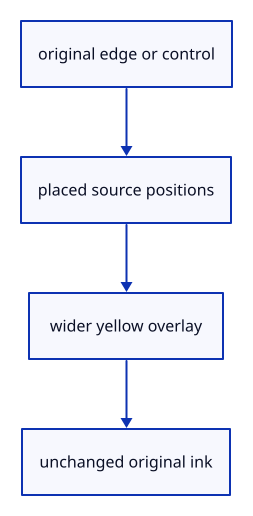

# 6.3.11 · Build highlights from original ink targets

**Chapter 6 · Picking and selection · Section 6.3 · Faces, edges and original controls** · [Contents](contents.md)

**Typing: 24–48 minutes.** [Estimate](typing-load.md).

Derive a selected edge, whole curve or original control overlay from its source target. Keep the original black ink in its own lane.

## Type

Continue from [Highlight original edges and controls](44i-ink-highlight.md). [Save or recover your work](recovery.md).

### 1. `src/highlight.rs`

Build original edge, curve and control overlays.

<details>
<summary>Locate the existing block</summary>

```rust
impl Highlight {
    pub fn new(device: &wgpu::Device, format: wgpu::TextureFormat) -> Self {
        Self { mesh: None, strokes: Lane::new(device, format), paths: Lane::joined(device, format), markers: Lane::markers(device, format) }
    }

    pub fn view(&self, queue: &wgpu::Queue, transform: &[f32; 16], size: [u32; 2], density: f32) {
```

</details>

Edit the existing block to match this code; keep unchanged lines:

```rust
--8<-- "journey/code/44ia-original-ink-01.rs"
```

## Run and check

In your project:

```sh
cd workspace/journey
REGEN_PROTO=0 cargo build --lib --locked --target wasm32-unknown-unknown -j1
REGEN_PROTO=0 CARGO_BUILD_JOBS=1 trunk serve --port 8780
```

Open `http://127.0.0.1:8780/`. Keep an existing Trunk server running; saving rebuilds it.

The original-target overlay builders are ready; interactive drawing is connected at44l.

### Recorded visual result

**Previous native render — current verification pending.**

The inherited placed boxes, source ink and ground grid remain visible. The image proves drawing; copied tests prove the new metadata.


*This recorded image predates a source or checker change. Rebuild this checkpoint before using it as current evidence; browser controls require separate acceptance.*

This reference image is shared with [6.3.8 · Draw original boundary edges consistently](44g-edge-ink.md). It does not demonstrate a new feature by itself.

<details>
<summary>Code explanation and diagram</summary>


original edge or control → placed source positions → wider yellow overlay → unchanged original ink.



Which positions define a polyline edge highlight?

The endpoints of the original segment, after placement; its source index is not a display-sample index.

Study estimate, including typing and experiments: 0.5–1 hours.

</details>

<details>
<summary>Optional experiment</summary>

Trace the selected control index back to its original marker and compare its halo diameter.

</details>

<details>
<summary>Check and save your work</summary>

Restore experimental edits, then run from `session_viewer`:

```sh
npm --prefix ../session_tests run course -- check 6.3.11
npm --prefix ../session_tests run course -- save 6.3.11
```

Source comparison leaves your project untouched. [Save and recovery instructions](recovery.md).

</details>

<details>
<summary>Viewer coverage and verification</summary>

This preparation retains whole-object input. Source part modes and highlights become interactive together at44l. Original source topology is distinct from display triangulation.

The existing point-picking exercise remains available. Part selection is connected at44l; browser acceptance is pending.

[Full validation scope](release.md).

To reproduce the scripted acceptance of the reference checkpoint, run from `session_viewer` with the [course bundle server](release.md#reproduce) running on port 8781:

```sh
npm --prefix ../session_tests run course -- capture 6.3.11
```

This uses the verified reference bundle; it does not check or change your typed project.

</details>
